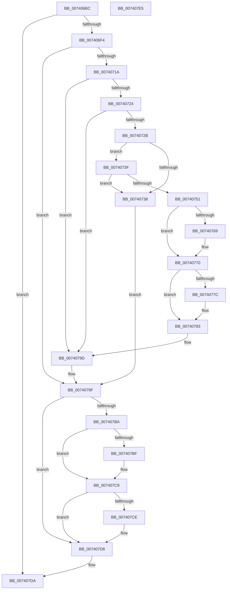

# PiUpdateDeviceResourceLists

- RVA: `0x007406BC`–`0x007407E6` (길이 `298` bytes)
- VA: `0x00000001407406BC`
- 실행 섹션: `PAGE`
- PDB 이름 있음: `예`; PDB Function 태그: `아니요`
- unwind 정보 RVA: `0x000C927C`
- 디코드: `87`개 명령, `298/298` bytes 표시
- 미해석 바이트: `0` (있으면 어셈블리에 `.byte`로 보존)

> 이 문서는 커널 이미지의 기계어와 PDB 기호를 분석해 생성했습니다. 4번과 5번은 함수 원형과 자료형을 바이너리 사용 방식에서 추정한 C 해석이며 원본 소스 복구 결과는 아닙니다.

## 1. Dependencies

- 직접 호출 지점: **12**; 고유 호출 대상: **6**
- 직접 호출자로 확인된 함수: **1**
- RIP 상대 이미지 참조: **1**

### Outgoing calls
- `0x007406E7` → [IopQueryBusResourceUpdateInterface](../73/IopQueryBusResourceUpdateInterface_function_0073DE44.md) (function, `0x0073DE44`)
- `0x0074070B` → [guard_dispatch_icall](../../text/6B/guard_dispatch_icall_function_006BAAD0.md) (function, `0x006BAAD0`)
- `0x0074072B` → [PnpCopyResourceList](../73/PnpCopyResourceList_function_0073D844.md) (function, `0x0073D844`)
- `0x00740744` → [PnpCopyResourceList](../73/PnpCopyResourceList_function_0073D844.md) (function, `0x0073D844`)
- `0x00740758` → [ExAcquireFastMutex](../../text/20/ExAcquireFastMutex_function_0020E5A0.md) (function, `0x0020E5A0`)
- `0x0074076B` → [ExFreePoolWithTag](../../poolcode/B8/ExFreePoolWithTag_function_00B82870.md) (function, `0x00B82870`)
- `0x0074077E` → [ExFreePoolWithTag](../../poolcode/B8/ExFreePoolWithTag_function_00B82870.md) (function, `0x00B82870`)
- `0x00740798` → [ExReleaseFastMutex](../../text/25/ExReleaseFastMutex_function_002519C0.md) (function, `0x002519C0`)
- `0x007407A7` → [guard_dispatch_icall](../../text/6B/guard_dispatch_icall_function_006BAAD0.md) (function, `0x006BAAD0`)
- `0x007407B1` → [ExFreePoolWithTag](../../poolcode/B8/ExFreePoolWithTag_function_00B82870.md) (function, `0x00B82870`)
- `0x007407C4` → [ExFreePoolWithTag](../../poolcode/B8/ExFreePoolWithTag_function_00B82870.md) (function, `0x00B82870`)
- `0x007407D3` → [ExFreePoolWithTag](../../poolcode/B8/ExFreePoolWithTag_function_00B82870.md) (function, `0x00B82870`)

### Direct callers
- [PiProcessQueryDeviceState](../8F/PiProcessQueryDeviceState_function_008FA0F8.md) at `0x008FA310`

### Static image references
- `0x00740751` → RVA `0x00F8C3E0` (`.data`; read)

## 2. Other-region calls and transfers

- 다른 실행 섹션으로 향하는 call: **9**
  - `0x0074070B` → [guard_dispatch_icall](../../text/6B/guard_dispatch_icall_function_006BAAD0.md) (`PAGE` → `.text`)
  - `0x00740758` → [ExAcquireFastMutex](../../text/20/ExAcquireFastMutex_function_0020E5A0.md) (`PAGE` → `.text`)
  - `0x0074076B` → [ExFreePoolWithTag](../../poolcode/B8/ExFreePoolWithTag_function_00B82870.md) (`PAGE` → `POOLCODE`)
  - `0x0074077E` → [ExFreePoolWithTag](../../poolcode/B8/ExFreePoolWithTag_function_00B82870.md) (`PAGE` → `POOLCODE`)
  - `0x00740798` → [ExReleaseFastMutex](../../text/25/ExReleaseFastMutex_function_002519C0.md) (`PAGE` → `.text`)
  - `0x007407A7` → [guard_dispatch_icall](../../text/6B/guard_dispatch_icall_function_006BAAD0.md) (`PAGE` → `.text`)
  - `0x007407B1` → [ExFreePoolWithTag](../../poolcode/B8/ExFreePoolWithTag_function_00B82870.md) (`PAGE` → `POOLCODE`)
  - `0x007407C4` → [ExFreePoolWithTag](../../poolcode/B8/ExFreePoolWithTag_function_00B82870.md) (`PAGE` → `POOLCODE`)
  - `0x007407D3` → [ExFreePoolWithTag](../../poolcode/B8/ExFreePoolWithTag_function_00B82870.md) (`PAGE` → `POOLCODE`)
- 별도 외부 분기/꼬리 이동을 확인하지 못했습니다.

## 3. Assembly (complete function range)

```asm
007406BC  48 8B C4                        mov rax, rsp
007406BF  53                              push rbx
007406C0  55                              push rbp
007406C1  56                              push rsi
007406C2  57                              push rdi
007406C3  41 56                           push r14
007406C5  48 83 EC 20                     sub rsp, 0x20
007406C9  48 83 60 18 00                  and qword ptr [rax + 0x18], 0
007406CE  48 8D 50 10                     lea rdx, [rax + 0x10]
007406D2  48 83 60 08 00                  and qword ptr [rax + 8], 0
007406D7  48 8B E9                        mov rbp, rcx
007406DA  48 8B 49 20                     mov rcx, qword ptr [rcx + 0x20]
007406DE  33 F6                           xor esi, esi
007406E0  48 83 60 10 00                  and qword ptr [rax + 0x10], 0
007406E5  33 FF                           xor edi, edi
007406E7  E8 58 D7 FF FF                  call 0x14073de44
007406EC  85 C0                           test eax, eax
007406EE  0F 88 E6 00 00 00               js 0x1407407da
007406F4  4C 8B 74 24 58                  mov r14, qword ptr [rsp + 0x58]
007406F9  4C 8D 44 24 50                  lea r8, [rsp + 0x50]
007406FE  48 8D 54 24 60                  lea rdx, [rsp + 0x60]
00740703  49 8B 46 20                     mov rax, qword ptr [r14 + 0x20]
00740707  49 8B 4E 08                     mov rcx, qword ptr [r14 + 8]
0074070B  E8 C0 A3 F7 FF                  call 0x1406baad0
00740710  8B D8                           mov ebx, eax
00740712  85 C0                           test eax, eax
00740714  0F 88 85 00 00 00               js 0x14074079f
0074071A  48 8B 4C 24 60                  mov rcx, qword ptr [rsp + 0x60]
0074071F  48 85 C9                        test rcx, rcx
00740722  74 79                           je 0x14074079d
00740724  48 39 74 24 50                  cmp qword ptr [rsp + 0x50], rsi
00740729  74 72                           je 0x14074079d
0074072B  E8 14 D1 FF FF                  call 0x14073d844
00740730  48 8B F0                        mov rsi, rax
00740733  48 85 C0                        test rax, rax
00740736  75 07                           jne 0x14074073f
00740738  BB 9A 00 00 C0                  mov ebx, 0xc000009a
0074073D  EB 60                           jmp 0x14074079f
0074073F  48 8B 4C 24 50                  mov rcx, qword ptr [rsp + 0x50]
00740744  E8 FB D0 FF FF                  call 0x14073d844
00740749  48 8B F8                        mov rdi, rax
0074074C  48 85 C0                        test rax, rax
0074074F  74 E7                           je 0x140740738
00740751  48 8D 0D 88 BC 84 00            lea rcx, [rip + 0x84bc88]
00740758  E8 43 DE AC FF                  call 0x14020e5a0
0074075D  48 8B 8D A0 01 00 00            mov rcx, qword ptr [rbp + 0x1a0]
00740764  48 85 C9                        test rcx, rcx
00740767  74 07                           je 0x140740770
00740769  33 D2                           xor edx, edx
0074076B  E8 00 21 44 00                  call 0x140b82870
00740770  48 8B 8D A8 01 00 00            mov rcx, qword ptr [rbp + 0x1a8]
00740777  48 85 C9                        test rcx, rcx
0074077A  74 07                           je 0x140740783
0074077C  33 D2                           xor edx, edx
0074077E  E8 ED 20 44 00                  call 0x140b82870
00740783  48 8D 0D 56 BC 84 00            lea rcx, [rip + 0x84bc56]
0074078A  48 89 B5 A0 01 00 00            mov qword ptr [rbp + 0x1a0], rsi
00740791  48 89 BD A8 01 00 00            mov qword ptr [rbp + 0x1a8], rdi
00740798  E8 23 12 B1 FF                  call 0x1402519c0
0074079D  33 DB                           xor ebx, ebx
0074079F  49 8B 46 18                     mov rax, qword ptr [r14 + 0x18]
007407A3  49 8B 4E 08                     mov rcx, qword ptr [r14 + 8]
007407A7  E8 24 A3 F7 FF                  call 0x1406baad0
007407AC  33 D2                           xor edx, edx
007407AE  49 8B CE                        mov rcx, r14
007407B1  E8 BA 20 44 00                  call 0x140b82870
007407B6  85 DB                           test ebx, ebx
007407B8  79 1E                           jns 0x1407407d8
007407BA  48 85 F6                        test rsi, rsi
007407BD  74 0A                           je 0x1407407c9
007407BF  33 D2                           xor edx, edx
007407C1  48 8B CE                        mov rcx, rsi
007407C4  E8 A7 20 44 00                  call 0x140b82870
007407C9  48 85 FF                        test rdi, rdi
007407CC  74 0A                           je 0x1407407d8
007407CE  33 D2                           xor edx, edx
007407D0  48 8B CF                        mov rcx, rdi
007407D3  E8 98 20 44 00                  call 0x140b82870
007407D8  8B C3                           mov eax, ebx
007407DA  48 83 C4 20                     add rsp, 0x20
007407DE  41 5E                           pop r14
007407E0  5F                              pop rdi
007407E1  5E                              pop rsi
007407E2  5D                              pop rbp
007407E3  5B                              pop rbx
007407E4  C3                              ret
007407E5  CC                              int3
```

## 4. C-style interpretation (structured pseudocode)

```c
__int64 __fastcall PiUpdateDeviceResourceLists(__int64 a1)
{
    __int64 result;
    __int64 v_rbx;
    __int64 v_rdi;
    __int64 v_rsi;
    __int64 v_rsp;
    unsigned __int64 v_stack_p10;
    unsigned __int64 v_stack_p18;
    unsigned __int64 v_stack_p8;

    v_rsp = (v_rsp) - (32);
    v_rsi = 0;
    v_rdi = 0;
    result = IopQueryBusResourceUpdateInterface(*(unsigned __int64 *)(a1 + 32), v_rsp + 16, a3, a4);
    if (sign_flag) goto loc_007407DA;
    result = guard_dispatch_icall(*(unsigned __int64 *)(v_stack_p10 + 8), v_stack_p18, v_stack_p8, a4);
    if (sign_flag) goto loc_0074079F;
    if (v_stack_p18 == 0) goto loc_0074079D;
    if (v_stack_p8 == 0) goto loc_0074079D;
    result = PnpCopyResourceList(v_stack_p18, v_stack_p18, v_stack_p8, a4);
    if (result != 0) goto loc_0074073F;
loc_00740738:
    goto loc_0074079F;
loc_0074073F:
    result = PnpCopyResourceList(v_stack_p8, v_stack_p18, v_stack_p8, a4);
    if (result == 0) goto loc_00740738;
    result = ExAcquireFastMutex(v_rip + 8699016, v_stack_p18, v_stack_p8, a4);
    if (*(unsigned __int64 *)(a1 + 416) != 0) {
        a2 = 0;
        result = ExFreePoolWithTag(*(unsigned __int64 *)(a1 + 416), a2, v_stack_p8, a4);
    }
    if (*(unsigned __int64 *)(a1 + 424) != 0) {
        a2 = 0;
        result = ExFreePoolWithTag(*(unsigned __int64 *)(a1 + 424), a2, v_stack_p8, a4);
    }
    *(unsigned __int64 *)(a1 + 416) = result;
    *(unsigned __int64 *)(a1 + 424) = result;
    result = ExReleaseFastMutex(v_rip + 8698966, a2, v_stack_p8, a4);
loc_0074079D:
    v_rbx = 0;
loc_0074079F:
    result = guard_dispatch_icall(*(unsigned __int64 *)(v_stack_p10 + 8), a2, v_stack_p8, a4);
    a2 = 0;
    result = ExFreePoolWithTag(v_stack_p10, a2, v_stack_p8, a4);
    if (!sign_flag) goto loc_007407D8;
    if (result != 0) {
        a2 = 0;
        a1 = result;
        result = ExFreePoolWithTag(a1, a2, v_stack_p8, a4);
    }
    if (result != 0) {
        a2 = 0;
        a1 = result;
        result = ExFreePoolWithTag(a1, a2, v_stack_p8, a4);
    }
loc_007407DA:
    v_rsp = (v_rsp) + (32);
    return 0;
}
```

## 5. (Beta) C Style

```c
int64_t PiUpdateDeviceResourceLists(void *Arg1)
{
    uint8_t *arg1 = (uint8_t *)Arg1;

    int64_t result;
    int64_t local_rbx;
    int64_t local_rdi;
    int64_t local_rsi;
    int64_t local_rsp;
    uint64_t v_stack_p10;
    uint64_t v_stack_p18;
    uint64_t v_stack_p8;

    local_rsp = (local_rsp) - (32);
    local_rsi = 0;
    local_rdi = 0;
    result = IopQueryBusResourceUpdateInterface(*(uint64_t *)(arg1 + 0x20), local_rsp + 16, a3, a4);
    if (sign_flag) goto loc_007407DA;
    result = guard_dispatch_icall(*(uint64_t *)(v_stack_p10 + 0x8), v_stack_p18, v_stack_p8, a4);
    if (sign_flag) goto loc_0074079F;
    if (v_stack_p18 == 0) goto loc_0074079D;
    if (v_stack_p8 == 0) goto loc_0074079D;
    result = PnpCopyResourceList(v_stack_p18, v_stack_p18, v_stack_p8, a4);
    if (result != 0) goto loc_0074073F;
loc_00740738:
    goto loc_0074079F;
loc_0074073F:
    result = PnpCopyResourceList(v_stack_p8, v_stack_p18, v_stack_p8, a4);
    if (result == 0) goto loc_00740738;
    result = ExAcquireFastMutex(v_rip + 8699016, v_stack_p18, v_stack_p8, a4);
    if (*(uint64_t *)(arg1 + 0x1A0) != 0) {
        a2 = 0;
        result = ExFreePoolWithTag(*(uint64_t *)(arg1 + 0x1A0), a2, v_stack_p8, a4);
    }
    if (*(uint64_t *)(arg1 + 0x1A8) != 0) {
        a2 = 0;
        result = ExFreePoolWithTag(*(uint64_t *)(arg1 + 0x1A8), a2, v_stack_p8, a4);
    }
    *(uint64_t *)(arg1 + 0x1A0) = result;
    *(uint64_t *)(arg1 + 0x1A8) = result;
    result = ExReleaseFastMutex(v_rip + 8698966, a2, v_stack_p8, a4);
loc_0074079D:
    local_rbx = 0;
loc_0074079F:
    result = guard_dispatch_icall(*(uint64_t *)(v_stack_p10 + 0x8), a2, v_stack_p8, a4);
    a2 = 0;
    result = ExFreePoolWithTag(v_stack_p10, a2, v_stack_p8, a4);
    if (!sign_flag) goto loc_007407D8;
    if (result != 0) {
        a2 = 0;
        Arg1 = result;
        result = ExFreePoolWithTag(Arg1, a2, v_stack_p8, a4);
    }
    if (result != 0) {
        a2 = 0;
        Arg1 = result;
        result = ExFreePoolWithTag(Arg1, a2, v_stack_p8, a4);
    }
loc_007407DA:
    local_rsp = (local_rsp) + (32);
    return 0;
}
```

### 관측된 메모리 오프셋

구조체 형식이 확인되지 않은 접근은 인자 기준의 오프셋으로만 기록했습니다.

| 기준 인자 | 오프셋 표현 | 폭 (bit) | 접근 |
|---|---:|---:|---|
| `Arg1` | `+ 0x20` | `64` | `R` |
| `Arg1` | `+ 0x1A0` | `64` | `R` |
| `Arg1` | `+ 0x1A0` | `64` | `W` |
| `Arg1` | `+ 0x1A8` | `64` | `R` |
| `Arg1` | `+ 0x1A8` | `64` | `W` |

## 6. Execution-region graph

[열기: 2D/3D 그래프와 함수 탐색 컨트롤 패널](../../../control-panel.html?section=page&rva=0x007406BC&view=graph)

- 2D 그래프는 위에서 아래로 흐르고, 3D 그래프는 빈 공간을 드래그해 회전합니다. Shift+드래그는 이동, 휠은 확대·축소, 함수 노드 선택은 대상 보고서 이동입니다.

### Static fallback


