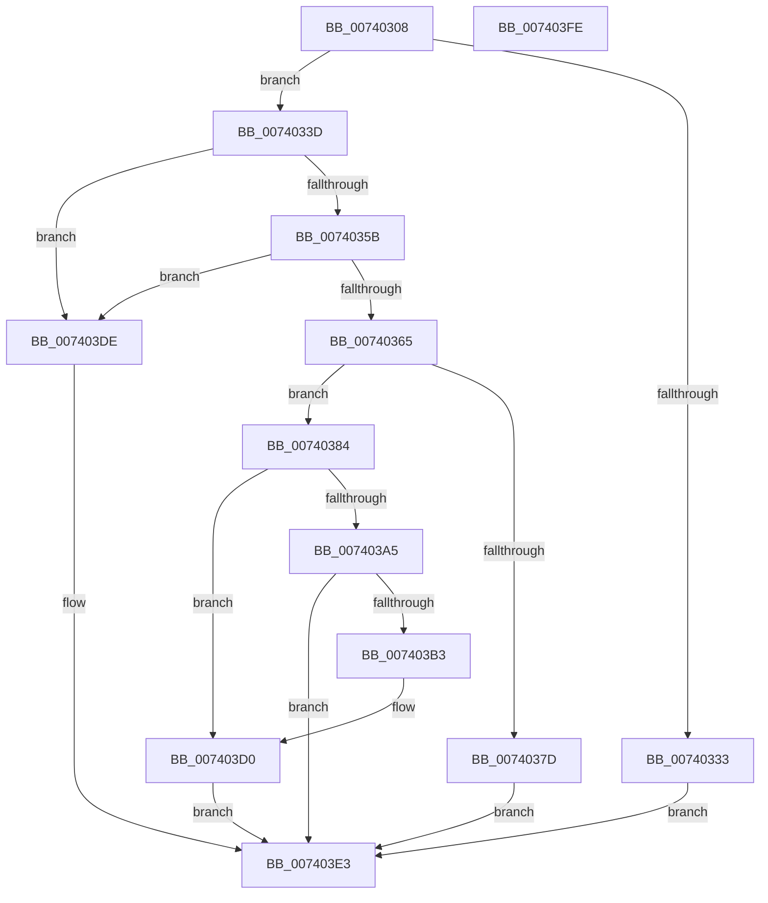

# PipIommuRetrieveDeviceId

- RVA: `0x00740308`–`0x007403FF` (길이 `247` bytes)
- VA: `0x0000000140740308`
- 실행 섹션: `PAGE`
- PDB 이름 있음: `예`; PDB Function 태그: `아니요`
- unwind 정보 RVA: `0x000C924C`
- 디코드: `69`개 명령, `247/247` bytes 표시
- 미해석 바이트: `0` (있으면 어셈블리에 `.byte`로 보존)

> 이 문서는 커널 이미지의 기계어와 PDB 기호를 분석해 생성했습니다. 4번과 5번은 함수 원형과 자료형을 바이너리 사용 방식에서 추정한 C 해석이며 원본 소스 복구 결과는 아닙니다.

## 1. Dependencies

- 직접 호출 지점: **6**; 고유 호출 대상: **5**
- 직접 호출자로 확인된 함수: **1**
- RIP 상대 이미지 참조: **0**

### Outgoing calls
- `0x0074034B` → [guard_dispatch_icall](../../text/6B/guard_dispatch_icall_function_006BAAD0.md) (function, `0x006BAAD0`)
- `0x00740370` → [ExAllocatePool2](../../poolcode/B8/ExAllocatePool2_function_00B820F0.md) (function, `0x00B820F0`)
- `0x00740397` → [guard_dispatch_icall](../../text/6B/guard_dispatch_icall_function_006BAAD0.md) (function, `0x006BAAD0`)
- `0x007403AA` → [IidValidateDeviceId](../82/IidValidateDeviceId_function_00828A64.md) (function, `0x00828A64`)
- `0x007403CA` → [KeBugCheckEx](../../text/4F/KeBugCheckEx_function_004FD660.md) (function, `0x004FD660`)
- `0x007403D5` → [ExFreePoolWithTag](../../poolcode/B8/ExFreePoolWithTag_function_00B82870.md) (function, `0x00B82870`)

### Direct callers
- [PiIommuAllocateExtension](PiIommuAllocateExtension_function_00740004.md) at `0x00740055`

### Static image references
- 디코드된 RIP-relative 메모리 참조가 없습니다.

## 2. Other-region calls and transfers

- 다른 실행 섹션으로 향하는 call: **5**
  - `0x0074034B` → [guard_dispatch_icall](../../text/6B/guard_dispatch_icall_function_006BAAD0.md) (`PAGE` → `.text`)
  - `0x00740370` → [ExAllocatePool2](../../poolcode/B8/ExAllocatePool2_function_00B820F0.md) (`PAGE` → `POOLCODE`)
  - `0x00740397` → [guard_dispatch_icall](../../text/6B/guard_dispatch_icall_function_006BAAD0.md) (`PAGE` → `.text`)
  - `0x007403CA` → [KeBugCheckEx](../../text/4F/KeBugCheckEx_function_004FD660.md) (`PAGE` → `.text`)
  - `0x007403D5` → [ExFreePoolWithTag](../../poolcode/B8/ExFreePoolWithTag_function_00B82870.md) (`PAGE` → `POOLCODE`)
- 별도 외부 분기/꼬리 이동을 확인하지 못했습니다.

## 3. Assembly (complete function range)

```asm
00740308  48 8B C4                        mov rax, rsp
0074030B  48 89 58 10                     mov qword ptr [rax + 0x10], rbx
0074030F  48 89 70 18                     mov qword ptr [rax + 0x18], rsi
00740313  48 89 78 20                     mov qword ptr [rax + 0x20], rdi
00740317  41 56                           push r14
00740319  48 83 EC 30                     sub rsp, 0x30
0074031D  48 83 60 08 00                  and qword ptr [rax + 8], 0
00740322  33 FF                           xor edi, edi
00740324  48 8B 41 40                     mov rax, qword ptr [rcx + 0x40]
00740328  4C 8B F2                        mov r14, rdx
0074032B  48 8B F1                        mov rsi, rcx
0074032E  48 85 C0                        test rax, rax
00740331  75 0A                           jne 0x14074033d
00740333  BB BB 00 00 C0                  mov ebx, 0xc00000bb
00740338  E9 A6 00 00 00                  jmp 0x1407403e3
0074033D  48 8B 49 08                     mov rcx, qword ptr [rcx + 8]
00740341  4C 8D 4C 24 40                  lea r9, [rsp + 0x40]
00740346  45 33 C0                        xor r8d, r8d
00740349  33 D2                           xor edx, edx
0074034B  E8 80 A7 F7 FF                  call 0x1406baad0
00740350  3D 23 00 00 C0                  cmp eax, 0xc0000023
00740355  0F 85 83 00 00 00               jne 0x1407403de
0074035B  48 8B 54 24 40                  mov rdx, qword ptr [rsp + 0x40]
00740360  48 85 D2                        test rdx, rdx
00740363  74 79                           je 0x1407403de
00740365  B9 40 00 00 00                  mov ecx, 0x40
0074036A  41 B8 50 6E 70 64               mov r8d, 0x64706e50
00740370  E8 7B 1D 44 00                  call 0x140b820f0
00740375  48 8B F8                        mov rdi, rax
00740378  48 85 C0                        test rax, rax
0074037B  75 07                           jne 0x140740384
0074037D  BB 9A 00 00 C0                  mov ebx, 0xc000009a
00740382  EB 5F                           jmp 0x1407403e3
00740384  48 8B 46 40                     mov rax, qword ptr [rsi + 0x40]
00740388  45 33 C9                        xor r9d, r9d
0074038B  48 8B 54 24 40                  mov rdx, qword ptr [rsp + 0x40]
00740390  4C 8B C7                        mov r8, rdi
00740393  48 8B 4E 08                     mov rcx, qword ptr [rsi + 8]
00740397  E8 34 A7 F7 FF                  call 0x1406baad0
0074039C  8B D8                           mov ebx, eax
0074039E  48 8B CF                        mov rcx, rdi
007403A1  85 C0                           test eax, eax
007403A3  78 2B                           js 0x1407403d0
007403A5  48 8B 54 24 40                  mov rdx, qword ptr [rsp + 0x40]
007403AA  E8 B5 86 0E 00                  call 0x140828a64
007403AF  85 C0                           test eax, eax
007403B1  79 30                           jns 0x1407403e3
007403B3  48 98                           cdqe
007403B5  4C 8B CF                        mov r9, rdi
007403B8  4C 8B C6                        mov r8, rsi
007403BB  48 89 44 24 20                  mov qword ptr [rsp + 0x20], rax
007403C0  BA 12 00 00 00                  mov edx, 0x12
007403C5  B9 CA 00 00 00                  mov ecx, 0xca
007403CA  E8 91 D2 DB FF                  call 0x1404fd660
007403CF  CC                              int3
007403D0  BA 50 6E 70 64                  mov edx, 0x64706e50
007403D5  E8 96 24 44 00                  call 0x140b82870
007403DA  33 FF                           xor edi, edi
007403DC  EB 05                           jmp 0x1407403e3
007403DE  BB 01 00 00 C0                  mov ebx, 0xc0000001
007403E3  48 8B 74 24 50                  mov rsi, qword ptr [rsp + 0x50]
007403E8  8B C3                           mov eax, ebx
007403EA  48 8B 5C 24 48                  mov rbx, qword ptr [rsp + 0x48]
007403EF  49 89 3E                        mov qword ptr [r14], rdi
007403F2  48 8B 7C 24 58                  mov rdi, qword ptr [rsp + 0x58]
007403F7  48 83 C4 30                     add rsp, 0x30
007403FB  41 5E                           pop r14
007403FD  C3                              ret
007403FE  CC                              int3
```

## 4. C-style interpretation (structured pseudocode)

```c
__int64 __fastcall PipIommuRetrieveDeviceId(__int64 a1, __int64 a2, int a3)
{
    __int64 result;
    __int64 v_rdi;
    __int64 v_rsp;
    unsigned __int64 v_stack_m18;
    unsigned __int64 v_stack_p10;
    unsigned __int64 v_stack_p18;
    unsigned __int64 v_stack_p20;
    unsigned __int64 v_stack_p8;

    *(unsigned __int64 *)(v_rsp + 16) = v_rbx;
    *(unsigned __int64 *)(v_rsp + 24) = v_rsi;
    *(unsigned __int64 *)(v_rsp + 32) = v_rdi;
    v_rsp = (v_rsp) - (48);
    v_rdi = 0;
    if (*(unsigned __int64 *)(a1 + 64) != 0) goto loc_0074033D;
    goto loc_007403E3;
loc_0074033D:
    a3 = 0;
    a2 = 0;
    result = guard_dispatch_icall(*(unsigned __int64 *)(a1 + 8), a2, a3, v_stack_p8);
    if (((unsigned int)(result)) != 0xC0000023ULL) goto loc_007403DE;
    if (v_stack_p8 == 0) goto loc_007403DE;
    result = ExAllocatePool2(64, v_stack_p8, (unsigned int)(0x64706E50ULL), v_stack_p8);
    if (result != 0) goto loc_00740384;
    goto loc_007403E3;
loc_00740384:
    a4 = 0;
    result = guard_dispatch_icall(*(unsigned __int64 *)(a1 + 8), v_stack_p8, result, a4);
    if (sign_flag) goto loc_007403D0;
    result = IidValidateDeviceId(result, v_stack_p8, result, a4);
    if (!sign_flag) goto loc_007403E3;
    v_stack_m18 = result;
    result = KeBugCheckEx(202, 18, a1, result);
loc_007403D0:
    result = ExFreePoolWithTag(202, (unsigned int)(0x64706E50ULL), a1, result);
    v_rdi = 0;
    goto loc_007403E3;
loc_007403DE:
loc_007403E3:
    *(unsigned __int64 *)(a2) = 0;
    v_rsp = (v_rsp) + (48);
    return (unsigned int)((unsigned int)((unsigned int)(0xC0000001ULL)));
}
```

## 5. (Beta) C Style

```c
int64_t PipIommuRetrieveDeviceId(void *Arg1, void *Arg2, int32_t Arg3)
{
    uint8_t *arg1 = (uint8_t *)Arg1;
    uint8_t *arg2 = (uint8_t *)Arg2;

    int64_t result;
    int64_t local_rdi;
    int64_t local_rsp;
    uint64_t v_stack_m18;
    uint64_t v_stack_p10;
    uint64_t v_stack_p18;
    uint64_t v_stack_p20;
    uint64_t v_stack_p8;

    *(uint64_t *)(local_rsp + 0x10) = local_rbx;
    *(uint64_t *)(local_rsp + 0x18) = local_rsi;
    *(uint64_t *)(local_rsp + 0x20) = local_rdi;
    local_rsp = (local_rsp) - (48);
    local_rdi = 0;
    if (*(uint64_t *)(arg1 + 0x40) != 0) goto loc_0074033D;
    goto loc_007403E3;
loc_0074033D:
    Arg3 = 0;
    Arg2 = 0;
    result = guard_dispatch_icall(*(uint64_t *)(arg1 + 0x8), Arg2, Arg3, v_stack_p8);
    if (((uint32_t)(result)) != 0xC0000023ULL) goto loc_007403DE;
    if (v_stack_p8 == 0) goto loc_007403DE;
    result = ExAllocatePool2(64, v_stack_p8, (uint32_t)(0x64706E50ULL), v_stack_p8);
    if (result != 0) goto loc_00740384;
    goto loc_007403E3;
loc_00740384:
    a4 = 0;
    result = guard_dispatch_icall(*(uint64_t *)(arg1 + 0x8), v_stack_p8, result, a4);
    if (sign_flag) goto loc_007403D0;
    result = IidValidateDeviceId(result, v_stack_p8, result, a4);
    if (!sign_flag) goto loc_007403E3;
    v_stack_m18 = result;
    result = KeBugCheckEx(202, 18, Arg1, result);
loc_007403D0:
    result = ExFreePoolWithTag(202, (uint32_t)(0x64706E50ULL), Arg1, result);
    local_rdi = 0;
    goto loc_007403E3;
loc_007403DE:
loc_007403E3:
    *(uint64_t *)(arg2) = 0;
    local_rsp = (local_rsp) + (48);
    return (uint32_t)((uint32_t)((uint32_t)(0xC0000001ULL)));
}
```

### 관측된 메모리 오프셋

구조체 형식이 확인되지 않은 접근은 인자 기준의 오프셋으로만 기록했습니다.

| 기준 인자 | 오프셋 표현 | 폭 (bit) | 접근 |
|---|---:|---:|---|
| `Arg1` | `+ 0x8` | `64` | `R` |
| `Arg1` | `+ 0x40` | `64` | `R` |
| `Arg2` | `+ 0x0` | `64` | `W` |

## 6. Execution-region graph

[열기: 2D/3D 그래프와 함수 탐색 컨트롤 패널](../../../control-panel.html?section=page&rva=0x00740308&view=graph)

- 2D 그래프는 위에서 아래로 흐르고, 3D 그래프는 빈 공간을 드래그해 회전합니다. Shift+드래그는 이동, 휠은 확대·축소, 함수 노드 선택은 대상 보고서 이동입니다.

### Static fallback


