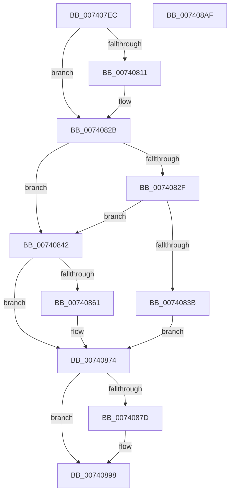

# PipProcessRestartPhase1

- RVA: `0x007407EC`–`0x007408B0` (길이 `196` bytes)
- VA: `0x00000001407407EC`
- 실행 섹션: `PAGE`
- PDB 이름 있음: `예`; PDB Function 태그: `아니요`
- unwind 정보 RVA: `0x00066400`
- 디코드: `50`개 명령, `196/196` bytes 표시
- 미해석 바이트: `0` (있으면 어셈블리에 `.byte`로 보존)

> 이 문서는 커널 이미지의 기계어와 PDB 기호를 분석해 생성했습니다. 4번과 5번은 함수 원형과 자료형을 바이너리 사용 방식에서 추정한 C 해석이며 원본 소스 복구 결과는 아닙니다.

## 1. Dependencies

- 직접 호출 지점: **5**; 고유 호출 대상: **4**
- 직접 호출자로 확인된 함수: **1**
- RIP 상대 이미지 참조: **3**

### Outgoing calls
- `0x00740826` → [McTemplateK0dz_EtwWriteTransfer](../../text/42/McTemplateK0dz_EtwWriteTransfer_function_0042316C.md) (function, `0x0042316C`)
- `0x0074084D` → [PnpStartDeviceNode](../8F/PnpStartDeviceNode_function_008FE38C.md) (function, `0x008FE38C`)
- `0x00740865` → [PnpUnlockMountableDevice](../../text/4C/PnpUnlockMountableDevice_function_004CDD2C.md) (function, `0x004CDD2C`)
- `0x0074086F` → [PipClearDevNodeFlags](../8F/PipClearDevNodeFlags_function_008F9F54.md) (function, `0x008F9F54`)
- `0x00740893` → [McTemplateK0dz_EtwWriteTransfer](../../text/42/McTemplateK0dz_EtwWriteTransfer_function_0042316C.md) (function, `0x0042316C`)

### Direct callers
- [PipProcessDevNodeTree](../8F/PipProcessDevNodeTree_function_008F9068.md) at `0x008F9857`

### Static image references
- `0x00740800` → RVA `0x00EF012B` (`.data`; read)
- `0x00740815` → RVA `0x00027500` (`.rdata`; read)
- `0x00740881` → RVA `0x00027550` (`.rdata`; read)

## 2. Other-region calls and transfers

- 다른 실행 섹션으로 향하는 call: **3**
  - `0x00740826` → [McTemplateK0dz_EtwWriteTransfer](../../text/42/McTemplateK0dz_EtwWriteTransfer_function_0042316C.md) (`PAGE` → `.text`)
  - `0x00740865` → [PnpUnlockMountableDevice](../../text/4C/PnpUnlockMountableDevice_function_004CDD2C.md) (`PAGE` → `.text`)
  - `0x00740893` → [McTemplateK0dz_EtwWriteTransfer](../../text/42/McTemplateK0dz_EtwWriteTransfer_function_0042316C.md) (`PAGE` → `.text`)
- 별도 외부 분기/꼬리 이동을 확인하지 못했습니다.

## 3. Assembly (complete function range)

```asm
007407EC  4C 8B DC                        mov r11, rsp
007407EF  49 89 5B 08                     mov qword ptr [r11 + 8], rbx
007407F3  49 89 6B 10                     mov qword ptr [r11 + 0x10], rbp
007407F7  49 89 73 18                     mov qword ptr [r11 + 0x18], rsi
007407FB  57                              push rdi
007407FC  48 83 EC 30                     sub rsp, 0x30
00740800  F6 05 24 F9 7A 00 20            test byte ptr [rip + 0x7af924], 0x20
00740807  41 8B F0                        mov esi, r8d
0074080A  8B EA                           mov ebp, edx
0074080C  48 8B D9                        mov rbx, rcx
0074080F  74 1A                           je 0x14074082b
00740811  48 8B 41 30                     mov rax, qword ptr [rcx + 0x30]
00740815  48 8D 15 E4 6C 8E FF            lea rdx, [rip - 0x71931c]
0074081C  41 B9 01 00 00 00               mov r9d, 1
00740822  49 89 43 E8                     mov qword ptr [r11 - 0x18], rax
00740826  E8 41 29 CE FF                  call 0x14042316c
0074082B  85 F6                           test esi, esi
0074082D  74 13                           je 0x140740842
0074082F  F7 83 8C 01 00 00 00 00 40 00   test dword ptr [rbx + 0x18c], 0x400000
00740839  74 07                           je 0x140740842
0074083B  BE 2D 02 00 C0                  mov esi, 0xc000022d
00740840  EB 32                           jmp 0x140740874
00740842  44 8B C5                        mov r8d, ebp
00740845  BA 01 00 00 00                  mov edx, 1
0074084A  48 8B CB                        mov rcx, rbx
0074084D  E8 3A DB 1B 00                  call 0x1408fe38c
00740852  BD 00 00 00 01                  mov ebp, 0x1000000
00740857  8B F0                           mov esi, eax
00740859  85 AB 8C 01 00 00               test dword ptr [rbx + 0x18c], ebp
0074085F  74 13                           je 0x140740874
00740861  48 8B 4B 20                     mov rcx, qword ptr [rbx + 0x20]
00740865  E8 C2 D4 D8 FF                  call 0x1404cdd2c
0074086A  8B D5                           mov edx, ebp
0074086C  48 8B CB                        mov rcx, rbx
0074086F  E8 E0 96 1B 00                  call 0x1408f9f54
00740874  F6 05 B0 F8 7A 00 20            test byte ptr [rip + 0x7af8b0], 0x20
0074087B  74 1B                           je 0x140740898
0074087D  48 8B 43 30                     mov rax, qword ptr [rbx + 0x30]
00740881  48 8D 15 C8 6C 8E FF            lea rdx, [rip - 0x719338]
00740888  41 B9 01 00 00 00               mov r9d, 1
0074088E  48 89 44 24 20                  mov qword ptr [rsp + 0x20], rax
00740893  E8 D4 28 CE FF                  call 0x14042316c
00740898  48 8B 5C 24 40                  mov rbx, qword ptr [rsp + 0x40]
0074089D  8B C6                           mov eax, esi
0074089F  48 8B 74 24 50                  mov rsi, qword ptr [rsp + 0x50]
007408A4  48 8B 6C 24 48                  mov rbp, qword ptr [rsp + 0x48]
007408A9  48 83 C4 30                     add rsp, 0x30
007408AD  5F                              pop rdi
007408AE  C3                              ret
007408AF  CC                              int3
```

## 4. C-style interpretation (structured pseudocode)

```c
__int64 __fastcall PipProcessRestartPhase1(__int64 a1, int a2, int a3)
{
    __int64 result;
    __int64 v_rsp;
    unsigned __int64 v_stack_m18;
    unsigned __int64 v_stack_p10;
    unsigned __int64 v_stack_p18;
    unsigned __int64 v_stack_p8;

    *(unsigned __int64 *)(v_rsp + 8) = v_rbx;
    *(unsigned __int64 *)(v_rsp + 16) = v_rbp;
    *(unsigned __int64 *)(v_rsp + 24) = v_rsi;
    v_rsp = (v_rsp) - (48);
    if (((*(unsigned __int8 *)(v_rip + 8059172)) & (32)) != 0) {
        result = *(unsigned __int64 *)(a1 + 48);
        a2 = v_rip - 7443228;
        a4 = 1;
        *(unsigned __int64 *)(v_rsp - 24) = result;
        result = McTemplateK0dz_EtwWriteTransfer(a1, a2, a3, a4);
    }
    if ((unsigned int)((unsigned int)(a3)) == 0) goto loc_00740842;
    if (((*(unsigned int *)(a1 + 396)) & (0x400000ULL)) == 0) goto loc_00740842;
    goto loc_00740874;
loc_00740842:
    result = PnpStartDeviceNode(a1, 1, (unsigned int)((unsigned int)((unsigned int)(a2))), a4);
    if (((*(unsigned int *)(a1 + 396)) & ((unsigned int)((unsigned int)(0x1000000ULL)))) != 0) {
        a1 = *(unsigned __int64 *)(a1 + 32);
        result = PnpUnlockMountableDevice(a1, 1, (unsigned int)((unsigned int)((unsigned int)(a2))), a4);
        a2 = (unsigned int)((unsigned int)(0x1000000ULL));
        a1 = a1;
        result = PipClearDevNodeFlags(a1, a2, (unsigned int)((unsigned int)((unsigned int)(a2))), a4);
    }
    if (((*(unsigned __int8 *)(v_rip + 8059056)) & (32)) != 0) {
        result = *(unsigned __int64 *)(a1 + 48);
        a2 = v_rip - 7443256;
        a4 = 1;
        v_stack_m18 = result;
        result = McTemplateK0dz_EtwWriteTransfer(a1, a2, (unsigned int)((unsigned int)((unsigned int)(a2))), a4);
    }
    v_rsp = (v_rsp) + (48);
    return (unsigned int)((unsigned int)((unsigned int)((unsigned int)(result))));
}
```

## 5. (Beta) C Style

```c
int64_t PipProcessRestartPhase1(void *Arg1, int32_t Arg2, int32_t Arg3)
{
    uint8_t *arg1 = (uint8_t *)Arg1;

    int64_t result;
    int64_t local_rsp;
    uint64_t v_stack_m18;
    uint64_t v_stack_p10;
    uint64_t v_stack_p18;
    uint64_t v_stack_p8;

    *(uint64_t *)(local_rsp + 0x8) = local_rbx;
    *(uint64_t *)(local_rsp + 0x10) = local_rbp;
    *(uint64_t *)(local_rsp + 0x18) = local_rsi;
    local_rsp = (local_rsp) - (48);
    if (((*(uint8_t *)(v_rip + 0x7AF924)) & (32)) != 0) {
        result = *(uint64_t *)(arg1 + 0x30);
        Arg2 = v_rip - 7443228;
        a4 = 1;
        *(uint64_t *)(local_rsp - 0x18) = result;
        result = McTemplateK0dz_EtwWriteTransfer(Arg1, Arg2, Arg3, a4);
    }
    if ((uint32_t)((uint32_t)(Arg3)) == 0) goto loc_00740842;
    if (((*(uint32_t *)(arg1 + 0x18C)) & (0x400000ULL)) == 0) goto loc_00740842;
    goto loc_00740874;
loc_00740842:
    result = PnpStartDeviceNode(Arg1, 1, (uint32_t)((uint32_t)((uint32_t)(Arg2))), a4);
    if (((*(uint32_t *)(arg1 + 0x18C)) & ((uint32_t)((uint32_t)(0x1000000ULL)))) != 0) {
        Arg1 = *(uint64_t *)(arg1 + 0x20);
        result = PnpUnlockMountableDevice(Arg1, 1, (uint32_t)((uint32_t)((uint32_t)(Arg2))), a4);
        Arg2 = (uint32_t)((uint32_t)(0x1000000ULL));
        Arg1 = Arg1;
        result = PipClearDevNodeFlags(Arg1, Arg2, (uint32_t)((uint32_t)((uint32_t)(Arg2))), a4);
    }
    if (((*(uint8_t *)(v_rip + 0x7AF8B0)) & (32)) != 0) {
        result = *(uint64_t *)(arg1 + 0x30);
        Arg2 = v_rip - 7443256;
        a4 = 1;
        v_stack_m18 = result;
        result = McTemplateK0dz_EtwWriteTransfer(Arg1, Arg2, (uint32_t)((uint32_t)((uint32_t)(Arg2))), a4);
    }
    local_rsp = (local_rsp) + (48);
    return (uint32_t)((uint32_t)((uint32_t)((uint32_t)(result))));
}
```

### 관측된 메모리 오프셋

구조체 형식이 확인되지 않은 접근은 인자 기준의 오프셋으로만 기록했습니다.

| 기준 인자 | 오프셋 표현 | 폭 (bit) | 접근 |
|---|---:|---:|---|
| `Arg1` | `+ 0x20` | `64` | `R` |
| `Arg1` | `+ 0x30` | `64` | `R` |
| `Arg1` | `+ 0x18C` | `32` | `R` |

## 6. Execution-region graph

[열기: 2D/3D 그래프와 함수 탐색 컨트롤 패널](../../../control-panel.html?section=page&rva=0x007407EC&view=graph)

- 2D 그래프는 위에서 아래로 흐르고, 3D 그래프는 빈 공간을 드래그해 회전합니다. Shift+드래그는 이동, 휠은 확대·축소, 함수 노드 선택은 대상 보고서 이동입니다.

### Static fallback


