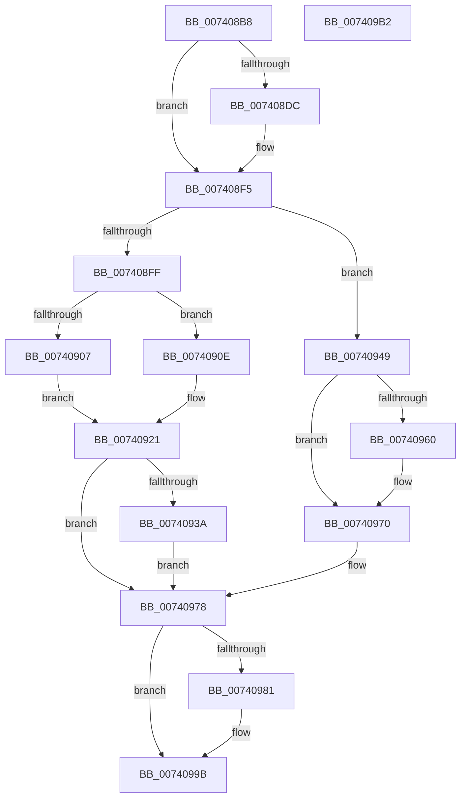

# PipProcessRestartPhase2

- RVA: `0x007408B8`–`0x007409B3` (길이 `251` bytes)
- VA: `0x00000001407408B8`
- 실행 섹션: `PAGE`
- PDB 이름 있음: `예`; PDB Function 태그: `아니요`
- unwind 정보 RVA: `0x00066400`
- 디코드: `63`개 명령, `251/251` bytes 표시
- 미해석 바이트: `0` (있으면 어셈블리에 `.byte`로 보존)

> 이 문서는 커널 이미지의 기계어와 PDB 기호를 분석해 생성했습니다. 4번과 5번은 함수 원형과 자료형을 바이너리 사용 방식에서 추정한 C 해석이며 원본 소스 복구 결과는 아닙니다.

## 1. Dependencies

- 직접 호출 지점: **8**; 고유 호출 대상: **7**
- 직접 호출자로 확인된 함수: **1**
- RIP 상대 이미지 참조: **3**

### Outgoing calls
- `0x007408F0` → [McTemplateK0dz_EtwWriteTransfer](../../text/42/McTemplateK0dz_EtwWriteTransfer_function_0042316C.md) (function, `0x0042316C`)
- `0x0074091C` → [PnpUpdateRebootRequiredReason](../72/PnpUpdateRebootRequiredReason_function_0072CE64.md) (function, `0x0072CE64`)
- `0x0074092C` → [PnpRequestDeviceRemoval](../8F/PnpRequestDeviceRemoval_function_008FC294.md) (function, `0x008FC294`)
- `0x0074093E` → [IoRequestDeviceEject](../../text/5A/IoRequestDeviceEject_function_005A59B0.md) (function, `0x005A59B0`)
- `0x00740951` → [PipSetDevNodeState](../../text/47/PipSetDevNodeState_function_00470708.md) (function, `0x00470708`)
- `0x00740964` → [PoFxIdleDevice](../../text/48/PoFxIdleDevice_function_00483EE8.md) (function, `0x00483EE8`)
- `0x00740973` → [PnpStartedDeviceNodeDependencyCheck](../8F/PnpStartedDeviceNodeDependencyCheck_function_008FCF58.md) (function, `0x008FCF58`)
- `0x00740996` → [McTemplateK0dz_EtwWriteTransfer](../../text/42/McTemplateK0dz_EtwWriteTransfer_function_0042316C.md) (function, `0x0042316C`)

### Direct callers
- [PipProcessDevNodeTree](../8F/PipProcessDevNodeTree_function_008F9068.md) at `0x008F9842`

### Static image references
- `0x007408CC` → RVA `0x00EF012B` (`.data`; read)
- `0x007408DF` → RVA `0x00027500` (`.rdata`; read)
- `0x00740984` → RVA `0x00027550` (`.rdata`; read)

## 2. Other-region calls and transfers

- 다른 실행 섹션으로 향하는 call: **5**
  - `0x007408F0` → [McTemplateK0dz_EtwWriteTransfer](../../text/42/McTemplateK0dz_EtwWriteTransfer_function_0042316C.md) (`PAGE` → `.text`)
  - `0x0074093E` → [IoRequestDeviceEject](../../text/5A/IoRequestDeviceEject_function_005A59B0.md) (`PAGE` → `.text`)
  - `0x00740951` → [PipSetDevNodeState](../../text/47/PipSetDevNodeState_function_00470708.md) (`PAGE` → `.text`)
  - `0x00740964` → [PoFxIdleDevice](../../text/48/PoFxIdleDevice_function_00483EE8.md) (`PAGE` → `.text`)
  - `0x00740996` → [McTemplateK0dz_EtwWriteTransfer](../../text/42/McTemplateK0dz_EtwWriteTransfer_function_0042316C.md) (`PAGE` → `.text`)
- 별도 외부 분기/꼬리 이동을 확인하지 못했습니다.

## 3. Assembly (complete function range)

```asm
007408B8  4C 8B DC                        mov r11, rsp
007408BB  49 89 5B 08                     mov qword ptr [r11 + 8], rbx
007408BF  49 89 6B 10                     mov qword ptr [r11 + 0x10], rbp
007408C3  49 89 73 18                     mov qword ptr [r11 + 0x18], rsi
007408C7  57                              push rdi
007408C8  48 83 EC 30                     sub rsp, 0x30
007408CC  F6 05 58 F8 7A 00 20            test byte ptr [rip + 0x7af858], 0x20
007408D3  48 8D 79 30                     lea rdi, [rcx + 0x30]
007408D7  48 8B D9                        mov rbx, rcx
007408DA  74 19                           je 0x1407408f5
007408DC  48 8B 07                        mov rax, qword ptr [rdi]
007408DF  48 8D 15 1A 6C 8E FF            lea rdx, [rip - 0x7193e6]
007408E6  41 B9 02 00 00 00               mov r9d, 2
007408EC  49 89 43 E8                     mov qword ptr [r11 - 0x18], rax
007408F0  E8 77 28 CE FF                  call 0x14042316c
007408F5  8B B3 88 01 00 00               mov esi, dword ptr [rbx + 0x188]
007408FB  85 F6                           test esi, esi
007408FD  79 4A                           jns 0x140740949
007408FF  81 FE D2 02 00 C0               cmp esi, 0xc00002d2
00740905  74 07                           je 0x14074090e
00740907  BD 0A 00 00 00                  mov ebp, 0xa
0074090C  EB 13                           jmp 0x140740921
0074090E  48 8B 0F                        mov rcx, qword ptr [rdi]
00740911  41 B8 00 00 00 80               mov r8d, 0x80000000
00740917  BD 0E 00 00 00                  mov ebp, 0xe
0074091C  E8 43 C5 FE FF                  call 0x14072ce64
00740921  44 8B CE                        mov r9d, esi
00740924  44 8B C5                        mov r8d, ebp
00740927  33 D2                           xor edx, edx
00740929  48 8B CB                        mov rcx, rbx
0074092C  E8 63 B9 1B 00                  call 0x1408fc294
00740931  83 BB 38 02 00 00 00            cmp dword ptr [rbx + 0x238], 0
00740938  74 3E                           je 0x140740978
0074093A  48 8B 4B 20                     mov rcx, qword ptr [rbx + 0x20]
0074093E  E8 6D 50 E6 FF                  call 0x1405a59b0
00740943  48 8D 7B 30                     lea rdi, [rbx + 0x30]
00740947  EB 2F                           jmp 0x140740978
00740949  BA 0A 03 00 00                  mov edx, 0x30a
0074094E  48 8B CB                        mov rcx, rbx
00740951  E8 B2 FD D2 FF                  call 0x140470708
00740956  8B 83 C0 02 00 00               mov eax, dword ptr [rbx + 0x2c0]
0074095C  A8 20                           test al, 0x20
0074095E  74 10                           je 0x140740970
00740960  48 8B 4B 20                     mov rcx, qword ptr [rbx + 0x20]
00740964  E8 7F 35 D4 FF                  call 0x140483ee8
00740969  83 A3 C0 02 00 00 DF            and dword ptr [rbx + 0x2c0], 0xffffffdf
00740970  48 8B CB                        mov rcx, rbx
00740973  E8 E0 C5 1B 00                  call 0x1408fcf58
00740978  F6 05 AC F7 7A 00 20            test byte ptr [rip + 0x7af7ac], 0x20
0074097F  74 1A                           je 0x14074099b
00740981  48 8B 0F                        mov rcx, qword ptr [rdi]
00740984  48 8D 15 C5 6B 8E FF            lea rdx, [rip - 0x71943b]
0074098B  41 B9 02 00 00 00               mov r9d, 2
00740991  48 89 4C 24 20                  mov qword ptr [rsp + 0x20], rcx
00740996  E8 D1 27 CE FF                  call 0x14042316c
0074099B  48 8B 5C 24 40                  mov rbx, qword ptr [rsp + 0x40]
007409A0  8B C6                           mov eax, esi
007409A2  48 8B 74 24 50                  mov rsi, qword ptr [rsp + 0x50]
007409A7  48 8B 6C 24 48                  mov rbp, qword ptr [rsp + 0x48]
007409AC  48 83 C4 30                     add rsp, 0x30
007409B0  5F                              pop rdi
007409B1  C3                              ret
007409B2  CC                              int3
```

## 4. C-style interpretation (structured pseudocode)

```c
__int64 __fastcall PipProcessRestartPhase2(__int64 a1)
{
    __int64 result;
    __int64 v_rsp;
    unsigned __int64 v_stack_m18;
    unsigned __int64 v_stack_p10;
    unsigned __int64 v_stack_p18;
    unsigned __int64 v_stack_p8;

    *(unsigned __int64 *)(v_rsp + 8) = v_rbx;
    *(unsigned __int64 *)(v_rsp + 16) = v_rbp;
    *(unsigned __int64 *)(v_rsp + 24) = v_rsi;
    v_rsp = (v_rsp) - (48);
    if (((*(unsigned __int8 *)(v_rip + 8058968)) & (32)) != 0) {
        result = *(unsigned __int64 *)(a1 + 48);
        a2 = v_rip - 7443430;
        a4 = 2;
        *(unsigned __int64 *)(v_rsp - 24) = result;
        result = McTemplateK0dz_EtwWriteTransfer(a1, a2, a3, a4);
    }
    if (!sign_flag) goto loc_00740949;
    if (((unsigned int)((unsigned int)(*(unsigned int *)(a1 + 392)))) == 0xC00002D2ULL) goto loc_0074090E;
    goto loc_00740921;
loc_0074090E:
    result = PnpUpdateRebootRequiredReason(*(unsigned __int64 *)(a1 + 48), a2, (unsigned int)(0x80000000ULL), a4);
loc_00740921:
    a2 = 0;
    result = PnpRequestDeviceRemoval(a1, a2, 14, (unsigned int)((unsigned int)((unsigned int)(*(unsigned int *)(a1 + 392)))));
    if ((*(unsigned int *)(a1 + 568)) == 0) goto loc_00740978;
    result = IoRequestDeviceEject(*(unsigned __int64 *)(a1 + 32), a2, 14, (unsigned int)((unsigned int)((unsigned int)(*(unsigned int *)(a1 + 392)))));
    goto loc_00740978;
loc_00740949:
    result = PipSetDevNodeState(a1, 778, 14, (unsigned int)((unsigned int)((unsigned int)(*(unsigned int *)(a1 + 392)))));
    result = (unsigned int)(*(unsigned int *)(a1 + 704));
    if ((((unsigned __int8)((unsigned int)(*(unsigned int *)(a1 + 704)))) & (32)) != 0) {
        a1 = *(unsigned __int64 *)(a1 + 32);
        result = PoFxIdleDevice(a1, 778, 14, (unsigned int)((unsigned int)((unsigned int)(*(unsigned int *)(a1 + 392)))));
    }
    result = PnpStartedDeviceNodeDependencyCheck(a1, 778, 14, (unsigned int)((unsigned int)((unsigned int)(*(unsigned int *)(a1 + 392)))));
loc_00740978:
    if (((*(unsigned __int8 *)(v_rip + 8058796)) & (32)) != 0) {
        a1 = *(unsigned __int64 *)(a1 + 48);
        a2 = v_rip - 7443515;
        a4 = 2;
        v_stack_m18 = a1;
        result = McTemplateK0dz_EtwWriteTransfer(a1, a2, 14, a4);
    }
    v_rsp = (v_rsp) + (48);
    return (unsigned int)((unsigned int)((unsigned int)(*(unsigned int *)(a1 + 392))));
}
```

## 5. (Beta) C Style

```c
int64_t PipProcessRestartPhase2(void *Arg1)
{
    uint8_t *arg1 = (uint8_t *)Arg1;

    int64_t result;
    int64_t local_rsp;
    uint64_t v_stack_m18;
    uint64_t v_stack_p10;
    uint64_t v_stack_p18;
    uint64_t v_stack_p8;

    *(uint64_t *)(local_rsp + 0x8) = local_rbx;
    *(uint64_t *)(local_rsp + 0x10) = local_rbp;
    *(uint64_t *)(local_rsp + 0x18) = local_rsi;
    local_rsp = (local_rsp) - (48);
    if (((*(uint8_t *)(v_rip + 0x7AF858)) & (32)) != 0) {
        result = *(uint64_t *)(arg1 + 0x30);
        a2 = v_rip - 7443430;
        a4 = 2;
        *(uint64_t *)(local_rsp - 0x18) = result;
        result = McTemplateK0dz_EtwWriteTransfer(Arg1, a2, a3, a4);
    }
    if (!sign_flag) goto loc_00740949;
    if (((uint32_t)((uint32_t)(*(uint32_t *)(arg1 + 0x188)))) == 0xC00002D2ULL) goto loc_0074090E;
    goto loc_00740921;
loc_0074090E:
    result = PnpUpdateRebootRequiredReason(*(uint64_t *)(arg1 + 0x30), a2, (uint32_t)(0x80000000ULL), a4);
loc_00740921:
    a2 = 0;
    result = PnpRequestDeviceRemoval(Arg1, a2, 14, (uint32_t)((uint32_t)((uint32_t)(*(uint32_t *)(arg1 + 0x188)))));
    if ((*(uint32_t *)(arg1 + 0x238)) == 0) goto loc_00740978;
    result = IoRequestDeviceEject(*(uint64_t *)(arg1 + 0x20), a2, 14, (uint32_t)((uint32_t)((uint32_t)(*(uint32_t *)(arg1 + 0x188)))));
    goto loc_00740978;
loc_00740949:
    result = PipSetDevNodeState(Arg1, 778, 14, (uint32_t)((uint32_t)((uint32_t)(*(uint32_t *)(arg1 + 0x188)))));
    result = (uint32_t)(*(uint32_t *)(arg1 + 0x2C0));
    if ((((uint8_t)((uint32_t)(*(uint32_t *)(arg1 + 0x2C0)))) & (32)) != 0) {
        Arg1 = *(uint64_t *)(arg1 + 0x20);
        result = PoFxIdleDevice(Arg1, 778, 14, (uint32_t)((uint32_t)((uint32_t)(*(uint32_t *)(arg1 + 0x188)))));
    }
    result = PnpStartedDeviceNodeDependencyCheck(Arg1, 778, 14, (uint32_t)((uint32_t)((uint32_t)(*(uint32_t *)(arg1 + 0x188)))));
loc_00740978:
    if (((*(uint8_t *)(v_rip + 0x7AF7AC)) & (32)) != 0) {
        Arg1 = *(uint64_t *)(arg1 + 0x30);
        a2 = v_rip - 7443515;
        a4 = 2;
        v_stack_m18 = Arg1;
        result = McTemplateK0dz_EtwWriteTransfer(Arg1, a2, 14, a4);
    }
    local_rsp = (local_rsp) + (48);
    return (uint32_t)((uint32_t)((uint32_t)(*(uint32_t *)(arg1 + 0x188))));
}
```

### 관측된 메모리 오프셋

구조체 형식이 확인되지 않은 접근은 인자 기준의 오프셋으로만 기록했습니다.

| 기준 인자 | 오프셋 표현 | 폭 (bit) | 접근 |
|---|---:|---:|---|
| `Arg1` | `+ 0x0` | `64` | `R` |
| `Arg1` | `+ 0x20` | `64` | `R` |
| `Arg1` | `+ 0x30` | `64` | `R` |
| `Arg1` | `+ 0x188` | `32` | `R` |
| `Arg1` | `+ 0x238` | `32` | `R` |
| `Arg1` | `+ 0x2C0` | `32` | `R` |
| `Arg1` | `+ 0x2C0` | `32` | `R/W` |

## 6. Execution-region graph

[열기: 2D/3D 그래프와 함수 탐색 컨트롤 패널](../../../control-panel.html?section=page&rva=0x007408B8&view=graph)

- 2D 그래프는 위에서 아래로 흐르고, 3D 그래프는 빈 공간을 드래그해 회전합니다. Shift+드래그는 이동, 휠은 확대·축소, 함수 노드 선택은 대상 보고서 이동입니다.

### Static fallback


