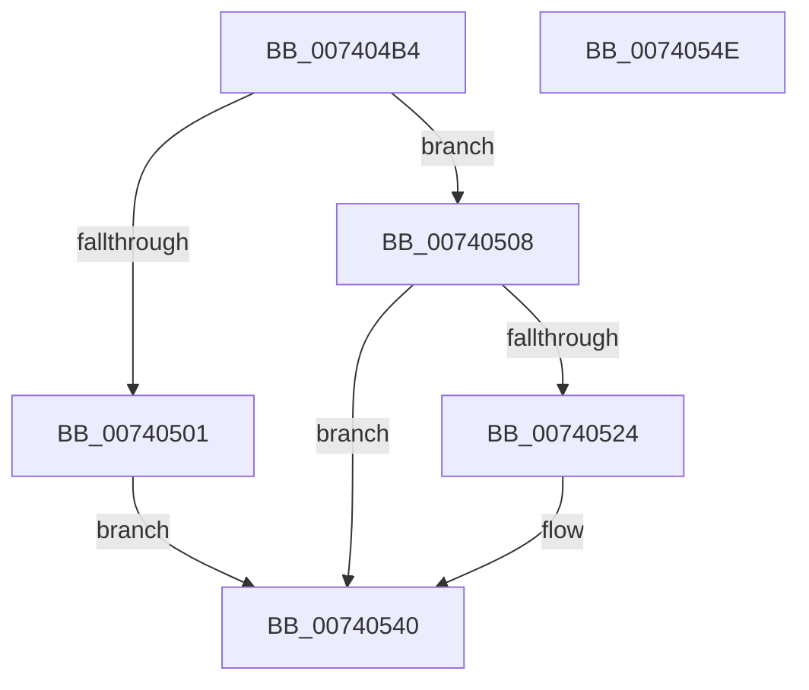

# PipSendGuestAssignedNotification

- RVA: `0x007404B4`–`0x0074054F` (길이 `155` bytes)
- VA: `0x00000001407404B4`
- 실행 섹션: `PAGE`
- PDB 이름 있음: `예`; PDB Function 태그: `아니요`
- unwind 정보 RVA: `0x000BA0F0`
- 디코드: `40`개 명령, `155/155` bytes 표시
- 미해석 바이트: `0` (있으면 어셈블리에 `.byte`로 보존)

> 이 문서는 커널 이미지의 기계어와 PDB 기호를 분석해 생성했습니다. 4번과 5번은 함수 원형과 자료형을 바이너리 사용 방식에서 추정한 C 해석이며 원본 소스 복구 결과는 아닙니다.

## 1. Dependencies

- 직접 호출 지점: **6**; 고유 호출 대상: **6**
- 직접 호출자로 확인된 함수: **2**
- RIP 상대 이미지 참조: **0**

### Outgoing calls
- `0x007404CF` → [memset](../../text/6C/memset_function_006C6C40.md) (function, `0x006C6C40`)
- `0x007404D8` → [IoGetAttachedDevice](../../text/41/IoGetAttachedDevice_function_00410810.md) (function, `0x00410810`)
- `0x007404F4` → [PpIrpAllocateDeviceUsageNotification](../73/PpIrpAllocateDeviceUsageNotification_function_0073E1DC.md) (function, `0x0073E1DC`)
- `0x0074050B` → [IoQueueThreadIrp](../../text/4B/IoQueueThreadIrp_function_004BBFC0.md) (function, `0x004BBFC0`)
- `0x00740518` → [IofCallDriver](../../text/29/IofCallDriver_function_0029B4B0.md) (function, `0x0029B4B0`)
- `0x00740537` → [KeWaitForSingleObject](../../text/20/KeWaitForSingleObject_function_0020E6B0.md) (function, `0x0020E6B0`)

### Direct callers
- [sub_00B1F5B6](../B1/Unknown_function_00B1F5B6.md) at `0x00B1F5E2`
- [sub_00B34B5E](../B3/Unknown_function_00B34B5E.md) at `0x00B34B9E`

### Static image references
- 디코드된 RIP-relative 메모리 참조가 없습니다.

## 2. Other-region calls and transfers

- 다른 실행 섹션으로 향하는 call: **5**
  - `0x007404CF` → [memset](../../text/6C/memset_function_006C6C40.md) (`PAGE` → `.text`)
  - `0x007404D8` → [IoGetAttachedDevice](../../text/41/IoGetAttachedDevice_function_00410810.md) (`PAGE` → `.text`)
  - `0x0074050B` → [IoQueueThreadIrp](../../text/4B/IoQueueThreadIrp_function_004BBFC0.md) (`PAGE` → `.text`)
  - `0x00740518` → [IofCallDriver](../../text/29/IofCallDriver_function_0029B4B0.md) (`PAGE` → `.text`)
  - `0x00740537` → [KeWaitForSingleObject](../../text/20/KeWaitForSingleObject_function_0020E6B0.md) (`PAGE` → `.text`)
- 별도 외부 분기/꼬리 이동을 확인하지 못했습니다.

## 3. Assembly (complete function range)

```asm
007404B4  48 89 5C 24 08                  mov qword ptr [rsp + 8], rbx
007404B9  57                              push rdi
007404BA  48 83 EC 70                     sub rsp, 0x70
007404BE  40 8A FA                        mov dil, dl
007404C1  48 8B D9                        mov rbx, rcx
007404C4  33 D2                           xor edx, edx
007404C6  48 8D 4C 24 30                  lea rcx, [rsp + 0x30]
007404CB  44 8D 42 40                     lea r8d, [rdx + 0x40]
007404CF  E8 6C 67 F8 FF                  call 0x1406c6c40
007404D4  48 8B 4B 20                     mov rcx, qword ptr [rbx + 0x20]
007404D8  E8 33 03 CD FF                  call 0x140410810
007404DD  48 8D 4C 24 30                  lea rcx, [rsp + 0x30]
007404E2  48 89 44 24 30                  mov qword ptr [rsp + 0x30], rax
007404E7  C7 44 24 38 06 00 00 00         mov dword ptr [rsp + 0x38], 6
007404EF  40 88 7C 24 3C                  mov byte ptr [rsp + 0x3c], dil
007404F4  E8 E3 DC FF FF                  call 0x14073e1dc
007404F9  48 8B D8                        mov rbx, rax
007404FC  48 85 C0                        test rax, rax
007404FF  75 07                           jne 0x140740508
00740501  B8 17 00 00 C0                  mov eax, 0xc0000017
00740506  EB 38                           jmp 0x140740540
00740508  48 8B CB                        mov rcx, rbx
0074050B  E8 B0 BA D7 FF                  call 0x1404bbfc0
00740510  48 8B 4C 24 30                  mov rcx, qword ptr [rsp + 0x30]
00740515  48 8B D3                        mov rdx, rbx
00740518  E8 93 AF B5 FF                  call 0x14029b4b0
0074051D  3D 03 01 00 00                  cmp eax, 0x103
00740522  75 1C                           jne 0x140740540
00740524  48 83 64 24 20 00               and qword ptr [rsp + 0x20], 0
0074052A  48 8D 4C 24 58                  lea rcx, [rsp + 0x58]
0074052F  45 33 C9                        xor r9d, r9d
00740532  45 33 C0                        xor r8d, r8d
00740535  33 D2                           xor edx, edx
00740537  E8 74 E1 AC FF                  call 0x14020e6b0
0074053C  8B 44 24 48                     mov eax, dword ptr [rsp + 0x48]
00740540  48 8B 9C 24 80 00 00 00         mov rbx, qword ptr [rsp + 0x80]
00740548  48 83 C4 70                     add rsp, 0x70
0074054C  5F                              pop rdi
0074054D  C3                              ret
0074054E  CC                              int3
```

## 4. C-style interpretation (structured pseudocode)

```c
__int64 __fastcall PipSendGuestAssignedNotification(__int64 a1, int a2, __int64 a3, int a4)
{
    __int64 result;
    __int64 v_rsp;
    unsigned __int64 v_stack_m20;
    unsigned int v_stack_m30;
    unsigned __int8 v_stack_m3C;
    unsigned int v_stack_m40;
    unsigned __int64 v_stack_m48;
    unsigned __int64 v_stack_m58;
    unsigned __int64 v_stack_p8;

    v_stack_p8 = v_rbx;
    v_rsp = (v_rsp) - (112);
    a2 = 0;
    result = memset(v_stack_m48, a2, a2 + 64, a4);
    result = IoGetAttachedDevice(*(unsigned __int64 *)(a1 + 32), a2, a2 + 64, a4);
    v_stack_m48 = result;
    v_stack_m40 = 6;
    v_stack_m3C = (unsigned __int8)((unsigned __int8)(a2));
    result = PpIrpAllocateDeviceUsageNotification(v_stack_m48, a2, a2 + 64, a4);
    if (result != 0) goto loc_00740508;
    goto loc_00740540;
loc_00740508:
    result = IoQueueThreadIrp(result, a2, a2 + 64, a4);
    result = IofCallDriver(v_stack_m48, result, a2 + 64, a4);
    if (((unsigned int)(result)) == 259) {
        a1 = v_stack_m20;
        a4 = 0;
        a3 = 0;
        a2 = 0;
        result = KeWaitForSingleObject(a1, a2, a3, a4);
        result = v_stack_m30;
    }
    v_rsp = (v_rsp) + (112);
    return result;
}
```

## 5. (Beta) C Style

```c
int64_t PipSendGuestAssignedNotification(void *Arg1, int32_t Arg2, int64_t Arg3, int32_t Arg4)
{
    uint8_t *arg1 = (uint8_t *)Arg1;

    int64_t result;
    int64_t local_rsp;
    uint64_t v_stack_m20;
    uint32_t v_stack_m30;
    uint8_t v_stack_m3C;
    uint32_t v_stack_m40;
    uint64_t v_stack_m48;
    uint64_t v_stack_m58;
    uint64_t v_stack_p8;

    v_stack_p8 = local_rbx;
    local_rsp = (local_rsp) - (112);
    Arg2 = 0;
    result = memset(v_stack_m48, Arg2, Arg2 + 64, Arg4);
    result = IoGetAttachedDevice(*(uint64_t *)(arg1 + 0x20), Arg2, Arg2 + 64, Arg4);
    v_stack_m48 = result;
    v_stack_m40 = 6;
    v_stack_m3C = (uint8_t)((uint8_t)(Arg2));
    result = PpIrpAllocateDeviceUsageNotification(v_stack_m48, Arg2, Arg2 + 64, Arg4);
    if (result != 0) goto loc_00740508;
    goto loc_00740540;
loc_00740508:
    result = IoQueueThreadIrp(result, Arg2, Arg2 + 64, Arg4);
    result = IofCallDriver(v_stack_m48, result, Arg2 + 64, Arg4);
    if (((uint32_t)(result)) == 259) {
        Arg1 = v_stack_m20;
        Arg4 = 0;
        Arg3 = 0;
        Arg2 = 0;
        result = KeWaitForSingleObject(Arg1, Arg2, Arg3, Arg4);
        result = v_stack_m30;
    }
    local_rsp = (local_rsp) + (112);
    return result;
}
```

### 관측된 메모리 오프셋

구조체 형식이 확인되지 않은 접근은 인자 기준의 오프셋으로만 기록했습니다.

| 기준 인자 | 오프셋 표현 | 폭 (bit) | 접근 |
|---|---:|---:|---|
| `Arg1` | `+ 0x20` | `64` | `R` |

## 6. Execution-region graph

[열기: 2D/3D 그래프와 함수 탐색 컨트롤 패널](../../../control-panel.html?section=page&rva=0x007404B4&view=graph)

- 2D 그래프는 위에서 아래로 흐르고, 3D 그래프는 빈 공간을 드래그해 회전합니다. Shift+드래그는 이동, 휠은 확대·축소, 함수 노드 선택은 대상 보고서 이동입니다.

### Static fallback


