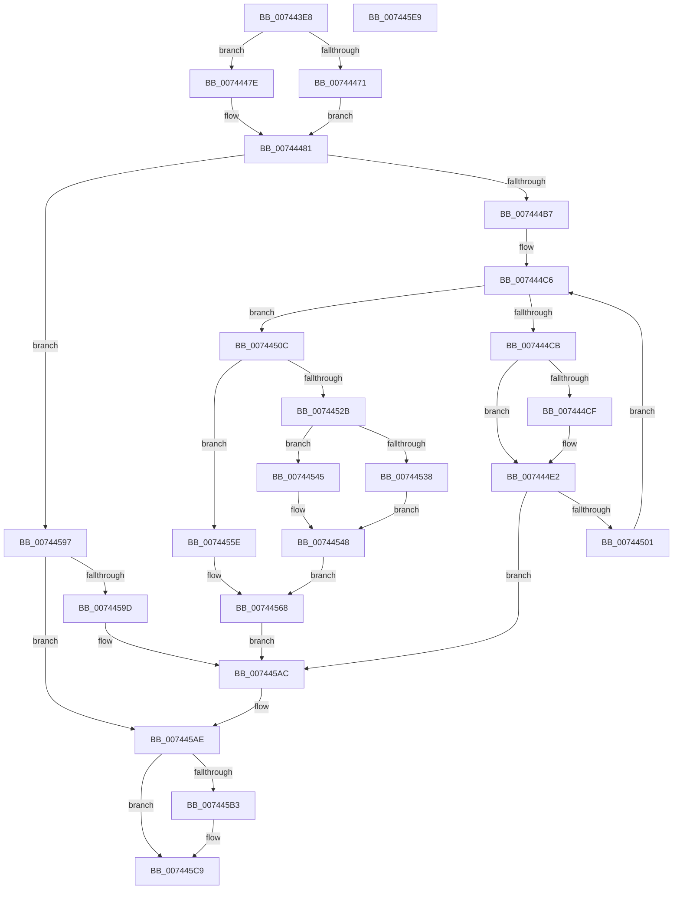

# PipSendQueryRemoveIrpAndCheckOpenHandles

- RVA: `0x007443E8`–`0x007445EA` (길이 `514` bytes)
- VA: `0x00000001407443E8`
- 실행 섹션: `PAGE`
- PDB 이름 있음: `예`; PDB Function 태그: `아니요`
- unwind 정보 RVA: `0x000C9454`
- 디코드: `146`개 명령, `514/514` bytes 표시
- 미해석 바이트: `0` (있으면 어셈블리에 `.byte`로 보존)

> 이 문서는 커널 이미지의 기계어와 PDB 기호를 분석해 생성했습니다. 4번과 5번은 함수 원형과 자료형을 바이너리 사용 방식에서 추정한 C 해석이며 원본 소스 복구 결과는 아닙니다.

## 1. Dependencies

- 직접 호출 지점: **12**; 고유 호출 대상: **10**
- 직접 호출자로 확인된 함수: **1**
- RIP 상대 이미지 참조: **1**

### Outgoing calls
- `0x00744448` → [PnpDeleteLockedDeviceNodes](../A0/PnpDeleteLockedDeviceNodes_function_00A09B30.md) (function, `0x00A09B30`)
- `0x007444D7` → [KeDelayExecutionThread](../../text/20/KeDelayExecutionThread_function_00209550.md) (function, `0x00209550`)
- `0x007444F4` → [PnpIsChainDereferenced](../../text/4A/PnpIsChainDereferenced_function_004ABAE8.md) (function, `0x004ABAE8`)
- `0x0074451D` → [PnpCollectOpenHandles](../73/PnpCollectOpenHandles_function_00737E54.md) (function, `0x00737E54`)
- `0x0074452B` → [IoGetDeviceAttachmentBaseRef](../../text/27/IoGetDeviceAttachmentBaseRef_function_00272710.md) (function, `0x00272710`)
- `0x0074454F` → [RtlCopyUnicodeString](../../text/3F/RtlCopyUnicodeString_function_003FEF30.md) (function, `0x003FEF30`)
- `0x00744557` → [ObfDereferenceObject](../../text/2F/ObfDereferenceObject_function_002F9350.md) (function, `0x002F9350`)
- `0x00744563` → [RtlInitUnicodeString](../../text/42/RtlInitUnicodeString_function_0042A780.md) (function, `0x0042A780`)
- `0x0074458B` → [PnpDeleteLockedDeviceNodes](../A0/PnpDeleteLockedDeviceNodes_function_00A09B30.md) (function, `0x00A09B30`)
- `0x007445A7` → [PnpCollectOpenHandles](../73/PnpCollectOpenHandles_function_00737E54.md) (function, `0x00737E54`)
- `0x007445BB` → [PnpLogVetoInformation](../AB/PnpLogVetoInformation_function_00AB6BE8.md) (function, `0x00AB6BE8`)
- `0x007445C4` → [PnpFreeVetoInformation](../73/PnpFreeVetoInformation_function_00737F5C.md) (function, `0x00737F5C`)

### Direct callers
- [PiProcessQueryAndCancelRemoval](../A0/PiProcessQueryAndCancelRemoval_function_00A05A58.md) at `0x00A05B9D`

### Static image references
- `0x0074449C` → RVA `0x00FC42C0` (`.data`; read)

## 2. Other-region calls and transfers

- 다른 실행 섹션으로 향하는 call: **6**
  - `0x007444D7` → [KeDelayExecutionThread](../../text/20/KeDelayExecutionThread_function_00209550.md) (`PAGE` → `.text`)
  - `0x007444F4` → [PnpIsChainDereferenced](../../text/4A/PnpIsChainDereferenced_function_004ABAE8.md) (`PAGE` → `.text`)
  - `0x0074452B` → [IoGetDeviceAttachmentBaseRef](../../text/27/IoGetDeviceAttachmentBaseRef_function_00272710.md) (`PAGE` → `.text`)
  - `0x0074454F` → [RtlCopyUnicodeString](../../text/3F/RtlCopyUnicodeString_function_003FEF30.md) (`PAGE` → `.text`)
  - `0x00744557` → [ObfDereferenceObject](../../text/2F/ObfDereferenceObject_function_002F9350.md) (`PAGE` → `.text`)
  - `0x00744563` → [RtlInitUnicodeString](../../text/42/RtlInitUnicodeString_function_0042A780.md) (`PAGE` → `.text`)
- 별도 외부 분기/꼬리 이동을 확인하지 못했습니다.

## 3. Assembly (complete function range)

```asm
007443E8  48 8B C4                        mov rax, rsp
007443EB  48 89 58 08                     mov qword ptr [rax + 8], rbx
007443EF  48 89 70 18                     mov qword ptr [rax + 0x18], rsi
007443F3  48 89 78 20                     mov qword ptr [rax + 0x20], rdi
007443F7  55                              push rbp
007443F8  41 54                           push r12
007443FA  41 55                           push r13
007443FC  41 56                           push r14
007443FE  41 57                           push r15
00744400  48 8B EC                        mov rbp, rsp
00744403  48 83 EC 70                     sub rsp, 0x70
00744407  4C 8B BA A0 00 00 00            mov r15, qword ptr [rdx + 0xa0]
0074440E  4D 8B E8                        mov r13, r8
00744411  4C 8B 75 58                     mov r14, qword ptr [rbp + 0x58]
00744415  41 8B F1                        mov esi, r9d
00744418  48 83 65 38 00                  and qword ptr [rbp + 0x38], 0
0074441D  8B D9                           mov ebx, ecx
0074441F  41 B9 01 00 00 00               mov r9d, 1
00744425  45 33 C0                        xor r8d, r8d
00744428  49 8B CF                        mov rcx, r15
0074442B  4D 8D 66 08                     lea r12, [r14 + 8]
0074442F  4C 89 60 A0                     mov qword ptr [rax - 0x60], r12
00744433  4C 89 70 98                     mov qword ptr [rax - 0x68], r14
00744437  8B 42 14                        mov eax, dword ptr [rdx + 0x14]
0074443A  89 44 24 28                     mov dword ptr [rsp + 0x28], eax
0074443E  8B 42 10                        mov eax, dword ptr [rdx + 0x10]
00744441  49 8B D5                        mov rdx, r13
00744444  89 44 24 20                     mov dword ptr [rsp + 0x20], eax
00744448  E8 E3 56 2C 00                  call 0x140a09b30
0074444D  33 D2                           xor edx, edx
0074444F  8B F8                           mov edi, eax
00744451  F7 C3 FB FF FF FF               test ebx, 0xfffffffb
00744457  0F B6 CA                        movzx ecx, dl
0074445A  66 89 55 F5                     mov word ptr [rbp - 0xb], dx
0074445E  88 55 F7                        mov byte ptr [rbp - 9], dl
00744461  44 8D 42 01                     lea r8d, [rdx + 1]
00744465  41 0F 44 C8                     cmove ecx, r8d
00744469  88 4D F5                        mov byte ptr [rbp - 0xb], cl
0074446C  4D 85 FF                        test r15, r15
0074446F  74 0D                           je 0x14074447e
00744471  49 8B 87 38 01 00 00            mov rax, qword ptr [r15 + 0x138]
00744478  48 8B 40 28                     mov rax, qword ptr [rax + 0x28]
0074447C  EB 03                           jmp 0x140744481
0074447E  48 8B C2                        mov rax, rdx
00744481  48 83 C0 28                     add rax, 0x28
00744485  89 55 F0                        mov dword ptr [rbp - 0x10], edx
00744488  48 89 45 D8                     mov qword ptr [rbp - 0x28], rax
0074448C  48 8D 45 E0                     lea rax, [rbp - 0x20]
00744490  48 89 45 E8                     mov qword ptr [rbp - 0x18], rax
00744494  48 8D 45 E0                     lea rax, [rbp - 0x20]
00744498  48 89 45 E0                     mov qword ptr [rbp - 0x20], rax
0074449C  8B 05 1E FE 87 00               mov eax, dword ptr [rip + 0x87fe1e]
007444A2  C1 E8 0E                        shr eax, 0xe
007444A5  41 22 C0                        and al, r8b
007444A8  48 89 55 D0                     mov qword ptr [rbp - 0x30], rdx
007444AC  88 45 F4                        mov byte ptr [rbp - 0xc], al
007444AF  85 FF                           test edi, edi
007444B1  0F 88 E0 00 00 00               js 0x140744597
007444B7  83 4D 5C FF                     or dword ptr [rbp + 0x5c], 0xffffffff
007444BB  33 FF                           xor edi, edi
007444BD  C7 45 58 C0 BD F0 FF            mov dword ptr [rbp + 0x58], 0xfff0bdc0
007444C4  8B DF                           mov ebx, edi
007444C6  83 FB 32                        cmp ebx, 0x32
007444C9  73 41                           jae 0x14074450c
007444CB  85 DB                           test ebx, ebx
007444CD  74 13                           je 0x1407444e2
007444CF  4C 8D 45 58                     lea r8, [rbp + 0x58]
007444D3  33 D2                           xor edx, edx
007444D5  33 C9                           xor ecx, ecx
007444D7  E8 74 50 AC FF                  call 0x140209550
007444DC  41 B8 01 00 00 00               mov r8d, 1
007444E2  48 8B 4D 50                     mov rcx, qword ptr [rbp + 0x50]
007444E6  48 8D 45 38                     lea rax, [rbp + 0x38]
007444EA  45 33 C9                        xor r9d, r9d
007444ED  48 89 44 24 20                  mov qword ptr [rsp + 0x20], rax
007444F2  8B D6                           mov edx, esi
007444F4  E8 EF 75 D6 FF                  call 0x1404abae8
007444F9  85 C0                           test eax, eax
007444FB  0F 84 AB 00 00 00               je 0x1407445ac
00744501  41 B8 01 00 00 00               mov r8d, 1
00744507  41 03 D8                        add ebx, r8d
0074450A  EB BA                           jmp 0x1407444c6
0074450C  48 8B 4D 50                     mov rcx, qword ptr [rbp + 0x50]
00744510  4C 8D 45 D0                     lea r8, [rbp - 0x30]
00744514  8B D6                           mov edx, esi
00744516  41 C7 06 05 00 00 00            mov dword ptr [r14], 5
0074451D  E8 32 39 FF FF                  call 0x140737e54
00744522  48 8B 4D 38                     mov rcx, qword ptr [rbp + 0x38]
00744526  48 85 C9                        test rcx, rcx
00744529  74 33                           je 0x14074455e
0074452B  E8 E0 E1 B2 FF                  call 0x140272710
00744530  48 8B D8                        mov rbx, rax
00744533  48 85 C0                        test rax, rax
00744536  74 0D                           je 0x140744545
00744538  48 8B 88 38 01 00 00            mov rcx, qword ptr [rax + 0x138]
0074453F  48 8B 51 28                     mov rdx, qword ptr [rcx + 0x28]
00744543  EB 03                           jmp 0x140744548
00744545  48 8B D7                        mov rdx, rdi
00744548  48 83 C2 28                     add rdx, 0x28
0074454C  49 8B CC                        mov rcx, r12
0074454F  E8 DC A9 CB FF                  call 0x1403fef30
00744554  48 8B CB                        mov rcx, rbx
00744557  E8 F4 4D BB FF                  call 0x1402f9350
0074455C  EB 0A                           jmp 0x140744568
0074455E  33 D2                           xor edx, edx
00744560  49 8B CC                        mov rcx, r12
00744563  E8 18 62 CE FF                  call 0x14042a780
00744568  48 89 7C 24 38                  mov qword ptr [rsp + 0x38], rdi
0074456D  B8 01 00 00 00                  mov eax, 1
00744572  48 89 7C 24 30                  mov qword ptr [rsp + 0x30], rdi
00744577  44 8A C8                        mov r9b, al
0074457A  89 7C 24 28                     mov dword ptr [rsp + 0x28], edi
0074457E  44 8B C0                        mov r8d, eax
00744581  49 8B D5                        mov rdx, r13
00744584  89 7C 24 20                     mov dword ptr [rsp + 0x20], edi
00744588  49 8B CF                        mov rcx, r15
0074458B  E8 A0 55 2C 00                  call 0x140a09b30
00744590  BF 28 00 00 80                  mov edi, 0x80000028
00744595  EB 15                           jmp 0x1407445ac
00744597  41 83 3E 06                     cmp dword ptr [r14], 6
0074459B  75 11                           jne 0x1407445ae
0074459D  48 8B 4D 50                     mov rcx, qword ptr [rbp + 0x50]
007445A1  4C 8D 45 D0                     lea r8, [rbp - 0x30]
007445A5  8B D6                           mov edx, esi
007445A7  E8 A8 38 FF FF                  call 0x140737e54
007445AC  33 D2                           xor edx, edx
007445AE  38 55 F5                        cmp byte ptr [rbp - 0xb], dl
007445B1  74 16                           je 0x1407445c9
007445B3  48 8B 4D D8                     mov rcx, qword ptr [rbp - 0x28]
007445B7  48 8D 55 E0                     lea rdx, [rbp - 0x20]
007445BB  E8 28 26 37 00                  call 0x140ab6be8
007445C0  48 8D 4D E0                     lea rcx, [rbp - 0x20]
007445C4  E8 93 39 FF FF                  call 0x140737f5c
007445C9  4C 8D 5C 24 70                  lea r11, [rsp + 0x70]
007445CE  8B C7                           mov eax, edi
007445D0  49 8B 5B 30                     mov rbx, qword ptr [r11 + 0x30]
007445D4  49 8B 73 40                     mov rsi, qword ptr [r11 + 0x40]
007445D8  49 8B 7B 48                     mov rdi, qword ptr [r11 + 0x48]
007445DC  49 8B E3                        mov rsp, r11
007445DF  41 5F                           pop r15
007445E1  41 5E                           pop r14
007445E3  41 5D                           pop r13
007445E5  41 5C                           pop r12
007445E7  5D                              pop rbp
007445E8  C3                              ret
007445E9  CC                              int3
```

## 4. C-style interpretation (structured pseudocode)

```c
__int64 __fastcall PipSendQueryRemoveIrpAndCheckOpenHandles(int a1, __int64 a2, __int64 a3, int a4, __int64 a5, __int64 a6)
{
    __int64 result;
    __int64 v_rbx;
    __int64 v_rdi;
    __int64 v_rsp;
    unsigned __int64 v_stack_m28;
    unsigned __int8 v_stack_m31;
    unsigned __int16 v_stack_m33;
    unsigned __int8 v_stack_m34;
    unsigned int v_stack_m38;
    unsigned __int64 v_stack_m40;
    unsigned __int64 v_stack_m48;
    unsigned __int64 v_stack_m50;
    unsigned __int64 v_stack_m58;
    unsigned __int64 v_stack_m60;
    unsigned __int64 v_stack_m68;
    unsigned int v_stack_m70;
    unsigned int v_stack_m78;
    unsigned __int64 v_stack_p10;
    unsigned int v_stack_p30;
    unsigned int v_stack_p34;

    *(unsigned __int64 *)(v_rsp + 8) = v_rbx;
    *(unsigned __int64 *)(v_rsp + 24) = v_rsi;
    *(unsigned __int64 *)(v_rsp + 32) = v_rdi;
    v_rsp = (v_rsp) - (112);
    a3 = 0;
    *(unsigned __int64 *)(v_rsp - 96) = a6 + 8;
    *(unsigned __int64 *)(v_rsp - 104) = a6;
    v_stack_m70 = (unsigned int)((unsigned int)(*(unsigned int *)(a2 + 20)));
    v_stack_m78 = (unsigned int)((unsigned int)(*(unsigned int *)(a2 + 16)));
    result = PnpDeleteLockedDeviceNodes(*(unsigned __int64 *)(a2 + 160), 0, a3, 1);
    a2 = 0;
    v_stack_m33 = 0;
    v_stack_m31 = 0;
    a1 = 0;
    if ((((unsigned int)((unsigned int)(a1))) & (0xFFFFFFFBULL)) == 0) { a1 = (unsigned int)(a2 + 1); }
    v_stack_m33 = (unsigned __int8)(a1);
    if (*(unsigned __int64 *)(a2 + 160) == 0) goto loc_0074447E;
    goto loc_00744481;
loc_0074447E:
loc_00744481:
    result = (0) + (40);
    v_stack_m38 = 0;
    v_stack_m50 = result;
    v_stack_m40 = v_stack_m48;
    v_stack_m48 = v_stack_m48;
    result = (unsigned int)(((unsigned int)(*(unsigned int *)(v_rip + 8912414))) >> (14));
    result = (unsigned __int8)((result) & ((unsigned __int8)(a2 + 1)));
    v_stack_m58 = 0;
    v_stack_m34 = (unsigned __int8)(result);
    if (sign_flag) goto loc_00744597;
    v_rdi = 0;
    v_stack_p30 = 0xFFF0BDC0ULL;
loc_007444C6:
    if (0 >= 50) goto loc_0074450C;
    if (0 != 0) {
        a3 = a6;
        a2 = 0;
        a1 = 0;
        result = KeDelayExecutionThread(a1, a2, a3, 1);
        a3 = 1;
    }
    a4 = 0;
    v_stack_m78 = v_stack_p10;
    result = PnpIsChainDereferenced(a5, (unsigned int)((unsigned int)((unsigned int)(a4))), a3, a4);
    if ((unsigned int)(result) == 0) goto loc_007445AC;
    v_rbx = (unsigned int)((0) + (1));
    goto loc_007444C6;
loc_0074450C:
    *(unsigned int *)(a6) = 5;
    result = PnpCollectOpenHandles(a5, (unsigned int)((unsigned int)((unsigned int)(a4))), v_stack_m58, a4);
    if (v_stack_p10 == 0) goto loc_0074455E;
    result = IoGetDeviceAttachmentBaseRef(v_stack_p10, (unsigned int)((unsigned int)((unsigned int)(a4))), v_stack_m58, a4);
    if (result == 0) goto loc_00744545;
    goto loc_00744548;
loc_00744545:
loc_00744548:
    a2 = (0) + (40);
    result = RtlCopyUnicodeString(a6 + 8, a2, v_stack_m58, a4);
    result = ObfDereferenceObject(result, a2, v_stack_m58, a4);
    goto loc_00744568;
loc_0074455E:
    a2 = 0;
    result = RtlInitUnicodeString(a6 + 8, a2, v_stack_m58, a4);
loc_00744568:
    v_stack_m60 = 0;
    v_stack_m68 = 0;
    v_stack_m70 = 0;
    v_stack_m78 = 0;
    result = PnpDeleteLockedDeviceNodes(*(unsigned __int64 *)(a2 + 160), a3, 1, 1);
    goto loc_007445AC;
loc_00744597:
    if ((*(unsigned int *)(a6)) != 6) goto loc_007445AE;
    result = PnpCollectOpenHandles(a5, (unsigned int)((unsigned int)((unsigned int)(a4))), v_stack_m58, 1);
loc_007445AC:
    a2 = 0;
loc_007445AE:
    if (v_stack_m33 != 0) {
        a1 = v_stack_m50;
        a2 = v_stack_m48;
        result = PnpLogVetoInformation(a1, a2, v_stack_m58, 1);
        a1 = v_stack_m48;
        result = PnpFreeVetoInformation(a1, a2, v_stack_m58, 1);
    }
    return (unsigned int)((unsigned int)((unsigned int)(0x80000028ULL)));
}
```

## 5. (Beta) C Style

```c
int64_t PipSendQueryRemoveIrpAndCheckOpenHandles(int32_t Arg1, void *Arg2, int64_t Arg3, int32_t Arg4, int64_t Arg5, void *Arg6)
{
    uint8_t *arg2 = (uint8_t *)Arg2;
    uint8_t *arg6 = (uint8_t *)Arg6;

    int64_t result;
    int64_t local_rbx;
    int64_t local_rdi;
    int64_t local_rsp;
    uint64_t v_stack_m28;
    uint8_t v_stack_m31;
    uint16_t v_stack_m33;
    uint8_t v_stack_m34;
    uint32_t v_stack_m38;
    uint64_t v_stack_m40;
    uint64_t v_stack_m48;
    uint64_t v_stack_m50;
    uint64_t v_stack_m58;
    uint64_t v_stack_m60;
    uint64_t v_stack_m68;
    uint32_t v_stack_m70;
    uint32_t v_stack_m78;
    uint64_t v_stack_p10;
    uint32_t v_stack_p30;
    uint32_t v_stack_p34;

    *(uint64_t *)(local_rsp + 0x8) = local_rbx;
    *(uint64_t *)(local_rsp + 0x18) = local_rsi;
    *(uint64_t *)(local_rsp + 0x20) = local_rdi;
    local_rsp = (local_rsp) - (112);
    Arg3 = 0;
    *(void **)(local_rsp - 0x60) = Arg6 + 8;
    *(void **)(local_rsp - 0x68) = Arg6;
    v_stack_m70 = (uint32_t)((uint32_t)(*(uint32_t *)(arg2 + 0x14)));
    v_stack_m78 = (uint32_t)((uint32_t)(*(uint32_t *)(arg2 + 0x10)));
    result = PnpDeleteLockedDeviceNodes(*(uint64_t *)(arg2 + 0xA0), 0, Arg3, 1);
    Arg2 = 0;
    v_stack_m33 = 0;
    v_stack_m31 = 0;
    Arg1 = 0;
    if ((((uint32_t)((uint32_t)(Arg1))) & (0xFFFFFFFBULL)) == 0) { Arg1 = (uint32_t)(Arg2 + 1); }
    v_stack_m33 = (uint8_t)(Arg1);
    if (*(uint64_t *)(arg2 + 0xA0) == 0) goto loc_0074447E;
    goto loc_00744481;
loc_0074447E:
loc_00744481:
    result = (0) + (40);
    v_stack_m38 = 0;
    v_stack_m50 = result;
    v_stack_m40 = v_stack_m48;
    v_stack_m48 = v_stack_m48;
    result = (uint32_t)(((uint32_t)(*(uint32_t *)(v_rip + 0x87FE1E))) >> (14));
    result = (uint8_t)((result) & ((uint8_t)(Arg2 + 1)));
    v_stack_m58 = 0;
    v_stack_m34 = (uint8_t)(result);
    if (sign_flag) goto loc_00744597;
    local_rdi = 0;
    v_stack_p30 = 0xFFF0BDC0ULL;
loc_007444C6:
    if (0 >= 50) goto loc_0074450C;
    if (0 != 0) {
        Arg3 = Arg6;
        Arg2 = 0;
        Arg1 = 0;
        result = KeDelayExecutionThread(Arg1, Arg2, Arg3, 1);
        Arg3 = 1;
    }
    Arg4 = 0;
    v_stack_m78 = v_stack_p10;
    result = PnpIsChainDereferenced(Arg5, (uint32_t)((uint32_t)((uint32_t)(Arg4))), Arg3, Arg4);
    if ((uint32_t)(result) == 0) goto loc_007445AC;
    local_rbx = (uint32_t)((0) + (1));
    goto loc_007444C6;
loc_0074450C:
    *(uint32_t *)(arg6) = 5;
    result = PnpCollectOpenHandles(Arg5, (uint32_t)((uint32_t)((uint32_t)(Arg4))), v_stack_m58, Arg4);
    if (v_stack_p10 == 0) goto loc_0074455E;
    result = IoGetDeviceAttachmentBaseRef(v_stack_p10, (uint32_t)((uint32_t)((uint32_t)(Arg4))), v_stack_m58, Arg4);
    if (result == 0) goto loc_00744545;
    goto loc_00744548;
loc_00744545:
loc_00744548:
    Arg2 = (0) + (40);
    result = RtlCopyUnicodeString(Arg6 + 8, Arg2, v_stack_m58, Arg4);
    result = ObfDereferenceObject(result, Arg2, v_stack_m58, Arg4);
    goto loc_00744568;
loc_0074455E:
    Arg2 = 0;
    result = RtlInitUnicodeString(Arg6 + 8, Arg2, v_stack_m58, Arg4);
loc_00744568:
    v_stack_m60 = 0;
    v_stack_m68 = 0;
    v_stack_m70 = 0;
    v_stack_m78 = 0;
    result = PnpDeleteLockedDeviceNodes(*(uint64_t *)(arg2 + 0xA0), Arg3, 1, 1);
    goto loc_007445AC;
loc_00744597:
    if ((*(uint32_t *)(arg6)) != 6) goto loc_007445AE;
    result = PnpCollectOpenHandles(Arg5, (uint32_t)((uint32_t)((uint32_t)(Arg4))), v_stack_m58, 1);
loc_007445AC:
    Arg2 = 0;
loc_007445AE:
    if (v_stack_m33 != 0) {
        Arg1 = v_stack_m50;
        Arg2 = v_stack_m48;
        result = PnpLogVetoInformation(Arg1, Arg2, v_stack_m58, 1);
        Arg1 = v_stack_m48;
        result = PnpFreeVetoInformation(Arg1, Arg2, v_stack_m58, 1);
    }
    return (uint32_t)((uint32_t)((uint32_t)(0x80000028ULL)));
}
```

### 관측된 메모리 오프셋

구조체 형식이 확인되지 않은 접근은 인자 기준의 오프셋으로만 기록했습니다.

| 기준 인자 | 오프셋 표현 | 폭 (bit) | 접근 |
|---|---:|---:|---|
| `Arg2` | `+ 0x10` | `32` | `R` |
| `Arg2` | `+ 0x14` | `32` | `R` |
| `Arg2` | `+ 0xA0` | `64` | `R` |
| `Arg6` | `+ 0x0` | `32` | `R` |
| `Arg6` | `+ 0x0` | `32` | `W` |
| `Arg6` | `+ 0x8` | `64` | `R` |

## 6. Execution-region graph

[열기: 2D/3D 그래프와 함수 탐색 컨트롤 패널](../../../control-panel.html?section=page&rva=0x007443E8&view=graph)

- 2D 그래프는 위에서 아래로 흐르고, 3D 그래프는 빈 공간을 드래그해 회전합니다. Shift+드래그는 이동, 휠은 확대·축소, 함수 노드 선택은 대상 보고서 이동입니다.

### Static fallback


