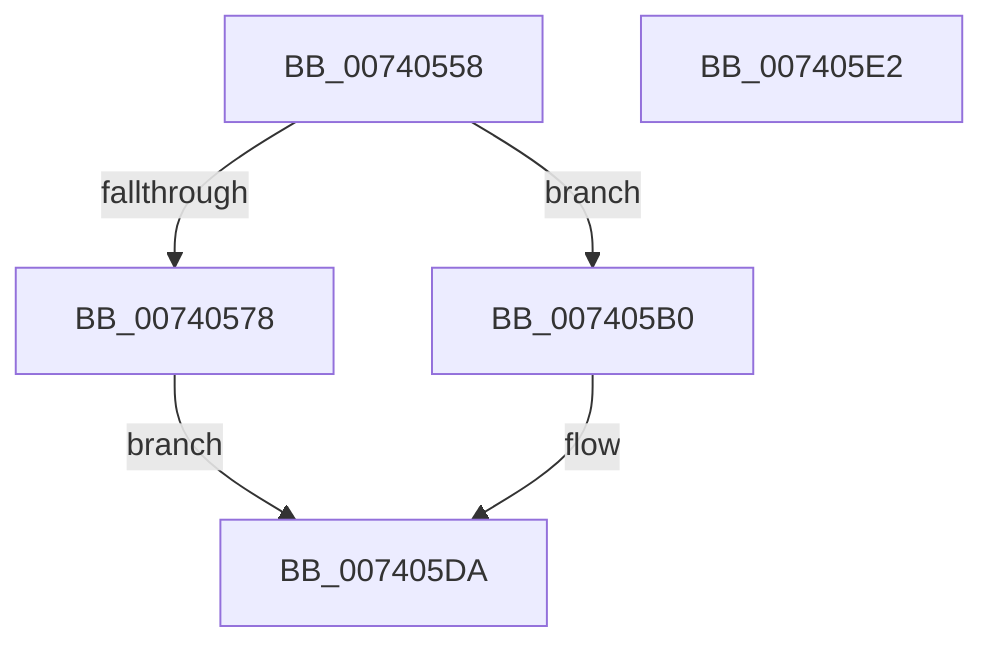

# PipSetGuestAssignedProperty

- RVA: `0x00740558`–`0x007405E3` (길이 `139` bytes)
- VA: `0x0000000140740558`
- 실행 섹션: `PAGE`
- PDB 이름 있음: `예`; PDB Function 태그: `아니요`
- unwind 정보 RVA: `0x000AF0B0`
- 디코드: `36`개 명령, `139/139` bytes 표시
- 미해석 바이트: `0` (있으면 어셈블리에 `.byte`로 보존)

> 이 문서는 커널 이미지의 기계어와 PDB 기호를 분석해 생성했습니다. 4번과 5번은 함수 원형과 자료형을 바이너리 사용 방식에서 추정한 C 해석이며 원본 소스 복구 결과는 아닙니다.

## 1. Dependencies

- 직접 호출 지점: **2**; 고유 호출 대상: **1**
- 직접 호출자로 확인된 함수: **1**
- RIP 상대 이미지 참조: **2**

### Outgoing calls
- `0x007405A7` → [PnpSetObjectProperty](../8F/PnpSetObjectProperty_function_008F66E8.md) (function, `0x008F66E8`)
- `0x007405D5` → [PnpSetObjectProperty](../8F/PnpSetObjectProperty_function_008F66E8.md) (function, `0x008F66E8`)

### Direct callers
- [sub_00B1F5B6](../B1/Unknown_function_00B1F5B6.md) at `0x00B1F5D1`

### Static image references
- `0x00740584` → RVA `0x00027EC0` (`.rdata`; read)
- `0x00740597` → RVA `0x00E66398` (`.data`; read)

## 2. Other-region calls and transfers

- 다른 실행 섹션으로 향하는 call: **0**
- 별도 외부 분기/꼬리 이동을 확인하지 못했습니다.

## 3. Assembly (complete function range)

```asm
00740558  4C 8B DC                        mov r11, rsp
0074055B  53                              push rbx
0074055C  48 83 EC 50                     sub rsp, 0x50
00740560  48 8B 41 30                     mov rax, qword ptr [rcx + 0x30]
00740564  33 DB                           xor ebx, ebx
00740566  45 33 C9                        xor r9d, r9d
00740569  89 5C 24 48                     mov dword ptr [rsp + 0x48], ebx
0074056D  84 D2                           test dl, dl
0074056F  48 8B D0                        mov rdx, rax
00740572  44 8D 43 01                     lea r8d, [rbx + 1]
00740576  74 38                           je 0x1407405b0
00740578  45 89 43 E8                     mov dword ptr [r11 - 0x18], r8d
0074057C  49 8D 4B 10                     lea rcx, [r11 + 0x10]
00740580  49 89 4B E0                     mov qword ptr [r11 - 0x20], rcx
00740584  48 8D 0D 35 79 8E FF            lea rcx, [rip - 0x7186cb]
0074058B  C7 44 24 30 11 00 00 00         mov dword ptr [rsp + 0x30], 0x11
00740593  49 89 4B D0                     mov qword ptr [r11 - 0x30], rcx
00740597  48 8B 0D FA 5D 72 00            mov rcx, qword ptr [rip + 0x725dfa]
0074059E  C6 44 24 68 FF                  mov byte ptr [rsp + 0x68], 0xff
007405A3  49 89 5B C8                     mov qword ptr [r11 - 0x38], rbx
007405A7  E8 3C 61 1B 00                  call 0x1408f66e8
007405AC  8B D8                           mov ebx, eax
007405AE  EB 2A                           jmp 0x1407405da
007405B0  89 5C 24 40                     mov dword ptr [rsp + 0x40], ebx
007405B4  48 8D 0D 05 79 8E FF            lea rcx, [rip - 0x7186fb]
007405BB  48 89 5C 24 38                  mov qword ptr [rsp + 0x38], rbx
007405C0  89 5C 24 30                     mov dword ptr [rsp + 0x30], ebx
007405C4  48 89 4C 24 28                  mov qword ptr [rsp + 0x28], rcx
007405C9  48 8B 0D C8 5D 72 00            mov rcx, qword ptr [rip + 0x725dc8]
007405D0  48 89 5C 24 20                  mov qword ptr [rsp + 0x20], rbx
007405D5  E8 0E 61 1B 00                  call 0x1408f66e8
007405DA  8B C3                           mov eax, ebx
007405DC  48 83 C4 50                     add rsp, 0x50
007405E0  5B                              pop rbx
007405E1  C3                              ret
007405E2  CC                              int3
```

## 4. C-style interpretation (structured pseudocode)

```c
__int64 __fastcall PipSetGuestAssignedProperty(__int64 a1, unsigned __int8 a2, __int64 a3, int a4)
{
    __int64 result;
    __int64 v_rbx;
    __int64 v_rsp;
    unsigned int v_stack_m10;
    unsigned int v_stack_m18;
    unsigned __int64 v_stack_m20;
    unsigned int v_stack_m28;
    unsigned __int64 v_stack_m30;
    unsigned __int64 v_stack_m38;
    unsigned __int8 v_stack_p10;

    v_rsp = (v_rsp) - (80);
    v_rbx = 0;
    a4 = 0;
    v_stack_m10 = 0;
    if (a2 == 0) goto loc_007405B0;
    *(unsigned int *)(v_rsp - 24) = (unsigned int)(v_rbx + 1);
    *(unsigned __int64 *)(v_rsp - 32) = v_rsp + 16;
    v_stack_m28 = 17;
    *(unsigned __int64 *)(v_rsp - 48) = v_rip - 7440075;
    v_stack_p10 = 255;
    *(unsigned __int64 *)(v_rsp - 56) = 0;
    result = PnpSetObjectProperty(*(unsigned __int64 *)(v_rip + 7495162), *(unsigned __int64 *)(a1 + 48), v_rbx + 1, a4);
    goto loc_007405DA;
loc_007405B0:
    v_stack_m18 = (unsigned int)((unsigned int)((unsigned int)(result)));
    v_stack_m20 = (unsigned int)((unsigned int)(result));
    v_stack_m28 = (unsigned int)((unsigned int)((unsigned int)(result)));
    v_stack_m30 = v_rip - 7440123;
    v_stack_m38 = (unsigned int)((unsigned int)(result));
    result = PnpSetObjectProperty(*(unsigned __int64 *)(v_rip + 7495112), *(unsigned __int64 *)(a1 + 48), v_rbx + 1, a4);
loc_007405DA:
    v_rsp = (v_rsp) + (80);
    return (unsigned int)((unsigned int)((unsigned int)((unsigned int)(result))));
}
```

## 5. (Beta) C Style

```c
int64_t PipSetGuestAssignedProperty(void *Arg1, uint8_t Arg2, int64_t Arg3, int32_t Arg4)
{
    uint8_t *arg1 = (uint8_t *)Arg1;

    int64_t result;
    int64_t local_rbx;
    int64_t local_rsp;
    uint32_t v_stack_m10;
    uint32_t v_stack_m18;
    uint64_t v_stack_m20;
    uint32_t v_stack_m28;
    uint64_t v_stack_m30;
    uint64_t v_stack_m38;
    uint8_t v_stack_p10;

    local_rsp = (local_rsp) - (80);
    local_rbx = 0;
    Arg4 = 0;
    v_stack_m10 = 0;
    if (Arg2 == 0) goto loc_007405B0;
    *(uint32_t *)(local_rsp - 0x18) = (uint32_t)(local_rbx + 1);
    *(uint64_t *)(local_rsp - 0x20) = local_rsp + 16;
    v_stack_m28 = 17;
    *(uint64_t *)(local_rsp - 0x30) = v_rip - 7440075;
    v_stack_p10 = 255;
    *(uint64_t *)(local_rsp - 0x38) = 0;
    result = PnpSetObjectProperty(*(uint64_t *)(v_rip + 0x725DFA), *(uint64_t *)(arg1 + 0x30), local_rbx + 1, Arg4);
    goto loc_007405DA;
loc_007405B0:
    v_stack_m18 = (uint32_t)((uint32_t)((uint32_t)(result)));
    v_stack_m20 = (uint32_t)((uint32_t)(result));
    v_stack_m28 = (uint32_t)((uint32_t)((uint32_t)(result)));
    v_stack_m30 = v_rip - 7440123;
    v_stack_m38 = (uint32_t)((uint32_t)(result));
    result = PnpSetObjectProperty(*(uint64_t *)(v_rip + 0x725DC8), *(uint64_t *)(arg1 + 0x30), local_rbx + 1, Arg4);
loc_007405DA:
    local_rsp = (local_rsp) + (80);
    return (uint32_t)((uint32_t)((uint32_t)((uint32_t)(result))));
}
```

### 관측된 메모리 오프셋

구조체 형식이 확인되지 않은 접근은 인자 기준의 오프셋으로만 기록했습니다.

| 기준 인자 | 오프셋 표현 | 폭 (bit) | 접근 |
|---|---:|---:|---|
| `Arg1` | `+ 0x30` | `64` | `R` |

## 6. Execution-region graph

[열기: 2D/3D 그래프와 함수 탐색 컨트롤 패널](../../../control-panel.html?section=page&rva=0x00740558&view=graph)

- 2D 그래프는 위에서 아래로 흐르고, 3D 그래프는 빈 공간을 드래그해 회전합니다. Shift+드래그는 이동, 휠은 확대·축소, 함수 노드 선택은 대상 보고서 이동입니다.

### Static fallback


