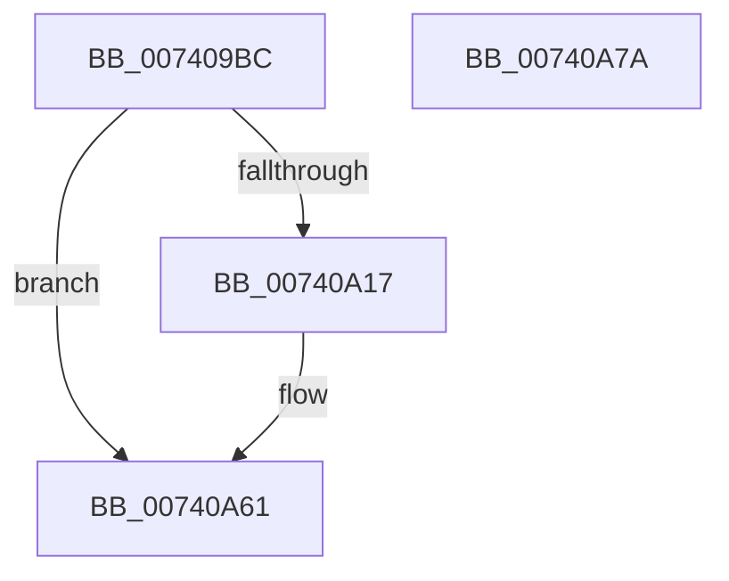

# PipUnprotectDevice

- RVA: `0x007409BC`–`0x00740A7B` (길이 `191` bytes)
- VA: `0x00000001407409BC`
- 실행 섹션: `PAGE`
- PDB 이름 있음: `예`; PDB Function 태그: `아니요`
- unwind 정보 RVA: `0x000C9290`
- 디코드: `44`개 명령, `191/191` bytes 표시
- 미해석 바이트: `0` (있으면 어셈블리에 `.byte`로 보존)

> 이 문서는 커널 이미지의 기계어와 PDB 기호를 분석해 생성했습니다. 4번과 5번은 함수 원형과 자료형을 바이너리 사용 방식에서 추정한 C 해석이며 원본 소스 복구 결과는 아닙니다.

## 1. Dependencies

- 직접 호출 지점: **6**; 고유 호출 대상: **5**
- 직접 호출자로 확인된 함수: **1**
- RIP 상대 이미지 참조: **2**

### Outgoing calls
- `0x00740A0E` → [PnpQueryInterface](../A2/PnpQueryInterface_function_00A28D38.md) (function, `0x00A28D38`)
- `0x00740A21` → [guard_dispatch_icall](../../text/6B/guard_dispatch_icall_function_006BAAD0.md) (function, `0x006BAAD0`)
- `0x00740A33` → [guard_dispatch_icall](../../text/6B/guard_dispatch_icall_function_006BAAD0.md) (function, `0x006BAAD0`)
- `0x00740A43` → [memset](../../text/6C/memset_function_006C6C40.md) (function, `0x006C6C40`)
- `0x00740A5C` → [VslpEnterIumSecureMode](../../text/23/VslpEnterIumSecureMode_function_00235E50.md) (function, `0x00235E50`)
- `0x00740A6C` → [_security_check_cookie](../../text/6A/_security_check_cookie_function_006AC640.md) (function, `0x006AC640`)

### Direct callers
- [PiProcessDriversLoadedOnSecureDevice](../A2/PiProcessDriversLoadedOnSecureDevice_function_00A27F9C.md) at `0x00A28017`

### Static image references
- `0x007409C5` → RVA `0x00E0A740` (`.data`; read)
- `0x007409DB` → RVA `0x00024088` (`.rdata`; read)

## 2. Other-region calls and transfers

- 다른 실행 섹션으로 향하는 call: **5**
  - `0x00740A21` → [guard_dispatch_icall](../../text/6B/guard_dispatch_icall_function_006BAAD0.md) (`PAGE` → `.text`)
  - `0x00740A33` → [guard_dispatch_icall](../../text/6B/guard_dispatch_icall_function_006BAAD0.md) (`PAGE` → `.text`)
  - `0x00740A43` → [memset](../../text/6C/memset_function_006C6C40.md) (`PAGE` → `.text`)
  - `0x00740A5C` → [VslpEnterIumSecureMode](../../text/23/VslpEnterIumSecureMode_function_00235E50.md) (`PAGE` → `.text`)
  - `0x00740A6C` → [_security_check_cookie](../../text/6A/_security_check_cookie_function_006AC640.md) (`PAGE` → `.text`)
- 별도 외부 분기/꼬리 이동을 확인하지 못했습니다.

## 3. Assembly (complete function range)

```asm
007409BC  40 53                           push rbx
007409BE  48 81 EC E0 00 00 00            sub rsp, 0xe0
007409C5  48 8B 05 74 9D 6C 00            mov rax, qword ptr [rip + 0x6c9d74]
007409CC  48 33 C4                        xor rax, rsp
007409CF  48 89 84 24 D0 00 00 00         mov qword ptr [rsp + 0xd0], rax
007409D7  48 8B 49 20                     mov rcx, qword ptr [rcx + 0x20]
007409DB  48 8D 15 A6 36 8E FF            lea rdx, [rip - 0x71c95a]
007409E2  33 C0                           xor eax, eax
007409E4  0F 57 C0                        xorps xmm0, xmm0
007409E7  48 89 44 24 50                  mov qword ptr [rsp + 0x50], rax
007409EC  0F 11 44 24 30                  movups xmmword ptr [rsp + 0x30], xmm0
007409F1  44 8D 48 28                     lea r9d, [rax + 0x28]
007409F5  44 8D 40 01                     lea r8d, [rax + 1]
007409F9  48 8D 44 24 30                  lea rax, [rsp + 0x30]
007409FE  48 89 44 24 28                  mov qword ptr [rsp + 0x28], rax
00740A03  48 83 64 24 20 00               and qword ptr [rsp + 0x20], 0
00740A09  0F 11 44 24 40                  movups xmmword ptr [rsp + 0x40], xmm0
00740A0E  E8 25 83 2E 00                  call 0x140a28d38
00740A13  85 C0                           test eax, eax
00740A15  78 4A                           js 0x140740a61
00740A17  48 8B 4C 24 38                  mov rcx, qword ptr [rsp + 0x38]
00740A1C  48 8B 44 24 50                  mov rax, qword ptr [rsp + 0x50]
00740A21  E8 AA A0 F7 FF                  call 0x1406baad0
00740A26  48 8B 4C 24 38                  mov rcx, qword ptr [rsp + 0x38]
00740A2B  48 8B D8                        mov rbx, rax
00740A2E  48 8B 44 24 48                  mov rax, qword ptr [rsp + 0x48]
00740A33  E8 98 A0 F7 FF                  call 0x1406baad0
00740A38  33 D2                           xor edx, edx
00740A3A  48 8D 4C 24 60                  lea rcx, [rsp + 0x60]
00740A3F  44 8D 42 68                     lea r8d, [rdx + 0x68]
00740A43  E8 F8 61 F8 FF                  call 0x1406c6c40
00740A48  BA 47 00 00 00                  mov edx, 0x47
00740A4D  48 89 5C 24 68                  mov qword ptr [rsp + 0x68], rbx
00740A52  4C 8D 4C 24 60                  lea r9, [rsp + 0x60]
00740A57  45 33 C0                        xor r8d, r8d
00740A5A  B1 02                           mov cl, 2
00740A5C  E8 EF 53 AF FF                  call 0x140235e50
00740A61  48 8B 8C 24 D0 00 00 00         mov rcx, qword ptr [rsp + 0xd0]
00740A69  48 33 CC                        xor rcx, rsp
00740A6C  E8 CF BB F6 FF                  call 0x1406ac640
00740A71  48 81 C4 E0 00 00 00            add rsp, 0xe0
00740A78  5B                              pop rbx
00740A79  C3                              ret
00740A7A  CC                              int3
```

## 4. C-style interpretation (structured pseudocode)

```c
__int64 __fastcall PipUnprotectDevice(__int64 a1)
{
    __int64 result;
    __int64 v_rbx;
    __int64 v_rsp;
    unsigned __int64 v_stack_m18;
    unsigned __int64 v_stack_m80;
    unsigned __int64 v_stack_m88;
    unsigned __int64 v_stack_m98;
    unsigned __int64 v_stack_mA0;
    unsigned __int64 v_stack_mA8;
    unsigned __int64 v_stack_mB0;
    unsigned __int64 v_stack_mB8;
    unsigned __int64 v_stack_mC0;
    unsigned __int64 v_stack_mC8;

    v_rsp = (v_rsp) - (224);
    result = (*(unsigned __int64 *)(v_rip + 7118196)) ^ (v_rsp);
    v_stack_m18 = result;
    result = 0;
    v_stack_m98 = 0;
    v_stack_mB8 = v_xmm0;
    v_stack_mC0 = v_stack_mB8;
    v_stack_mA8 = v_xmm0;
    result = PnpQueryInterface(*(unsigned __int64 *)(a1 + 32), v_rip - 7457114, result + 1, result + 40);
    if (!(sign_flag)) {
        a1 = v_stack_mB0;
        result = v_stack_m98;
        result = guard_dispatch_icall(a1, v_rip - 7457114, result + 1, result + 40);
        a1 = v_stack_mB0;
        v_rbx = result;
        result = v_stack_mA0;
        result = guard_dispatch_icall(a1, v_rip - 7457114, result + 1, result + 40);
        a2 = 0;
        a1 = v_stack_m88;
        a3 = a2 + 104;
        result = memset(a1, a2, a3, result + 40);
        a2 = 71;
        v_stack_m80 = v_rbx;
        a4 = v_stack_m88;
        a3 = 0;
        a1 = 2;
        result = VslpEnterIumSecureMode(a1, a2, a3, a4);
    }
    a1 = (v_stack_m18) ^ (v_rsp);
    result = _security_check_cookie(a1, a2, a3, a4);
    v_rsp = (v_rsp) + (224);
    return result;
}
```

## 5. (Beta) C Style

```c
int64_t PipUnprotectDevice(void *Arg1)
{
    uint8_t *arg1 = (uint8_t *)Arg1;

    int64_t result;
    int64_t local_rbx;
    int64_t local_rsp;
    uint64_t v_stack_m18;
    uint64_t v_stack_m80;
    uint64_t v_stack_m88;
    uint64_t v_stack_m98;
    uint64_t v_stack_mA0;
    uint64_t v_stack_mA8;
    uint64_t v_stack_mB0;
    uint64_t v_stack_mB8;
    uint64_t v_stack_mC0;
    uint64_t v_stack_mC8;

    local_rsp = (local_rsp) - (224);
    result = (*(uint64_t *)(v_rip + 0x6C9D74)) ^ (local_rsp);
    v_stack_m18 = result;
    result = 0;
    v_stack_m98 = 0;
    v_stack_mB8 = v_xmm0;
    v_stack_mC0 = v_stack_mB8;
    v_stack_mA8 = v_xmm0;
    result = PnpQueryInterface(*(uint64_t *)(arg1 + 0x20), v_rip - 7457114, result + 1, result + 40);
    if (!(sign_flag)) {
        Arg1 = v_stack_mB0;
        result = v_stack_m98;
        result = guard_dispatch_icall(Arg1, v_rip - 7457114, result + 1, result + 40);
        Arg1 = v_stack_mB0;
        local_rbx = result;
        result = v_stack_mA0;
        result = guard_dispatch_icall(Arg1, v_rip - 7457114, result + 1, result + 40);
        a2 = 0;
        Arg1 = v_stack_m88;
        a3 = a2 + 104;
        result = memset(Arg1, a2, a3, result + 40);
        a2 = 71;
        v_stack_m80 = local_rbx;
        a4 = v_stack_m88;
        a3 = 0;
        Arg1 = 2;
        result = VslpEnterIumSecureMode(Arg1, a2, a3, a4);
    }
    Arg1 = (v_stack_m18) ^ (local_rsp);
    result = _security_check_cookie(Arg1, a2, a3, a4);
    local_rsp = (local_rsp) + (224);
    return result;
}
```

### 관측된 메모리 오프셋

구조체 형식이 확인되지 않은 접근은 인자 기준의 오프셋으로만 기록했습니다.

| 기준 인자 | 오프셋 표현 | 폭 (bit) | 접근 |
|---|---:|---:|---|
| `Arg1` | `+ 0x20` | `64` | `R` |

## 6. Execution-region graph

[열기: 2D/3D 그래프와 함수 탐색 컨트롤 패널](../../../control-panel.html?section=page&rva=0x007409BC&view=graph)

- 2D 그래프는 위에서 아래로 흐르고, 3D 그래프는 빈 공간을 드래그해 회전합니다. Shift+드래그는 이동, 휠은 확대·축소, 함수 노드 선택은 대상 보고서 이동입니다.

### Static fallback


