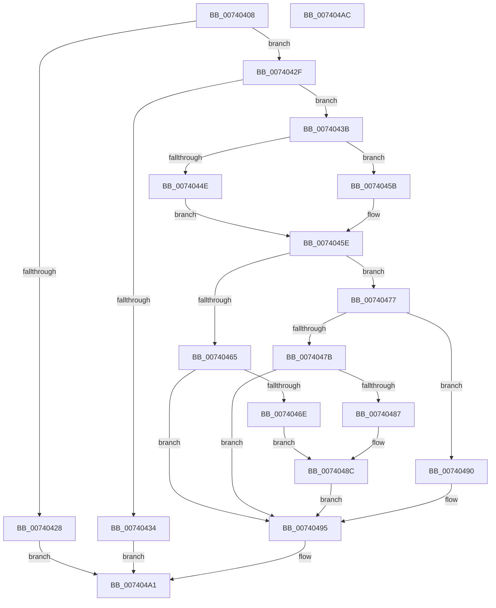

# PnpIommuBlockUnblockDevice

- RVA: `0x00740408`–`0x007404AD` (길이 `165` bytes)
- VA: `0x0000000140740408`
- 실행 섹션: `PAGE`
- PDB 이름 있음: `예`; PDB Function 태그: `아니요`
- unwind 정보 RVA: `0x0005CAAC`
- 디코드: `48`개 명령, `165/165` bytes 표시
- 미해석 바이트: `0` (있으면 어셈블리에 `.byte`로 보존)

> 이 문서는 커널 이미지의 기계어와 PDB 기호를 분석해 생성했습니다. 4번과 5번은 함수 원형과 자료형을 바이너리 사용 방식에서 추정한 C 해석이며 원본 소스 복구 결과는 아닙니다.

## 1. Dependencies

- 직접 호출 지점: **4**; 고유 호출 대상: **4**
- 직접 호출자로 확인된 함수: **1**
- RIP 상대 이미지 참조: **0**

### Outgoing calls
- `0x00740440` → [PpDevNodeLockTree](../A1/PpDevNodeLockTree_function_00A19310.md) (function, `0x00A19310`)
- `0x00740470` → [PiIommuUnblockDevice](../AA/PiIommuUnblockDevice_function_00AADEFC.md) (function, `0x00AADEFC`)
- `0x00740487` → [PiIommuBlockDevice](PiIommuBlockDevice_function_00740178.md) (function, `0x00740178`)
- `0x0074049A` → [PpDevNodeUnlockTree](../A2/PpDevNodeUnlockTree_function_00A21290.md) (function, `0x00A21290`)

### Direct callers
- [NtSetSystemInformation](../AF/NtSetSystemInformation_function_00AF4A60.md) at `0x00AF6784`

### Static image references
- 디코드된 RIP-relative 메모리 참조가 없습니다.

## 2. Other-region calls and transfers

- 다른 실행 섹션으로 향하는 call: **0**
- 별도 외부 분기/꼬리 이동을 확인하지 못했습니다.

## 3. Assembly (complete function range)

```asm
00740408  48 89 5C 24 08                  mov qword ptr [rsp + 8], rbx
0074040D  57                              push rdi
0074040E  48 83 EC 20                     sub rsp, 0x20
00740412  65 48 8B 04 25 88 01 00 00      mov rax, qword ptr gs:[0x188]
0074041B  33 DB                           xor ebx, ebx
0074041D  48 8B F9                        mov rdi, rcx
00740420  38 98 32 02 00 00               cmp byte ptr [rax + 0x232], bl
00740426  74 07                           je 0x14074042f
00740428  B8 BB 00 00 C0                  mov eax, 0xc00000bb
0074042D  EB 72                           jmp 0x1407404a1
0074042F  83 FA 10                        cmp edx, 0x10
00740432  74 07                           je 0x14074043b
00740434  B8 04 00 00 C0                  mov eax, 0xc0000004
00740439  EB 66                           jmp 0x1407404a1
0074043B  B9 01 00 00 00                  mov ecx, 1
00740440  E8 CB 8E 2D 00                  call 0x140a19310
00740445  48 8B 47 08                     mov rax, qword ptr [rdi + 8]
00740449  48 85 C0                        test rax, rax
0074044C  74 0D                           je 0x14074045b
0074044E  48 8B 80 38 01 00 00            mov rax, qword ptr [rax + 0x138]
00740455  48 8B 48 28                     mov rcx, qword ptr [rax + 0x28]
00740459  EB 03                           jmp 0x14074045e
0074045B  48 8B CB                        mov rcx, rbx
0074045E  8B 07                           mov eax, dword ptr [rdi]
00740460  83 F8 01                        cmp eax, 1
00740463  75 12                           jne 0x140740477
00740465  48 39 99 D0 02 00 00            cmp qword ptr [rcx + 0x2d0], rbx
0074046C  74 27                           je 0x140740495
0074046E  8A D0                           mov dl, al
00740470  E8 87 DA 36 00                  call 0x140aadefc
00740475  EB 15                           jmp 0x14074048c
00740477  85 C0                           test eax, eax
00740479  75 15                           jne 0x140740490
0074047B  48 8B 89 D0 02 00 00            mov rcx, qword ptr [rcx + 0x2d0]
00740482  48 85 C9                        test rcx, rcx
00740485  74 0E                           je 0x140740495
00740487  E8 EC FC FF FF                  call 0x140740178
0074048C  8B D8                           mov ebx, eax
0074048E  EB 05                           jmp 0x140740495
00740490  BB BB 00 00 C0                  mov ebx, 0xc00000bb
00740495  B9 01 00 00 00                  mov ecx, 1
0074049A  E8 F1 0D 2E 00                  call 0x140a21290
0074049F  8B C3                           mov eax, ebx
007404A1  48 8B 5C 24 30                  mov rbx, qword ptr [rsp + 0x30]
007404A6  48 83 C4 20                     add rsp, 0x20
007404AA  5F                              pop rdi
007404AB  C3                              ret
007404AC  CC                              int3
```

## 4. C-style interpretation (structured pseudocode)

```c
__int64 __fastcall PnpIommuBlockUnblockDevice(__int64 a1, int a2)
{
    __int64 result;
    __int64 v_rbx;
    __int64 v_rsp;
    unsigned __int64 v_stack_p8;

    v_stack_p8 = v_rbx;
    v_rsp = (v_rsp) - (32);
    v_rbx = 0;
    if ((*(unsigned __int8 *)(*(unsigned __int64 *)(gs_base + (0 + 392)) + 562)) == 0) goto loc_0074042F;
    goto loc_007404A1;
loc_0074042F:
    if (a2 == 16) goto loc_0074043B;
    goto loc_007404A1;
loc_0074043B:
    result = PpDevNodeLockTree(1, a2, a3, a4);
    if (*(unsigned __int64 *)(a1 + 8) == 0) goto loc_0074045B;
    goto loc_0074045E;
loc_0074045B:
loc_0074045E:
    if (((unsigned int)((unsigned int)(*(unsigned int *)(a1)))) != 1) goto loc_00740477;
    if ((*(unsigned __int64 *)(0 + 720)) == 0) goto loc_00740495;
    result = PiIommuUnblockDevice(0, (unsigned __int8)((unsigned int)(*(unsigned int *)(a1))), a3, a4);
    goto loc_0074048C;
loc_00740477:
    if ((unsigned int)(result) != 0) goto loc_00740490;
    if (*(unsigned __int64 *)(0 + 720) == 0) goto loc_00740495;
    result = PiIommuBlockDevice(*(unsigned __int64 *)(0 + 720), (unsigned __int8)((unsigned int)(*(unsigned int *)(a1))), a3, a4);
loc_0074048C:
    goto loc_00740495;
loc_00740490:
loc_00740495:
    result = PpDevNodeUnlockTree(1, (unsigned __int8)((unsigned int)(*(unsigned int *)(a1))), a3, a4);
loc_007404A1:
    v_rsp = (v_rsp) + (32);
    return (unsigned int)((unsigned int)((unsigned int)(0xC00000BBULL)));
}
```

## 5. (Beta) C Style

```c
int64_t PnpIommuBlockUnblockDevice(void *Arg1, int32_t Arg2)
{
    uint8_t *arg1 = (uint8_t *)Arg1;

    int64_t result;
    int64_t local_rbx;
    int64_t local_rsp;
    uint64_t v_stack_p8;

    v_stack_p8 = local_rbx;
    local_rsp = (local_rsp) - (32);
    local_rbx = 0;
    if ((*(uint8_t *)(*(uint64_t *)(gs_base + (0 + 0x188)) + 0x232)) == 0) goto loc_0074042F;
    goto loc_007404A1;
loc_0074042F:
    if (Arg2 == 16) goto loc_0074043B;
    goto loc_007404A1;
loc_0074043B:
    result = PpDevNodeLockTree(1, Arg2, a3, a4);
    if (*(uint64_t *)(arg1 + 0x8) == 0) goto loc_0074045B;
    goto loc_0074045E;
loc_0074045B:
loc_0074045E:
    if (((uint32_t)((uint32_t)(*(uint32_t *)(arg1)))) != 1) goto loc_00740477;
    if ((*(uint64_t *)(0 + 0x2D0)) == 0) goto loc_00740495;
    result = PiIommuUnblockDevice(0, (uint8_t)((uint32_t)(*(uint32_t *)(arg1))), a3, a4);
    goto loc_0074048C;
loc_00740477:
    if ((uint32_t)(result) != 0) goto loc_00740490;
    if (*(uint64_t *)(0 + 0x2D0) == 0) goto loc_00740495;
    result = PiIommuBlockDevice(*(uint64_t *)(0 + 0x2D0), (uint8_t)((uint32_t)(*(uint32_t *)(arg1))), a3, a4);
loc_0074048C:
    goto loc_00740495;
loc_00740490:
loc_00740495:
    result = PpDevNodeUnlockTree(1, (uint8_t)((uint32_t)(*(uint32_t *)(arg1))), a3, a4);
loc_007404A1:
    local_rsp = (local_rsp) + (32);
    return (uint32_t)((uint32_t)((uint32_t)(0xC00000BBULL)));
}
```

### 관측된 메모리 오프셋

구조체 형식이 확인되지 않은 접근은 인자 기준의 오프셋으로만 기록했습니다.

| 기준 인자 | 오프셋 표현 | 폭 (bit) | 접근 |
|---|---:|---:|---|
| `Arg1` | `+ 0x0` | `32` | `R` |
| `Arg1` | `+ 0x8` | `64` | `R` |

## 6. Execution-region graph

[열기: 2D/3D 그래프와 함수 탐색 컨트롤 패널](../../../control-panel.html?section=page&rva=0x00740408&view=graph)

- 2D 그래프는 위에서 아래로 흐르고, 3D 그래프는 빈 공간을 드래그해 회전합니다. Shift+드래그는 이동, 휠은 확대·축소, 함수 노드 선택은 대상 보고서 이동입니다.

### Static fallback


