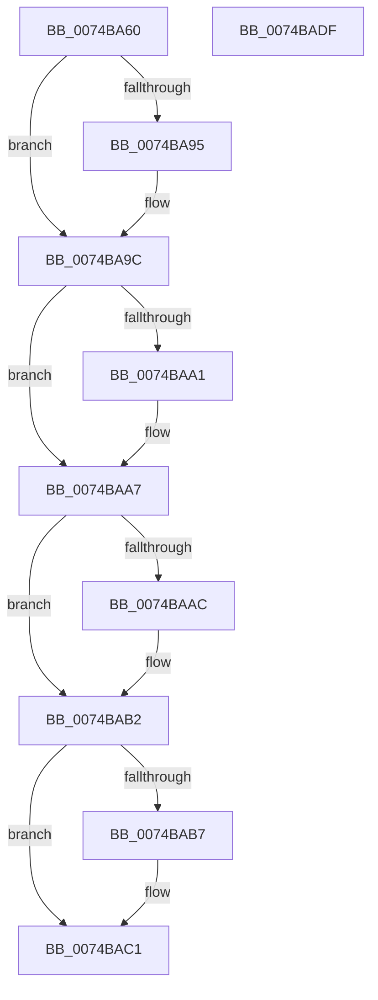

# Win7PsGetVersion

- RVA: `0x0074BA60`–`0x0074BAE0` (길이 `128` bytes)
- VA: `0x000000014074BA60`
- 실행 섹션: `PAGE`
- PDB 이름 있음: `예`; PDB Function 태그: `아니요`
- unwind 정보 RVA: `0x0005E6B4`
- 디코드: `37`개 명령, `128/128` bytes 표시
- 미해석 바이트: `0` (있으면 어셈블리에 `.byte`로 보존)

> 이 문서는 커널 이미지의 기계어와 PDB 기호를 분석해 생성했습니다. 4번과 5번은 함수 원형과 자료형을 바이너리 사용 방식에서 추정한 C 해석이며 원본 소스 복구 결과는 아닙니다.

## 1. Dependencies

- 직접 호출 지점: **2**; 고유 호출 대상: **2**
- 직접 호출자로 확인된 함수: **0**
- RIP 상대 이미지 참조: **0**

### Outgoing calls
- `0x0074BA88` → [PsGetVersion](../../text/49/PsGetVersion_function_00495AB0.md) (function, `0x00495AB0`)
- `0x0074BABC` → [RtlInitUnicodeString](../../text/42/RtlInitUnicodeString_function_0042A780.md) (function, `0x0042A780`)

### Direct callers
- 이 함수 시작 RVA로 연결되는 직접 call은 확인되지 않았습니다. 간접 호출은 완전히 역산할 수 없습니다.

### Static image references
- 디코드된 RIP-relative 메모리 참조가 없습니다.

## 2. Other-region calls and transfers

- 다른 실행 섹션으로 향하는 call: **2**
  - `0x0074BA88` → [PsGetVersion](../../text/49/PsGetVersion_function_00495AB0.md) (`PAGE` → `.text`)
  - `0x0074BABC` → [RtlInitUnicodeString](../../text/42/RtlInitUnicodeString_function_0042A780.md) (`PAGE` → `.text`)
- 별도 외부 분기/꼬리 이동을 확인하지 못했습니다.

## 3. Assembly (complete function range)

```asm
0074BA60  48 8B C4                        mov rax, rsp
0074BA63  48 89 58 08                     mov qword ptr [rax + 8], rbx
0074BA67  48 89 68 10                     mov qword ptr [rax + 0x10], rbp
0074BA6B  48 89 70 18                     mov qword ptr [rax + 0x18], rsi
0074BA6F  48 89 78 20                     mov qword ptr [rax + 0x20], rdi
0074BA73  41 56                           push r14
0074BA75  48 83 EC 20                     sub rsp, 0x20
0074BA79  49 8B F1                        mov rsi, r9
0074BA7C  49 8B D8                        mov rbx, r8
0074BA7F  45 33 C9                        xor r9d, r9d
0074BA82  48 8B FA                        mov rdi, rdx
0074BA85  4C 8B F1                        mov r14, rcx
0074BA88  E8 23 A0 D4 FF                  call 0x140495ab0
0074BA8D  40 8A E8                        mov bpl, al
0074BA90  4D 85 F6                        test r14, r14
0074BA93  74 07                           je 0x14074ba9c
0074BA95  41 C7 06 06 00 00 00            mov dword ptr [r14], 6
0074BA9C  48 85 FF                        test rdi, rdi
0074BA9F  74 06                           je 0x14074baa7
0074BAA1  C7 07 01 00 00 00               mov dword ptr [rdi], 1
0074BAA7  48 85 DB                        test rbx, rbx
0074BAAA  74 06                           je 0x14074bab2
0074BAAC  C7 03 B0 1D 00 00               mov dword ptr [rbx], 0x1db0
0074BAB2  48 85 F6                        test rsi, rsi
0074BAB5  74 0A                           je 0x14074bac1
0074BAB7  33 D2                           xor edx, edx
0074BAB9  48 8B CE                        mov rcx, rsi
0074BABC  E8 BF EC CD FF                  call 0x14042a780
0074BAC1  48 8B 5C 24 30                  mov rbx, qword ptr [rsp + 0x30]
0074BAC6  40 8A C5                        mov al, bpl
0074BAC9  48 8B 6C 24 38                  mov rbp, qword ptr [rsp + 0x38]
0074BACE  48 8B 74 24 40                  mov rsi, qword ptr [rsp + 0x40]
0074BAD3  48 8B 7C 24 48                  mov rdi, qword ptr [rsp + 0x48]
0074BAD8  48 83 C4 20                     add rsp, 0x20
0074BADC  41 5E                           pop r14
0074BADE  C3                              ret
0074BADF  CC                              int3
```

## 4. C-style interpretation (structured pseudocode)

```c
__int64 __fastcall Win7PsGetVersion(__int64 a1, __int64 a2, __int64 a3, __int64 a4)
{
    __int64 result;
    __int64 v_rsp;
    unsigned __int64 v_stack_p10;
    unsigned __int64 v_stack_p18;
    unsigned __int64 v_stack_p20;
    unsigned __int64 v_stack_p8;

    *(unsigned __int64 *)(v_rsp + 8) = v_rbx;
    *(unsigned __int64 *)(v_rsp + 16) = v_rbp;
    *(unsigned __int64 *)(v_rsp + 24) = v_rsi;
    *(unsigned __int64 *)(v_rsp + 32) = v_rdi;
    v_rsp = (v_rsp) - (32);
    a4 = 0;
    result = PsGetVersion(a1, a2, a3, a4);
    if (a1 != 0) {
        *(unsigned int *)(a1) = 6;
    }
    if (a2 != 0) {
        *(unsigned int *)(a2) = 1;
    }
    if (a3 != 0) {
        *(unsigned int *)(a3) = 0x1DB0ULL;
    }
    if (0 != 0) {
        a2 = 0;
        a1 = 0;
        result = RtlInitUnicodeString(a1, a2, a3, a4);
    }
    v_rsp = (v_rsp) + (32);
    return (unsigned __int8)((unsigned __int8)(result));
}
```

## 5. (Beta) C Style

```c
int64_t Win7PsGetVersion(int64_t Arg1, int64_t Arg2, int64_t Arg3, int64_t Arg4)
{
    int64_t result;
    int64_t local_rsp;
    uint64_t v_stack_p10;
    uint64_t v_stack_p18;
    uint64_t v_stack_p20;
    uint64_t v_stack_p8;

    *(uint64_t *)(local_rsp + 0x8) = local_rbx;
    *(uint64_t *)(local_rsp + 0x10) = local_rbp;
    *(uint64_t *)(local_rsp + 0x18) = local_rsi;
    *(uint64_t *)(local_rsp + 0x20) = local_rdi;
    local_rsp = (local_rsp) - (32);
    Arg4 = 0;
    result = PsGetVersion(Arg1, Arg2, Arg3, Arg4);
    if (Arg1 != 0) {
        *(uint32_t *)(Arg1) = 6;
    }
    if (Arg2 != 0) {
        *(uint32_t *)(Arg2) = 1;
    }
    if (Arg3 != 0) {
        *(uint32_t *)(Arg3) = 0x1DB0ULL;
    }
    if (0 != 0) {
        Arg2 = 0;
        Arg1 = 0;
        result = RtlInitUnicodeString(Arg1, Arg2, Arg3, Arg4);
    }
    local_rsp = (local_rsp) + (32);
    return (uint8_t)((uint8_t)(result));
}
```

## 6. Execution-region graph

[열기: 2D/3D 그래프와 함수 탐색 컨트롤 패널](../../../control-panel.html?section=page&rva=0x0074BA60&view=graph)

- 2D 그래프는 위에서 아래로 흐르고, 3D 그래프는 빈 공간을 드래그해 회전합니다. Shift+드래그는 이동, 휠은 확대·축소, 함수 노드 선택은 대상 보고서 이동입니다.

### Static fallback


