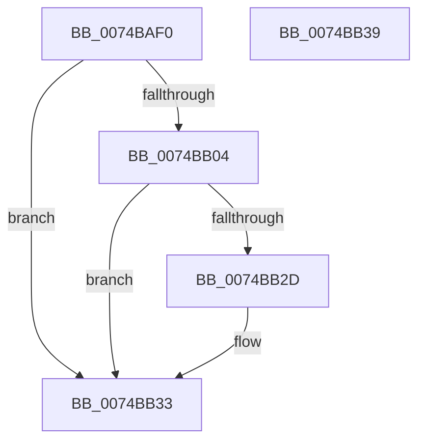

# Win7RtlGetVersion

- RVA: `0x0074BAF0`–`0x0074BB3A` (길이 `74` bytes)
- VA: `0x000000014074BAF0`
- 실행 섹션: `PAGE`
- PDB 이름 있음: `예`; PDB Function 태그: `아니요`
- unwind 정보 RVA: `0x0005CF00`
- 디코드: `20`개 명령, `74/74` bytes 표시
- 미해석 바이트: `0` (있으면 어셈블리에 `.byte`로 보존)

> 이 문서는 커널 이미지의 기계어와 PDB 기호를 분석해 생성했습니다. 4번과 5번은 함수 원형과 자료형을 바이너리 사용 방식에서 추정한 C 해석이며 원본 소스 복구 결과는 아닙니다.

## 1. Dependencies

- 직접 호출 지점: **1**; 고유 호출 대상: **1**
- 직접 호출자로 확인된 함수: **0**
- RIP 상대 이미지 참조: **0**

### Outgoing calls
- `0x0074BAF9` → [RtlGetVersion](../A1/RtlGetVersion_function_00A19110.md) (function, `0x00A19110`)

### Direct callers
- 이 함수 시작 RVA로 연결되는 직접 call은 확인되지 않았습니다. 간접 호출은 완전히 역산할 수 없습니다.

### Static image references
- 디코드된 RIP-relative 메모리 참조가 없습니다.

## 2. Other-region calls and transfers

- 다른 실행 섹션으로 향하는 call: **0**
- 별도 외부 분기/꼬리 이동을 확인하지 못했습니다.

## 3. Assembly (complete function range)

```asm
0074BAF0  40 53                           push rbx
0074BAF2  48 83 EC 20                     sub rsp, 0x20
0074BAF6  48 8B D9                        mov rbx, rcx
0074BAF9  E8 12 D6 2C 00                  call 0x140a19110
0074BAFE  33 C9                           xor ecx, ecx
0074BB00  85 C0                           test eax, eax
0074BB02  78 2F                           js 0x14074bb33
0074BB04  66 89 4B 14                     mov word ptr [rbx + 0x14], cx
0074BB08  8B 13                           mov edx, dword ptr [rbx]
0074BB0A  81 EA 1C 01 00 00               sub edx, 0x11c
0074BB10  C7 43 04 06 00 00 00            mov dword ptr [rbx + 4], 6
0074BB17  C7 43 08 01 00 00 00            mov dword ptr [rbx + 8], 1
0074BB1E  C7 43 0C B0 1D 00 00            mov dword ptr [rbx + 0xc], 0x1db0
0074BB25  F7 C2 F7 FF FF FF               test edx, 0xfffffff7
0074BB2B  75 06                           jne 0x14074bb33
0074BB2D  89 8B 14 01 00 00               mov dword ptr [rbx + 0x114], ecx
0074BB33  48 83 C4 20                     add rsp, 0x20
0074BB37  5B                              pop rbx
0074BB38  C3                              ret
0074BB39  CC                              int3
```

## 4. C-style interpretation (structured pseudocode)

```c
__int64 __fastcall Win7RtlGetVersion(__int64 a1)
{
    __int64 result;
    __int64 v_rsp;

    v_rsp = (v_rsp) - (32);
    result = RtlGetVersion(a1, a2, a3, a4);
    a1 = 0;
    if (sign_flag) goto loc_0074BB33;
    *(unsigned __int16 *)(a1 + 20) = 0;
    a2 = (unsigned int)(((unsigned int)(*(unsigned int *)(a1))) - (284));
    *(unsigned int *)(a1 + 4) = 6;
    *(unsigned int *)(a1 + 8) = 1;
    *(unsigned int *)(a1 + 12) = 0x1DB0ULL;
    if ((((unsigned int)(a2)) & (0xFFFFFFF7ULL)) == 0) {
        *(unsigned int *)(a1 + 276) = 0;
    }
    v_rsp = (v_rsp) + (32);
    return result;
}
```

## 5. (Beta) C Style

```c
int64_t Win7RtlGetVersion(void *Arg1)
{
    uint8_t *arg1 = (uint8_t *)Arg1;

    int64_t result;
    int64_t local_rsp;

    local_rsp = (local_rsp) - (32);
    result = RtlGetVersion(Arg1, a2, a3, a4);
    Arg1 = 0;
    if (sign_flag) goto loc_0074BB33;
    *(uint16_t *)(arg1 + 0x14) = 0;
    a2 = (uint32_t)(((uint32_t)(*(uint32_t *)(arg1))) - (284));
    *(uint32_t *)(arg1 + 0x4) = 6;
    *(uint32_t *)(arg1 + 0x8) = 1;
    *(uint32_t *)(arg1 + 0xC) = 0x1DB0ULL;
    if ((((uint32_t)(a2)) & (0xFFFFFFF7ULL)) == 0) {
        *(uint32_t *)(arg1 + 0x114) = 0;
    }
    local_rsp = (local_rsp) + (32);
    return result;
}
```

### 관측된 메모리 오프셋

구조체 형식이 확인되지 않은 접근은 인자 기준의 오프셋으로만 기록했습니다.

| 기준 인자 | 오프셋 표현 | 폭 (bit) | 접근 |
|---|---:|---:|---|
| `Arg1` | `+ 0x0` | `32` | `R` |
| `Arg1` | `+ 0x4` | `32` | `W` |
| `Arg1` | `+ 0x8` | `32` | `W` |
| `Arg1` | `+ 0xC` | `32` | `W` |
| `Arg1` | `+ 0x14` | `16` | `W` |
| `Arg1` | `+ 0x114` | `32` | `W` |

## 6. Execution-region graph

[열기: 2D/3D 그래프와 함수 탐색 컨트롤 패널](../../../control-panel.html?section=page&rva=0x0074BAF0&view=graph)

- 2D 그래프는 위에서 아래로 흐르고, 3D 그래프는 빈 공간을 드래그해 회전합니다. Shift+드래그는 이동, 휠은 확대·축소, 함수 노드 선택은 대상 보고서 이동입니다.

### Static fallback


