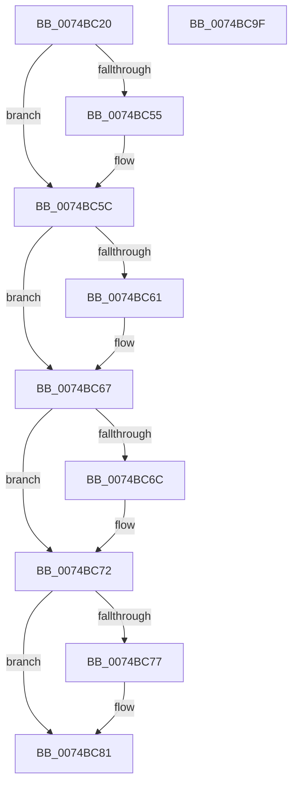

# Win8PsGetVersion

- RVA: `0x0074BC20`–`0x0074BCA0` (길이 `128` bytes)
- VA: `0x000000014074BC20`
- 실행 섹션: `PAGE`
- PDB 이름 있음: `예`; PDB Function 태그: `아니요`
- unwind 정보 RVA: `0x0005E6B4`
- 디코드: `37`개 명령, `128/128` bytes 표시
- 미해석 바이트: `0` (있으면 어셈블리에 `.byte`로 보존)

> 이 문서는 커널 이미지의 기계어와 PDB 기호를 분석해 생성했습니다. 4번과 5번은 함수 원형과 자료형을 바이너리 사용 방식에서 추정한 C 해석이며 원본 소스 복구 결과는 아닙니다.

## 1. Dependencies

- 직접 호출 지점: **2**; 고유 호출 대상: **2**
- 직접 호출자로 확인된 함수: **0**
- RIP 상대 이미지 참조: **0**

### Outgoing calls
- `0x0074BC48` → [PsGetVersion](../../text/49/PsGetVersion_function_00495AB0.md) (function, `0x00495AB0`)
- `0x0074BC7C` → [RtlInitUnicodeString](../../text/42/RtlInitUnicodeString_function_0042A780.md) (function, `0x0042A780`)

### Direct callers
- 이 함수 시작 RVA로 연결되는 직접 call은 확인되지 않았습니다. 간접 호출은 완전히 역산할 수 없습니다.

### Static image references
- 디코드된 RIP-relative 메모리 참조가 없습니다.

## 2. Other-region calls and transfers

- 다른 실행 섹션으로 향하는 call: **2**
  - `0x0074BC48` → [PsGetVersion](../../text/49/PsGetVersion_function_00495AB0.md) (`PAGE` → `.text`)
  - `0x0074BC7C` → [RtlInitUnicodeString](../../text/42/RtlInitUnicodeString_function_0042A780.md) (`PAGE` → `.text`)
- 별도 외부 분기/꼬리 이동을 확인하지 못했습니다.

## 3. Assembly (complete function range)

```asm
0074BC20  48 8B C4                        mov rax, rsp
0074BC23  48 89 58 08                     mov qword ptr [rax + 8], rbx
0074BC27  48 89 68 10                     mov qword ptr [rax + 0x10], rbp
0074BC2B  48 89 70 18                     mov qword ptr [rax + 0x18], rsi
0074BC2F  48 89 78 20                     mov qword ptr [rax + 0x20], rdi
0074BC33  41 56                           push r14
0074BC35  48 83 EC 20                     sub rsp, 0x20
0074BC39  49 8B F1                        mov rsi, r9
0074BC3C  49 8B D8                        mov rbx, r8
0074BC3F  45 33 C9                        xor r9d, r9d
0074BC42  48 8B FA                        mov rdi, rdx
0074BC45  4C 8B F1                        mov r14, rcx
0074BC48  E8 63 9E D4 FF                  call 0x140495ab0
0074BC4D  40 8A E8                        mov bpl, al
0074BC50  4D 85 F6                        test r14, r14
0074BC53  74 07                           je 0x14074bc5c
0074BC55  41 C7 06 06 00 00 00            mov dword ptr [r14], 6
0074BC5C  48 85 FF                        test rdi, rdi
0074BC5F  74 06                           je 0x14074bc67
0074BC61  C7 07 02 00 00 00               mov dword ptr [rdi], 2
0074BC67  48 85 DB                        test rbx, rbx
0074BC6A  74 06                           je 0x14074bc72
0074BC6C  C7 03 F0 23 00 00               mov dword ptr [rbx], 0x23f0
0074BC72  48 85 F6                        test rsi, rsi
0074BC75  74 0A                           je 0x14074bc81
0074BC77  33 D2                           xor edx, edx
0074BC79  48 8B CE                        mov rcx, rsi
0074BC7C  E8 FF EA CD FF                  call 0x14042a780
0074BC81  48 8B 5C 24 30                  mov rbx, qword ptr [rsp + 0x30]
0074BC86  40 8A C5                        mov al, bpl
0074BC89  48 8B 6C 24 38                  mov rbp, qword ptr [rsp + 0x38]
0074BC8E  48 8B 74 24 40                  mov rsi, qword ptr [rsp + 0x40]
0074BC93  48 8B 7C 24 48                  mov rdi, qword ptr [rsp + 0x48]
0074BC98  48 83 C4 20                     add rsp, 0x20
0074BC9C  41 5E                           pop r14
0074BC9E  C3                              ret
0074BC9F  CC                              int3
```

## 4. C-style interpretation (structured pseudocode)

```c
__int64 __fastcall Win8PsGetVersion(__int64 a1, __int64 a2, __int64 a3, __int64 a4)
{
    __int64 result;
    __int64 v_rsp;
    unsigned __int64 v_stack_p10;
    unsigned __int64 v_stack_p18;
    unsigned __int64 v_stack_p20;
    unsigned __int64 v_stack_p8;

    *(unsigned __int64 *)(v_rsp + 8) = v_rbx;
    *(unsigned __int64 *)(v_rsp + 16) = v_rbp;
    *(unsigned __int64 *)(v_rsp + 24) = v_rsi;
    *(unsigned __int64 *)(v_rsp + 32) = v_rdi;
    v_rsp = (v_rsp) - (32);
    a4 = 0;
    result = PsGetVersion(a1, a2, a3, a4);
    if (a1 != 0) {
        *(unsigned int *)(a1) = 6;
    }
    if (a2 != 0) {
        *(unsigned int *)(a2) = 2;
    }
    if (a3 != 0) {
        *(unsigned int *)(a3) = 0x23F0ULL;
    }
    if (0 != 0) {
        a2 = 0;
        a1 = 0;
        result = RtlInitUnicodeString(a1, a2, a3, a4);
    }
    v_rsp = (v_rsp) + (32);
    return (unsigned __int8)((unsigned __int8)(result));
}
```

## 5. (Beta) C Style

```c
int64_t Win8PsGetVersion(int64_t Arg1, int64_t Arg2, int64_t Arg3, int64_t Arg4)
{
    int64_t result;
    int64_t local_rsp;
    uint64_t v_stack_p10;
    uint64_t v_stack_p18;
    uint64_t v_stack_p20;
    uint64_t v_stack_p8;

    *(uint64_t *)(local_rsp + 0x8) = local_rbx;
    *(uint64_t *)(local_rsp + 0x10) = local_rbp;
    *(uint64_t *)(local_rsp + 0x18) = local_rsi;
    *(uint64_t *)(local_rsp + 0x20) = local_rdi;
    local_rsp = (local_rsp) - (32);
    Arg4 = 0;
    result = PsGetVersion(Arg1, Arg2, Arg3, Arg4);
    if (Arg1 != 0) {
        *(uint32_t *)(Arg1) = 6;
    }
    if (Arg2 != 0) {
        *(uint32_t *)(Arg2) = 2;
    }
    if (Arg3 != 0) {
        *(uint32_t *)(Arg3) = 0x23F0ULL;
    }
    if (0 != 0) {
        Arg2 = 0;
        Arg1 = 0;
        result = RtlInitUnicodeString(Arg1, Arg2, Arg3, Arg4);
    }
    local_rsp = (local_rsp) + (32);
    return (uint8_t)((uint8_t)(result));
}
```

## 6. Execution-region graph

[열기: 2D/3D 그래프와 함수 탐색 컨트롤 패널](../../../control-panel.html?section=page&rva=0x0074BC20&view=graph)

- 2D 그래프는 위에서 아래로 흐르고, 3D 그래프는 빈 공간을 드래그해 회전합니다. Shift+드래그는 이동, 휠은 확대·축소, 함수 노드 선택은 대상 보고서 이동입니다.

### Static fallback


