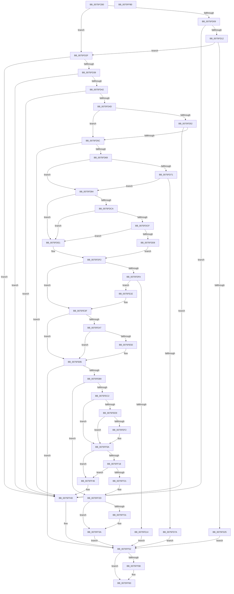

# NtInitiatePowerAction

- RVA: `0x0075FCB0`–`0x0075FF81` (길이 `721` bytes)
- VA: `0x000000014075FCB0`
- 실행 섹션: `PAGE`
- PDB 이름 있음: `예`; PDB Function 태그: `아니요`
- unwind 정보 RVA: `0x000AD928`
- 디코드: `193`개 명령, `721/721` bytes 표시
- 미해석 바이트: `0` (있으면 어셈블리에 `.byte`로 보존)

> 이 문서는 커널 이미지의 기계어와 PDB 기호를 분석해 생성했습니다. 4번과 5번은 함수 원형과 자료형을 바이너리 사용 방식에서 추정한 C 해석이며 원본 소스 복구 결과는 아닙니다.

## 1. Dependencies

- 직접 호출 지점: **19**; 고유 호출 대상: **16**
- 직접 호출자로 확인된 함수: **2**
- RIP 상대 이미지 참조: **7**

### Outgoing calls
- `0x0075FD1C` → [SeSinglePrivilegeCheck](../87/SeSinglePrivilegeCheck_function_00871E20.md) (function, `0x00871E20`)
- `0x0075FD71` → [PsIsCurrentThreadInServerSilo](../../text/43/PsIsCurrentThreadInServerSilo_function_004362E0.md) (function, `0x004362E0`)
- `0x0075FDAE` → [PoCaptureReasonContext](../../text/23/PoCaptureReasonContext_function_00230A38.md) (function, `0x00230A38`)
- `0x0075FDED` → [PopDiagTracePolicyInitiatePowerActionApiCall](../AC/PopDiagTracePolicyInitiatePowerActionApiCall_function_00AC139C.md) (function, `0x00AC139C`)
- `0x0075FE07` → [ExAllocatePool2](../../poolcode/B8/ExAllocatePool2_function_00B820F0.md) (function, `0x00B820F0`)
- `0x0075FE32` → [KeInitializeEvent](../../text/40/KeInitializeEvent_function_0040DD10.md) (function, `0x0040DD10`)
- `0x0075FE57` → [PopAcquireRwLockExclusive](../../text/43/PopAcquireRwLockExclusive_function_00430B44.md) (function, `0x00430B44`)
- `0x0075FE74` → [PopBsdHandleRequest](../../text/4B/PopBsdHandleRequest_function_004B27A0.md) (function, `0x004B27A0`)
- `0x0075FE80` → [PopReleaseRwLock](../../text/2D/PopReleaseRwLock_function_002DFBBC.md) (function, `0x002DFBBC`)
- `0x0075FE85` → [PopAcquirePolicyLock](../../pagelk/B7/PopAcquirePolicyLock_function_00B783C0.md) (function, `0x00B783C0`)
- `0x0075FE9F` → [PopExecutePowerAction](PopExecutePowerAction_function_0075E6B4.md) (function, `0x0075E6B4`)
- `0x0075FEA4` → [PopReleasePolicyLock](../../pagelk/B7/PopReleasePolicyLock_function_00B78410.md) (function, `0x00B78410`)
- `0x0075FEAB` → [PopThermalEventTransitionEnableDeepSleep](../../text/4F/PopThermalEventTransitionEnableDeepSleep_function_004FB584.md) (function, `0x004FB584`)
- `0x0075FEDB` → [KeWaitForSingleObject](../../text/20/KeWaitForSingleObject_function_0020E6B0.md) (function, `0x0020E6B0`)
- `0x0075FF03` → [KeWaitForSingleObject](../../text/20/KeWaitForSingleObject_function_0020E6B0.md) (function, `0x0020E6B0`)
- `0x0075FF0A` → [PopAcquirePolicyLock](../../pagelk/B7/PopAcquirePolicyLock_function_00B783C0.md) (function, `0x00B783C0`)
- `0x0075FF28` → [PopReleasePolicyLock](../../pagelk/B7/PopReleasePolicyLock_function_00B78410.md) (function, `0x00B78410`)
- `0x0075FF3F` → [ExFreePoolWithTag](../../poolcode/B8/ExFreePoolWithTag_function_00B82870.md) (function, `0x00B82870`)
- `0x0075FF5B` → [PoDestroyReasonContext](../../text/23/PoDestroyReasonContext_function_00230944.md) (function, `0x00230944`)

### Direct callers
- [IopWarmEjectDevice](../74/IopWarmEjectDevice_function_007405EC.md) at `0x0074063D`
- [PopCheckPowerSourceAfterRtcWakeTimerWorker](../../pagelk/B7/PopCheckPowerSourceAfterRtcWakeTimerWorker_function_00B70AB0.md) at `0x00B70B0F`

### Static image references
- `0x0075FD12` → RVA `0x00FD9B30` (`PAGEDATA`; read)
- `0x0075FE47` → RVA `0x00E67418` (`.data`; read)
- `0x0075FE50` → RVA `0x00F0F1E0` (`.data`; read)
- `0x0075FE5C` → RVA `0x00F0BD54` (`.data`; read)
- `0x0075FE67` → RVA `0x00E67418` (`.data`; read/write)
- `0x0075FE6E` → RVA `0x00E673F0` (`.data`; write)
- `0x0075FEE9` → RVA `0x00F0BD41` (`.data`; read)

## 2. Other-region calls and transfers

- 다른 실행 섹션으로 향하는 call: **16**
  - `0x0075FD71` → [PsIsCurrentThreadInServerSilo](../../text/43/PsIsCurrentThreadInServerSilo_function_004362E0.md) (`PAGE` → `.text`)
  - `0x0075FDAE` → [PoCaptureReasonContext](../../text/23/PoCaptureReasonContext_function_00230A38.md) (`PAGE` → `.text`)
  - `0x0075FE07` → [ExAllocatePool2](../../poolcode/B8/ExAllocatePool2_function_00B820F0.md) (`PAGE` → `POOLCODE`)
  - `0x0075FE32` → [KeInitializeEvent](../../text/40/KeInitializeEvent_function_0040DD10.md) (`PAGE` → `.text`)
  - `0x0075FE57` → [PopAcquireRwLockExclusive](../../text/43/PopAcquireRwLockExclusive_function_00430B44.md) (`PAGE` → `.text`)
  - `0x0075FE74` → [PopBsdHandleRequest](../../text/4B/PopBsdHandleRequest_function_004B27A0.md) (`PAGE` → `.text`)
  - `0x0075FE80` → [PopReleaseRwLock](../../text/2D/PopReleaseRwLock_function_002DFBBC.md) (`PAGE` → `.text`)
  - `0x0075FE85` → [PopAcquirePolicyLock](../../pagelk/B7/PopAcquirePolicyLock_function_00B783C0.md) (`PAGE` → `PAGELK`)
  - `0x0075FEA4` → [PopReleasePolicyLock](../../pagelk/B7/PopReleasePolicyLock_function_00B78410.md) (`PAGE` → `PAGELK`)
  - `0x0075FEAB` → [PopThermalEventTransitionEnableDeepSleep](../../text/4F/PopThermalEventTransitionEnableDeepSleep_function_004FB584.md) (`PAGE` → `.text`)
  - `0x0075FEDB` → [KeWaitForSingleObject](../../text/20/KeWaitForSingleObject_function_0020E6B0.md) (`PAGE` → `.text`)
  - `0x0075FF03` → [KeWaitForSingleObject](../../text/20/KeWaitForSingleObject_function_0020E6B0.md) (`PAGE` → `.text`)
  - `0x0075FF0A` → [PopAcquirePolicyLock](../../pagelk/B7/PopAcquirePolicyLock_function_00B783C0.md) (`PAGE` → `PAGELK`)
  - `0x0075FF28` → [PopReleasePolicyLock](../../pagelk/B7/PopReleasePolicyLock_function_00B78410.md) (`PAGE` → `PAGELK`)
  - `0x0075FF3F` → [ExFreePoolWithTag](../../poolcode/B8/ExFreePoolWithTag_function_00B82870.md) (`PAGE` → `POOLCODE`)
  - `0x0075FF5B` → [PoDestroyReasonContext](../../text/23/PoDestroyReasonContext_function_00230944.md) (`PAGE` → `.text`)
- 별도 외부 분기/꼬리 이동을 확인하지 못했습니다.

## 3. Assembly (complete function range)

```asm
0075FCB0  48 89 5C 24 08                  mov qword ptr [rsp + 8], rbx
0075FCB5  48 89 74 24 10                  mov qword ptr [rsp + 0x10], rsi
0075FCBA  48 89 7C 24 18                  mov qword ptr [rsp + 0x18], rdi
0075FCBF  55                              push rbp
0075FCC0  41 54                           push r12
0075FCC2  41 55                           push r13
0075FCC4  41 56                           push r14
0075FCC6  41 57                           push r15
0075FCC8  48 8B EC                        mov rbp, rsp
0075FCCB  48 83 EC 70                     sub rsp, 0x70
0075FCCF  83 4D C4 FF                     or dword ptr [rbp - 0x3c], 0xffffffff
0075FCD3  0F 57 C0                        xorps xmm0, xmm0
0075FCD6  0F 11 45 D8                     movups xmmword ptr [rbp - 0x28], xmm0
0075FCDA  C7 45 C0 00 D1 97 A6            mov dword ptr [rbp - 0x40], 0xa697d100
0075FCE1  33 DB                           xor ebx, ebx
0075FCE3  0F 11 45 E8                     movups xmmword ptr [rbp - 0x18], xmm0
0075FCE7  65 48 8B 04 25 88 01 00 00      mov rax, qword ptr gs:[0x188]
0075FCF0  45 8A E9                        mov r13b, r9b
0075FCF3  45 8B F0                        mov r14d, r8d
0075FCF6  44 8B FA                        mov r15d, edx
0075FCF9  8B F1                           mov esi, ecx
0075FCFB  8B FB                           mov edi, ebx
0075FCFD  44 8A A0 32 02 00 00            mov r12b, byte ptr [rax + 0x232]
0075FD04  45 84 E4                        test r12b, r12b
0075FD07  74 26                           je 0x14075fd2f
0075FD09  83 F9 07                        cmp ecx, 7
0075FD0C  0F 84 3B 02 00 00               je 0x14075ff4d
0075FD12  48 8B 0D 17 9E 87 00            mov rcx, qword ptr [rip + 0x879e17]
0075FD19  41 8A D4                        mov dl, r12b
0075FD1C  E8 FF 20 11 00                  call 0x140871e20
0075FD21  84 C0                           test al, al
0075FD23  75 0A                           jne 0x14075fd2f
0075FD25  BB 61 00 00 C0                  mov ebx, 0xc0000061
0075FD2A  E9 23 02 00 00                  jmp 0x14075ff52
0075FD2F  41 83 FF 07                     cmp r15d, 7
0075FD33  0F 8F 14 02 00 00               jg 0x14075ff4d
0075FD39  83 FE 07                        cmp esi, 7
0075FD3C  0F 8F 0B 02 00 00               jg 0x14075ff4d
0075FD42  41 0F BA E6 1C                  bt r14d, 0x1c
0075FD47  0F 82 00 02 00 00               jb 0x14075ff4d
0075FD4D  83 FE 02                        cmp esi, 2
0075FD50  75 0A                           jne 0x14075fd5c
0075FD52  41 83 FF 05                     cmp r15d, 5
0075FD56  0F 8D F1 01 00 00               jge 0x14075ff4d
0075FD5C  41 F7 C6 C0 FF FF 0C            test r14d, 0xcffffc0
0075FD63  0F 85 E4 01 00 00               jne 0x14075ff4d
0075FD69  8D 46 FC                        lea eax, [rsi - 4]
0075FD6C  83 F8 02                        cmp eax, 2
0075FD6F  76 13                           jbe 0x14075fd84
0075FD71  E8 6A 65 CD FF                  call 0x1404362e0
0075FD76  84 C0                           test al, al
0075FD78  74 0A                           je 0x14075fd84
0075FD7A  BB BB 00 00 C0                  mov ebx, 0xc00000bb
0075FD7F  E9 CE 01 00 00                  jmp 0x14075ff52
0075FD84  48 8D 45 E8                     lea rax, [rbp - 0x18]
0075FD88  89 5D D0                        mov dword ptr [rbp - 0x30], ebx
0075FD8B  48 89 44 24 28                  mov qword ptr [rsp + 0x28], rax
0075FD90  45 33 C9                        xor r9d, r9d
0075FD93  45 33 C0                        xor r8d, r8d
0075FD96  48 89 5C 24 20                  mov qword ptr [rsp + 0x20], rbx
0075FD9B  41 8A D4                        mov dl, r12b
0075FD9E  89 75 C8                        mov dword ptr [rbp - 0x38], esi
0075FDA1  33 C9                           xor ecx, ecx
0075FDA3  44 89 75 CC                     mov dword ptr [rbp - 0x34], r14d
0075FDA7  C7 45 DC 80 00 00 00            mov dword ptr [rbp - 0x24], 0x80
0075FDAE  E8 85 0C AD FF                  call 0x140230a38
0075FDB3  8B D8                           mov ebx, eax
0075FDB5  33 C9                           xor ecx, ecx
0075FDB7  48 8B 45 E8                     mov rax, qword ptr [rbp - 0x18]
0075FDBB  85 DB                           test ebx, ebx
0075FDBD  48 0F 48 C1                     cmovs rax, rcx
0075FDC1  48 89 45 E8                     mov qword ptr [rbp - 0x18], rax
0075FDC5  45 84 E4                        test r12b, r12b
0075FDC8  75 17                           jne 0x14075fde1
0075FDCA  83 FE 06                        cmp esi, 6
0075FDCD  75 12                           jne 0x14075fde1
0075FDCF  41 F7 C6 00 00 00 03            test r14d, 0x3000000
0075FDD6  74 09                           je 0x14075fde1
0075FDD8  C7 45 D8 0F 00 00 00            mov dword ptr [rbp - 0x28], 0xf
0075FDDF  EB 11                           jmp 0x14075fdf2
0075FDE1  41 8B D7                        mov edx, r15d
0075FDE4  C7 45 D8 04 00 00 00            mov dword ptr [rbp - 0x28], 4
0075FDEB  8B CE                           mov ecx, esi
0075FDED  E8 AA 15 36 00                  call 0x140ac139c
0075FDF2  45 33 F6                        xor r14d, r14d
0075FDF5  45 84 ED                        test r13b, r13b
0075FDF8  75 45                           jne 0x14075fe3f
0075FDFA  41 8D 56 38                     lea edx, [r14 + 0x38]
0075FDFE  41 B8 50 41 63 57               mov r8d, 0x57634150
0075FE04  8D 4A 08                        lea ecx, [rdx + 8]
0075FE07  E8 E4 22 42 00                  call 0x140b820f0
0075FE0C  48 8B F8                        mov rdi, rax
0075FE0F  48 85 C0                        test rax, rax
0075FE12  75 0A                           jne 0x14075fe1e
0075FE14  BB 9A 00 00 C0                  mov ebx, 0xc000009a
0075FE19  E9 34 01 00 00                  jmp 0x14075ff52
0075FE1E  44 89 70 18                     mov dword ptr [rax + 0x18], r14d
0075FE22  45 33 C0                        xor r8d, r8d
0075FE25  48 8D 45 D8                     lea rax, [rbp - 0x28]
0075FE29  33 D2                           xor edx, edx
0075FE2B  48 8B CF                        mov rcx, rdi
0075FE2E  48 89 47 30                     mov qword ptr [rdi + 0x30], rax
0075FE32  E8 D9 DE CA FF                  call 0x14040dd10
0075FE37  83 4D DC 20                     or dword ptr [rbp - 0x24], 0x20
0075FE3B  48 89 7D E0                     mov qword ptr [rbp - 0x20], rdi
0075FE3F  8D 46 FC                        lea eax, [rsi - 4]
0075FE42  83 F8 02                        cmp eax, 2
0075FE45  77 3E                           ja 0x14075fe85
0075FE47  F6 05 CA 75 70 00 08            test byte ptr [rip + 0x7075ca], 8
0075FE4E  75 35                           jne 0x14075fe85
0075FE50  48 8D 0D 89 F3 7A 00            lea rcx, [rip + 0x7af389]
0075FE57  E8 E8 0C CD FF                  call 0x140430b44
0075FE5C  8A 05 F2 BE 7A 00               mov al, byte ptr [rip + 0x7abef2]
0075FE62  B9 0B 00 00 00                  mov ecx, 0xb
0075FE67  80 0D AA 75 70 00 08            or byte ptr [rip + 0x7075aa], 8
0075FE6E  88 05 7C 75 70 00               mov byte ptr [rip + 0x70757c], al
0075FE74  E8 27 29 D5 FF                  call 0x1404b27a0
0075FE79  48 8D 0D 60 F3 7A 00            lea rcx, [rip + 0x7af360]
0075FE80  E8 37 FD B7 FF                  call 0x1402dfbbc
0075FE85  E8 36 85 41 00                  call 0x140b783c0
0075FE8A  45 8B CF                        mov r9d, r15d
0075FE8D  C7 44 24 20 01 00 00 00         mov dword ptr [rsp + 0x20], 1
0075FE95  4C 8D 45 C8                     lea r8, [rbp - 0x38]
0075FE99  33 D2                           xor edx, edx
0075FE9B  48 8D 4D D8                     lea rcx, [rbp - 0x28]
0075FE9F  E8 10 E8 FF FF                  call 0x14075e6b4
0075FEA4  E8 67 85 41 00                  call 0x140b78410
0075FEA9  8B CE                           mov ecx, esi
0075FEAB  E8 D4 B6 D9 FF                  call 0x1404fb584
0075FEB0  48 85 FF                        test rdi, rdi
0075FEB3  0F 84 99 00 00 00               je 0x14075ff52
0075FEB9  48 8D 77 20                     lea rsi, [rdi + 0x20]
0075FEBD  4C 39 36                        cmp qword ptr [rsi], r14
0075FEC0  74 6B                           je 0x14075ff2d
0075FEC2  45 33 C0                        xor r8d, r8d
0075FEC5  48 8D 45 C0                     lea rax, [rbp - 0x40]
0075FEC9  41 B1 01                        mov r9b, 1
0075FECC  48 89 44 24 20                  mov qword ptr [rsp + 0x20], rax
0075FED1  48 8B CF                        mov rcx, rdi
0075FED4  45 8D 78 05                     lea r15d, [r8 + 5]
0075FED8  41 8B D7                        mov edx, r15d
0075FEDB  E8 D0 E7 AA FF                  call 0x14020e6b0
0075FEE0  8B D8                           mov ebx, eax
0075FEE2  3D 02 01 00 00                  cmp eax, 0x102
0075FEE7  75 21                           jne 0x14075ff0a
0075FEE9  F6 05 51 BE 7A 00 03            test byte ptr [rip + 0x7abe51], 3
0075FEF0  74 18                           je 0x14075ff0a
0075FEF2  41 B1 01                        mov r9b, 1
0075FEF5  4C 89 74 24 20                  mov qword ptr [rsp + 0x20], r14
0075FEFA  45 33 C0                        xor r8d, r8d
0075FEFD  41 8B D7                        mov edx, r15d
0075FF00  48 8B CF                        mov rcx, rdi
0075FF03  E8 A8 E7 AA FF                  call 0x14020e6b0
0075FF08  8B D8                           mov ebx, eax
0075FF0A  E8 B1 84 41 00                  call 0x140b783c0
0075FF0F  48 8B 0E                        mov rcx, qword ptr [rsi]
0075FF12  48 39 71 08                     cmp qword ptr [rcx + 8], rsi
0075FF16  75 2E                           jne 0x14075ff46
0075FF18  48 8B 46 08                     mov rax, qword ptr [rsi + 8]
0075FF1C  48 39 30                        cmp qword ptr [rax], rsi
0075FF1F  75 25                           jne 0x14075ff46
0075FF21  48 89 08                        mov qword ptr [rax], rcx
0075FF24  48 89 41 08                     mov qword ptr [rcx + 8], rax
0075FF28  E8 E3 84 41 00                  call 0x140b78410
0075FF2D  85 DB                           test ebx, ebx
0075FF2F  78 09                           js 0x14075ff3a
0075FF31  8B 5F 18                        mov ebx, dword ptr [rdi + 0x18]
0075FF34  85 DB                           test ebx, ebx
0075FF36  41 0F 49 DE                     cmovns ebx, r14d
0075FF3A  33 D2                           xor edx, edx
0075FF3C  48 8B CF                        mov rcx, rdi
0075FF3F  E8 2C 29 42 00                  call 0x140b82870
0075FF44  EB 0C                           jmp 0x14075ff52
0075FF46  B9 03 00 00 00                  mov ecx, 3
0075FF4B  CD 29                           int 0x29
0075FF4D  BB 0D 00 00 C0                  mov ebx, 0xc000000d
0075FF52  48 8B 4D E8                     mov rcx, qword ptr [rbp - 0x18]
0075FF56  48 85 C9                        test rcx, rcx
0075FF59  74 05                           je 0x14075ff60
0075FF5B  E8 E4 09 AD FF                  call 0x140230944
0075FF60  4C 8D 5C 24 70                  lea r11, [rsp + 0x70]
0075FF65  8B C3                           mov eax, ebx
0075FF67  49 8B 5B 30                     mov rbx, qword ptr [r11 + 0x30]
0075FF6B  49 8B 73 38                     mov rsi, qword ptr [r11 + 0x38]
0075FF6F  49 8B 7B 40                     mov rdi, qword ptr [r11 + 0x40]
0075FF73  49 8B E3                        mov rsp, r11
0075FF76  41 5F                           pop r15
0075FF78  41 5E                           pop r14
0075FF7A  41 5D                           pop r13
0075FF7C  41 5C                           pop r12
0075FF7E  5D                              pop rbp
0075FF7F  C3                              ret
0075FF80  CC                              int3
```

## 4. C-style interpretation (structured pseudocode)

```c
__int64 __fastcall NtInitiatePowerAction(int a1, int a2, int a3, int a4)
{
    __int64 result;
    __int64 v_r14;
    __int64 v_rbx;
    __int64 v_rsp;
    unsigned __int64 v_stack_m28;
    unsigned __int64 v_stack_m40;
    unsigned __int64 v_stack_m48;
    unsigned int v_stack_m4C;
    unsigned __int64 v_stack_m50;
    unsigned int v_stack_m58;
    unsigned int v_stack_m5C;
    unsigned int v_stack_m60;
    unsigned int v_stack_m64;
    unsigned int v_stack_m68;
    unsigned __int64 v_stack_m70;
    unsigned __int64 v_stack_m78;
    unsigned __int64 v_stack_p10;
    unsigned __int64 v_stack_p18;
    unsigned __int64 v_stack_p8;

    v_stack_p8 = v_rbx;
    v_stack_p10 = v_rsi;
    v_stack_p18 = v_rdi;
    v_rsp = (v_rsp) - (112);
    v_stack_m50 = v_xmm0;
    v_stack_m68 = 0xA697D100ULL;
    v_rbx = 0;
    v_stack_m40 = v_xmm0;
    if ((unsigned __int8)(*(unsigned __int8 *)(*(unsigned __int64 *)(gs_base + (0 + 392)) + 562)) == 0) goto loc_0075FD2F;
    if (a1 == 7) goto loc_0075FF4D;
    result = SeSinglePrivilegeCheck(*(unsigned __int64 *)(v_rip + 8887831), (unsigned __int8)(*(unsigned __int8 *)(*(unsigned __int64 *)(gs_base + (0 + 392)) + 562)), a3, a4);
    if ((unsigned __int8)(result) != 0) goto loc_0075FD2F;
    goto loc_0075FF52;
loc_0075FD2F:
    if (((unsigned int)((unsigned int)(a2))) > 7) goto loc_0075FF4D;
    if (((unsigned int)((unsigned int)(a1))) > 7) goto loc_0075FF4D;
    if (((unsigned int)((unsigned int)(a1))) < 7) goto loc_0075FF4D;
    if (((unsigned int)((unsigned int)(a1))) != 2) goto loc_0075FD5C;
    if (((unsigned int)((unsigned int)(a2))) >= 5) goto loc_0075FF4D;
loc_0075FD5C:
    if ((((unsigned int)((unsigned int)(a3))) & (0xCFFFFC0ULL)) != 0) goto loc_0075FF4D;
    if (((unsigned int)((unsigned int)(a1) - 4)) <= 2) goto loc_0075FD84;
    result = PsIsCurrentThreadInServerSilo(*(unsigned __int64 *)(v_rip + 8887831), (unsigned __int8)(*(unsigned __int8 *)(*(unsigned __int64 *)(gs_base + (0 + 392)) + 562)), a3, a4);
    if ((unsigned __int8)(result) == 0) goto loc_0075FD84;
    goto loc_0075FF52;
loc_0075FD84:
    v_stack_m58 = (unsigned int)((unsigned int)(0xC00000BBULL));
    v_stack_m70 = v_stack_m40;
    a4 = 0;
    a3 = 0;
    v_stack_m78 = (unsigned int)(0xC00000BBULL);
    v_stack_m60 = (unsigned int)((unsigned int)(a1));
    a1 = 0;
    v_stack_m5C = (unsigned int)((unsigned int)(a3));
    v_stack_m4C = 128;
    result = PoCaptureReasonContext(a1, (unsigned __int8)(*(unsigned __int8 *)(*(unsigned __int64 *)(gs_base + (0 + 392)) + 562)), a3, a4);
    a1 = 0;
    result = v_stack_m40;
    if (sign_flag) { result = 0; }
    v_stack_m40 = result;
    if ((unsigned __int8)(*(unsigned __int8 *)(*(unsigned __int64 *)(gs_base + (0 + 392)) + 562)) != 0) goto loc_0075FDE1;
    if (((unsigned int)((unsigned int)(a1))) != 6) goto loc_0075FDE1;
    if ((((unsigned int)((unsigned int)(a3))) & (0x3000000ULL)) == 0) goto loc_0075FDE1;
    v_stack_m50 = 15;
    goto loc_0075FDF2;
loc_0075FDE1:
    v_stack_m50 = 4;
    result = PopDiagTracePolicyInitiatePowerActionApiCall((unsigned int)((unsigned int)((unsigned int)(a1))), (unsigned int)((unsigned int)((unsigned int)(a2))), a3, a4);
loc_0075FDF2:
    v_r14 = 0;
    if ((unsigned __int8)((unsigned __int8)(a4)) != 0) goto loc_0075FE3F;
    result = ExAllocatePool2(v_r14 + 56 + 8, v_r14 + 56, (unsigned int)(0x57634150ULL), a4);
    if (result != 0) goto loc_0075FE1E;
    goto loc_0075FF52;
loc_0075FE1E:
    *(unsigned int *)(result + 24) = 0;
    a3 = 0;
    a2 = 0;
    *(unsigned __int64 *)(result + 48) = v_stack_m50;
    result = KeInitializeEvent(result, a2, a3, a4);
    v_stack_m48 = result;
loc_0075FE3F:
    if (((unsigned int)((unsigned int)(a1) - 4)) > 2) goto loc_0075FE85;
    result = (unsigned int)(a1) - 4;
    if (((*(unsigned __int8 *)(v_rip + 7370186)) & (8)) == 0) {
        a1 = v_rip + 8057737;
        result = PopAcquireRwLockExclusive(a1, a2, a3, a4);
        result = *(unsigned __int8 *)(v_rip + 8044274);
        a1 = 11;
        *(unsigned __int8 *)(v_rip + 7370108) = (unsigned __int8)(result);
        result = PopBsdHandleRequest(a1, a2, a3, a4);
        a1 = v_rip + 8057696;
        result = PopReleaseRwLock(a1, a2, a3, a4);
    }
    result = PopAcquirePolicyLock(a1, a2, a3, a4);
    v_stack_m78 = 1;
    a2 = 0;
    result = PopExecutePowerAction(v_stack_m50, a2, v_stack_m60, (unsigned int)((unsigned int)((unsigned int)(a2))));
    result = PopReleasePolicyLock(v_stack_m50, a2, v_stack_m60, (unsigned int)((unsigned int)((unsigned int)(a2))));
    result = PopThermalEventTransitionEnableDeepSleep((unsigned int)((unsigned int)((unsigned int)(a1))), a2, v_stack_m60, (unsigned int)((unsigned int)((unsigned int)(a2))));
    if (result == 0) goto loc_0075FF52;
    if ((*(unsigned __int64 *)(result + 32)) == 0) goto loc_0075FF2D;
    a3 = 0;
    v_stack_m78 = v_stack_m68;
    result = KeWaitForSingleObject(result, (unsigned int)((unsigned int)(a3 + 5)), a3, 1);
    if (((unsigned int)(result)) != 258) goto loc_0075FF0A;
    v_rbx = (unsigned int)((unsigned int)(result));
    if (((*(unsigned __int8 *)(v_rip + 8044113)) & (3)) != 0) {
        a4 = 1;
        v_stack_m78 = 0;
        a3 = 0;
        a2 = (unsigned int)(a3 + 5);
        a1 = result;
        result = KeWaitForSingleObject(a1, a2, a3, a4);
        v_rbx = (unsigned int)(result);
    }
    result = PopAcquirePolicyLock(a1, a2, a3, a4);
    if ((*(unsigned __int64 *)(*(unsigned __int64 *)(result + 32) + 8)) != (result + 32)) goto loc_0075FF46;
    if ((*(unsigned __int64 *)(*(unsigned __int64 *)(result + 32 + 8))) != (result + 32)) goto loc_0075FF46;
    *(unsigned __int64 *)(*(unsigned __int64 *)(result + 32 + 8)) = *(unsigned __int64 *)(result + 32);
    *(unsigned __int64 *)(*(unsigned __int64 *)(result + 32) + 8) = *(unsigned __int64 *)(result + 32 + 8);
    result = PopReleasePolicyLock(*(unsigned __int64 *)(result + 32), a2, a3, a4);
loc_0075FF2D:
    if (!(sign_flag)) {
        v_rbx = *(unsigned int *)(result + 24);
        if (!sign_flag) { v_rbx = 0; }
    }
    a2 = 0;
    result = ExFreePoolWithTag(result, a2, a3, a4);
    goto loc_0075FF52;
loc_0075FF46:
loc_0075FF4D:
loc_0075FF52:
    if (v_stack_m40 != 0) {
        result = PoDestroyReasonContext(v_stack_m40, a2, a3, a4);
    }
    return (unsigned int)((unsigned int)((unsigned int)(0xC000000DULL)));
}
```

## 5. (Beta) C Style

```c
int64_t NtInitiatePowerAction(int32_t Arg1, int32_t Arg2, int32_t Arg3, int32_t Arg4)
{
    int64_t result;
    int64_t local_r14;
    int64_t local_rbx;
    int64_t local_rsp;
    uint64_t v_stack_m28;
    uint64_t v_stack_m40;
    uint64_t v_stack_m48;
    uint32_t v_stack_m4C;
    uint64_t v_stack_m50;
    uint32_t v_stack_m58;
    uint32_t v_stack_m5C;
    uint32_t v_stack_m60;
    uint32_t v_stack_m64;
    uint32_t v_stack_m68;
    uint64_t v_stack_m70;
    uint64_t v_stack_m78;
    uint64_t v_stack_p10;
    uint64_t v_stack_p18;
    uint64_t v_stack_p8;

    v_stack_p8 = local_rbx;
    v_stack_p10 = local_rsi;
    v_stack_p18 = local_rdi;
    local_rsp = (local_rsp) - (112);
    v_stack_m50 = v_xmm0;
    v_stack_m68 = 0xA697D100ULL;
    local_rbx = 0;
    v_stack_m40 = v_xmm0;
    if ((uint8_t)(*(uint8_t *)(*(uint64_t *)(gs_base + (0 + 0x188)) + 0x232)) == 0) goto loc_0075FD2F;
    if (Arg1 == 7) goto loc_0075FF4D;
    result = SeSinglePrivilegeCheck(*(uint64_t *)(v_rip + 0x879E17), (uint8_t)(*(uint8_t *)(*(uint64_t *)(gs_base + (0 + 0x188)) + 0x232)), Arg3, Arg4);
    if ((uint8_t)(result) != 0) goto loc_0075FD2F;
    goto loc_0075FF52;
loc_0075FD2F:
    if (((uint32_t)((uint32_t)(Arg2))) > 7) goto loc_0075FF4D;
    if (((uint32_t)((uint32_t)(Arg1))) > 7) goto loc_0075FF4D;
    if (((uint32_t)((uint32_t)(Arg1))) < 7) goto loc_0075FF4D;
    if (((uint32_t)((uint32_t)(Arg1))) != 2) goto loc_0075FD5C;
    if (((uint32_t)((uint32_t)(Arg2))) >= 5) goto loc_0075FF4D;
loc_0075FD5C:
    if ((((uint32_t)((uint32_t)(Arg3))) & (0xCFFFFC0ULL)) != 0) goto loc_0075FF4D;
    if (((uint32_t)((uint32_t)(Arg1) - 4)) <= 2) goto loc_0075FD84;
    result = PsIsCurrentThreadInServerSilo(*(uint64_t *)(v_rip + 0x879E17), (uint8_t)(*(uint8_t *)(*(uint64_t *)(gs_base + (0 + 0x188)) + 0x232)), Arg3, Arg4);
    if ((uint8_t)(result) == 0) goto loc_0075FD84;
    goto loc_0075FF52;
loc_0075FD84:
    v_stack_m58 = (uint32_t)((uint32_t)(0xC00000BBULL));
    v_stack_m70 = v_stack_m40;
    Arg4 = 0;
    Arg3 = 0;
    v_stack_m78 = (uint32_t)(0xC00000BBULL);
    v_stack_m60 = (uint32_t)((uint32_t)(Arg1));
    Arg1 = 0;
    v_stack_m5C = (uint32_t)((uint32_t)(Arg3));
    v_stack_m4C = 128;
    result = PoCaptureReasonContext(Arg1, (uint8_t)(*(uint8_t *)(*(uint64_t *)(gs_base + (0 + 0x188)) + 0x232)), Arg3, Arg4);
    Arg1 = 0;
    result = v_stack_m40;
    if (sign_flag) { result = 0; }
    v_stack_m40 = result;
    if ((uint8_t)(*(uint8_t *)(*(uint64_t *)(gs_base + (0 + 0x188)) + 0x232)) != 0) goto loc_0075FDE1;
    if (((uint32_t)((uint32_t)(Arg1))) != 6) goto loc_0075FDE1;
    if ((((uint32_t)((uint32_t)(Arg3))) & (0x3000000ULL)) == 0) goto loc_0075FDE1;
    v_stack_m50 = 15;
    goto loc_0075FDF2;
loc_0075FDE1:
    v_stack_m50 = 4;
    result = PopDiagTracePolicyInitiatePowerActionApiCall((uint32_t)((uint32_t)((uint32_t)(Arg1))), (uint32_t)((uint32_t)((uint32_t)(Arg2))), Arg3, Arg4);
loc_0075FDF2:
    local_r14 = 0;
    if ((uint8_t)((uint8_t)(Arg4)) != 0) goto loc_0075FE3F;
    result = ExAllocatePool2(local_r14 + 56 + 8, local_r14 + 56, (uint32_t)(0x57634150ULL), Arg4);
    if (result != 0) goto loc_0075FE1E;
    goto loc_0075FF52;
loc_0075FE1E:
    *(uint32_t *)(result + 0x18) = 0;
    Arg3 = 0;
    Arg2 = 0;
    *(uint64_t *)(result + 0x30) = v_stack_m50;
    result = KeInitializeEvent(result, Arg2, Arg3, Arg4);
    v_stack_m48 = result;
loc_0075FE3F:
    if (((uint32_t)((uint32_t)(Arg1) - 4)) > 2) goto loc_0075FE85;
    result = (uint32_t)(Arg1) - 4;
    if (((*(uint8_t *)(v_rip + 0x7075CA)) & (8)) == 0) {
        Arg1 = v_rip + 8057737;
        result = PopAcquireRwLockExclusive(Arg1, Arg2, Arg3, Arg4);
        result = *(uint8_t *)(v_rip + 0x7ABEF2);
        Arg1 = 11;
        *(uint8_t *)(v_rip + 0x70757C) = (uint8_t)(result);
        result = PopBsdHandleRequest(Arg1, Arg2, Arg3, Arg4);
        Arg1 = v_rip + 8057696;
        result = PopReleaseRwLock(Arg1, Arg2, Arg3, Arg4);
    }
    result = PopAcquirePolicyLock(Arg1, Arg2, Arg3, Arg4);
    v_stack_m78 = 1;
    Arg2 = 0;
    result = PopExecutePowerAction(v_stack_m50, Arg2, v_stack_m60, (uint32_t)((uint32_t)((uint32_t)(Arg2))));
    result = PopReleasePolicyLock(v_stack_m50, Arg2, v_stack_m60, (uint32_t)((uint32_t)((uint32_t)(Arg2))));
    result = PopThermalEventTransitionEnableDeepSleep((uint32_t)((uint32_t)((uint32_t)(Arg1))), Arg2, v_stack_m60, (uint32_t)((uint32_t)((uint32_t)(Arg2))));
    if (result == 0) goto loc_0075FF52;
    if ((*(uint64_t *)(result + 0x20)) == 0) goto loc_0075FF2D;
    Arg3 = 0;
    v_stack_m78 = v_stack_m68;
    result = KeWaitForSingleObject(result, (uint32_t)((uint32_t)(Arg3 + 5)), Arg3, 1);
    if (((uint32_t)(result)) != 258) goto loc_0075FF0A;
    local_rbx = (uint32_t)((uint32_t)(result));
    if (((*(uint8_t *)(v_rip + 0x7ABE51)) & (3)) != 0) {
        Arg4 = 1;
        v_stack_m78 = 0;
        Arg3 = 0;
        Arg2 = (uint32_t)(Arg3 + 5);
        Arg1 = result;
        result = KeWaitForSingleObject(Arg1, Arg2, Arg3, Arg4);
        local_rbx = (uint32_t)(result);
    }
    result = PopAcquirePolicyLock(Arg1, Arg2, Arg3, Arg4);
    if ((*(uint64_t *)(*(uint64_t *)(result + 0x20) + 0x8)) != (result + 32)) goto loc_0075FF46;
    if ((*(uint64_t *)(*(uint64_t *)(result + 0x20 + 0x8))) != (result + 32)) goto loc_0075FF46;
    *(uint64_t *)(*(uint64_t *)(result + 0x20 + 0x8)) = *(uint64_t *)(result + 0x20);
    *(uint64_t *)(*(uint64_t *)(result + 0x20) + 0x8) = *(uint64_t *)(result + 0x20 + 0x8);
    result = PopReleasePolicyLock(*(uint64_t *)(result + 0x20), Arg2, Arg3, Arg4);
loc_0075FF2D:
    if (!(sign_flag)) {
        local_rbx = *(uint32_t *)(result + 0x18);
        if (!sign_flag) { local_rbx = 0; }
    }
    Arg2 = 0;
    result = ExFreePoolWithTag(result, Arg2, Arg3, Arg4);
    goto loc_0075FF52;
loc_0075FF46:
loc_0075FF4D:
loc_0075FF52:
    if (v_stack_m40 != 0) {
        result = PoDestroyReasonContext(v_stack_m40, Arg2, Arg3, Arg4);
    }
    return (uint32_t)((uint32_t)((uint32_t)(0xC000000DULL)));
}
```

## 6. Execution-region graph

[열기: 2D/3D 그래프와 함수 탐색 컨트롤 패널](../../../control-panel.html?section=page&rva=0x0075FCB0&view=graph)

- 2D 그래프는 위에서 아래로 흐르고, 3D 그래프는 빈 공간을 드래그해 회전합니다. Shift+드래그는 이동, 휠은 확대·축소, 함수 노드 선택은 대상 보고서 이동입니다.

### Static fallback


