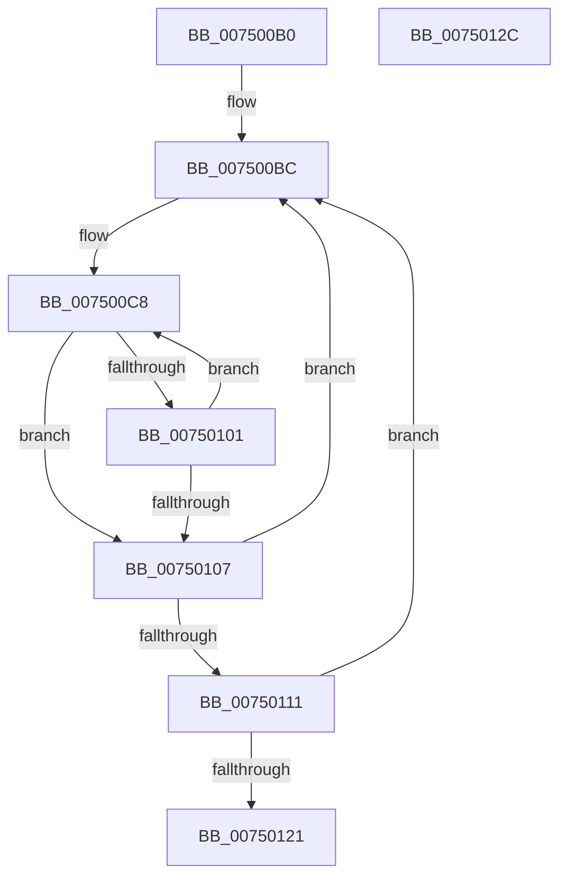

# ObpPushStackInfoQueue

- RVA: `0x007500B0`–`0x0075012D` (길이 `125` bytes)
- VA: `0x00000001407500B0`
- 실행 섹션: `PAGE`
- PDB 이름 있음: `예`; PDB Function 태그: `아니요`
- unwind 정보 RVA: `0x000C6200`
- 디코드: `33`개 명령, `125/125` bytes 표시
- 미해석 바이트: `0` (있으면 어셈블리에 `.byte`로 보존)

> 이 문서는 커널 이미지의 기계어와 PDB 기호를 분석해 생성했습니다. 4번과 5번은 함수 원형과 자료형을 바이너리 사용 방식에서 추정한 C 해석이며 원본 소스 복구 결과는 아닙니다.

## 1. Dependencies

- 직접 호출 지점: **2**; 고유 호출 대상: **2**
- 직접 호출자로 확인된 함수: **0**
- RIP 상대 이미지 참조: **2**

### Outgoing calls
- `0x007500E8` → [ObpPushRefDerefInfo](../74/ObpPushRefDerefInfo_function_0074FEC4.md) (function, `0x0074FEC4`)
- `0x007500F7` → [ObpFreeWorkItemBlock](../74/ObpFreeWorkItemBlock_function_0074F940.md) (function, `0x0074F940`)

### Direct callers
- 이 함수 시작 RVA로 연결되는 직접 call은 확인되지 않았습니다. 간접 호출은 완전히 역산할 수 없습니다.

### Static image references
- `0x007500C1` → RVA `0x00F0F540` (`.data`; read/write)
- `0x00750107` → RVA `0x00F0F540` (`.data`; read)

## 2. Other-region calls and transfers

- 다른 실행 섹션으로 향하는 call: **0**
- 별도 외부 분기/꼬리 이동을 확인하지 못했습니다.

## 3. Assembly (complete function range)

```asm
007500B0  48 89 5C 24 08                  mov qword ptr [rsp + 8], rbx
007500B5  56                              push rsi
007500B6  48 83 EC 30                     sub rsp, 0x30
007500BA  33 F6                           xor esi, esi
007500BC  BB 01 00 00 00                  mov ebx, 1
007500C1  48 87 1D 78 F4 7B 00            xchg qword ptr [rip + 0x7bf478], rbx
007500C8  8B 43 14                        mov eax, dword ptr [rbx + 0x14]
007500CB  48 8D 4B 20                     lea rcx, [rbx + 0x20]
007500CF  44 8B 4B 18                     mov r9d, dword ptr [rbx + 0x18]
007500D3  44 0F B7 43 12                  movzx r8d, word ptr [rbx + 0x12]
007500D8  8A 53 10                        mov dl, byte ptr [rbx + 0x10]
007500DB  89 44 24 28                     mov dword ptr [rsp + 0x28], eax
007500DF  48 89 4C 24 20                  mov qword ptr [rsp + 0x20], rcx
007500E4  48 8B 4B 08                     mov rcx, qword ptr [rbx + 8]
007500E8  E8 D7 FD FF FF                  call 0x14074fec4
007500ED  48 8B CB                        mov rcx, rbx
007500F0  48 8B 1B                        mov rbx, qword ptr [rbx]
007500F3  48 83 C1 F0                     add rcx, -0x10
007500F7  E8 44 F8 FF FF                  call 0x14074f940
007500FC  48 85 DB                        test rbx, rbx
007500FF  74 06                           je 0x140750107
00750101  48 83 FB 01                     cmp rbx, 1
00750105  75 C1                           jne 0x1407500c8
00750107  48 83 3D 31 F4 7B 00 01         cmp qword ptr [rip + 0x7bf431], 1
0075010F  75 AB                           jne 0x1407500bc
00750111  B8 01 00 00 00                  mov eax, 1
00750116  F0 48 0F B1 35 21 F4 7B 00      lock cmpxchg qword ptr [rip + 0x7bf421], rsi
0075011F  75 9B                           jne 0x1407500bc
00750121  48 8B 5C 24 40                  mov rbx, qword ptr [rsp + 0x40]
00750126  48 83 C4 30                     add rsp, 0x30
0075012A  5E                              pop rsi
0075012B  C3                              ret
0075012C  CC                              int3
```

## 4. C-style interpretation (structured pseudocode)

```c
__int64 __fastcall ObpPushStackInfoQueue(void)
{
    __int64 result;
    __int64 v_rsi;
    __int64 v_rsp;
    unsigned int v_stack_m10;
    unsigned __int64 v_stack_m18;
    unsigned __int64 v_stack_p8;

    v_stack_p8 = v_rbx;
    v_rsp = (v_rsp) - (48);
    v_rsi = 0;
loc_007500BC:
loc_007500C8:
    v_stack_m10 = (unsigned int)((unsigned int)(*(unsigned int *)(1 + 20)));
    v_stack_m18 = 1 + 32;
    result = ObpPushRefDerefInfo(*(unsigned __int64 *)(1 + 8), *(unsigned __int8 *)(1 + 16), *(unsigned __int16 *)(1 + 18), (unsigned int)(*(unsigned int *)(1 + 24)));
    a1 = (1) + (-16);
    result = ObpFreeWorkItemBlock(a1, *(unsigned __int8 *)(1 + 16), *(unsigned __int16 *)(1 + 18), (unsigned int)(*(unsigned int *)(1 + 24)));
    if (*(unsigned __int64 *)(1) == 0) goto loc_00750107;
    if ((*(unsigned __int64 *)(1)) != 1) goto loc_007500C8;
loc_00750107:
    if ((*(unsigned __int64 *)(v_rip + 8123441)) != 1) goto loc_007500BC;
    if ((*(unsigned __int64 *)(v_rip + 8123441)) != 1) goto loc_007500BC;
    v_rsp = (v_rsp) + (48);
    return 1;
}
```

## 5. (Beta) C Style

```c
void ObpPushStackInfoQueue(void)
{
    int64_t result;
    int64_t local_rsi;
    int64_t local_rsp;
    uint32_t v_stack_m10;
    uint64_t v_stack_m18;
    uint64_t v_stack_p8;

    v_stack_p8 = local_rbx;
    local_rsp = (local_rsp) - (48);
    local_rsi = 0;
loc_007500BC:
loc_007500C8:
    v_stack_m10 = (uint32_t)((uint32_t)(*(uint32_t *)(1 + 0x14)));
    v_stack_m18 = 1 + 32;
    result = ObpPushRefDerefInfo(*(uint64_t *)(1 + 0x8), *(uint8_t *)(1 + 0x10), *(uint16_t *)(1 + 0x12), (uint32_t)(*(uint32_t *)(1 + 0x18)));
    a1 = (1) + (-16);
    result = ObpFreeWorkItemBlock(a1, *(uint8_t *)(1 + 0x10), *(uint16_t *)(1 + 0x12), (uint32_t)(*(uint32_t *)(1 + 0x18)));
    if (*(uint64_t *)(1) == 0) goto loc_00750107;
    if ((*(uint64_t *)(1)) != 1) goto loc_007500C8;
loc_00750107:
    if ((*(uint64_t *)(v_rip + 0x7BF431)) != 1) goto loc_007500BC;
    if ((*(uint64_t *)(v_rip + 0x7BF431)) != 1) goto loc_007500BC;
    local_rsp = (local_rsp) + (48);
    return 1;
}
```

## 6. Execution-region graph

[열기: 2D/3D 그래프와 함수 탐색 컨트롤 패널](../../../control-panel.html?section=page&rva=0x007500B0&view=graph)

- 2D 그래프는 위에서 아래로 흐르고, 3D 그래프는 빈 공간을 드래그해 회전합니다. Shift+드래그는 이동, 휠은 확대·축소, 함수 노드 선택은 대상 보고서 이동입니다.

### Static fallback


