# ObpStartRuntimeStackTrace

- RVA: `0x00750134`–`0x0075056D` (길이 `1,081` bytes)
- VA: `0x0000000140750134`
- 실행 섹션: `PAGE`
- PDB 이름 있음: `예`; PDB Function 태그: `아니요`
- unwind 정보 RVA: `0x000CB89C`
- 디코드: `262`개 명령, `1,081/1,081` bytes 표시
- 미해석 바이트: `0` (있으면 어셈블리에 `.byte`로 보존)

> 이 문서는 커널 이미지의 기계어와 PDB 기호를 분석해 생성했습니다. 4번과 5번은 함수 원형과 자료형을 바이너리 사용 방식에서 추정한 C 해석이며 원본 소스 복구 결과는 아닙니다.

## 1. Dependencies

- 직접 호출 지점: **17**; 고유 호출 대상: **12**
- 직접 호출자로 확인된 함수: **1**
- RIP 상대 이미지 참조: **15**

### Outgoing calls
- `0x0075016E` → [memset](../../text/6C/memset_function_006C6C40.md) (function, `0x006C6C40`)
- `0x00750225` → [ExRaiseDatatypeMisalignment](../89/ExRaiseDatatypeMisalignment_function_00899FD0.md) (function, `0x00899FD0`)
- `0x0075030A` → [ExAllocatePool2](../../poolcode/B8/ExAllocatePool2_function_00B820F0.md) (function, `0x00B820F0`)
- `0x0075033D` → [ExRaiseDatatypeMisalignment](../89/ExRaiseDatatypeMisalignment_function_00899FD0.md) (function, `0x00899FD0`)
- `0x0075036F` → [memcpy](../../text/6C/memcpy_function_006C6840.md) (function, `0x006C6840`)
- `0x00750393` → [ExFreePoolWithTag](../../poolcode/B8/ExFreePoolWithTag_function_00B82870.md) (function, `0x00B82870`)
- `0x007503E1` → [KeAbPreAcquire](../../text/21/KeAbPreAcquire_function_00210230.md) (function, `0x00210230`)
- `0x007503FA` → [ExfAcquirePushLockExclusiveEx](../../text/20/ExfAcquirePushLockExclusiveEx_function_0020FC90.md) (function, `0x0020FC90`)
- `0x00750412` → [ObpInitStackAndObjectTables](../74/ObpInitStackAndObjectTables_function_0074FCF4.md) (function, `0x0074FCF4`)
- `0x007504D8` → [ExfTryToWakePushLock](../../text/26/ExfTryToWakePushLock_function_00265DD0.md) (function, `0x00265DD0`)
- `0x007504E4` → [KeAbPostRelease](../../text/2E/KeAbPostRelease_function_002E1600.md) (function, `0x002E1600`)
- `0x007504E9` → [KeLeaveGuardedRegion](../../text/2E/KeLeaveGuardedRegion_function_002E2C40.md) (function, `0x002E2C40`)
- `0x00750510` → [ExfTryToWakePushLock](../../text/26/ExfTryToWakePushLock_function_00265DD0.md) (function, `0x00265DD0`)
- `0x0075051C` → [KeAbPostRelease](../../text/2E/KeAbPostRelease_function_002E1600.md) (function, `0x002E1600`)
- `0x00750521` → [KeLeaveGuardedRegion](../../text/2E/KeLeaveGuardedRegion_function_002E2C40.md) (function, `0x002E2C40`)
- `0x00750535` → [ExFreePoolWithTag](../../poolcode/B8/ExFreePoolWithTag_function_00B82870.md) (function, `0x00B82870`)
- `0x0075054A` → [_security_check_cookie](../../text/6A/_security_check_cookie_function_006AC640.md) (function, `0x006AC640`)

### Direct callers
- [ObSetRefTraceInformation](../74/ObSetRefTraceInformation_function_0074F7B0.md) at `0x0074F830`

### Static image references
- `0x0075014E` → RVA `0x00E0A740` (`.data`; read)
- `0x007503D7` → RVA `0x00F0F580` (`.data`; read)
- `0x00750408` → RVA `0x00FC5010` (`ALMOSTRO`; read)
- `0x00750423` → RVA `0x00F0F248` (`.data`; read)
- `0x0075042F` → RVA `0x00F0F240` (`.data`; write)
- `0x0075043C` → RVA `0x00F0F280` (`.data`; read)
- `0x0075044B` → RVA `0x00F0F290` (`.data`; read)
- `0x0075045A` → RVA `0x00F0F2A0` (`.data`; read)
- `0x00750469` → RVA `0x00F0F2B0` (`.data`; read)
- `0x00750480` → RVA `0x00F0F2C0` (`.data`; write)
- `0x00750486` → RVA `0x00FC5010` (`ALMOSTRO`; write)
- `0x007504A0` → RVA `0x00F0F260` (`.data`; write)
- `0x007504AA` → RVA `0x00F0F240` (`.data`; read)
- `0x007504B9` → RVA `0x00F0F2C8` (`.data`; write)
- `0x007504C0` → RVA `0x00F0F580` (`.data`; read/write)

## 2. Other-region calls and transfers

- 다른 실행 섹션으로 향하는 call: **14**
  - `0x0075016E` → [memset](../../text/6C/memset_function_006C6C40.md) (`PAGE` → `.text`)
  - `0x0075030A` → [ExAllocatePool2](../../poolcode/B8/ExAllocatePool2_function_00B820F0.md) (`PAGE` → `POOLCODE`)
  - `0x0075036F` → [memcpy](../../text/6C/memcpy_function_006C6840.md) (`PAGE` → `.text`)
  - `0x00750393` → [ExFreePoolWithTag](../../poolcode/B8/ExFreePoolWithTag_function_00B82870.md) (`PAGE` → `POOLCODE`)
  - `0x007503E1` → [KeAbPreAcquire](../../text/21/KeAbPreAcquire_function_00210230.md) (`PAGE` → `.text`)
  - `0x007503FA` → [ExfAcquirePushLockExclusiveEx](../../text/20/ExfAcquirePushLockExclusiveEx_function_0020FC90.md) (`PAGE` → `.text`)
  - `0x007504D8` → [ExfTryToWakePushLock](../../text/26/ExfTryToWakePushLock_function_00265DD0.md) (`PAGE` → `.text`)
  - `0x007504E4` → [KeAbPostRelease](../../text/2E/KeAbPostRelease_function_002E1600.md) (`PAGE` → `.text`)
  - `0x007504E9` → [KeLeaveGuardedRegion](../../text/2E/KeLeaveGuardedRegion_function_002E2C40.md) (`PAGE` → `.text`)
  - `0x00750510` → [ExfTryToWakePushLock](../../text/26/ExfTryToWakePushLock_function_00265DD0.md) (`PAGE` → `.text`)
  - `0x0075051C` → [KeAbPostRelease](../../text/2E/KeAbPostRelease_function_002E1600.md) (`PAGE` → `.text`)
  - `0x00750521` → [KeLeaveGuardedRegion](../../text/2E/KeLeaveGuardedRegion_function_002E2C40.md) (`PAGE` → `.text`)
  - `0x00750535` → [ExFreePoolWithTag](../../poolcode/B8/ExFreePoolWithTag_function_00B82870.md) (`PAGE` → `POOLCODE`)
  - `0x0075054A` → [_security_check_cookie](../../text/6A/_security_check_cookie_function_006AC640.md) (`PAGE` → `.text`)
- 별도 외부 분기/꼬리 이동을 확인하지 못했습니다.

## 3. Assembly (complete function range)

```asm
00750134  48 89 5C 24 10                  mov qword ptr [rsp + 0x10], rbx
00750139  48 89 74 24 18                  mov qword ptr [rsp + 0x18], rsi
0075013E  57                              push rdi
0075013F  41 54                           push r12
00750141  41 55                           push r13
00750143  41 56                           push r14
00750145  41 57                           push r15
00750147  48 81 EC C0 00 00 00            sub rsp, 0xc0
0075014E  48 8B 05 EB A5 6B 00            mov rax, qword ptr [rip + 0x6ba5eb]
00750155  48 33 C4                        xor rax, rsp
00750158  48 89 84 24 B0 00 00 00         mov qword ptr [rsp + 0xb0], rax
00750160  48 8B D9                        mov rbx, rcx
00750163  33 D2                           xor edx, edx
00750165  44 8D 42 40                     lea r8d, [rdx + 0x40]
00750169  48 8D 4C 24 70                  lea rcx, [rsp + 0x70]
0075016E  E8 CD 6A F7 FF                  call 0x1406c6c40
00750173  45 33 D2                        xor r10d, r10d
00750176  45 8B FA                        mov r15d, r10d
00750179  0F 57 C0                        xorps xmm0, xmm0
0075017C  0F 11 44 24 28                  movups xmmword ptr [rsp + 0x28], xmm0
00750181  41 8B FA                        mov edi, r10d
00750184  65 48 8B 04 25 88 01 00 00      mov rax, qword ptr gs:[0x188]
0075018D  44 8A 88 32 02 00 00            mov r9b, byte ptr [rax + 0x232]
00750194  44 88 4C 24 20                  mov byte ptr [rsp + 0x20], r9b
00750199  0F 10 43 18                     movups xmm0, xmmword ptr [rbx + 0x18]
0075019D  F3 0F 7F 44 24 48               movdqu xmmword ptr [rsp + 0x48], xmm0
007501A3  0F 10 4B 08                     movups xmm1, xmmword ptr [rbx + 8]
007501A7  F3 0F 7F 4C 24 58               movdqu xmmword ptr [rsp + 0x58], xmm1
007501AD  0F B6 43 01                     movzx eax, byte ptr [rbx + 1]
007501B1  89 44 24 44                     mov dword ptr [rsp + 0x44], eax
007501B5  0F B7 44 24 48                  movzx eax, word ptr [rsp + 0x48]
007501BA  66 85 C0                        test ax, ax
007501BD  0F 84 EB 00 00 00               je 0x1407502ae
007501C3  A8 01                           test al, 1
007501C5  0F 85 DE 01 00 00               jne 0x1407503a9
007501CB  44 8B C0                        mov r8d, eax
007501CE  8B C8                           mov ecx, eax
007501D0  48 D1 E9                        shr rcx, 1
007501D3  49 BB CD CC CC CC CC CC CC CC   movabs r11, 0xcccccccccccccccd
007501DD  49 8B C3                        mov rax, r11
007501E0  48 F7 E1                        mul rcx
007501E3  48 C1 EA 02                     shr rdx, 2
007501E7  48 8D 04 92                     lea rax, [rdx + rdx*4]
007501EB  48 2B C8                        sub rcx, rax
007501EE  48 F7 C1 FB FF FF FF            test rcx, -5
007501F5  0F 85 AE 01 00 00               jne 0x1407503a9
007501FB  49 8D 48 02                     lea rcx, [r8 + 2]
007501FF  49 8B C3                        mov rax, r11
00750202  48 F7 E1                        mul rcx
00750205  4C 8B DA                        mov r11, rdx
00750208  49 C1 EB 03                     shr r11, 3
0075020C  41 BD 10 00 00 00               mov r13d, 0x10
00750212  45 3B DD                        cmp r11d, r13d
00750215  45 0F 47 DD                     cmova r11d, r13d
00750219  45 84 C9                        test r9b, r9b
0075021C  74 2D                           je 0x14075024b
0075021E  F6 44 24 50 01                  test byte ptr [rsp + 0x50], 1
00750223  74 05                           je 0x14075022a
00750225  E8 A6 9D 14 00                  call 0x140899fd0
0075022A  48 8B 44 24 50                  mov rax, qword ptr [rsp + 0x50]
0075022F  49 8D 0C 00                     lea rcx, [r8 + rax]
00750233  48 BE 00 00 FF FF FF 7F 00 00   movabs rsi, 0x7fffffff0000
0075023D  48 3B CE                        cmp rcx, rsi
00750240  77 05                           ja 0x140750247
00750242  48 3B C8                        cmp rcx, rax
00750245  73 0E                           jae 0x140750255
00750247  8A 06                           mov al, byte ptr [rsi]
00750249  EB 0A                           jmp 0x140750255
0075024B  48 BE 00 00 FF FF FF 7F 00 00   movabs rsi, 0x7fffffff0000
00750255  45 8B CA                        mov r9d, r10d
00750258  44 89 54 24 3C                  mov dword ptr [rsp + 0x3c], r10d
0075025D  45 3B CB                        cmp r9d, r11d
00750260  73 42                           jae 0x1407502a4
00750262  44 89 54 24 38                  mov dword ptr [rsp + 0x38], r10d
00750267  41 83 FA 04                     cmp r10d, 4
0075026B  73 2A                           jae 0x140750297
0075026D  45 8B C1                        mov r8d, r9d
00750270  43 8D 0C 89                     lea ecx, [r9 + r9*4]
00750274  41 2B CA                        sub ecx, r10d
00750277  83 C1 03                        add ecx, 3
0075027A  48 8B 44 24 50                  mov rax, qword ptr [rsp + 0x50]
0075027F  0F B7 14 48                     movzx edx, word ptr [rax + rcx*2]
00750283  42 8B 44 84 70                  mov eax, dword ptr [rsp + r8*4 + 0x70]
00750288  C1 E0 08                        shl eax, 8
0075028B  0B D0                           or edx, eax
0075028D  42 89 54 84 70                  mov dword ptr [rsp + r8*4 + 0x70], edx
00750292  41 FF C2                        inc r10d
00750295  EB CB                           jmp 0x140750262
00750297  41 FF C1                        inc r9d
0075029A  44 89 4C 24 3C                  mov dword ptr [rsp + 0x3c], r9d
0075029F  45 33 D2                        xor r10d, r10d
007502A2  EB B9                           jmp 0x14075025d
007502A4  41 8B FD                        mov edi, r13d
007502A7  EB 15                           jmp 0x1407502be
007502A9  E9 91 02 00 00                  jmp 0x14075053f
007502AE  48 BE 00 00 FF FF FF 7F 00 00   movabs rsi, 0x7fffffff0000
007502B8  41 BD 10 00 00 00               mov r13d, 0x10
007502BE  44 0F B7 74 24 58               movzx r14d, word ptr [rsp + 0x58]
007502C4  66 45 85 F6                     test r14w, r14w
007502C8  0F 84 D1 00 00 00               je 0x14075039f
007502CE  41 F6 C6 01                     test r14b, 1
007502D2  0F 85 D1 00 00 00               jne 0x1407503a9
007502D8  B8 80 00 00 00                  mov eax, 0x80
007502DD  66 44 3B F0                     cmp r14w, ax
007502E1  73 06                           jae 0x1407502e9
007502E3  41 0F B7 DE                     movzx ebx, r14w
007502E7  EB 05                           jmp 0x1407502ee
007502E9  BB 7E 00 00 00                  mov ebx, 0x7e
007502EE  66 89 5C 24 28                  mov word ptr [rsp + 0x28], bx
007502F3  0F B7 D3                        movzx edx, bx
007502F6  41 BC 02 00 00 00               mov r12d, 2
007502FC  49 03 D4                        add rdx, r12
007502FF  41 8D 4C 24 3E                  lea ecx, [r12 + 0x3e]
00750304  41 B8 4F 62 52 74               mov r8d, 0x7452624f
0075030A  E8 E1 1D 43 00                  call 0x140b820f0
0075030F  4C 8B F8                        mov r15, rax
00750312  48 89 44 24 30                  mov qword ptr [rsp + 0x30], rax
00750317  48 85 C0                        test rax, rax
0075031A  75 0A                           jne 0x140750326
0075031C  B8 17 00 00 C0                  mov eax, 0xc0000017
00750321  E9 19 02 00 00                  jmp 0x14075053f
00750326  41 8D 04 1C                     lea eax, [r12 + rbx]
0075032A  66 89 44 24 2A                  mov word ptr [rsp + 0x2a], ax
0075032F  80 7C 24 20 00                  cmp byte ptr [rsp + 0x20], 0
00750334  74 2B                           je 0x140750361
00750336  F6 44 24 60 01                  test byte ptr [rsp + 0x60], 1
0075033B  74 05                           je 0x140750342
0075033D  E8 8E 9C 14 00                  call 0x140899fd0
00750342  48 8B 4C 24 60                  mov rcx, qword ptr [rsp + 0x60]
00750347  4A 8D 14 31                     lea rdx, [rcx + r14]
0075034B  48 3B D6                        cmp rdx, rsi
0075034E  77 05                           ja 0x140750355
00750350  48 3B D1                        cmp rdx, rcx
00750353  73 0C                           jae 0x140750361
00750355  8A 06                           mov al, byte ptr [rsi]
00750357  4C 8B 7C 24 30                  mov r15, qword ptr [rsp + 0x30]
0075035C  0F B7 5C 24 28                  movzx ebx, word ptr [rsp + 0x28]
00750361  0F B7 DB                        movzx ebx, bx
00750364  44 8B C3                        mov r8d, ebx
00750367  48 8B 54 24 60                  mov rdx, qword ptr [rsp + 0x60]
0075036C  49 8B CF                        mov rcx, r15
0075036F  E8 CC 64 F7 FF                  call 0x1406c6840
00750374  48 D1 EB                        shr rbx, 1
00750377  45 33 D2                        xor r10d, r10d
0075037A  66 45 89 14 5F                  mov word ptr [r15 + rbx*2], r10w
0075037F  83 CF 20                        or edi, 0x20
00750382  45 8B FA                        mov r15d, r10d
00750385  EB 1E                           jmp 0x1407503a5
00750387  8B D8                           mov ebx, eax
00750389  BA 4F 62 52 74                  mov edx, 0x7452624f
0075038E  48 8B 4C 24 30                  mov rcx, qword ptr [rsp + 0x30]
00750393  E8 D8 24 43 00                  call 0x140b82870
00750398  8B C3                           mov eax, ebx
0075039A  E9 A0 01 00 00                  jmp 0x14075053f
0075039F  41 BC 02 00 00 00               mov r12d, 2
007503A5  85 FF                           test edi, edi
007503A7  75 0A                           jne 0x1407503b3
007503A9  B8 0D 00 00 C0                  mov eax, 0xc000000d
007503AE  E9 8C 01 00 00                  jmp 0x14075053f
007503B3  44 39 54 24 44                  cmp dword ptr [rsp + 0x44], r10d
007503B8  74 03                           je 0x1407503bd
007503BA  83 CF 40                        or edi, 0x40
007503BD  65 48 8B 04 25 88 01 00 00      mov rax, qword ptr gs:[0x188]
007503C6  48 83 CB FF                     or rbx, 0xffffffffffffffff
007503CA  66 01 98 E6 01 00 00            add word ptr [rax + 0x1e6], bx
007503D1  90                              nop
007503D2  45 33 C0                        xor r8d, r8d
007503D5  33 D2                           xor edx, edx
007503D7  4C 8D 35 A2 F1 7B 00            lea r14, [rip + 0x7bf1a2]
007503DE  49 8B CE                        mov rcx, r14
007503E1  E8 4A FE AB FF                  call 0x140210230
007503E6  48 8B F0                        mov rsi, rax
007503E9  F0 49 0F BA 2E 00               lock bts qword ptr [r14], 0
007503EF  73 0E                           jae 0x1407503ff
007503F1  4D 8B C6                        mov r8, r14
007503F4  48 8B D0                        mov rdx, rax
007503F7  49 8B CE                        mov rcx, r14
007503FA  E8 91 F8 AB FF                  call 0x14020fc90
007503FF  48 85 F6                        test rsi, rsi
00750402  74 04                           je 0x140750408
00750404  C6 46 0A 01                     mov byte ptr [rsi + 0xa], 1
00750408  8B 05 02 4C 87 00               mov eax, dword ptr [rip + 0x874c02]
0075040E  A8 73                           test al, 0x73
00750410  75 08                           jne 0x14075041a
00750412  E8 DD F8 FF FF                  call 0x14074fcf4
00750417  44 8B F8                        mov r15d, eax
0075041A  45 85 FF                        test r15d, r15d
0075041D  0F 88 D5 00 00 00               js 0x1407504f8
00750423  48 8B 35 1E EE 7B 00            mov rsi, qword ptr [rip + 0x7bee1e]
0075042A  0F 10 44 24 28                  movups xmm0, xmmword ptr [rsp + 0x28]
0075042F  F3 0F 7F 05 09 EE 7B 00         movdqu xmmword ptr [rip + 0x7bee09], xmm0
00750437  0F 28 4C 24 70                  movaps xmm1, xmmword ptr [rsp + 0x70]
0075043C  0F 11 0D 3D EE 7B 00            movups xmmword ptr [rip + 0x7bee3d], xmm1
00750443  0F 28 84 24 80 00 00 00         movaps xmm0, xmmword ptr [rsp + 0x80]
0075044B  0F 11 05 3E EE 7B 00            movups xmmword ptr [rip + 0x7bee3e], xmm0
00750452  0F 28 8C 24 90 00 00 00         movaps xmm1, xmmword ptr [rsp + 0x90]
0075045A  0F 11 0D 3F EE 7B 00            movups xmmword ptr [rip + 0x7bee3f], xmm1
00750461  0F 28 84 24 A0 00 00 00         movaps xmm0, xmmword ptr [rsp + 0xa0]
00750469  0F 11 05 40 EE 7B 00            movups xmmword ptr [rip + 0x7bee40], xmm0
00750470  8B 0D 9A 4B 87 00               mov ecx, dword ptr [rip + 0x874b9a]
00750476  83 E1 8E                        and ecx, 0xffffff8e
00750479  0B CF                           or ecx, edi
0075047B  8B C1                           mov eax, ecx
0075047D  41 0B C4                        or eax, r12d
00750480  89 05 3A EE 7B 00               mov dword ptr [rip + 0x7bee3a], eax
00750486  89 05 84 4B 87 00               mov dword ptr [rip + 0x874b84], eax
0075048C  8B C1                           mov eax, ecx
0075048E  41 22 C5                        and al, r13b
00750491  48 8D 15 E8 ED 7B 00            lea rdx, [rip + 0x7bede8]
00750498  F6 D8                           neg al
0075049A  48 1B C0                        sbb rax, rax
0075049D  48 23 C2                        and rax, rdx
007504A0  48 89 05 B9 ED 7B 00            mov qword ptr [rip + 0x7bedb9], rax
007504A7  80 E1 20                        and cl, 0x20
007504AA  48 8D 15 8F ED 7B 00            lea rdx, [rip + 0x7bed8f]
007504B1  F6 D9                           neg cl
007504B3  48 1B C0                        sbb rax, rax
007504B6  48 23 C2                        and rax, rdx
007504B9  48 89 05 08 EE 7B 00            mov qword ptr [rip + 0x7bee08], rax
007504C0  F0 48 0F C1 1D B7 F0 7B 00      lock xadd qword ptr [rip + 0x7bf0b7], rbx
007504C9  80 E3 06                        and bl, 6
007504CC  41 3A DC                        cmp bl, r12b
007504CF  75 0C                           jne 0x1407504dd
007504D1  48 8D 0D A8 F0 7B 00            lea rcx, [rip + 0x7bf0a8]
007504D8  E8 F3 58 B1 FF                  call 0x140265dd0
007504DD  48 8D 0D 9C F0 7B 00            lea rcx, [rip + 0x7bf09c]
007504E4  E8 17 11 B9 FF                  call 0x1402e1600
007504E9  E8 52 27 B9 FF                  call 0x1402e2c40
007504EE  48 85 F6                        test rsi, rsi
007504F1  74 47                           je 0x14075053a
007504F3  48 8B CE                        mov rcx, rsi
007504F6  EB 38                           jmp 0x140750530
007504F8  F0 48 0F C1 1D 7F F0 7B 00      lock xadd qword ptr [rip + 0x7bf07f], rbx
00750501  80 E3 06                        and bl, 6
00750504  41 3A DC                        cmp bl, r12b
00750507  75 0C                           jne 0x140750515
00750509  48 8D 0D 70 F0 7B 00            lea rcx, [rip + 0x7bf070]
00750510  E8 BB 58 B1 FF                  call 0x140265dd0
00750515  48 8D 0D 64 F0 7B 00            lea rcx, [rip + 0x7bf064]
0075051C  E8 DF 10 B9 FF                  call 0x1402e1600
00750521  E8 1A 27 B9 FF                  call 0x1402e2c40
00750526  48 8B 4C 24 30                  mov rcx, qword ptr [rsp + 0x30]
0075052B  48 85 C9                        test rcx, rcx
0075052E  74 0A                           je 0x14075053a
00750530  BA 4F 62 52 74                  mov edx, 0x7452624f
00750535  E8 36 23 43 00                  call 0x140b82870
0075053A  41 8B C7                        mov eax, r15d
0075053D  EB 00                           jmp 0x14075053f
0075053F  48 8B 8C 24 B0 00 00 00         mov rcx, qword ptr [rsp + 0xb0]
00750547  48 33 CC                        xor rcx, rsp
0075054A  E8 F1 C0 F5 FF                  call 0x1406ac640
0075054F  4C 8D 9C 24 C0 00 00 00         lea r11, [rsp + 0xc0]
00750557  49 8B 5B 38                     mov rbx, qword ptr [r11 + 0x38]
0075055B  49 8B 73 40                     mov rsi, qword ptr [r11 + 0x40]
0075055F  49 8B E3                        mov rsp, r11
00750562  41 5F                           pop r15
00750564  41 5E                           pop r14
00750566  41 5D                           pop r13
00750568  41 5C                           pop r12
0075056A  5F                              pop rdi
0075056B  C3                              ret
0075056C  CC                              int3
```

## 4. C-style interpretation (structured pseudocode)

```c
__int64 __fastcall ObpStartRuntimeStackTrace(__int64 a1, int a2)
{
    __int64 result;
    __int64 v_r10;
    __int64 v_r11;
    __int64 v_r15;
    __int64 v_rbx;
    __int64 v_rdi;
    __int64 v_rsp;
    unsigned __int64 v_stack_m28;
    unsigned __int64 v_stack_m38;
    unsigned __int64 v_stack_m48;
    unsigned __int64 v_stack_m58;
    unsigned __int64 v_stack_m68;
    unsigned __int64 v_stack_m78;
    unsigned __int8 v_stack_m88;
    unsigned __int64 v_stack_m90;
    unsigned __int8 v_stack_m98;
    unsigned __int64 v_stack_mA0;
    unsigned int v_stack_mA4;
    unsigned int v_stack_mAC;
    unsigned int v_stack_mB0;
    unsigned __int64 v_stack_mB8;
    unsigned __int16 v_stack_mBE;
    unsigned __int64 v_stack_mC0;
    unsigned __int8 v_stack_mC8;
    unsigned __int64 v_stack_p10;
    unsigned __int64 v_stack_p18;

    v_stack_p10 = v_rbx;
    v_stack_p18 = v_rsi;
    v_rsp = (v_rsp) - (192);
    result = (*(unsigned __int64 *)(v_rip + 7054827)) ^ (v_rsp);
    v_stack_m38 = result;
    a2 = 0;
    result = memset(v_stack_m78, a2, a2 + 64, a4);
    v_r10 = 0;
    v_stack_mC0 = v_xmm0;
    v_stack_mC8 = (unsigned __int8)(*(unsigned __int8 *)(*(unsigned __int64 *)(gs_base + (0 + 392)) + 562));
    v_stack_mA0 = v_xmm0;
    v_stack_m90 = v_xmm1;
    v_stack_mA4 = (unsigned int)(*(unsigned __int8 *)(a1 + 1));
    if ((unsigned __int16)(v_stack_mA0) == 0) goto loc_007502AE;
    if ((((unsigned __int8)(v_stack_mA0)) & (1)) != 0) goto loc_007503A9;
    a1 = ((unsigned int)((unsigned int)(v_stack_mA0))) >> (1);
    a2 = (a2) >> (2);
    a1 = (a1) - (a2 + a2 * 4);
    if (((a1) & (-5)) != 0) goto loc_007503A9;
    v_r11 = (a2) >> (3);
    if (((unsigned int)(v_r11)) > 16) { v_r11 = 16; }
    if ((unsigned __int8)(*(unsigned __int8 *)(*(unsigned __int64 *)(gs_base + (0 + 392)) + 562)) == 0) goto loc_0075024B;
    result = v_r11;
    if (((v_stack_m98) & (1)) != 0) {
        result = ExRaiseDatatypeMisalignment((unsigned int)((unsigned int)(v_stack_mA0)) + 2, a2, (unsigned int)((unsigned int)(v_stack_mA0)), *(unsigned __int8 *)(*(unsigned __int64 *)(gs_base + (0 + 392)) + 562));
    }
    if (((unsigned int)((unsigned int)(v_stack_mA0)) + v_stack_m98 * 1) > v_rsi) goto loc_00750247;
    if (((unsigned int)((unsigned int)(v_stack_mA0)) + v_stack_m98 * 1) >= v_stack_m98) goto loc_00750255;
loc_00750247:
    goto loc_00750255;
loc_0075024B:
loc_00750255:
    v_stack_mAC = 0;
loc_0075025D:
    if (0 >= ((unsigned int)(v_r11))) goto loc_007502A4;
loc_00750262:
    v_stack_mB0 = 0;
    if (0 >= 4) goto loc_00750297;
    a1 = (unsigned int)((0 + 0 * 4) - (0));
    a1 = (unsigned int)((a1) + (3));
    result = (unsigned int)(((unsigned int)(*(unsigned int *)(v_rsp + 0 * 4 + 112))) << (8));
    a2 = (unsigned int)((*(unsigned __int16 *)(v_stack_m98 + a1 * 2)) | ((unsigned int)(result)));
    *(unsigned int *)(v_rsp + 0 * 4 + 112) = a2;
    v_r10 = (unsigned int)((v_r10) + 1);
    goto loc_00750262;
loc_00750297:
    a4 = (unsigned int)((0) + 1);
    v_stack_mAC = (unsigned int)(a4);
    v_r10 = 0;
    goto loc_0075025D;
loc_007502A4:
    goto loc_007502BE;
loc_007502AE:
loc_007502BE:
    if ((unsigned __int16)(v_stack_m90) == 0) goto loc_0075039F;
    if ((((unsigned __int8)(v_stack_m90)) & (1)) != 0) goto loc_007503A9;
    if (((unsigned __int16)(v_stack_m90)) >= 128) goto loc_007502E9;
    goto loc_007502EE;
loc_007502E9:
loc_007502EE:
    v_stack_mC0 = 126;
    a2 = (126) + (2);
    result = ExAllocatePool2(2 + 62, a2, (unsigned int)(0x7452624FULL), a4);
    v_stack_mB8 = result;
    if (result != 0) goto loc_00750326;
    goto loc_0075053F;
loc_00750326:
    v_stack_mBE = (unsigned __int16)(2 + 126 * 1);
    if (v_stack_mC8 == 0) goto loc_00750361;
    result = 2 + 126 * 1;
    if (((v_stack_m88) & (1)) != 0) {
        result = ExRaiseDatatypeMisalignment(2 + 62, a2, (unsigned int)(0x7452624FULL), a4);
    }
    if ((v_stack_m88 + v_stack_m90 * 1) > v_rsi) goto loc_00750355;
    v_rbx = 126;
    v_r15 = result;
    if ((v_stack_m88 + v_stack_m90 * 1) < v_stack_m88) {
        result = *(unsigned __int8 *)(v_rsi);
        v_r15 = v_stack_mB8;
        v_rbx = v_stack_mC0;
    }
    result = memcpy(v_r15, v_stack_m88, (unsigned int)((unsigned int)((unsigned __int16)(v_rbx))), a4);
    v_rbx = ((unsigned __int16)(v_rbx)) >> (1);
    v_r10 = 0;
    *(unsigned __int16 *)(v_r15 + v_rbx * 2) = 0;
    v_rdi = (unsigned int)((16) | (32));
    goto loc_007503A5;
loc_0075039F:
loc_007503A5:
    if ((unsigned int)(v_rdi) != 0) goto loc_007503B3;
loc_007503A9:
    goto loc_0075053F;
loc_007503B3:
    if (v_stack_mA4 != 0) {
        v_rdi = (unsigned int)((v_rdi) | (64));
    }
    v_rbx = (v_rbx) | (-1);
    a3 = 0;
    a2 = 0;
    result = KeAbPreAcquire(v_rip + 8122786, a2, a3, a4);
    if (!(condition_is_above_or_equal)) {
        a3 = v_rip + 8122786;
        a2 = result;
        a1 = v_rip + 8122786;
        result = ExfAcquirePushLockExclusiveEx(a1, a2, a3, a4);
    }
    if (result != 0) {
        *(unsigned __int8 *)(result + 10) = 1;
    }
    result = (unsigned int)(*(unsigned int *)(v_rip + 8866818));
    v_r15 = 0;
    if ((((unsigned __int8)((unsigned int)(*(unsigned int *)(v_rip + 8866818)))) & (115)) == 0) {
        result = ObpInitStackAndObjectTables(a1, a2, a3, a4);
        v_r15 = (unsigned int)(result);
    }
    if (sign_flag) goto loc_007504F8;
    *(unsigned __int64 *)(v_rip + 8121865) = v_xmm0;
    *(unsigned __int64 *)(v_rip + 8121917) = v_xmm1;
    *(unsigned __int64 *)(v_rip + 8121918) = v_xmm0;
    *(unsigned __int64 *)(v_rip + 8121919) = v_xmm1;
    *(unsigned __int64 *)(v_rip + 8121920) = v_xmm0;
    a1 = (unsigned int)(((unsigned int)(*(unsigned int *)(v_rip + 8866714))) & (0xFFFFFF8EULL));
    a1 = (unsigned int)((a1) | ((unsigned int)(v_rdi)));
    result = (unsigned int)(((unsigned int)((unsigned int)(a1))) | (2));
    *(unsigned int *)(v_rip + 8121914) = (unsigned int)(result);
    *(unsigned int *)(v_rip + 8866692) = (unsigned int)(result);
    result = (unsigned __int8)(((unsigned int)((unsigned int)(a1))) & (16));
    result = (unsigned __int8)(-(result));
    result = (result) & (v_rip + 8121832);
    *(unsigned __int64 *)(v_rip + 8121785) = result;
    a1 = (unsigned __int8)((a1) & (32));
    a1 = (unsigned __int8)(-(a1));
    result = (result) & (v_rip + 8121743);
    *(unsigned __int64 *)(v_rip + 8121864) = result;
    v_rbx = (unsigned __int8)((v_rbx) & (6));
    if (((unsigned __int8)(v_rbx)) == 2) {
        a1 = v_rip + 8122536;
        result = ExfTryToWakePushLock(a1, v_rip + 8121743, a3, a4);
    }
    result = KeAbPostRelease(v_rip + 8122524, v_rip + 8121743, a3, a4);
    result = KeLeaveGuardedRegion(v_rip + 8122524, v_rip + 8121743, a3, a4);
    if (*(unsigned __int64 *)(v_rip + 8121886) == 0) goto loc_0075053A;
    goto loc_00750530;
loc_007504F8:
    v_rbx = (unsigned __int8)((v_rbx) & (6));
    if (((unsigned __int8)(v_rbx)) == 2) {
        a1 = v_rip + 8122480;
        result = ExfTryToWakePushLock(a1, v_rip + 8121743, a3, a4);
    }
    result = KeAbPostRelease(v_rip + 8122468, v_rip + 8121743, a3, a4);
    result = KeLeaveGuardedRegion(v_rip + 8122468, v_rip + 8121743, a3, a4);
    if (v_stack_mB8 != 0) {
        a2 = 0x7452624FULL;
        result = ExFreePoolWithTag(v_stack_mB8, a2, a3, a4);
    }
    goto loc_0075053F;
loc_0075053F:
    a1 = (v_stack_m38) ^ (v_rsp);
    result = _security_check_cookie(a1, a2, a3, a4);
    return result;
}
```

## 5. (Beta) C Style

```c
int64_t ObpStartRuntimeStackTrace(void *Arg1, int32_t Arg2)
{
    uint8_t *arg1 = (uint8_t *)Arg1;

    int64_t result;
    int64_t local_r10;
    int64_t local_r11;
    int64_t local_r15;
    int64_t local_rbx;
    int64_t local_rdi;
    int64_t local_rsp;
    uint64_t v_stack_m28;
    uint64_t v_stack_m38;
    uint64_t v_stack_m48;
    uint64_t v_stack_m58;
    uint64_t v_stack_m68;
    uint64_t v_stack_m78;
    uint8_t v_stack_m88;
    uint64_t v_stack_m90;
    uint8_t v_stack_m98;
    uint64_t v_stack_mA0;
    uint32_t v_stack_mA4;
    uint32_t v_stack_mAC;
    uint32_t v_stack_mB0;
    uint64_t v_stack_mB8;
    uint16_t v_stack_mBE;
    uint64_t v_stack_mC0;
    uint8_t v_stack_mC8;
    uint64_t v_stack_p10;
    uint64_t v_stack_p18;

    v_stack_p10 = local_rbx;
    v_stack_p18 = local_rsi;
    local_rsp = (local_rsp) - (192);
    result = (*(uint64_t *)(v_rip + 0x6BA5EB)) ^ (local_rsp);
    v_stack_m38 = result;
    Arg2 = 0;
    result = memset(v_stack_m78, Arg2, Arg2 + 64, a4);
    local_r10 = 0;
    v_stack_mC0 = v_xmm0;
    v_stack_mC8 = (uint8_t)(*(uint8_t *)(*(uint64_t *)(gs_base + (0 + 0x188)) + 0x232));
    v_stack_mA0 = v_xmm0;
    v_stack_m90 = v_xmm1;
    v_stack_mA4 = (uint32_t)(*(uint8_t *)(arg1 + 0x1));
    if ((uint16_t)(v_stack_mA0) == 0) goto loc_007502AE;
    if ((((uint8_t)(v_stack_mA0)) & (1)) != 0) goto loc_007503A9;
    Arg1 = ((uint32_t)((uint32_t)(v_stack_mA0))) >> (1);
    Arg2 = (Arg2) >> (2);
    Arg1 = (Arg1) - (Arg2 + Arg2 * 4);
    if (((Arg1) & (-5)) != 0) goto loc_007503A9;
    local_r11 = (Arg2) >> (3);
    if (((uint32_t)(local_r11)) > 16) { local_r11 = 16; }
    if ((uint8_t)(*(uint8_t *)(*(uint64_t *)(gs_base + (0 + 0x188)) + 0x232)) == 0) goto loc_0075024B;
    result = local_r11;
    if (((v_stack_m98) & (1)) != 0) {
        result = ExRaiseDatatypeMisalignment((uint32_t)((uint32_t)(v_stack_mA0)) + 2, Arg2, (uint32_t)((uint32_t)(v_stack_mA0)), *(uint8_t *)(*(uint64_t *)(gs_base + (0 + 0x188)) + 0x232));
    }
    if (((uint32_t)((uint32_t)(v_stack_mA0)) + v_stack_m98 * 1) > local_rsi) goto loc_00750247;
    if (((uint32_t)((uint32_t)(v_stack_mA0)) + v_stack_m98 * 1) >= v_stack_m98) goto loc_00750255;
loc_00750247:
    goto loc_00750255;
loc_0075024B:
loc_00750255:
    v_stack_mAC = 0;
loc_0075025D:
    if (0 >= ((uint32_t)(local_r11))) goto loc_007502A4;
loc_00750262:
    v_stack_mB0 = 0;
    if (0 >= 4) goto loc_00750297;
    Arg1 = (uint32_t)((0 + 0 * 4) - (0));
    Arg1 = (uint32_t)((Arg1) + (3));
    result = (uint32_t)(((uint32_t)(*(uint32_t *)(local_rsp + 0x0 * 4 + 0x70))) << (8));
    Arg2 = (uint32_t)((*(uint16_t *)(v_stack_m98 + arg1 * 2)) | ((uint32_t)(result)));
    *(uint32_t *)(local_rsp + 0x0 * 4 + 0x70) = Arg2;
    local_r10 = (uint32_t)((local_r10) + 1);
    goto loc_00750262;
loc_00750297:
    a4 = (uint32_t)((0) + 1);
    v_stack_mAC = (uint32_t)(a4);
    local_r10 = 0;
    goto loc_0075025D;
loc_007502A4:
    goto loc_007502BE;
loc_007502AE:
loc_007502BE:
    if ((uint16_t)(v_stack_m90) == 0) goto loc_0075039F;
    if ((((uint8_t)(v_stack_m90)) & (1)) != 0) goto loc_007503A9;
    if (((uint16_t)(v_stack_m90)) >= 128) goto loc_007502E9;
    goto loc_007502EE;
loc_007502E9:
loc_007502EE:
    v_stack_mC0 = 126;
    Arg2 = (126) + (2);
    result = ExAllocatePool2(2 + 62, Arg2, (uint32_t)(0x7452624FULL), a4);
    v_stack_mB8 = result;
    if (result != 0) goto loc_00750326;
    goto loc_0075053F;
loc_00750326:
    v_stack_mBE = (uint16_t)(2 + 126 * 1);
    if (v_stack_mC8 == 0) goto loc_00750361;
    result = 2 + 126 * 1;
    if (((v_stack_m88) & (1)) != 0) {
        result = ExRaiseDatatypeMisalignment(2 + 62, Arg2, (uint32_t)(0x7452624FULL), a4);
    }
    if ((v_stack_m88 + v_stack_m90 * 1) > local_rsi) goto loc_00750355;
    local_rbx = 126;
    local_r15 = result;
    if ((v_stack_m88 + v_stack_m90 * 1) < v_stack_m88) {
        result = *(uint8_t *)(local_rsi);
        local_r15 = v_stack_mB8;
        local_rbx = v_stack_mC0;
    }
    result = memcpy(local_r15, v_stack_m88, (uint32_t)((uint32_t)((uint16_t)(local_rbx))), a4);
    local_rbx = ((uint16_t)(local_rbx)) >> (1);
    local_r10 = 0;
    *(uint16_t *)(local_r15 + local_rbx * 2) = 0;
    local_rdi = (uint32_t)((16) | (32));
    goto loc_007503A5;
loc_0075039F:
loc_007503A5:
    if ((uint32_t)(local_rdi) != 0) goto loc_007503B3;
loc_007503A9:
    goto loc_0075053F;
loc_007503B3:
    if (v_stack_mA4 != 0) {
        local_rdi = (uint32_t)((local_rdi) | (64));
    }
    local_rbx = (local_rbx) | (-1);
    a3 = 0;
    Arg2 = 0;
    result = KeAbPreAcquire(v_rip + 8122786, Arg2, a3, a4);
    if (!(condition_is_above_or_equal)) {
        a3 = v_rip + 8122786;
        Arg2 = result;
        Arg1 = v_rip + 8122786;
        result = ExfAcquirePushLockExclusiveEx(Arg1, Arg2, a3, a4);
    }
    if (result != 0) {
        *(uint8_t *)(result + 0xA) = 1;
    }
    result = (uint32_t)(*(uint32_t *)(v_rip + 0x874C02));
    local_r15 = 0;
    if ((((uint8_t)((uint32_t)(*(uint32_t *)(v_rip + 0x874C02)))) & (115)) == 0) {
        result = ObpInitStackAndObjectTables(Arg1, Arg2, a3, a4);
        local_r15 = (uint32_t)(result);
    }
    if (sign_flag) goto loc_007504F8;
    *(uint64_t *)(v_rip + 0x7BEE09) = v_xmm0;
    *(uint64_t *)(v_rip + 0x7BEE3D) = v_xmm1;
    *(uint64_t *)(v_rip + 0x7BEE3E) = v_xmm0;
    *(uint64_t *)(v_rip + 0x7BEE3F) = v_xmm1;
    *(uint64_t *)(v_rip + 0x7BEE40) = v_xmm0;
    Arg1 = (uint32_t)(((uint32_t)(*(uint32_t *)(v_rip + 0x874B9A))) & (0xFFFFFF8EULL));
    Arg1 = (uint32_t)((Arg1) | ((uint32_t)(local_rdi)));
    result = (uint32_t)(((uint32_t)((uint32_t)(Arg1))) | (2));
    *(uint32_t *)(v_rip + 0x7BEE3A) = (uint32_t)(result);
    *(uint32_t *)(v_rip + 0x874B84) = (uint32_t)(result);
    result = (uint8_t)(((uint32_t)((uint32_t)(Arg1))) & (16));
    result = (uint8_t)(-(result));
    result = (result) & (v_rip + 8121832);
    *(uint64_t *)(v_rip + 0x7BEDB9) = result;
    Arg1 = (uint8_t)((Arg1) & (32));
    Arg1 = (uint8_t)(-(Arg1));
    result = (result) & (v_rip + 8121743);
    *(uint64_t *)(v_rip + 0x7BEE08) = result;
    local_rbx = (uint8_t)((local_rbx) & (6));
    if (((uint8_t)(local_rbx)) == 2) {
        Arg1 = v_rip + 8122536;
        result = ExfTryToWakePushLock(Arg1, v_rip + 8121743, a3, a4);
    }
    result = KeAbPostRelease(v_rip + 8122524, v_rip + 8121743, a3, a4);
    result = KeLeaveGuardedRegion(v_rip + 8122524, v_rip + 8121743, a3, a4);
    if (*(uint64_t *)(v_rip + 0x7BEE1E) == 0) goto loc_0075053A;
    goto loc_00750530;
loc_007504F8:
    local_rbx = (uint8_t)((local_rbx) & (6));
    if (((uint8_t)(local_rbx)) == 2) {
        Arg1 = v_rip + 8122480;
        result = ExfTryToWakePushLock(Arg1, v_rip + 8121743, a3, a4);
    }
    result = KeAbPostRelease(v_rip + 8122468, v_rip + 8121743, a3, a4);
    result = KeLeaveGuardedRegion(v_rip + 8122468, v_rip + 8121743, a3, a4);
    if (v_stack_mB8 != 0) {
        Arg2 = 0x7452624FULL;
        result = ExFreePoolWithTag(v_stack_mB8, Arg2, a3, a4);
    }
    goto loc_0075053F;
loc_0075053F:
    Arg1 = (v_stack_m38) ^ (local_rsp);
    result = _security_check_cookie(Arg1, Arg2, a3, a4);
    return result;
}
```

### 관측된 메모리 오프셋

구조체 형식이 확인되지 않은 접근은 인자 기준의 오프셋으로만 기록했습니다.

| 기준 인자 | 오프셋 표현 | 폭 (bit) | 접근 |
|---|---:|---:|---|
| `Arg1` | `+ 0x1` | `8` | `R` |
| `Arg1` | `+ 0x8` | `128` | `R` |
| `Arg1` | `+ 0x18` | `128` | `R` |

## 6. Execution-region graph

[열기: 2D/3D 그래프와 함수 탐색 컨트롤 패널](../../../control-panel.html?section=page&rva=0x00750134&view=graph)

- 2D 그래프는 위에서 아래로 흐르고, 3D 그래프는 빈 공간을 드래그해 회전합니다. Shift+드래그는 이동, 휠은 확대·축소, 함수 노드 선택은 대상 보고서 이동입니다.

### Static fallback

```mermaid
flowchart TD
  bb_00750134[BB_00750134]
  bb_007501C3[BB_007501C3]
  bb_007501CB[BB_007501CB]
  bb_007501FB[BB_007501FB]
  bb_0075021E[BB_0075021E]
  bb_00750225[BB_00750225]
  bb_0075022A[BB_0075022A]
  bb_00750242[BB_00750242]
  bb_00750247[BB_00750247]
  bb_0075024B[BB_0075024B]
  bb_00750255[BB_00750255]
  bb_0075025D[BB_0075025D]
  bb_00750262[BB_00750262]
  bb_0075026D[BB_0075026D]
  bb_00750297[BB_00750297]
  bb_007502A4[BB_007502A4]
  bb_007502A9[BB_007502A9]
  bb_007502AE[BB_007502AE]
  bb_007502BE[BB_007502BE]
  bb_007502CE[BB_007502CE]
  bb_007502D8[BB_007502D8]
  bb_007502E3[BB_007502E3]
  bb_007502E9[BB_007502E9]
  bb_007502EE[BB_007502EE]
  bb_0075031C[BB_0075031C]
  bb_00750326[BB_00750326]
  bb_00750336[BB_00750336]
  bb_0075033D[BB_0075033D]
  bb_00750342[BB_00750342]
  bb_00750350[BB_00750350]
  bb_00750355[BB_00750355]
  bb_00750361[BB_00750361]
  bb_00750387[BB_00750387]
  bb_0075039F[BB_0075039F]
  bb_007503A5[BB_007503A5]
  bb_007503A9[BB_007503A9]
  bb_007503B3[BB_007503B3]
  bb_007503BA[BB_007503BA]
  bb_007503BD[BB_007503BD]
  bb_007503F1[BB_007503F1]
  bb_007503FF[BB_007503FF]
  bb_00750404[BB_00750404]
  bb_00750408[BB_00750408]
  bb_00750412[BB_00750412]
  bb_0075041A[BB_0075041A]
  bb_00750423[BB_00750423]
  bb_007504D1[BB_007504D1]
  bb_007504DD[BB_007504DD]
  bb_007504F3[BB_007504F3]
  bb_007504F8[BB_007504F8]
  bb_00750509[BB_00750509]
  bb_00750515[BB_00750515]
  bb_00750530[BB_00750530]
  bb_0075053A[BB_0075053A]
  bb_0075053F[BB_0075053F]
  bb_0075056C[BB_0075056C]
  bb_00750134 -->|branch| bb_007502AE
  bb_00750134 -->|fallthrough| bb_007501C3
  bb_007501C3 -->|branch| bb_007503A9
  bb_007501C3 -->|fallthrough| bb_007501CB
  bb_007501CB -->|branch| bb_007503A9
  bb_007501CB -->|fallthrough| bb_007501FB
  bb_007501FB -->|branch| bb_0075024B
  bb_007501FB -->|fallthrough| bb_0075021E
  bb_0075021E -->|branch| bb_0075022A
  bb_0075021E -->|fallthrough| bb_00750225
  bb_00750225 -->|flow| bb_0075022A
  bb_0075022A -->|branch| bb_00750247
  bb_0075022A -->|fallthrough| bb_00750242
  bb_00750242 -->|branch| bb_00750255
  bb_00750242 -->|fallthrough| bb_00750247
  bb_00750247 -->|branch| bb_00750255
  bb_0075024B -->|flow| bb_00750255
  bb_00750255 -->|flow| bb_0075025D
  bb_0075025D -->|branch| bb_007502A4
  bb_0075025D -->|fallthrough| bb_00750262
  bb_00750262 -->|branch| bb_00750297
  bb_00750262 -->|fallthrough| bb_0075026D
  bb_0075026D -->|branch| bb_00750262
  bb_00750297 -->|branch| bb_0075025D
  bb_007502A4 -->|branch| bb_007502BE
  bb_007502A9 -->|branch| bb_0075053F
  bb_007502AE -->|flow| bb_007502BE
  bb_007502BE -->|branch| bb_0075039F
  bb_007502BE -->|fallthrough| bb_007502CE
  bb_007502CE -->|branch| bb_007503A9
  bb_007502CE -->|fallthrough| bb_007502D8
  bb_007502D8 -->|branch| bb_007502E9
  bb_007502D8 -->|fallthrough| bb_007502E3
  bb_007502E3 -->|branch| bb_007502EE
  bb_007502E9 -->|flow| bb_007502EE
  bb_007502EE -->|branch| bb_00750326
  bb_007502EE -->|fallthrough| bb_0075031C
  bb_0075031C -->|branch| bb_0075053F
  bb_00750326 -->|branch| bb_00750361
  bb_00750326 -->|fallthrough| bb_00750336
  bb_00750336 -->|branch| bb_00750342
  bb_00750336 -->|fallthrough| bb_0075033D
  bb_0075033D -->|flow| bb_00750342
  bb_00750342 -->|branch| bb_00750355
  bb_00750342 -->|fallthrough| bb_00750350
  bb_00750350 -->|branch| bb_00750361
  bb_00750350 -->|fallthrough| bb_00750355
  bb_00750355 -->|flow| bb_00750361
  bb_00750361 -->|branch| bb_007503A5
  bb_00750387 -->|branch| bb_0075053F
  bb_0075039F -->|flow| bb_007503A5
  bb_007503A5 -->|branch| bb_007503B3
  bb_007503A5 -->|fallthrough| bb_007503A9
  bb_007503A9 -->|branch| bb_0075053F
  bb_007503B3 -->|branch| bb_007503BD
  bb_007503B3 -->|fallthrough| bb_007503BA
  bb_007503BA -->|flow| bb_007503BD
  bb_007503BD -->|branch| bb_007503FF
  bb_007503BD -->|fallthrough| bb_007503F1
  bb_007503F1 -->|flow| bb_007503FF
  bb_007503FF -->|branch| bb_00750408
  bb_007503FF -->|fallthrough| bb_00750404
  bb_00750404 -->|flow| bb_00750408
  bb_00750408 -->|branch| bb_0075041A
  bb_00750408 -->|fallthrough| bb_00750412
  bb_00750412 -->|flow| bb_0075041A
  bb_0075041A -->|branch| bb_007504F8
  bb_0075041A -->|fallthrough| bb_00750423
  bb_00750423 -->|branch| bb_007504DD
  bb_00750423 -->|fallthrough| bb_007504D1
  bb_007504D1 -->|flow| bb_007504DD
  bb_007504DD -->|branch| bb_0075053A
  bb_007504DD -->|fallthrough| bb_007504F3
  bb_007504F3 -->|branch| bb_00750530
  bb_007504F8 -->|branch| bb_00750515
  bb_007504F8 -->|fallthrough| bb_00750509
  bb_00750509 -->|flow| bb_00750515
  bb_00750515 -->|branch| bb_0075053A
  bb_00750515 -->|fallthrough| bb_00750530
  bb_00750530 -->|flow| bb_0075053A
  bb_0075053A -->|branch| bb_0075053F
```


