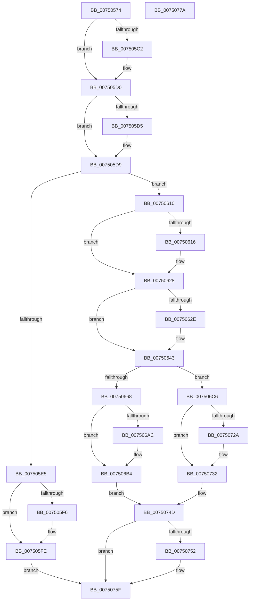

# ObpStopRuntimeStackTrace

- RVA: `0x00750574`–`0x0075077B` (길이 `519` bytes)
- VA: `0x0000000140750574`
- 실행 섹션: `PAGE`
- PDB 이름 있음: `예`; PDB Function 태그: `아니요`
- unwind 정보 RVA: `0x00060300`
- 디코드: `124`개 명령, `519/519` bytes 표시
- 미해석 바이트: `0` (있으면 어셈블리에 `.byte`로 보존)

> 이 문서는 커널 이미지의 기계어와 PDB 기호를 분석해 생성했습니다. 4번과 5번은 함수 원형과 자료형을 바이너리 사용 방식에서 추정한 C 해석이며 원본 소스 복구 결과는 아닙니다.

## 1. Dependencies

- 직접 호출 지점: **16**; 고유 호출 대상: **10**
- 직접 호출자로 확인된 함수: **1**
- RIP 상대 이미지 참조: **22**

### Outgoing calls
- `0x007505B2` → [KeAbPreAcquire](../../text/21/KeAbPreAcquire_function_00210230.md) (function, `0x00210230`)
- `0x007505CB` → [ExfAcquirePushLockExclusiveEx](../../text/20/ExfAcquirePushLockExclusiveEx_function_0020FC90.md) (function, `0x0020FC90`)
- `0x007505F9` → [ExfTryToWakePushLock](../../text/26/ExfTryToWakePushLock_function_00265DD0.md) (function, `0x00265DD0`)
- `0x00750601` → [KeAbPostRelease](../../text/2E/KeAbPostRelease_function_002E1600.md) (function, `0x002E1600`)
- `0x00750606` → [KeLeaveGuardedRegion](../../text/2E/KeLeaveGuardedRegion_function_002E2C40.md) (function, `0x002E2C40`)
- `0x00750623` → [memset](../../text/6C/memset_function_006C6C40.md) (function, `0x006C6C40`)
- `0x0075063E` → [RtlInitUnicodeStringEx](../../text/46/RtlInitUnicodeStringEx_function_00463960.md) (function, `0x00463960`)
- `0x007506AF` → [ExfTryToWakePushLock](../../text/26/ExfTryToWakePushLock_function_00265DD0.md) (function, `0x00265DD0`)
- `0x007506B7` → [KeAbPostRelease](../../text/2E/KeAbPostRelease_function_002E1600.md) (function, `0x002E1600`)
- `0x007506BC` → [KeLeaveGuardedRegion](../../text/2E/KeLeaveGuardedRegion_function_002E2C40.md) (function, `0x002E2C40`)
- `0x00750701` → [ExpInterlockedFlushSList](../../text/6B/ExpInterlockedFlushSList_function_006BA5F0.md) (function, `0x006BA5F0`)
- `0x0075072D` → [ExfTryToWakePushLock](../../text/26/ExfTryToWakePushLock_function_00265DD0.md) (function, `0x00265DD0`)
- `0x00750735` → [KeAbPostRelease](../../text/2E/KeAbPostRelease_function_002E1600.md) (function, `0x002E1600`)
- `0x0075073A` → [KeLeaveGuardedRegion](../../text/2E/KeLeaveGuardedRegion_function_002E2C40.md) (function, `0x002E2C40`)
- `0x00750748` → [ObpDestroyStackAndObjectTables](../74/ObpDestroyStackAndObjectTables_function_0074F858.md) (function, `0x0074F858`)
- `0x0075075A` → [ExFreePoolWithTag](../../poolcode/B8/ExFreePoolWithTag_function_00B82870.md) (function, `0x00B82870`)

### Direct callers
- [ObSetRefTraceInformation](../74/ObSetRefTraceInformation_function_0074F7B0.md) at `0x0074F837`

### Static image references
- `0x00750595` → RVA `0x00F0F580` (`.data`; read)
- `0x007505D9` → RVA `0x00FC5010` (`ALMOSTRO`; read)
- `0x007505E5` → RVA `0x00F0F580` (`.data`; read/write)
- `0x00750618` → RVA `0x00F0F280` (`.data`; read)
- `0x0075062E` → RVA `0x00F0F248` (`.data`; read)
- `0x00750635` → RVA `0x00F0F240` (`.data`; read)
- `0x0075064E` → RVA `0x00F0F2C0` (`.data`; read/write)
- `0x00750657` → RVA `0x00F0F2C4` (`.data`; read)
- `0x0075065D` → RVA `0x00FC5010` (`ALMOSTRO`; write)
- `0x0075066A` → RVA `0x00F0F400` (`.data`; read)
- `0x0075067E` → RVA `0x00F0F250` (`.data`; read)
- `0x00750687` → RVA `0x00F0F260` (`.data`; write)
- `0x00750694` → RVA `0x00F0F2C8` (`.data`; write)
- `0x007506C6` → RVA `0x00F0F260` (`.data`; read/write)
- `0x007506D0` → RVA `0x00F0F2C8` (`.data`; read/write)
- `0x007506D8` → RVA `0x00F0F550` (`.data`; read/write)
- `0x007506DF` → RVA `0x00F0F554` (`.data`; read/write)
- `0x007506E6` → RVA `0x00F0F588` (`.data`; read)
- `0x007506ED` → RVA `0x00F0F548` (`.data`; read)
- `0x007506FA` → RVA `0x00E27600` (`.data`; read)
- `0x00750706` → RVA `0x00F0F588` (`.data`; read/write)
- `0x00750711` → RVA `0x00F0F548` (`.data`; read/write)

## 2. Other-region calls and transfers

- 다른 실행 섹션으로 향하는 call: **15**
  - `0x007505B2` → [KeAbPreAcquire](../../text/21/KeAbPreAcquire_function_00210230.md) (`PAGE` → `.text`)
  - `0x007505CB` → [ExfAcquirePushLockExclusiveEx](../../text/20/ExfAcquirePushLockExclusiveEx_function_0020FC90.md) (`PAGE` → `.text`)
  - `0x007505F9` → [ExfTryToWakePushLock](../../text/26/ExfTryToWakePushLock_function_00265DD0.md) (`PAGE` → `.text`)
  - `0x00750601` → [KeAbPostRelease](../../text/2E/KeAbPostRelease_function_002E1600.md) (`PAGE` → `.text`)
  - `0x00750606` → [KeLeaveGuardedRegion](../../text/2E/KeLeaveGuardedRegion_function_002E2C40.md) (`PAGE` → `.text`)
  - `0x00750623` → [memset](../../text/6C/memset_function_006C6C40.md) (`PAGE` → `.text`)
  - `0x0075063E` → [RtlInitUnicodeStringEx](../../text/46/RtlInitUnicodeStringEx_function_00463960.md) (`PAGE` → `.text`)
  - `0x007506AF` → [ExfTryToWakePushLock](../../text/26/ExfTryToWakePushLock_function_00265DD0.md) (`PAGE` → `.text`)
  - `0x007506B7` → [KeAbPostRelease](../../text/2E/KeAbPostRelease_function_002E1600.md) (`PAGE` → `.text`)
  - `0x007506BC` → [KeLeaveGuardedRegion](../../text/2E/KeLeaveGuardedRegion_function_002E2C40.md) (`PAGE` → `.text`)
  - `0x00750701` → [ExpInterlockedFlushSList](../../text/6B/ExpInterlockedFlushSList_function_006BA5F0.md) (`PAGE` → `.text`)
  - `0x0075072D` → [ExfTryToWakePushLock](../../text/26/ExfTryToWakePushLock_function_00265DD0.md) (`PAGE` → `.text`)
  - `0x00750735` → [KeAbPostRelease](../../text/2E/KeAbPostRelease_function_002E1600.md) (`PAGE` → `.text`)
  - `0x0075073A` → [KeLeaveGuardedRegion](../../text/2E/KeLeaveGuardedRegion_function_002E2C40.md) (`PAGE` → `.text`)
  - `0x0075075A` → [ExFreePoolWithTag](../../poolcode/B8/ExFreePoolWithTag_function_00B82870.md) (`PAGE` → `POOLCODE`)
- 별도 외부 분기/꼬리 이동을 확인하지 못했습니다.

## 3. Assembly (complete function range)

```asm
00750574  48 89 5C 24 08                  mov qword ptr [rsp + 8], rbx
00750579  48 89 6C 24 10                  mov qword ptr [rsp + 0x10], rbp
0075057E  48 89 74 24 18                  mov qword ptr [rsp + 0x18], rsi
00750583  57                              push rdi
00750584  41 56                           push r14
00750586  41 57                           push r15
00750588  48 83 EC 20                     sub rsp, 0x20
0075058C  65 48 8B 04 25 88 01 00 00      mov rax, qword ptr gs:[0x188]
00750595  4C 8D 3D E4 EF 7B 00            lea r15, [rip + 0x7befe4]
0075059C  48 83 CB FF                     or rbx, 0xffffffffffffffff
007505A0  45 33 C0                        xor r8d, r8d
007505A3  33 D2                           xor edx, edx
007505A5  49 8B CF                        mov rcx, r15
007505A8  33 F6                           xor esi, esi
007505AA  66 01 98 E6 01 00 00            add word ptr [rax + 0x1e6], bx
007505B1  90                              nop
007505B2  E8 79 FC AB FF                  call 0x140210230
007505B7  F0 49 0F BA 2F 00               lock bts qword ptr [r15], 0
007505BD  48 8B F8                        mov rdi, rax
007505C0  73 0E                           jae 0x1407505d0
007505C2  4D 8B C7                        mov r8, r15
007505C5  48 8B D0                        mov rdx, rax
007505C8  49 8B CF                        mov rcx, r15
007505CB  E8 C0 F6 AB FF                  call 0x14020fc90
007505D0  48 85 FF                        test rdi, rdi
007505D3  74 04                           je 0x1407505d9
007505D5  C6 47 0A 01                     mov byte ptr [rdi + 0xa], 1
007505D9  8B 3D 31 4A 87 00               mov edi, dword ptr [rip + 0x874a31]
007505DF  40 F6 C7 02                     test dil, 2
007505E3  75 2B                           jne 0x140750610
007505E5  F0 48 0F C1 1D 92 EF 7B 00      lock xadd qword ptr [rip + 0x7bef92], rbx
007505EE  80 E3 06                        and bl, 6
007505F1  80 FB 02                        cmp bl, 2
007505F4  75 08                           jne 0x1407505fe
007505F6  49 8B CF                        mov rcx, r15
007505F9  E8 D2 57 B1 FF                  call 0x140265dd0
007505FE  49 8B CF                        mov rcx, r15
00750601  E8 FA 0F B9 FF                  call 0x1402e1600
00750606  E8 35 26 B9 FF                  call 0x1402e2c40
0075060B  E9 4F 01 00 00                  jmp 0x14075075f
00750610  40 F6 C7 10                     test dil, 0x10
00750614  74 12                           je 0x140750628
00750616  33 D2                           xor edx, edx
00750618  48 8D 0D 61 EC 7B 00            lea rcx, [rip + 0x7bec61]
0075061F  44 8D 42 40                     lea r8d, [rdx + 0x40]
00750623  E8 18 66 F7 FF                  call 0x1406c6c40
00750628  40 F6 C7 20                     test dil, 0x20
0075062C  74 15                           je 0x140750643
0075062E  48 8B 35 13 EC 7B 00            mov rsi, qword ptr [rip + 0x7bec13]
00750635  48 8D 0D 04 EC 7B 00            lea rcx, [rip + 0x7bec04]
0075063C  33 D2                           xor edx, edx
0075063E  E8 1D 33 D1 FF                  call 0x140463960
00750643  8B 0D C7 49 87 00               mov ecx, dword ptr [rip + 0x8749c7]
00750649  B8 8C FF FF FF                  mov eax, 0xffffff8c
0075064E  83 25 6B EC 7B 00 00            and dword ptr [rip + 0x7bec6b], 0
00750655  23 C8                           and ecx, eax
00750657  0B 0D 67 EC 7B 00               or ecx, dword ptr [rip + 0x7bec67]
0075065D  89 0D AD 49 87 00               mov dword ptr [rip + 0x8749ad], ecx
00750663  F6 C1 01                        test cl, 1
00750666  74 5E                           je 0x1407506c6
00750668  8B C1                           mov eax, ecx
0075066A  48 8D 15 8F ED 7B 00            lea rdx, [rip + 0x7bed8f]
00750671  24 10                           and al, 0x10
00750673  F6 D8                           neg al
00750675  48 1B C0                        sbb rax, rax
00750678  80 E1 20                        and cl, 0x20
0075067B  48 23 C2                        and rax, rdx
0075067E  48 8D 15 CB EB 7B 00            lea rdx, [rip + 0x7bebcb]
00750685  F6 D9                           neg cl
00750687  48 89 05 D2 EB 7B 00            mov qword ptr [rip + 0x7bebd2], rax
0075068E  48 1B C0                        sbb rax, rax
00750691  48 23 C2                        and rax, rdx
00750694  48 89 05 2D EC 7B 00            mov qword ptr [rip + 0x7bec2d], rax
0075069B  F0 48 0F C1 1D DC EE 7B 00      lock xadd qword ptr [rip + 0x7beedc], rbx
007506A4  80 E3 06                        and bl, 6
007506A7  80 FB 02                        cmp bl, 2
007506AA  75 08                           jne 0x1407506b4
007506AC  49 8B CF                        mov rcx, r15
007506AF  E8 1C 57 B1 FF                  call 0x140265dd0
007506B4  49 8B CF                        mov rcx, r15
007506B7  E8 44 0F B9 FF                  call 0x1402e1600
007506BC  E8 7F 25 B9 FF                  call 0x1402e2c40
007506C1  E9 87 00 00 00                  jmp 0x14075074d
007506C6  48 83 25 92 EB 7B 00 00         and qword ptr [rip + 0x7beb92], 0
007506CE  23 C8                           and ecx, eax
007506D0  48 83 25 F0 EB 7B 00 00         and qword ptr [rip + 0x7bebf0], 0
007506D8  83 25 71 EE 7B 00 00            and dword ptr [rip + 0x7bee71], 0
007506DF  83 25 6E EE 7B 00 00            and dword ptr [rip + 0x7bee6e], 0
007506E6  48 8B 3D 9B EE 7B 00            mov rdi, qword ptr [rip + 0x7bee9b]
007506ED  48 8B 2D 54 EE 7B 00            mov rbp, qword ptr [rip + 0x7bee54]
007506F4  89 0D 16 49 87 00               mov dword ptr [rip + 0x874916], ecx
007506FA  48 8D 0D FF 6E 6D 00            lea rcx, [rip + 0x6d6eff]
00750701  E8 EA 9E F6 FF                  call 0x1406ba5f0
00750706  48 83 25 7A EE 7B 00 00         and qword ptr [rip + 0x7bee7a], 0
0075070E  4C 8B F0                        mov r14, rax
00750711  48 83 25 2F EE 7B 00 00         and qword ptr [rip + 0x7bee2f], 0
00750719  F0 48 0F C1 1D 5E EE 7B 00      lock xadd qword ptr [rip + 0x7bee5e], rbx
00750722  80 E3 06                        and bl, 6
00750725  80 FB 02                        cmp bl, 2
00750728  75 08                           jne 0x140750732
0075072A  49 8B CF                        mov rcx, r15
0075072D  E8 9E 56 B1 FF                  call 0x140265dd0
00750732  49 8B CF                        mov rcx, r15
00750735  E8 C6 0E B9 FF                  call 0x1402e1600
0075073A  E8 01 25 B9 FF                  call 0x1402e2c40
0075073F  4D 8B C6                        mov r8, r14
00750742  48 8B D5                        mov rdx, rbp
00750745  48 8B CF                        mov rcx, rdi
00750748  E8 0B F1 FF FF                  call 0x14074f858
0075074D  48 85 F6                        test rsi, rsi
00750750  74 0D                           je 0x14075075f
00750752  BA 4F 62 52 74                  mov edx, 0x7452624f
00750757  48 8B CE                        mov rcx, rsi
0075075A  E8 11 21 43 00                  call 0x140b82870
0075075F  48 8B 5C 24 40                  mov rbx, qword ptr [rsp + 0x40]
00750764  33 C0                           xor eax, eax
00750766  48 8B 6C 24 48                  mov rbp, qword ptr [rsp + 0x48]
0075076B  48 8B 74 24 50                  mov rsi, qword ptr [rsp + 0x50]
00750770  48 83 C4 20                     add rsp, 0x20
00750774  41 5F                           pop r15
00750776  41 5E                           pop r14
00750778  5F                              pop rdi
00750779  C3                              ret
0075077A  CC                              int3
```

## 4. C-style interpretation (structured pseudocode)

```c
__int64 __fastcall ObpStopRuntimeStackTrace(__int64 a1, int a2, int a3)
{
    __int64 result;
    __int64 v_rbx;
    __int64 v_rsi;
    __int64 v_rsp;
    unsigned __int64 v_stack_p10;
    unsigned __int64 v_stack_p18;
    unsigned __int64 v_stack_p8;

    v_stack_p8 = v_rbx;
    v_stack_p10 = v_rbp;
    v_stack_p18 = v_rsi;
    v_rsp = (v_rsp) - (32);
    v_rbx = (v_rbx) | (-1);
    a3 = 0;
    a2 = 0;
    v_rsi = 0;
    result = KeAbPreAcquire(v_rip + 8122340, a2, a3, a4);
    if (!(condition_is_above_or_equal)) {
        a3 = v_rip + 8122340;
        a2 = result;
        a1 = v_rip + 8122340;
        result = ExfAcquirePushLockExclusiveEx(a1, a2, a3, a4);
    }
    if (result != 0) {
        *(unsigned __int8 *)(result + 10) = 1;
    }
    if ((((unsigned __int8)((unsigned int)(*(unsigned int *)(v_rip + 8866353)))) & (2)) != 0) goto loc_00750610;
    v_rbx = (unsigned __int8)((v_rbx) & (6));
    if (((unsigned __int8)(v_rbx)) == 2) {
        a1 = v_rip + 8122340;
        result = ExfTryToWakePushLock(a1, a2, a3, a4);
    }
    result = KeAbPostRelease(v_rip + 8122340, a2, a3, a4);
    result = KeLeaveGuardedRegion(v_rip + 8122340, a2, a3, a4);
    goto loc_0075075F;
loc_00750610:
    if ((((unsigned __int8)((unsigned int)(*(unsigned int *)(v_rip + 8866353)))) & (16)) != 0) {
        a2 = 0;
        a1 = v_rip + 8121441;
        a3 = a2 + 64;
        result = memset(a1, a2, a3, a4);
    }
    if ((((unsigned __int8)((unsigned int)(*(unsigned int *)(v_rip + 8866353)))) & (32)) != 0) {
        v_rsi = *(unsigned __int64 *)(v_rip + 8121363);
        a1 = v_rip + 8121348;
        a2 = 0;
        result = RtlInitUnicodeStringEx(a1, a2, a3, a4);
    }
    a1 = (unsigned int)(((unsigned int)(*(unsigned int *)(v_rip + 8866247))) & ((unsigned int)((unsigned int)(0xFFFFFF8CULL))));
    a1 = (unsigned int)((a1) | (*(unsigned int *)(v_rip + 8121447)));
    *(unsigned int *)(v_rip + 8866221) = (unsigned int)(a1);
    if ((((unsigned __int8)(a1)) & (1)) == 0) goto loc_007506C6;
    result = (unsigned __int8)(((unsigned int)((unsigned int)(a1))) & (16));
    result = (unsigned __int8)(-(result));
    a1 = (unsigned __int8)((a1) & (32));
    result = (result) & (v_rip + 8121743);
    a1 = (unsigned __int8)(-(a1));
    *(unsigned __int64 *)(v_rip + 8121298) = result;
    result = (result) & (v_rip + 8121291);
    *(unsigned __int64 *)(v_rip + 8121389) = result;
    v_rbx = (unsigned __int8)((v_rbx) & (6));
    if (((unsigned __int8)(v_rbx)) == 2) {
        a1 = v_rip + 8122340;
        result = ExfTryToWakePushLock(a1, v_rip + 8121291, a3, a4);
    }
    result = KeAbPostRelease(v_rip + 8122340, v_rip + 8121291, a3, a4);
    result = KeLeaveGuardedRegion(v_rip + 8122340, v_rip + 8121291, a3, a4);
    goto loc_0075074D;
loc_007506C6:
    a1 = (unsigned int)((v_rip + 8122340) & ((unsigned int)(result)));
    *(unsigned int *)(v_rip + 8866070) = (unsigned int)(a1);
    result = ExpInterlockedFlushSList(v_rip + 7171839, v_rip + 8121291, a3, a4);
    v_rbx = (unsigned __int8)((v_rbx) & (6));
    if (((unsigned __int8)(v_rbx)) == 2) {
        a1 = v_rip + 8122340;
        result = ExfTryToWakePushLock(a1, v_rip + 8121291, a3, a4);
    }
    result = KeAbPostRelease(v_rip + 8122340, v_rip + 8121291, a3, a4);
    result = KeLeaveGuardedRegion(v_rip + 8122340, v_rip + 8121291, a3, a4);
    result = ObpDestroyStackAndObjectTables(*(unsigned __int64 *)(v_rip + 8122011), *(unsigned __int64 *)(v_rip + 8121940), result, a4);
loc_0075074D:
    if (v_rsi != 0) {
        a2 = 0x7452624FULL;
        a1 = v_rsi;
        result = ExFreePoolWithTag(a1, a2, result, a4);
    }
    result = 0;
    v_rsp = (v_rsp) + (32);
    return result;
}
```

## 5. (Beta) C Style

```c
int64_t ObpStopRuntimeStackTrace(int64_t Arg1, int32_t Arg2, int32_t Arg3)
{
    int64_t result;
    int64_t local_rbx;
    int64_t local_rsi;
    int64_t local_rsp;
    uint64_t v_stack_p10;
    uint64_t v_stack_p18;
    uint64_t v_stack_p8;

    v_stack_p8 = local_rbx;
    v_stack_p10 = local_rbp;
    v_stack_p18 = local_rsi;
    local_rsp = (local_rsp) - (32);
    local_rbx = (local_rbx) | (-1);
    Arg3 = 0;
    Arg2 = 0;
    local_rsi = 0;
    result = KeAbPreAcquire(v_rip + 8122340, Arg2, Arg3, a4);
    if (!(condition_is_above_or_equal)) {
        Arg3 = v_rip + 8122340;
        Arg2 = result;
        Arg1 = v_rip + 8122340;
        result = ExfAcquirePushLockExclusiveEx(Arg1, Arg2, Arg3, a4);
    }
    if (result != 0) {
        *(uint8_t *)(result + 0xA) = 1;
    }
    if ((((uint8_t)((uint32_t)(*(uint32_t *)(v_rip + 0x874A31)))) & (2)) != 0) goto loc_00750610;
    local_rbx = (uint8_t)((local_rbx) & (6));
    if (((uint8_t)(local_rbx)) == 2) {
        Arg1 = v_rip + 8122340;
        result = ExfTryToWakePushLock(Arg1, Arg2, Arg3, a4);
    }
    result = KeAbPostRelease(v_rip + 8122340, Arg2, Arg3, a4);
    result = KeLeaveGuardedRegion(v_rip + 8122340, Arg2, Arg3, a4);
    goto loc_0075075F;
loc_00750610:
    if ((((uint8_t)((uint32_t)(*(uint32_t *)(v_rip + 0x874A31)))) & (16)) != 0) {
        Arg2 = 0;
        Arg1 = v_rip + 8121441;
        Arg3 = Arg2 + 64;
        result = memset(Arg1, Arg2, Arg3, a4);
    }
    if ((((uint8_t)((uint32_t)(*(uint32_t *)(v_rip + 0x874A31)))) & (32)) != 0) {
        local_rsi = *(uint64_t *)(v_rip + 0x7BEC13);
        Arg1 = v_rip + 8121348;
        Arg2 = 0;
        result = RtlInitUnicodeStringEx(Arg1, Arg2, Arg3, a4);
    }
    Arg1 = (uint32_t)(((uint32_t)(*(uint32_t *)(v_rip + 0x8749C7))) & ((uint32_t)((uint32_t)(0xFFFFFF8CULL))));
    Arg1 = (uint32_t)((Arg1) | (*(uint32_t *)(v_rip + 0x7BEC67)));
    *(uint32_t *)(v_rip + 0x8749AD) = (uint32_t)(Arg1);
    if ((((uint8_t)(Arg1)) & (1)) == 0) goto loc_007506C6;
    result = (uint8_t)(((uint32_t)((uint32_t)(Arg1))) & (16));
    result = (uint8_t)(-(result));
    Arg1 = (uint8_t)((Arg1) & (32));
    result = (result) & (v_rip + 8121743);
    Arg1 = (uint8_t)(-(Arg1));
    *(uint64_t *)(v_rip + 0x7BEBD2) = result;
    result = (result) & (v_rip + 8121291);
    *(uint64_t *)(v_rip + 0x7BEC2D) = result;
    local_rbx = (uint8_t)((local_rbx) & (6));
    if (((uint8_t)(local_rbx)) == 2) {
        Arg1 = v_rip + 8122340;
        result = ExfTryToWakePushLock(Arg1, v_rip + 8121291, Arg3, a4);
    }
    result = KeAbPostRelease(v_rip + 8122340, v_rip + 8121291, Arg3, a4);
    result = KeLeaveGuardedRegion(v_rip + 8122340, v_rip + 8121291, Arg3, a4);
    goto loc_0075074D;
loc_007506C6:
    Arg1 = (uint32_t)((v_rip + 8122340) & ((uint32_t)(result)));
    *(uint32_t *)(v_rip + 0x874916) = (uint32_t)(Arg1);
    result = ExpInterlockedFlushSList(v_rip + 7171839, v_rip + 8121291, Arg3, a4);
    local_rbx = (uint8_t)((local_rbx) & (6));
    if (((uint8_t)(local_rbx)) == 2) {
        Arg1 = v_rip + 8122340;
        result = ExfTryToWakePushLock(Arg1, v_rip + 8121291, Arg3, a4);
    }
    result = KeAbPostRelease(v_rip + 8122340, v_rip + 8121291, Arg3, a4);
    result = KeLeaveGuardedRegion(v_rip + 8122340, v_rip + 8121291, Arg3, a4);
    result = ObpDestroyStackAndObjectTables(*(uint64_t *)(v_rip + 0x7BEE9B), *(uint64_t *)(v_rip + 0x7BEE54), result, a4);
loc_0075074D:
    if (local_rsi != 0) {
        Arg2 = 0x7452624FULL;
        Arg1 = local_rsi;
        result = ExFreePoolWithTag(Arg1, Arg2, result, a4);
    }
    result = 0;
    local_rsp = (local_rsp) + (32);
    return result;
}
```

## 6. Execution-region graph

[열기: 2D/3D 그래프와 함수 탐색 컨트롤 패널](../../../control-panel.html?section=page&rva=0x00750574&view=graph)

- 2D 그래프는 위에서 아래로 흐르고, 3D 그래프는 빈 공간을 드래그해 회전합니다. Shift+드래그는 이동, 휠은 확대·축소, 함수 노드 선택은 대상 보고서 이동입니다.

### Static fallback


