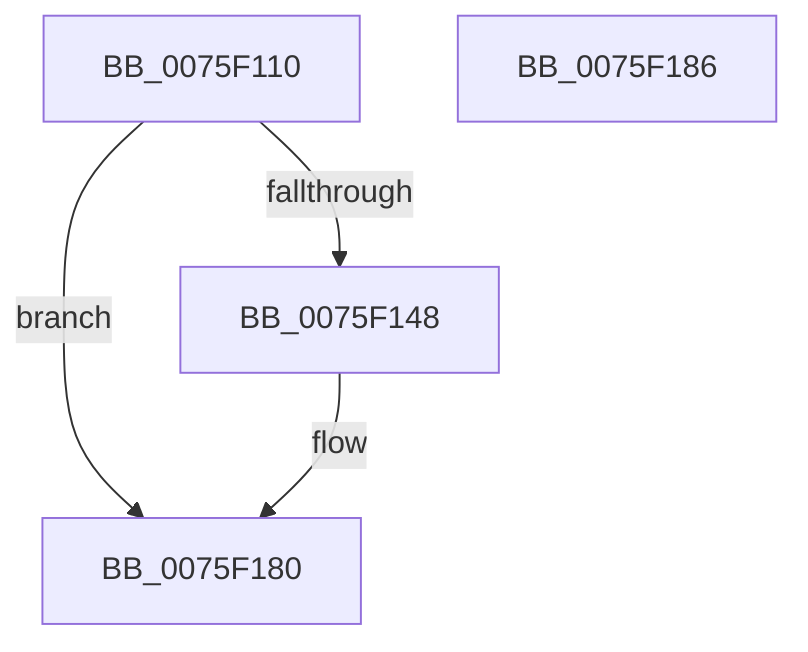

# PdcPoLidReliabilityUpdateCallback

- RVA: `0x0075F110`–`0x0075F187` (길이 `119` bytes)
- VA: `0x000000014075F110`
- 실행 섹션: `PAGE`
- PDB 이름 있음: `예`; PDB Function 태그: `아니요`
- unwind 정보 RVA: `0x0005CF00`
- 디코드: `30`개 명령, `119/119` bytes 표시
- 미해석 바이트: `0` (있으면 어셈블리에 `.byte`로 보존)

> 이 문서는 커널 이미지의 기계어와 PDB 기호를 분석해 생성했습니다. 4번과 5번은 함수 원형과 자료형을 바이너리 사용 방식에서 추정한 C 해석이며 원본 소스 복구 결과는 아닙니다.

## 1. Dependencies

- 직접 호출 지점: **4**; 고유 호출 대상: **4**
- 직접 호출자로 확인된 함수: **1**
- RIP 상대 이미지 참조: **6**

### Outgoing calls
- `0x0075F13A` → [PopSetPowerSettingValueAcDc](../91/PopSetPowerSettingValueAcDc_function_00914D6C.md) (function, `0x00914D6C`)
- `0x0075F14F` → [PopAcquireRwLockExclusive](../../text/43/PopAcquireRwLockExclusive_function_00430B44.md) (function, `0x00430B44`)
- `0x0075F16F` → [PopBsdHandleRequest](../../text/4B/PopBsdHandleRequest_function_004B27A0.md) (function, `0x004B27A0`)
- `0x0075F17B` → [PopReleaseRwLock](../../text/2D/PopReleaseRwLock_function_002DFBBC.md) (function, `0x002DFBBC`)

### Direct callers
- [PopLidReliabilityInit](../../text/5D/PopLidReliabilityInit_function_005D5308.md) at `0x005D53A6`

### Static image references
- `0x0075F126` → RVA `0x00024898` (`.rdata`; read)
- `0x0075F134` → RVA `0x00E0B570` (`.data`; read/write)
- `0x0075F13F` → RVA `0x00F0F1F0` (`.data`; read)
- `0x0075F148` → RVA `0x00F0F1E0` (`.data`; read)
- `0x0075F154` → RVA `0x00E673F1` (`.data`; read)
- `0x0075F169` → RVA `0x00E673F1` (`.data`; write)

## 2. Other-region calls and transfers

- 다른 실행 섹션으로 향하는 call: **3**
  - `0x0075F14F` → [PopAcquireRwLockExclusive](../../text/43/PopAcquireRwLockExclusive_function_00430B44.md) (`PAGE` → `.text`)
  - `0x0075F16F` → [PopBsdHandleRequest](../../text/4B/PopBsdHandleRequest_function_004B27A0.md) (`PAGE` → `.text`)
  - `0x0075F17B` → [PopReleaseRwLock](../../text/2D/PopReleaseRwLock_function_002DFBBC.md) (`PAGE` → `.text`)
- 별도 외부 분기/꼬리 이동을 확인하지 못했습니다.

## 3. Assembly (complete function range)

```asm
0075F110  40 53                           push rbx
0075F112  48 83 EC 20                     sub rsp, 0x20
0075F116  33 C0                           xor eax, eax
0075F118  4C 8D 44 24 30                  lea r8, [rsp + 0x30]
0075F11D  84 C9                           test cl, cl
0075F11F  8A D9                           mov bl, cl
0075F121  BA 04 00 00 00                  mov edx, 4
0075F126  48 8D 0D 6B 57 8C FF            lea rcx, [rip - 0x73a895]
0075F12D  0F 95 C0                        setne al
0075F130  89 44 24 30                     mov dword ptr [rsp + 0x30], eax
0075F134  87 05 36 C4 6A 00               xchg dword ptr [rip + 0x6ac436], eax
0075F13A  E8 2D 5C 1B 00                  call 0x140914d6c
0075F13F  80 3D AA 00 7B 00 00            cmp byte ptr [rip + 0x7b00aa], 0
0075F146  75 38                           jne 0x14075f180
0075F148  48 8D 0D 91 00 7B 00            lea rcx, [rip + 0x7b0091]
0075F14F  E8 F0 19 CD FF                  call 0x140430b44
0075F154  8A 05 97 82 70 00               mov al, byte ptr [rip + 0x708297]
0075F15A  80 E3 01                        and bl, 1
0075F15D  24 EF                           and al, 0xef
0075F15F  C0 E3 04                        shl bl, 4
0075F162  0A D8                           or bl, al
0075F164  B9 02 00 00 00                  mov ecx, 2
0075F169  88 1D 82 82 70 00               mov byte ptr [rip + 0x708282], bl
0075F16F  E8 2C 36 D5 FF                  call 0x1404b27a0
0075F174  48 8D 0D 65 00 7B 00            lea rcx, [rip + 0x7b0065]
0075F17B  E8 3C 0A B8 FF                  call 0x1402dfbbc
0075F180  48 83 C4 20                     add rsp, 0x20
0075F184  5B                              pop rbx
0075F185  C3                              ret
0075F186  CC                              int3
```

## 4. C-style interpretation (structured pseudocode)

```c
__int64 __fastcall PdcPoLidReliabilityUpdateCallback(unsigned __int8 a1)
{
    __int64 result;
    __int64 v_rbx;
    __int64 v_rsp;
    unsigned __int64 v_stack_p8;

    v_rsp = (v_rsp) - (32);
    result = 0;
    result = (a1 != 0) ? 1 : 0;
    v_stack_p8 = (unsigned int)(result);
    result = PopSetPowerSettingValueAcDc(v_rip - 7579797, 4, v_stack_p8, a4);
    v_rbx = a1;
    if ((*(unsigned __int8 *)(v_rip + 8061098)) == 0) {
        a1 = v_rip + 8061073;
        result = PopAcquireRwLockExclusive(a1, 4, v_stack_p8, a4);
        result = *(unsigned __int8 *)(v_rip + 7373463);
        v_rbx = (unsigned __int8)((a1) & (1));
        result = (unsigned __int8)((result) & (239));
        v_rbx = (unsigned __int8)((v_rbx) << (4));
        v_rbx = (unsigned __int8)((v_rbx) | ((unsigned __int8)(result)));
        a1 = 2;
        *(unsigned __int8 *)(v_rip + 7373442) = (unsigned __int8)(v_rbx);
        result = PopBsdHandleRequest(a1, 4, v_stack_p8, a4);
        a1 = v_rip + 8061029;
        result = PopReleaseRwLock(a1, 4, v_stack_p8, a4);
    }
    v_rsp = (v_rsp) + (32);
    return result;
}
```

## 5. (Beta) C Style

```c
int64_t PdcPoLidReliabilityUpdateCallback(uint8_t Arg1)
{
    int64_t result;
    int64_t local_rbx;
    int64_t local_rsp;
    uint64_t v_stack_p8;

    local_rsp = (local_rsp) - (32);
    result = 0;
    result = (Arg1 != 0) ? 1 : 0;
    v_stack_p8 = (uint32_t)(result);
    result = PopSetPowerSettingValueAcDc(v_rip - 7579797, 4, v_stack_p8, a4);
    local_rbx = Arg1;
    if ((*(uint8_t *)(v_rip + 0x7B00AA)) == 0) {
        Arg1 = v_rip + 8061073;
        result = PopAcquireRwLockExclusive(Arg1, 4, v_stack_p8, a4);
        result = *(uint8_t *)(v_rip + 0x708297);
        local_rbx = (uint8_t)((Arg1) & (1));
        result = (uint8_t)((result) & (239));
        local_rbx = (uint8_t)((local_rbx) << (4));
        local_rbx = (uint8_t)((local_rbx) | ((uint8_t)(result)));
        Arg1 = 2;
        *(uint8_t *)(v_rip + 0x708282) = (uint8_t)(local_rbx);
        result = PopBsdHandleRequest(Arg1, 4, v_stack_p8, a4);
        Arg1 = v_rip + 8061029;
        result = PopReleaseRwLock(Arg1, 4, v_stack_p8, a4);
    }
    local_rsp = (local_rsp) + (32);
    return result;
}
```

## 6. Execution-region graph

[열기: 2D/3D 그래프와 함수 탐색 컨트롤 패널](../../../control-panel.html?section=page&rva=0x0075F110&view=graph)

- 2D 그래프는 위에서 아래로 흐르고, 3D 그래프는 빈 공간을 드래그해 회전합니다. Shift+드래그는 이동, 휠은 확대·축소, 함수 노드 선택은 대상 보고서 이동입니다.

### Static fallback


