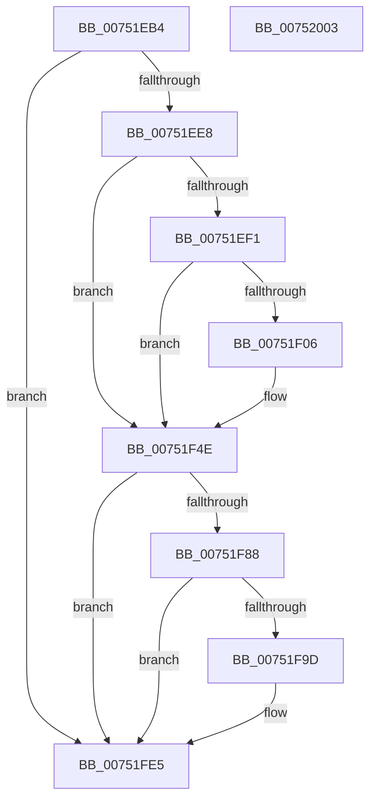

# PfDeletePartition

- RVA: `0x00751EB4`–`0x00752004` (길이 `336` bytes)
- VA: `0x0000000140751EB4`
- 실행 섹션: `PAGE`
- PDB 이름 있음: `예`; PDB Function 태그: `아니요`
- unwind 정보 RVA: `0x000BF160`
- 디코드: `78`개 명령, `336/336` bytes 표시
- 미해석 바이트: `0` (있으면 어셈블리에 `.byte`로 보존)

> 이 문서는 커널 이미지의 기계어와 PDB 기호를 분석해 생성했습니다. 4번과 5번은 함수 원형과 자료형을 바이너리 사용 방식에서 추정한 C 해석이며 원본 소스 복구 결과는 아닙니다.

## 1. Dependencies

- 직접 호출 지점: **12**; 고유 호출 대상: **9**
- 직접 호출자로 확인된 함수: **1**
- RIP 상대 이미지 참조: **5**

### Outgoing calls
- `0x00751ED7` → [MiReadReverseMapAttributes](../../text/4A/MiReadReverseMapAttributes_function_004A32D4.md) (function, `0x004A32D4`)
- `0x00751EFD` → [tlgKeywordOn](../../text/42/tlgKeywordOn_function_0042EAA0.md) (function, `0x0042EAA0`)
- `0x00751F09` → [PfpTraceLogPfPartitionId](../../text/5C/PfpTraceLogPfPartitionId_function_005CE1CC.md) (function, `0x005CE1CC`)
- `0x00751F49` → [tlgWriteTransfer_EtwWriteTransfer](../../text/42/tlgWriteTransfer_EtwWriteTransfer_function_004260E0.md) (function, `0x004260E0`)
- `0x00751F52` → [ExWaitForRundownProtectionReleaseCacheAware](../../text/46/ExWaitForRundownProtectionReleaseCacheAware_function_004643A0.md) (function, `0x004643A0`)
- `0x00751F5A` → [PfpPartitionRemoveFromGlobals](../../text/5C/PfpPartitionRemoveFromGlobals_function_005CE11C.md) (function, `0x005CE11C`)
- `0x00751F62` → [PfpPartitionCleanup](PfpPartitionCleanup_function_00752050.md) (function, `0x00752050`)
- `0x00751F6F` → [ExFreePoolWithTag](../../poolcode/B8/ExFreePoolWithTag_function_00B82870.md) (function, `0x00B82870`)
- `0x00751F94` → [tlgKeywordOn](../../text/42/tlgKeywordOn_function_0042EAA0.md) (function, `0x0042EAA0`)
- `0x00751FA0` → [PfpTraceLogPfPartitionId](../../text/5C/PfpTraceLogPfPartitionId_function_005CE1CC.md) (function, `0x005CE1CC`)
- `0x00751FE0` → [tlgWriteTransfer_EtwWriteTransfer](../../text/42/tlgWriteTransfer_EtwWriteTransfer_function_004260E0.md) (function, `0x004260E0`)
- `0x00751FEC` → [_security_check_cookie](../../text/6A/_security_check_cookie_function_006AC640.md) (function, `0x006AC640`)

### Direct callers
- [MiDeletePartitionResources](../80/MiDeletePartitionResources_function_0080D074.md) at `0x0080D14F`

### Static image references
- `0x00751EC6` → RVA `0x00E0A740` (`.data`; read)
- `0x00751EE8` → RVA `0x00E074D8` (`.data`; read)
- `0x00751F12` → RVA `0x00048A6F` (`.rdata`; read)
- `0x00751F74` → RVA `0x00FC6C08` (`ALMOSTRO`; read)
- `0x00751FA9` → RVA `0x00048AE8` (`.rdata`; read)

## 2. Other-region calls and transfers

- 다른 실행 섹션으로 향하는 call: **11**
  - `0x00751ED7` → [MiReadReverseMapAttributes](../../text/4A/MiReadReverseMapAttributes_function_004A32D4.md) (`PAGE` → `.text`)
  - `0x00751EFD` → [tlgKeywordOn](../../text/42/tlgKeywordOn_function_0042EAA0.md) (`PAGE` → `.text`)
  - `0x00751F09` → [PfpTraceLogPfPartitionId](../../text/5C/PfpTraceLogPfPartitionId_function_005CE1CC.md) (`PAGE` → `.text`)
  - `0x00751F49` → [tlgWriteTransfer_EtwWriteTransfer](../../text/42/tlgWriteTransfer_EtwWriteTransfer_function_004260E0.md) (`PAGE` → `.text`)
  - `0x00751F52` → [ExWaitForRundownProtectionReleaseCacheAware](../../text/46/ExWaitForRundownProtectionReleaseCacheAware_function_004643A0.md) (`PAGE` → `.text`)
  - `0x00751F5A` → [PfpPartitionRemoveFromGlobals](../../text/5C/PfpPartitionRemoveFromGlobals_function_005CE11C.md) (`PAGE` → `.text`)
  - `0x00751F6F` → [ExFreePoolWithTag](../../poolcode/B8/ExFreePoolWithTag_function_00B82870.md) (`PAGE` → `POOLCODE`)
  - `0x00751F94` → [tlgKeywordOn](../../text/42/tlgKeywordOn_function_0042EAA0.md) (`PAGE` → `.text`)
  - `0x00751FA0` → [PfpTraceLogPfPartitionId](../../text/5C/PfpTraceLogPfPartitionId_function_005CE1CC.md) (`PAGE` → `.text`)
  - `0x00751FE0` → [tlgWriteTransfer_EtwWriteTransfer](../../text/42/tlgWriteTransfer_EtwWriteTransfer_function_004260E0.md) (`PAGE` → `.text`)
  - `0x00751FEC` → [_security_check_cookie](../../text/6A/_security_check_cookie_function_006AC640.md) (`PAGE` → `.text`)
- 별도 외부 분기/꼬리 이동을 확인하지 못했습니다.

## 3. Assembly (complete function range)

```asm
00751EB4  48 89 5C 24 10                  mov qword ptr [rsp + 0x10], rbx
00751EB9  48 89 7C 24 18                  mov qword ptr [rsp + 0x18], rdi
00751EBE  55                              push rbp
00751EBF  48 8B EC                        mov rbp, rsp
00751EC2  48 83 EC 70                     sub rsp, 0x70
00751EC6  48 8B 05 73 88 6B 00            mov rax, qword ptr [rip + 0x6b8873]
00751ECD  48 33 C4                        xor rax, rsp
00751ED0  48 89 45 F8                     mov qword ptr [rbp - 8], rax
00751ED4  48 8B F9                        mov rdi, rcx
00751ED7  E8 F8 13 D5 FF                  call 0x1404a32d4
00751EDC  48 8B D8                        mov rbx, rax
00751EDF  48 85 C0                        test rax, rax
00751EE2  0F 84 FD 00 00 00               je 0x140751fe5
00751EE8  83 3D E9 55 6B 00 04            cmp dword ptr [rip + 0x6b55e9], 4
00751EEF  76 5D                           jbe 0x140751f4e
00751EF1  BA 01 00 00 00                  mov edx, 1
00751EF6  48 8D 0D DB 55 6B 00            lea rcx, [rip + 0x6b55db]
00751EFD  E8 9E CB CD FF                  call 0x14042eaa0
00751F02  84 C0                           test al, al
00751F04  74 48                           je 0x140751f4e
00751F06  48 8B CB                        mov rcx, rbx
00751F09  E8 BE C2 E7 FF                  call 0x1405ce1cc
00751F0E  83 65 F4 00                     and dword ptr [rbp - 0xc], 0
00751F12  48 8D 15 56 6B 8F FF            lea rdx, [rip - 0x7094aa]
00751F19  89 45 C0                        mov dword ptr [rbp - 0x40], eax
00751F1C  48 8D 0D B5 55 6B 00            lea rcx, [rip + 0x6b55b5]
00751F23  48 8D 45 C0                     lea rax, [rbp - 0x40]
00751F27  C7 45 F0 04 00 00 00            mov dword ptr [rbp - 0x10], 4
00751F2E  48 89 45 E8                     mov qword ptr [rbp - 0x18], rax
00751F32  45 33 C9                        xor r9d, r9d
00751F35  48 8D 45 C8                     lea rax, [rbp - 0x38]
00751F39  45 33 C0                        xor r8d, r8d
00751F3C  48 89 44 24 28                  mov qword ptr [rsp + 0x28], rax
00751F41  C7 44 24 20 03 00 00 00         mov dword ptr [rsp + 0x20], 3
00751F49  E8 92 41 CD FF                  call 0x1404260e0
00751F4E  48 8B 4B 10                     mov rcx, qword ptr [rbx + 0x10]
00751F52  E8 49 24 D1 FF                  call 0x1404643a0
00751F57  48 8B CB                        mov rcx, rbx
00751F5A  E8 BD C1 E7 FF                  call 0x1405ce11c
00751F5F  48 8B CB                        mov rcx, rbx
00751F62  E8 E9 00 00 00                  call 0x140752050
00751F67  BA 50 66 50 74                  mov edx, 0x74506650
00751F6C  48 8B CB                        mov rcx, rbx
00751F6F  E8 FC 08 43 00                  call 0x140b82870
00751F74  48 8B 05 8D 4C 87 00            mov rax, qword ptr [rip + 0x874c8d]
00751F7B  48 89 47 20                     mov qword ptr [rdi + 0x20], rax
00751F7F  83 3D 52 55 6B 00 04            cmp dword ptr [rip + 0x6b5552], 4
00751F86  76 5D                           jbe 0x140751fe5
00751F88  BA 01 00 00 00                  mov edx, 1
00751F8D  48 8D 0D 44 55 6B 00            lea rcx, [rip + 0x6b5544]
00751F94  E8 07 CB CD FF                  call 0x14042eaa0
00751F99  84 C0                           test al, al
00751F9B  74 48                           je 0x140751fe5
00751F9D  48 8B CB                        mov rcx, rbx
00751FA0  E8 27 C2 E7 FF                  call 0x1405ce1cc
00751FA5  83 65 F4 00                     and dword ptr [rbp - 0xc], 0
00751FA9  48 8D 15 38 6B 8F FF            lea rdx, [rip - 0x7094c8]
00751FB0  89 45 C0                        mov dword ptr [rbp - 0x40], eax
00751FB3  48 8D 0D 1E 55 6B 00            lea rcx, [rip + 0x6b551e]
00751FBA  48 8D 45 C0                     lea rax, [rbp - 0x40]
00751FBE  C7 45 F0 04 00 00 00            mov dword ptr [rbp - 0x10], 4
00751FC5  48 89 45 E8                     mov qword ptr [rbp - 0x18], rax
00751FC9  45 33 C9                        xor r9d, r9d
00751FCC  48 8D 45 C8                     lea rax, [rbp - 0x38]
00751FD0  45 33 C0                        xor r8d, r8d
00751FD3  48 89 44 24 28                  mov qword ptr [rsp + 0x28], rax
00751FD8  C7 44 24 20 03 00 00 00         mov dword ptr [rsp + 0x20], 3
00751FE0  E8 FB 40 CD FF                  call 0x1404260e0
00751FE5  48 8B 4D F8                     mov rcx, qword ptr [rbp - 8]
00751FE9  48 33 CC                        xor rcx, rsp
00751FEC  E8 4F A6 F5 FF                  call 0x1406ac640
00751FF1  4C 8D 5C 24 70                  lea r11, [rsp + 0x70]
00751FF6  49 8B 5B 18                     mov rbx, qword ptr [r11 + 0x18]
00751FFA  49 8B 7B 20                     mov rdi, qword ptr [r11 + 0x20]
00751FFE  49 8B E3                        mov rsp, r11
00752001  5D                              pop rbp
00752002  C3                              ret
00752003  CC                              int3
```

## 4. C-style interpretation (structured pseudocode)

```c
__int64 __fastcall PfDeletePartition(__int64 a1, __int64 a2, int a3, int a4)
{
    __int64 result;
    __int64 v_rsp;
    unsigned __int64 v_stack_m10;
    unsigned int v_stack_m14;
    unsigned int v_stack_m18;
    unsigned __int64 v_stack_m20;
    unsigned __int64 v_stack_m40;
    unsigned int v_stack_m48;
    unsigned __int64 v_stack_m50;
    unsigned int v_stack_m58;
    unsigned __int64 v_stack_m8;
    unsigned __int64 v_stack_p10;
    unsigned __int64 v_stack_p18;

    v_stack_p10 = v_rbx;
    v_stack_p18 = v_rdi;
    v_rsp = (v_rsp) - (112);
    result = (*(unsigned __int64 *)(v_rip + 7047283)) ^ (v_rsp);
    v_stack_m10 = result;
    result = MiReadReverseMapAttributes(a1, a2, a3, a4);
    if (result == 0) goto loc_00751FE5;
    if ((*(unsigned int *)(v_rip + 7034345)) <= 4) goto loc_00751F4E;
    result = tlgKeywordOn(v_rip + 7034331, 1, a3, a4);
    if ((unsigned __int8)(result) != 0) {
        a1 = result;
        result = PfpTraceLogPfPartitionId(a1, 1, a3, a4);
        a2 = v_rip - 7378090;
        v_stack_m48 = (unsigned int)(result);
        a1 = v_rip + 7034293;
        result = v_stack_m48;
        v_stack_m18 = 4;
        v_stack_m20 = result;
        a4 = 0;
        result = v_stack_m40;
        a3 = 0;
        v_stack_m50 = result;
        v_stack_m58 = 3;
        result = tlgWriteTransfer_EtwWriteTransfer(a1, a2, a3, a4);
    }
    result = ExWaitForRundownProtectionReleaseCacheAware(*(unsigned __int64 *)(result + 16), a2, a3, a4);
    result = PfpPartitionRemoveFromGlobals(result, a2, a3, a4);
    result = PfpPartitionCleanup(result, a2, a3, a4);
    result = ExFreePoolWithTag(result, (unsigned int)(0x74506650ULL), a3, a4);
    *(unsigned __int64 *)(a1 + 32) = *(unsigned __int64 *)(v_rip + 8866957);
    if ((*(unsigned int *)(v_rip + 7034194)) <= 4) goto loc_00751FE5;
    result = tlgKeywordOn(v_rip + 7034180, 1, a3, a4);
    if ((unsigned __int8)(result) != 0) {
        a1 = result;
        result = PfpTraceLogPfPartitionId(a1, 1, a3, a4);
        a2 = v_rip - 7378120;
        v_stack_m48 = (unsigned int)(result);
        a1 = v_rip + 7034142;
        result = v_stack_m48;
        v_stack_m18 = 4;
        v_stack_m20 = result;
        a4 = 0;
        result = v_stack_m40;
        a3 = 0;
        v_stack_m50 = result;
        v_stack_m58 = 3;
        result = tlgWriteTransfer_EtwWriteTransfer(a1, a2, a3, a4);
    }
    a1 = (v_stack_m10) ^ (v_rsp);
    result = _security_check_cookie(a1, a2, a3, a4);
    return result;
}
```

## 5. (Beta) C Style

```c
int64_t PfDeletePartition(void *Arg1, int64_t Arg2, int32_t Arg3, int32_t Arg4)
{
    uint8_t *arg1 = (uint8_t *)Arg1;

    int64_t result;
    int64_t local_rsp;
    uint64_t v_stack_m10;
    uint32_t v_stack_m14;
    uint32_t v_stack_m18;
    uint64_t v_stack_m20;
    uint64_t v_stack_m40;
    uint32_t v_stack_m48;
    uint64_t v_stack_m50;
    uint32_t v_stack_m58;
    uint64_t v_stack_m8;
    uint64_t v_stack_p10;
    uint64_t v_stack_p18;

    v_stack_p10 = local_rbx;
    v_stack_p18 = local_rdi;
    local_rsp = (local_rsp) - (112);
    result = (*(uint64_t *)(v_rip + 0x6B8873)) ^ (local_rsp);
    v_stack_m10 = result;
    result = MiReadReverseMapAttributes(Arg1, Arg2, Arg3, Arg4);
    if (result == 0) goto loc_00751FE5;
    if ((*(uint32_t *)(v_rip + 0x6B55E9)) <= 4) goto loc_00751F4E;
    result = tlgKeywordOn(v_rip + 7034331, 1, Arg3, Arg4);
    if ((uint8_t)(result) != 0) {
        Arg1 = result;
        result = PfpTraceLogPfPartitionId(Arg1, 1, Arg3, Arg4);
        Arg2 = v_rip - 7378090;
        v_stack_m48 = (uint32_t)(result);
        Arg1 = v_rip + 7034293;
        result = v_stack_m48;
        v_stack_m18 = 4;
        v_stack_m20 = result;
        Arg4 = 0;
        result = v_stack_m40;
        Arg3 = 0;
        v_stack_m50 = result;
        v_stack_m58 = 3;
        result = tlgWriteTransfer_EtwWriteTransfer(Arg1, Arg2, Arg3, Arg4);
    }
    result = ExWaitForRundownProtectionReleaseCacheAware(*(uint64_t *)(result + 0x10), Arg2, Arg3, Arg4);
    result = PfpPartitionRemoveFromGlobals(result, Arg2, Arg3, Arg4);
    result = PfpPartitionCleanup(result, Arg2, Arg3, Arg4);
    result = ExFreePoolWithTag(result, (uint32_t)(0x74506650ULL), Arg3, Arg4);
    *(uint64_t *)(arg1 + 0x20) = *(uint64_t *)(v_rip + 0x874C8D);
    if ((*(uint32_t *)(v_rip + 0x6B5552)) <= 4) goto loc_00751FE5;
    result = tlgKeywordOn(v_rip + 7034180, 1, Arg3, Arg4);
    if ((uint8_t)(result) != 0) {
        Arg1 = result;
        result = PfpTraceLogPfPartitionId(Arg1, 1, Arg3, Arg4);
        Arg2 = v_rip - 7378120;
        v_stack_m48 = (uint32_t)(result);
        Arg1 = v_rip + 7034142;
        result = v_stack_m48;
        v_stack_m18 = 4;
        v_stack_m20 = result;
        Arg4 = 0;
        result = v_stack_m40;
        Arg3 = 0;
        v_stack_m50 = result;
        v_stack_m58 = 3;
        result = tlgWriteTransfer_EtwWriteTransfer(Arg1, Arg2, Arg3, Arg4);
    }
    Arg1 = (v_stack_m10) ^ (local_rsp);
    result = _security_check_cookie(Arg1, Arg2, Arg3, Arg4);
    return result;
}
```

### 관측된 메모리 오프셋

구조체 형식이 확인되지 않은 접근은 인자 기준의 오프셋으로만 기록했습니다.

| 기준 인자 | 오프셋 표현 | 폭 (bit) | 접근 |
|---|---:|---:|---|
| `Arg1` | `+ 0x20` | `64` | `W` |

## 6. Execution-region graph

[열기: 2D/3D 그래프와 함수 탐색 컨트롤 패널](../../../control-panel.html?section=page&rva=0x00751EB4&view=graph)

- 2D 그래프는 위에서 아래로 흐르고, 3D 그래프는 빈 공간을 드래그해 회전합니다. Shift+드래그는 이동, 휠은 확대·축소, 함수 노드 선택은 대상 보고서 이동입니다.

### Static fallback


