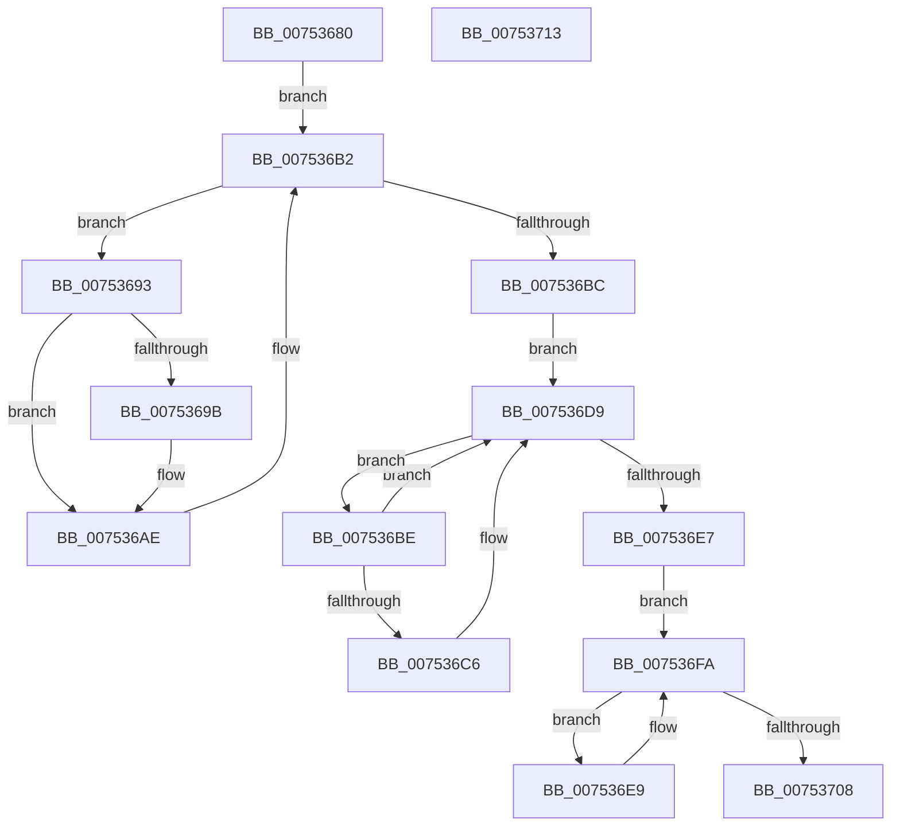

# PfFbBufferListCleanup

- RVA: `0x00753680`–`0x00753714` (길이 `148` bytes)
- VA: `0x0000000140753680`
- 실행 섹션: `PAGE`
- PDB 이름 있음: `예`; PDB Function 태그: `아니요`
- unwind 정보 RVA: `0x0005CAAC`
- 디코드: `48`개 명령, `148/148` bytes 표시
- 미해석 바이트: `0` (있으면 어셈블리에 `.byte`로 보존)

> 이 문서는 커널 이미지의 기계어와 PDB 기호를 분석해 생성했습니다. 4번과 5번은 함수 원형과 자료형을 바이너리 사용 방식에서 추정한 C 해석이며 원본 소스 복구 결과는 아닙니다.

## 1. Dependencies

- 직접 호출 지점: **6**; 고유 호출 대상: **2**
- 직접 호출자로 확인된 함수: **1**
- RIP 상대 이미지 참조: **0**

### Outgoing calls
- `0x007536A9` → [ExFreePoolWithTag](../../poolcode/B8/ExFreePoolWithTag_function_00B82870.md) (function, `0x00B82870`)
- `0x007536B2` → [ExpInterlockedPopEntrySList](../../text/6B/ExpInterlockedPopEntrySList_function_006BA570.md) (function, `0x006BA570`)
- `0x007536D4` → [ExFreePoolWithTag](../../poolcode/B8/ExFreePoolWithTag_function_00B82870.md) (function, `0x00B82870`)
- `0x007536DD` → [ExpInterlockedPopEntrySList](../../text/6B/ExpInterlockedPopEntrySList_function_006BA570.md) (function, `0x006BA570`)
- `0x007536F5` → [ExFreePoolWithTag](../../poolcode/B8/ExFreePoolWithTag_function_00B82870.md) (function, `0x00B82870`)
- `0x007536FE` → [ExpInterlockedPopEntrySList](../../text/6B/ExpInterlockedPopEntrySList_function_006BA570.md) (function, `0x006BA570`)

### Direct callers
- [PfTCleanup](PfTCleanup_function_00751208.md) at `0x00751407`
- [PfTCleanup](PfTCleanup_function_00751208.md) at `0x0075140F`

### Static image references
- 디코드된 RIP-relative 메모리 참조가 없습니다.

## 2. Other-region calls and transfers

- 다른 실행 섹션으로 향하는 call: **6**
  - `0x007536A9` → [ExFreePoolWithTag](../../poolcode/B8/ExFreePoolWithTag_function_00B82870.md) (`PAGE` → `POOLCODE`)
  - `0x007536B2` → [ExpInterlockedPopEntrySList](../../text/6B/ExpInterlockedPopEntrySList_function_006BA570.md) (`PAGE` → `.text`)
  - `0x007536D4` → [ExFreePoolWithTag](../../poolcode/B8/ExFreePoolWithTag_function_00B82870.md) (`PAGE` → `POOLCODE`)
  - `0x007536DD` → [ExpInterlockedPopEntrySList](../../text/6B/ExpInterlockedPopEntrySList_function_006BA570.md) (`PAGE` → `.text`)
  - `0x007536F5` → [ExFreePoolWithTag](../../poolcode/B8/ExFreePoolWithTag_function_00B82870.md) (`PAGE` → `POOLCODE`)
  - `0x007536FE` → [ExpInterlockedPopEntrySList](../../text/6B/ExpInterlockedPopEntrySList_function_006BA570.md) (`PAGE` → `.text`)
- 별도 외부 분기/꼬리 이동을 확인하지 못했습니다.

## 3. Assembly (complete function range)

```asm
00753680  48 89 5C 24 08                  mov qword ptr [rsp + 8], rbx
00753685  57                              push rdi
00753686  48 83 EC 20                     sub rsp, 0x20
0075368A  48 8B D9                        mov rbx, rcx
0075368D  48 83 C1 20                     add rcx, 0x20
00753691  EB 1F                           jmp 0x1407536b2
00753693  8B 50 2C                        mov edx, dword ptr [rax + 0x2c]
00753696  F6 C2 01                        test dl, 1
00753699  74 13                           je 0x1407536ae
0075369B  8B 53 44                        mov edx, dword ptr [rbx + 0x44]
0075369E  8B C8                           mov ecx, eax
007536A0  2B 48 20                        sub ecx, dword ptr [rax + 0x20]
007536A3  01 4B 70                        add dword ptr [rbx + 0x70], ecx
007536A6  48 8B C8                        mov rcx, rax
007536A9  E8 C2 F1 42 00                  call 0x140b82870
007536AE  48 8D 4B 20                     lea rcx, [rbx + 0x20]
007536B2  E8 B9 6E F6 FF                  call 0x1406ba570
007536B7  48 85 C0                        test rax, rax
007536BA  75 D7                           jne 0x140753693
007536BC  EB 1B                           jmp 0x1407536d9
007536BE  8B 48 2C                        mov ecx, dword ptr [rax + 0x2c]
007536C1  F6 C1 01                        test cl, 1
007536C4  74 13                           je 0x1407536d9
007536C6  8B 53 44                        mov edx, dword ptr [rbx + 0x44]
007536C9  8B C8                           mov ecx, eax
007536CB  2B 48 20                        sub ecx, dword ptr [rax + 0x20]
007536CE  01 4B 70                        add dword ptr [rbx + 0x70], ecx
007536D1  48 8B C8                        mov rcx, rax
007536D4  E8 97 F1 42 00                  call 0x140b82870
007536D9  48 8D 4B 10                     lea rcx, [rbx + 0x10]
007536DD  E8 8E 6E F6 FF                  call 0x1406ba570
007536E2  48 85 C0                        test rax, rax
007536E5  75 D7                           jne 0x1407536be
007536E7  EB 11                           jmp 0x1407536fa
007536E9  8B 48 18                        mov ecx, dword ptr [rax + 0x18]
007536EC  29 4B 70                        sub dword ptr [rbx + 0x70], ecx
007536EF  48 8B C8                        mov rcx, rax
007536F2  8B 53 44                        mov edx, dword ptr [rbx + 0x44]
007536F5  E8 76 F1 42 00                  call 0x140b82870
007536FA  48 8D 4B 30                     lea rcx, [rbx + 0x30]
007536FE  E8 6D 6E F6 FF                  call 0x1406ba570
00753703  48 85 C0                        test rax, rax
00753706  75 E1                           jne 0x1407536e9
00753708  48 8B 5C 24 30                  mov rbx, qword ptr [rsp + 0x30]
0075370D  48 83 C4 20                     add rsp, 0x20
00753711  5F                              pop rdi
00753712  C3                              ret
00753713  CC                              int3
```

## 4. C-style interpretation (structured pseudocode)

```c
__int64 __fastcall PfFbBufferListCleanup(__int64 a1)
{
    __int64 result;
    __int64 v_rsp;
    unsigned __int64 v_stack_p8;

    v_stack_p8 = v_rbx;
    v_rsp = (v_rsp) - (32);
    a1 = (a1) + (32);
    goto loc_007536B2;
loc_00753693:
    if ((((unsigned __int8)((unsigned int)(*(unsigned int *)(result + 44)))) & (1)) != 0) {
        a2 = *(unsigned int *)(a1 + 68);
        a1 = (unsigned int)(result);
        a1 = (unsigned int)((a1) - (*(unsigned int *)(result + 32)));
        a1 = result;
        result = ExFreePoolWithTag(a1, a2, a3, a4);
    }
loc_007536B2:
    result = ExpInterlockedPopEntrySList(a1 + 32, a2, a3, a4);
    if (result != 0) goto loc_00753693;
    goto loc_007536D9;
loc_007536BE:
    if ((((unsigned __int8)((unsigned int)(*(unsigned int *)(result + 44)))) & (1)) != 0) {
        a2 = *(unsigned int *)(a1 + 68);
        a1 = (unsigned int)(result);
        a1 = (unsigned int)((a1) - (*(unsigned int *)(result + 32)));
        a1 = result;
        result = ExFreePoolWithTag(a1, a2, a3, a4);
    }
    result = ExpInterlockedPopEntrySList(a1 + 16, a2, a3, a4);
    if (result != 0) goto loc_007536BE;
    goto loc_007536FA;
loc_007536E9:
    result = ExFreePoolWithTag(result, (unsigned int)(*(unsigned int *)(a1 + 68)), a3, a4);
loc_007536FA:
    result = ExpInterlockedPopEntrySList(a1 + 48, (unsigned int)(*(unsigned int *)(a1 + 68)), a3, a4);
    if (result != 0) goto loc_007536E9;
    v_rsp = (v_rsp) + (32);
    return result;
}
```

## 5. (Beta) C Style

```c
int64_t PfFbBufferListCleanup(void *Arg1)
{
    uint8_t *arg1 = (uint8_t *)Arg1;

    int64_t result;
    int64_t local_rsp;
    uint64_t v_stack_p8;

    v_stack_p8 = local_rbx;
    local_rsp = (local_rsp) - (32);
    Arg1 = (Arg1) + (32);
    goto loc_007536B2;
loc_00753693:
    if ((((uint8_t)((uint32_t)(*(uint32_t *)(result + 0x2C)))) & (1)) != 0) {
        a2 = *(uint32_t *)(arg1 + 0x44);
        Arg1 = (uint32_t)(result);
        Arg1 = (uint32_t)((Arg1) - (*(uint32_t *)(result + 0x20)));
        Arg1 = result;
        result = ExFreePoolWithTag(Arg1, a2, a3, a4);
    }
loc_007536B2:
    result = ExpInterlockedPopEntrySList(Arg1 + 32, a2, a3, a4);
    if (result != 0) goto loc_00753693;
    goto loc_007536D9;
loc_007536BE:
    if ((((uint8_t)((uint32_t)(*(uint32_t *)(result + 0x2C)))) & (1)) != 0) {
        a2 = *(uint32_t *)(arg1 + 0x44);
        Arg1 = (uint32_t)(result);
        Arg1 = (uint32_t)((Arg1) - (*(uint32_t *)(result + 0x20)));
        Arg1 = result;
        result = ExFreePoolWithTag(Arg1, a2, a3, a4);
    }
    result = ExpInterlockedPopEntrySList(Arg1 + 16, a2, a3, a4);
    if (result != 0) goto loc_007536BE;
    goto loc_007536FA;
loc_007536E9:
    result = ExFreePoolWithTag(result, (uint32_t)(*(uint32_t *)(arg1 + 0x44)), a3, a4);
loc_007536FA:
    result = ExpInterlockedPopEntrySList(Arg1 + 48, (uint32_t)(*(uint32_t *)(arg1 + 0x44)), a3, a4);
    if (result != 0) goto loc_007536E9;
    local_rsp = (local_rsp) + (32);
    return result;
}
```

### 관측된 메모리 오프셋

구조체 형식이 확인되지 않은 접근은 인자 기준의 오프셋으로만 기록했습니다.

| 기준 인자 | 오프셋 표현 | 폭 (bit) | 접근 |
|---|---:|---:|---|
| `Arg1` | `+ 0x10` | `64` | `R` |
| `Arg1` | `+ 0x20` | `64` | `R` |
| `Arg1` | `+ 0x30` | `64` | `R` |
| `Arg1` | `+ 0x44` | `32` | `R` |
| `Arg1` | `+ 0x70` | `32` | `R/W` |

## 6. Execution-region graph

[열기: 2D/3D 그래프와 함수 탐색 컨트롤 패널](../../../control-panel.html?section=page&rva=0x00753680&view=graph)

- 2D 그래프는 위에서 아래로 흐르고, 3D 그래프는 빈 공간을 드래그해 회전합니다. Shift+드래그는 이동, 휠은 확대·축소, 함수 노드 선택은 대상 보고서 이동입니다.

### Static fallback


