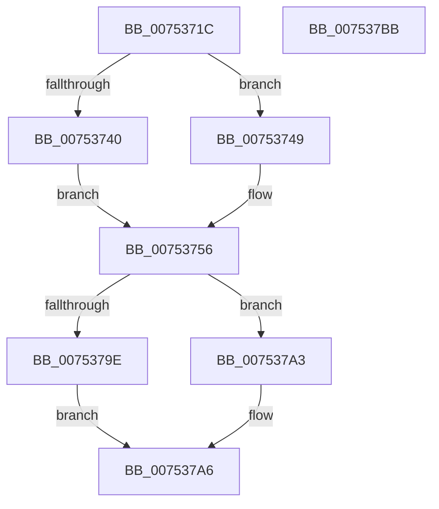

# PfFbBufferListInitialize

- RVA: `0x0075371C`–`0x007537BC` (길이 `160` bytes)
- VA: `0x000000014075371C`
- 실행 섹션: `PAGE`
- PDB 이름 있음: `예`; PDB Function 태그: `아니요`
- unwind 정보 RVA: `0x0005C954`
- 디코드: `46`개 명령, `160/160` bytes 표시
- 미해석 바이트: `0` (있으면 어셈블리에 `.byte`로 보존)

> 이 문서는 커널 이미지의 기계어와 PDB 기호를 분석해 생성했습니다. 4번과 5번은 함수 원형과 자료형을 바이너리 사용 방식에서 추정한 C 해석이며 원본 소스 복구 결과는 아닙니다.

## 1. Dependencies

- 직접 호출 지점: **4**; 고유 호출 대상: **2**
- 직접 호출자로 확인된 함수: **1**
- RIP 상대 이미지 참조: **0**

### Outgoing calls
- `0x00753751` → [memset](../../text/6C/memset_function_006C6C40.md) (function, `0x006C6C40`)
- `0x0075375A` → [InitializeSListHead](../../text/46/InitializeSListHead_function_00468A90.md) (function, `0x00468A90`)
- `0x00753763` → [InitializeSListHead](../../text/46/InitializeSListHead_function_00468A90.md) (function, `0x00468A90`)
- `0x0075376C` → [InitializeSListHead](../../text/46/InitializeSListHead_function_00468A90.md) (function, `0x00468A90`)

### Direct callers
- [PfTInitialize](PfTInitialize_function_00751554.md) at `0x00751723`
- [PfTInitialize](PfTInitialize_function_00751554.md) at `0x0075177F`

### Static image references
- 디코드된 RIP-relative 메모리 참조가 없습니다.

## 2. Other-region calls and transfers

- 다른 실행 섹션으로 향하는 call: **4**
  - `0x00753751` → [memset](../../text/6C/memset_function_006C6C40.md) (`PAGE` → `.text`)
  - `0x0075375A` → [InitializeSListHead](../../text/46/InitializeSListHead_function_00468A90.md) (`PAGE` → `.text`)
  - `0x00753763` → [InitializeSListHead](../../text/46/InitializeSListHead_function_00468A90.md) (`PAGE` → `.text`)
  - `0x0075376C` → [InitializeSListHead](../../text/46/InitializeSListHead_function_00468A90.md) (`PAGE` → `.text`)
- 별도 외부 분기/꼬리 이동을 확인하지 못했습니다.

## 3. Assembly (complete function range)

```asm
0075371C  48 89 5C 24 08                  mov qword ptr [rsp + 8], rbx
00753721  48 89 6C 24 10                  mov qword ptr [rsp + 0x10], rbp
00753726  48 89 74 24 18                  mov qword ptr [rsp + 0x18], rsi
0075372B  57                              push rdi
0075372C  48 83 EC 20                     sub rsp, 0x20
00753730  33 FF                           xor edi, edi
00753732  41 8A F0                        mov sil, r8b
00753735  48 8B EA                        mov rbp, rdx
00753738  48 8B D9                        mov rbx, rcx
0075373B  45 84 C0                        test r8b, r8b
0075373E  74 09                           je 0x140753749
00753740  48 89 79 70                     mov qword ptr [rcx + 0x70], rdi
00753744  89 79 78                        mov dword ptr [rcx + 0x78], edi
00753747  EB 0D                           jmp 0x140753756
00753749  33 D2                           xor edx, edx
0075374B  41 B8 80 00 00 00               mov r8d, 0x80
00753751  E8 EA 34 F7 FF                  call 0x1406c6c40
00753756  48 8D 4B 10                     lea rcx, [rbx + 0x10]
0075375A  E8 31 53 D1 FF                  call 0x140468a90
0075375F  48 8D 4B 20                     lea rcx, [rbx + 0x20]
00753763  E8 28 53 D1 FF                  call 0x140468a90
00753768  48 8D 4B 30                     lea rcx, [rbx + 0x30]
0075376C  E8 1F 53 D1 FF                  call 0x140468a90
00753771  0F 10 45 00                     movups xmm0, xmmword ptr [rbp]
00753775  8B 45 10                        mov eax, dword ptr [rbp + 0x10]
00753778  B9 30 00 00 00                  mov ecx, 0x30
0075377D  0F 10 4D 10                     movups xmm1, xmmword ptr [rbp + 0x10]
00753781  3B C1                           cmp eax, ecx
00753783  0F 11 43 40                     movups xmmword ptr [rbx + 0x40], xmm0
00753787  0F 42 C1                        cmovb eax, ecx
0075378A  0F 10 45 20                     movups xmm0, xmmword ptr [rbp + 0x20]
0075378E  0F 11 4B 50                     movups xmmword ptr [rbx + 0x50], xmm1
00753792  0F 11 43 60                     movups xmmword ptr [rbx + 0x60], xmm0
00753796  89 43 50                        mov dword ptr [rbx + 0x50], eax
00753799  40 84 F6                        test sil, sil
0075379C  74 05                           je 0x1407537a3
0075379E  48 87 3B                        xchg qword ptr [rbx], rdi
007537A1  EB 03                           jmp 0x1407537a6
007537A3  48 89 3B                        mov qword ptr [rbx], rdi
007537A6  48 8B 5C 24 30                  mov rbx, qword ptr [rsp + 0x30]
007537AB  48 8B 6C 24 38                  mov rbp, qword ptr [rsp + 0x38]
007537B0  48 8B 74 24 40                  mov rsi, qword ptr [rsp + 0x40]
007537B5  48 83 C4 20                     add rsp, 0x20
007537B9  5F                              pop rdi
007537BA  C3                              ret
007537BB  CC                              int3
```

## 4. C-style interpretation (structured pseudocode)

```c
__int64 __fastcall PfFbBufferListInitialize(__int64 a1, __int64 a2, unsigned __int8 a3)
{
    __int64 result;
    __int64 v_rdi;
    __int64 v_rsp;
    unsigned __int64 v_stack_p10;
    unsigned __int64 v_stack_p18;
    unsigned __int64 v_stack_p8;

    v_stack_p8 = v_rbx;
    v_stack_p10 = v_rbp;
    v_stack_p18 = v_rsi;
    v_rsp = (v_rsp) - (32);
    v_rdi = 0;
    if (a3 == 0) goto loc_00753749;
    *(unsigned __int64 *)(a1 + 112) = 0;
    *(unsigned int *)(a1 + 120) = 0;
    goto loc_00753756;
loc_00753749:
    a2 = 0;
    result = memset(a1, a2, 128, a4);
loc_00753756:
    result = InitializeSListHead(a1 + 16, a2, 128, a4);
    result = InitializeSListHead(a1 + 32, a2, 128, a4);
    result = InitializeSListHead(a1 + 48, a2, 128, a4);
    *(unsigned __int64 *)(a1 + 64) = v_xmm0;
    result = (unsigned int)(*(unsigned int *)(a2 + 16));
    if (((unsigned int)((unsigned int)(*(unsigned int *)(a2 + 16)))) < 48) { result = 48; }
    *(unsigned __int64 *)(a1 + 80) = v_xmm1;
    *(unsigned __int64 *)(a1 + 96) = v_xmm0;
    *(unsigned int *)(a1 + 80) = (unsigned int)(result);
    if (a3 == 0) goto loc_007537A3;
    goto loc_007537A6;
loc_007537A3:
    *(unsigned __int64 *)(a1) = 0;
loc_007537A6:
    v_rsp = (v_rsp) + (32);
    return result;
}
```

## 5. (Beta) C Style

```c
int64_t PfFbBufferListInitialize(void *Arg1, void *Arg2, uint8_t Arg3)
{
    uint8_t *arg1 = (uint8_t *)Arg1;
    uint8_t *arg2 = (uint8_t *)Arg2;

    int64_t result;
    int64_t local_rdi;
    int64_t local_rsp;
    uint64_t v_stack_p10;
    uint64_t v_stack_p18;
    uint64_t v_stack_p8;

    v_stack_p8 = local_rbx;
    v_stack_p10 = local_rbp;
    v_stack_p18 = local_rsi;
    local_rsp = (local_rsp) - (32);
    local_rdi = 0;
    if (Arg3 == 0) goto loc_00753749;
    *(uint64_t *)(arg1 + 0x70) = 0;
    *(uint32_t *)(arg1 + 0x78) = 0;
    goto loc_00753756;
loc_00753749:
    Arg2 = 0;
    result = memset(Arg1, Arg2, 128, a4);
loc_00753756:
    result = InitializeSListHead(Arg1 + 16, Arg2, 128, a4);
    result = InitializeSListHead(Arg1 + 32, Arg2, 128, a4);
    result = InitializeSListHead(Arg1 + 48, Arg2, 128, a4);
    *(uint64_t *)(arg1 + 0x40) = v_xmm0;
    result = (uint32_t)(*(uint32_t *)(arg2 + 0x10));
    if (((uint32_t)((uint32_t)(*(uint32_t *)(arg2 + 0x10)))) < 48) { result = 48; }
    *(uint64_t *)(arg1 + 0x50) = v_xmm1;
    *(uint64_t *)(arg1 + 0x60) = v_xmm0;
    *(uint32_t *)(arg1 + 0x50) = (uint32_t)(result);
    if (Arg3 == 0) goto loc_007537A3;
    goto loc_007537A6;
loc_007537A3:
    *(uint64_t *)(arg1) = 0;
loc_007537A6:
    local_rsp = (local_rsp) + (32);
    return result;
}
```

### 관측된 메모리 오프셋

구조체 형식이 확인되지 않은 접근은 인자 기준의 오프셋으로만 기록했습니다.

| 기준 인자 | 오프셋 표현 | 폭 (bit) | 접근 |
|---|---:|---:|---|
| `Arg1` | `+ 0x0` | `64` | `R/W` |
| `Arg1` | `+ 0x0` | `64` | `W` |
| `Arg1` | `+ 0x10` | `64` | `R` |
| `Arg1` | `+ 0x20` | `64` | `R` |
| `Arg1` | `+ 0x30` | `64` | `R` |
| `Arg1` | `+ 0x40` | `128` | `R` |
| `Arg1` | `+ 0x50` | `32` | `W` |
| `Arg1` | `+ 0x50` | `128` | `R` |
| `Arg1` | `+ 0x60` | `128` | `R` |
| `Arg1` | `+ 0x70` | `64` | `W` |
| `Arg1` | `+ 0x78` | `32` | `W` |
| `Arg2` | `+ 0x0` | `128` | `R` |
| `Arg2` | `+ 0x10` | `32` | `R` |
| `Arg2` | `+ 0x10` | `128` | `R` |
| `Arg2` | `+ 0x20` | `128` | `R` |

## 6. Execution-region graph

[열기: 2D/3D 그래프와 함수 탐색 컨트롤 패널](../../../control-panel.html?section=page&rva=0x0075371C&view=graph)

- 2D 그래프는 위에서 아래로 흐르고, 3D 그래프는 빈 공간을 드래그해 회전합니다. Shift+드래그는 이동, 휠은 확대·축소, 함수 노드 선택은 대상 보고서 이동입니다.

### Static fallback


