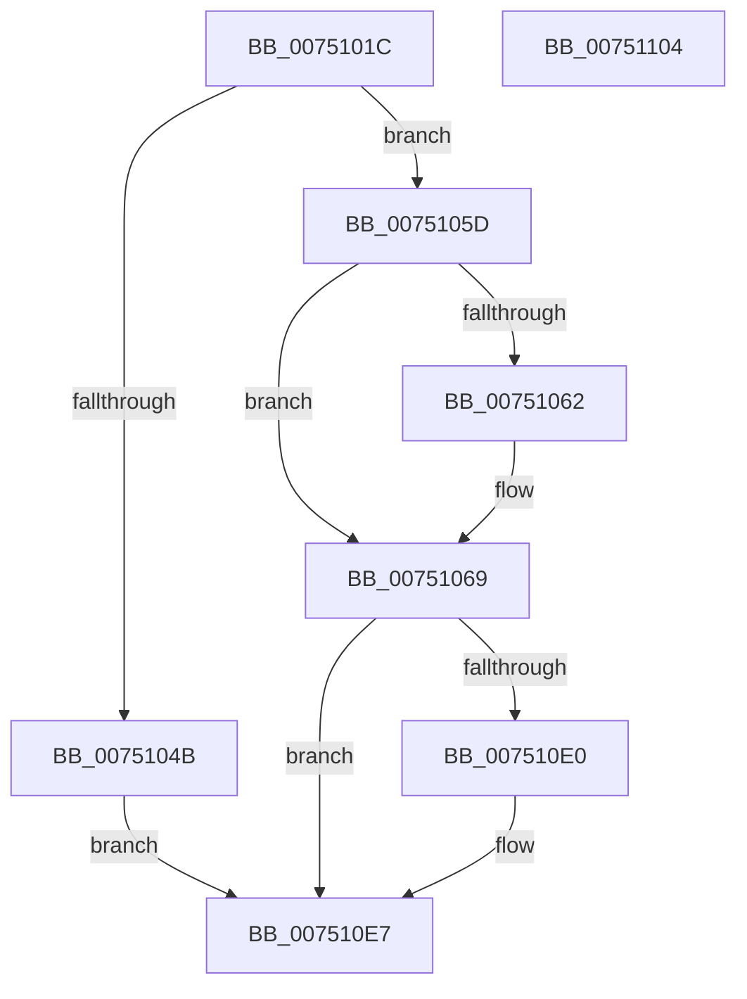

# PfGenerateTrace

- RVA: `0x0075101C`–`0x00751105` (길이 `233` bytes)
- VA: `0x000000014075101C`
- 실행 섹션: `PAGE`
- PDB 이름 있음: `예`; PDB Function 태그: `아니요`
- unwind 정보 RVA: `0x00091ECC`
- 디코드: `57`개 명령, `233/233` bytes 표시
- 미해석 바이트: `0` (있으면 어셈블리에 `.byte`로 보존)

> 이 문서는 커널 이미지의 기계어와 PDB 기호를 분석해 생성했습니다. 4번과 5번은 함수 원형과 자료형을 바이너리 사용 방식에서 추정한 C 해석이며 원본 소스 복구 결과는 아닙니다.

## 1. Dependencies

- 직접 호출 지점: **8**; 고유 호출 대상: **7**
- 직접 호출자로 확인된 함수: **4**
- RIP 상대 이미지 참조: **0**

### Outgoing calls
- `0x0075103B` → [PfpPartitionAccessTraceLockAcquire](../../pagelk/B6/PfpPartitionAccessTraceLockAcquire_function_00B6BBC4.md) (function, `0x00B6BBC4`)
- `0x00751053` → [PfpPartitionAccessTraceLockRelease](../../pagelk/B6/PfpPartitionAccessTraceLockRelease_function_00B6BBE0.md) (function, `0x00B6BBE0`)
- `0x00751073` → [KeResetEvent](../../text/24/KeResetEvent_function_00248350.md) (function, `0x00248350`)
- `0x00751084` → [KeSetEvent](../../text/33/KeSetEvent_function_0033F310.md) (function, `0x0033F310`)
- `0x00751093` → [ObfReferenceObject](../../text/20/ObfReferenceObject_function_0020FA20.md) (function, `0x0020FA20`)
- `0x0075109B` → [PfpPartitionAccessTraceLockRelease](../../pagelk/B6/PfpPartitionAccessTraceLockRelease_function_00B6BBE0.md) (function, `0x00B6BBE0`)
- `0x007510CE` → [KeWaitForMultipleObjects](../../text/20/KeWaitForMultipleObjects_function_0020D110.md) (function, `0x0020D110`)
- `0x007510D6` → [ObfDereferenceObject](../../text/2F/ObfDereferenceObject_function_002F9350.md) (function, `0x002F9350`)

### Direct callers
- [PfpLogScenarioEventCallback](PfpLogScenarioEventCallback_function_007507B0.md) at `0x00750801`
- [PfpLogScenarioEventCallback](PfpLogScenarioEventCallback_function_007507B0.md) at `0x007508AD`
- [PfpLogEventRequest](../AC/PfpLogEventRequest_function_00AC1278.md) at `0x00AC1362`
- [PfSetSuperfetchInformation](../AD/PfSetSuperfetchInformation_function_00ADE6E8.md) at `0x00ADEAD1`
- [PfpPowerActionSleepSystemPhaseCallback](../../pagelk/B6/PfpPowerActionSleepSystemPhaseCallback_function_00B6B270.md) at `0x00B6B2AA`

### Static image references
- 디코드된 RIP-relative 메모리 참조가 없습니다.

## 2. Other-region calls and transfers

- 다른 실행 섹션으로 향하는 call: **8**
  - `0x0075103B` → [PfpPartitionAccessTraceLockAcquire](../../pagelk/B6/PfpPartitionAccessTraceLockAcquire_function_00B6BBC4.md) (`PAGE` → `PAGELK`)
  - `0x00751053` → [PfpPartitionAccessTraceLockRelease](../../pagelk/B6/PfpPartitionAccessTraceLockRelease_function_00B6BBE0.md) (`PAGE` → `PAGELK`)
  - `0x00751073` → [KeResetEvent](../../text/24/KeResetEvent_function_00248350.md) (`PAGE` → `.text`)
  - `0x00751084` → [KeSetEvent](../../text/33/KeSetEvent_function_0033F310.md) (`PAGE` → `.text`)
  - `0x00751093` → [ObfReferenceObject](../../text/20/ObfReferenceObject_function_0020FA20.md) (`PAGE` → `.text`)
  - `0x0075109B` → [PfpPartitionAccessTraceLockRelease](../../pagelk/B6/PfpPartitionAccessTraceLockRelease_function_00B6BBE0.md) (`PAGE` → `PAGELK`)
  - `0x007510CE` → [KeWaitForMultipleObjects](../../text/20/KeWaitForMultipleObjects_function_0020D110.md) (`PAGE` → `.text`)
  - `0x007510D6` → [ObfDereferenceObject](../../text/2F/ObfDereferenceObject_function_002F9350.md) (`PAGE` → `.text`)
- 별도 외부 분기/꼬리 이동을 확인하지 못했습니다.

## 3. Assembly (complete function range)

```asm
0075101C  48 8B C4                        mov rax, rsp
0075101F  48 89 58 08                     mov qword ptr [rax + 8], rbx
00751023  48 89 68 10                     mov qword ptr [rax + 0x10], rbp
00751027  48 89 70 18                     mov qword ptr [rax + 0x18], rsi
0075102B  48 89 78 20                     mov qword ptr [rax + 0x20], rdi
0075102F  41 56                           push r14
00751031  48 83 EC 50                     sub rsp, 0x50
00751035  44 8B F2                        mov r14d, edx
00751038  48 8B F1                        mov rsi, rcx
0075103B  E8 84 AB 41 00                  call 0x140b6bbc4
00751040  33 ED                           xor ebp, ebp
00751042  48 39 AE A8 00 00 00            cmp qword ptr [rsi + 0xa8], rbp
00751049  75 12                           jne 0x14075105d
0075104B  48 8B CE                        mov rcx, rsi
0075104E  BD 87 02 00 C0                  mov ebp, 0xc0000287
00751053  E8 88 AB 41 00                  call 0x140b6bbe0
00751058  E9 8A 00 00 00                  jmp 0x1407510e7
0075105D  45 85 F6                        test r14d, r14d
00751060  75 07                           jne 0x140751069
00751062  F0 FF 86 F8 00 00 00            lock inc dword ptr [rsi + 0xf8]
00751069  48 8D 9E E0 00 00 00            lea rbx, [rsi + 0xe0]
00751070  48 8B CB                        mov rcx, rbx
00751073  E8 D8 72 AF FF                  call 0x140248350
00751078  48 8D 8E C8 00 00 00            lea rcx, [rsi + 0xc8]
0075107F  45 33 C0                        xor r8d, r8d
00751082  33 D2                           xor edx, edx
00751084  E8 87 E2 BE FF                  call 0x14033f310
00751089  48 8B BE A8 00 00 00            mov rdi, qword ptr [rsi + 0xa8]
00751090  48 8B CF                        mov rcx, rdi
00751093  E8 88 E9 AB FF                  call 0x14020fa20
00751098  48 8B CE                        mov rcx, rsi
0075109B  E8 40 AB 41 00                  call 0x140b6bbe0
007510A0  45 33 C9                        xor r9d, r9d
007510A3  48 89 6C 24 38                  mov qword ptr [rsp + 0x38], rbp
007510A8  48 89 6C 24 30                  mov qword ptr [rsp + 0x30], rbp
007510AD  48 8D 54 24 40                  lea rdx, [rsp + 0x40]
007510B2  40 88 6C 24 28                  mov byte ptr [rsp + 0x28], bpl
007510B7  48 89 5C 24 40                  mov qword ptr [rsp + 0x40], rbx
007510BC  45 8D 41 01                     lea r8d, [r9 + 1]
007510C0  48 89 7C 24 48                  mov qword ptr [rsp + 0x48], rdi
007510C5  41 8D 49 02                     lea ecx, [r9 + 2]
007510C9  40 88 6C 24 20                  mov byte ptr [rsp + 0x20], bpl
007510CE  E8 3D C0 AB FF                  call 0x14020d110
007510D3  48 8B CF                        mov rcx, rdi
007510D6  E8 75 82 BA FF                  call 0x1402f9350
007510DB  45 85 F6                        test r14d, r14d
007510DE  75 07                           jne 0x1407510e7
007510E0  F0 FF 8E F8 00 00 00            lock dec dword ptr [rsi + 0xf8]
007510E7  48 8B 5C 24 60                  mov rbx, qword ptr [rsp + 0x60]
007510EC  8B C5                           mov eax, ebp
007510EE  48 8B 6C 24 68                  mov rbp, qword ptr [rsp + 0x68]
007510F3  48 8B 74 24 70                  mov rsi, qword ptr [rsp + 0x70]
007510F8  48 8B 7C 24 78                  mov rdi, qword ptr [rsp + 0x78]
007510FD  48 83 C4 50                     add rsp, 0x50
00751101  41 5E                           pop r14
00751103  C3                              ret
00751104  CC                              int3
```

## 4. C-style interpretation (structured pseudocode)

```c
__int64 __fastcall PfGenerateTrace(__int64 a1, int a2, int a3, int a4)
{
    __int64 result;
    __int64 v_rbp;
    __int64 v_rsp;
    unsigned __int64 v_stack_m10;
    unsigned __int64 v_stack_m18;
    unsigned __int64 v_stack_m20;
    unsigned __int64 v_stack_m28;
    unsigned __int8 v_stack_m30;
    unsigned __int8 v_stack_m38;
    unsigned __int64 v_stack_p10;
    unsigned __int64 v_stack_p18;
    unsigned __int64 v_stack_p20;
    unsigned __int64 v_stack_p8;

    *(unsigned __int64 *)(v_rsp + 8) = v_rbx;
    *(unsigned __int64 *)(v_rsp + 16) = v_rbp;
    *(unsigned __int64 *)(v_rsp + 24) = v_rsi;
    *(unsigned __int64 *)(v_rsp + 32) = v_rdi;
    v_rsp = (v_rsp) - (80);
    result = PfpPartitionAccessTraceLockAcquire(a1, a2, a3, a4);
    v_rbp = 0;
    if ((*(unsigned __int64 *)(a1 + 168)) != 0) goto loc_0075105D;
    result = PfpPartitionAccessTraceLockRelease(a1, a2, a3, a4);
    goto loc_007510E7;
loc_0075105D:
    if ((unsigned int)((unsigned int)(a2)) == 0) {
    }
    result = KeResetEvent(a1 + 224, a2, a3, a4);
    a3 = 0;
    a2 = 0;
    result = KeSetEvent(a1 + 200, a2, a3, a4);
    result = ObfReferenceObject(*(unsigned __int64 *)(a1 + 168), a2, a3, a4);
    result = PfpPartitionAccessTraceLockRelease(a1, a2, a3, a4);
    a4 = 0;
    v_stack_m20 = (unsigned int)(0xC0000287ULL);
    v_stack_m28 = (unsigned int)(0xC0000287ULL);
    v_stack_m30 = (unsigned __int8)((unsigned int)(0xC0000287ULL));
    v_stack_m18 = a1 + 224;
    v_stack_m10 = *(unsigned __int64 *)(a1 + 168);
    v_stack_m38 = (unsigned __int8)((unsigned int)(0xC0000287ULL));
    result = KeWaitForMultipleObjects(a4 + 2, v_stack_m18, a4 + 1, a4);
    result = ObfDereferenceObject(*(unsigned __int64 *)(a1 + 168), v_stack_m18, a4 + 1, a4);
    if ((unsigned int)((unsigned int)(a2)) == 0) {
    }
    v_rsp = (v_rsp) + (80);
    return (unsigned int)((unsigned int)((unsigned int)(0xC0000287ULL)));
}
```

## 5. (Beta) C Style

```c
int64_t PfGenerateTrace(void *Arg1, int32_t Arg2, int32_t Arg3, int32_t Arg4)
{
    uint8_t *arg1 = (uint8_t *)Arg1;

    int64_t result;
    int64_t local_rbp;
    int64_t local_rsp;
    uint64_t v_stack_m10;
    uint64_t v_stack_m18;
    uint64_t v_stack_m20;
    uint64_t v_stack_m28;
    uint8_t v_stack_m30;
    uint8_t v_stack_m38;
    uint64_t v_stack_p10;
    uint64_t v_stack_p18;
    uint64_t v_stack_p20;
    uint64_t v_stack_p8;

    *(uint64_t *)(local_rsp + 0x8) = local_rbx;
    *(uint64_t *)(local_rsp + 0x10) = local_rbp;
    *(uint64_t *)(local_rsp + 0x18) = local_rsi;
    *(uint64_t *)(local_rsp + 0x20) = local_rdi;
    local_rsp = (local_rsp) - (80);
    result = PfpPartitionAccessTraceLockAcquire(Arg1, Arg2, Arg3, Arg4);
    local_rbp = 0;
    if ((*(uint64_t *)(arg1 + 0xA8)) != 0) goto loc_0075105D;
    result = PfpPartitionAccessTraceLockRelease(Arg1, Arg2, Arg3, Arg4);
    goto loc_007510E7;
loc_0075105D:
    if ((uint32_t)((uint32_t)(Arg2)) == 0) {
    }
    result = KeResetEvent(Arg1 + 224, Arg2, Arg3, Arg4);
    Arg3 = 0;
    Arg2 = 0;
    result = KeSetEvent(Arg1 + 200, Arg2, Arg3, Arg4);
    result = ObfReferenceObject(*(uint64_t *)(arg1 + 0xA8), Arg2, Arg3, Arg4);
    result = PfpPartitionAccessTraceLockRelease(Arg1, Arg2, Arg3, Arg4);
    Arg4 = 0;
    v_stack_m20 = (uint32_t)(0xC0000287ULL);
    v_stack_m28 = (uint32_t)(0xC0000287ULL);
    v_stack_m30 = (uint8_t)((uint32_t)(0xC0000287ULL));
    v_stack_m18 = Arg1 + 224;
    v_stack_m10 = *(uint64_t *)(arg1 + 0xA8);
    v_stack_m38 = (uint8_t)((uint32_t)(0xC0000287ULL));
    result = KeWaitForMultipleObjects(Arg4 + 2, v_stack_m18, Arg4 + 1, Arg4);
    result = ObfDereferenceObject(*(uint64_t *)(arg1 + 0xA8), v_stack_m18, Arg4 + 1, Arg4);
    if ((uint32_t)((uint32_t)(Arg2)) == 0) {
    }
    local_rsp = (local_rsp) + (80);
    return (uint32_t)((uint32_t)((uint32_t)(0xC0000287ULL)));
}
```

### 관측된 메모리 오프셋

구조체 형식이 확인되지 않은 접근은 인자 기준의 오프셋으로만 기록했습니다.

| 기준 인자 | 오프셋 표현 | 폭 (bit) | 접근 |
|---|---:|---:|---|
| `Arg1` | `+ 0xA8` | `64` | `R` |
| `Arg1` | `+ 0xC8` | `64` | `R` |
| `Arg1` | `+ 0xE0` | `64` | `R` |
| `Arg1` | `+ 0xF8` | `32` | `R/W` |

## 6. Execution-region graph

[열기: 2D/3D 그래프와 함수 탐색 컨트롤 패널](../../../control-panel.html?section=page&rva=0x0075101C&view=graph)

- 2D 그래프는 위에서 아래로 흐르고, 3D 그래프는 빈 공간을 드래그해 회전합니다. Shift+드래그는 이동, 휠은 확대·축소, 함수 노드 선택은 대상 보고서 이동입니다.

### Static fallback


