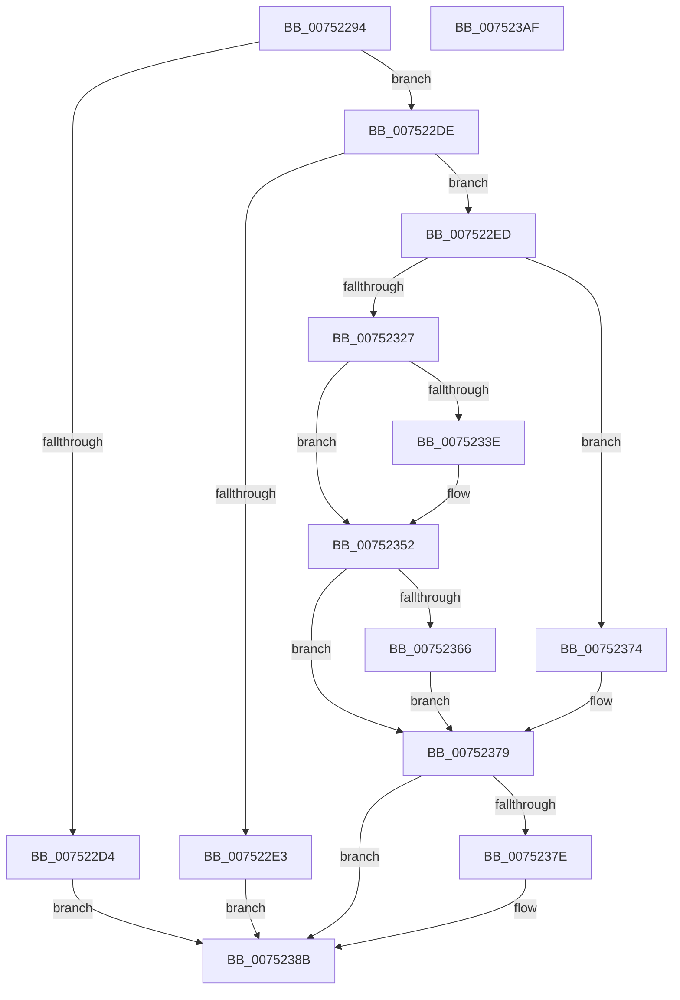

# PfSnAppLaunchScenarioControl

- RVA: `0x00752294`–`0x007523B0` (길이 `284` bytes)
- VA: `0x0000000140752294`
- 실행 섹션: `PAGE`
- PDB 이름 있음: `예`; PDB Function 태그: `아니요`
- unwind 정보 RVA: `0x000CBC1C`
- 디코드: `71`개 명령, `284/284` bytes 표시
- 미해석 바이트: `0` (있으면 어셈블리에 `.byte`로 보존)

> 이 문서는 커널 이미지의 기계어와 PDB 기호를 분석해 생성했습니다. 4번과 5번은 함수 원형과 자료형을 바이너리 사용 방식에서 추정한 C 해석이며 원본 소스 복구 결과는 아닙니다.

## 1. Dependencies

- 직접 호출 지점: **6**; 고유 호출 대상: **6**
- 직접 호출자로 확인된 함수: **1**
- RIP 상대 이미지 참조: **2**

### Outgoing calls
- `0x0075231C` → [ObpReferenceObjectByHandleWithTag](../86/ObpReferenceObjectByHandleWithTag_function_00869650.md) (function, `0x00869650`)
- `0x0075234D` → [KiStackAttachProcess](../../text/21/KiStackAttachProcess_function_00216820.md) (function, `0x00216820`)
- `0x0075235B` → [PfSnBeginAppLaunch](../95/PfSnBeginAppLaunch_function_0095EC44.md) (function, `0x0095EC44`)
- `0x0075236D` → [KiUnstackDetachProcess](../../text/21/KiUnstackDetachProcess_function_00217D30.md) (function, `0x00217D30`)
- `0x00752386` → [ObfDereferenceObjectWithTag](../../text/2F/ObfDereferenceObjectWithTag_function_002F78E0.md) (function, `0x002F78E0`)
- `0x00752395` → [_security_check_cookie](../../text/6A/_security_check_cookie_function_006AC640.md) (function, `0x006AC640`)

### Direct callers
- [sub_00B27DF8](../B2/Unknown_function_00B27DF8.md) at `0x00B27E4B`

### Static image references
- `0x007522A6` → RVA `0x00E0A740` (`.data`; read)
- `0x007522FF` → RVA `0x00FC6A98` (`ALMOSTRO`; read)

## 2. Other-region calls and transfers

- 다른 실행 섹션으로 향하는 call: **4**
  - `0x0075234D` → [KiStackAttachProcess](../../text/21/KiStackAttachProcess_function_00216820.md) (`PAGE` → `.text`)
  - `0x0075236D` → [KiUnstackDetachProcess](../../text/21/KiUnstackDetachProcess_function_00217D30.md) (`PAGE` → `.text`)
  - `0x00752386` → [ObfDereferenceObjectWithTag](../../text/2F/ObfDereferenceObjectWithTag_function_002F78E0.md) (`PAGE` → `.text`)
  - `0x00752395` → [_security_check_cookie](../../text/6A/_security_check_cookie_function_006AC640.md) (`PAGE` → `.text`)
- 별도 외부 분기/꼬리 이동을 확인하지 못했습니다.

## 3. Assembly (complete function range)

```asm
00752294  48 89 5C 24 10                  mov qword ptr [rsp + 0x10], rbx
00752299  48 89 74 24 18                  mov qword ptr [rsp + 0x18], rsi
0075229E  57                              push rdi
0075229F  48 81 EC 80 00 00 00            sub rsp, 0x80
007522A6  48 8B 05 93 84 6B 00            mov rax, qword ptr [rip + 0x6b8493]
007522AD  48 33 C4                        xor rax, rsp
007522B0  48 89 44 24 78                  mov qword ptr [rsp + 0x78], rax
007522B5  48 83 64 24 40 00               and qword ptr [rsp + 0x40], 0
007522BB  0F 57 C0                        xorps xmm0, xmm0
007522BE  33 F6                           xor esi, esi
007522C0  83 39 01                        cmp dword ptr [rcx], 1
007522C3  0F 11 44 24 48                  movups xmmword ptr [rsp + 0x48], xmm0
007522C8  0F 11 44 24 58                  movups xmmword ptr [rsp + 0x58], xmm0
007522CD  0F 11 44 24 68                  movups xmmword ptr [rsp + 0x68], xmm0
007522D2  74 0A                           je 0x1407522de
007522D4  BF 59 00 00 C0                  mov edi, 0xc0000059
007522D9  E9 AD 00 00 00                  jmp 0x14075238b
007522DE  39 71 04                        cmp dword ptr [rcx + 4], esi
007522E1  75 0A                           jne 0x1407522ed
007522E3  BF 0D 00 00 C0                  mov edi, 0xc000000d
007522E8  E9 9E 00 00 00                  jmp 0x14075238b
007522ED  48 21 74 24 38                  and qword ptr [rsp + 0x38], rsi
007522F2  48 8D 44 24 40                  lea rax, [rsp + 0x40]
007522F7  48 21 74 24 30                  and qword ptr [rsp + 0x30], rsi
007522FC  44 8A CA                        mov r9b, dl
007522FF  4C 8B 05 92 47 87 00            mov r8, qword ptr [rip + 0x874792]
00752306  BA 08 00 00 00                  mov edx, 8
0075230B  48 8B 49 08                     mov rcx, qword ptr [rcx + 8]
0075230F  48 89 44 24 28                  mov qword ptr [rsp + 0x28], rax
00752314  C7 44 24 20 50 66 57 73         mov dword ptr [rsp + 0x20], 0x73576650
0075231C  E8 2F 73 11 00                  call 0x140869650
00752321  8B F8                           mov edi, eax
00752323  85 C0                           test eax, eax
00752325  78 4D                           js 0x140752374
00752327  65 48 8B 04 25 88 01 00 00      mov rax, qword ptr gs:[0x188]
00752330  48 8B 5C 24 40                  mov rbx, qword ptr [rsp + 0x40]
00752335  48 39 98 B8 00 00 00            cmp qword ptr [rax + 0xb8], rbx
0075233C  74 14                           je 0x140752352
0075233E  4C 8D 44 24 48                  lea r8, [rsp + 0x48]
00752343  33 D2                           xor edx, edx
00752345  48 8B CB                        mov rcx, rbx
00752348  BE 01 00 00 00                  mov esi, 1
0075234D  E8 CE 44 AC FF                  call 0x140216820
00752352  33 D2                           xor edx, edx
00752354  48 8B CB                        mov rcx, rbx
00752357  44 8D 42 11                     lea r8d, [rdx + 0x11]
0075235B  E8 E4 C8 20 00                  call 0x14095ec44
00752360  33 FF                           xor edi, edi
00752362  85 F6                           test esi, esi
00752364  74 13                           je 0x140752379
00752366  33 D2                           xor edx, edx
00752368  48 8D 4C 24 48                  lea rcx, [rsp + 0x48]
0075236D  E8 BE 59 AC FF                  call 0x140217d30
00752372  EB 05                           jmp 0x140752379
00752374  48 8B 5C 24 40                  mov rbx, qword ptr [rsp + 0x40]
00752379  48 85 DB                        test rbx, rbx
0075237C  74 0D                           je 0x14075238b
0075237E  BA 50 66 57 73                  mov edx, 0x73576650
00752383  48 8B CB                        mov rcx, rbx
00752386  E8 55 55 BA FF                  call 0x1402f78e0
0075238B  8B C7                           mov eax, edi
0075238D  48 8B 4C 24 78                  mov rcx, qword ptr [rsp + 0x78]
00752392  48 33 CC                        xor rcx, rsp
00752395  E8 A6 A2 F5 FF                  call 0x1406ac640
0075239A  4C 8D 9C 24 80 00 00 00         lea r11, [rsp + 0x80]
007523A2  49 8B 5B 18                     mov rbx, qword ptr [r11 + 0x18]
007523A6  49 8B 73 20                     mov rsi, qword ptr [r11 + 0x20]
007523AA  49 8B E3                        mov rsp, r11
007523AD  5F                              pop rdi
007523AE  C3                              ret
007523AF  CC                              int3
```

## 4. C-style interpretation (structured pseudocode)

```c
__int64 __fastcall PfSnAppLaunchScenarioControl(__int64 a1, unsigned __int8 a2)
{
    __int64 result;
    __int64 v_rdi;
    __int64 v_rsi;
    __int64 v_rsp;
    unsigned __int64 v_stack_m10;
    unsigned __int64 v_stack_m20;
    unsigned __int64 v_stack_m30;
    unsigned __int64 v_stack_m40;
    unsigned __int64 v_stack_m48;
    unsigned __int64 v_stack_m50;
    unsigned __int64 v_stack_m58;
    unsigned __int64 v_stack_m60;
    unsigned int v_stack_m68;
    unsigned __int64 v_stack_m8;
    unsigned __int64 v_stack_p10;
    unsigned __int64 v_stack_p18;

    v_stack_p10 = v_rbx;
    v_stack_p18 = v_rsi;
    v_rsp = (v_rsp) - (128);
    result = (*(unsigned __int64 *)(v_rip + 7046291)) ^ (v_rsp);
    v_stack_m10 = result;
    v_rsi = 0;
    v_stack_m40 = v_xmm0;
    v_stack_m30 = v_xmm0;
    v_stack_m20 = v_xmm0;
    if ((*(unsigned int *)(a1)) == 1) goto loc_007522DE;
    goto loc_0075238B;
loc_007522DE:
    if ((*(unsigned int *)(a1 + 4)) != 0) goto loc_007522ED;
    goto loc_0075238B;
loc_007522ED:
    v_stack_m60 = v_stack_m48;
    v_stack_m68 = 0x73576650ULL;
    result = ObpReferenceObjectByHandleWithTag(*(unsigned __int64 *)(a1 + 8), 8, *(unsigned __int64 *)(v_rip + 8865682), a2);
    if (sign_flag) goto loc_00752374;
    result = *(unsigned __int64 *)(gs_base + (0 + 392));
    if ((*(unsigned __int64 *)(*(unsigned __int64 *)(gs_base + (0 + 392)) + 184)) != v_stack_m48) {
        a3 = v_stack_m40;
        a2 = 0;
        a1 = v_stack_m48;
        v_rsi = 1;
        result = KiStackAttachProcess(a1, a2, a3, a2);
    }
    a2 = 0;
    result = PfSnBeginAppLaunch(v_stack_m48, a2, a2 + 17, a2);
    v_rdi = 0;
    if ((unsigned int)(v_rsi) == 0) goto loc_00752379;
    a2 = 0;
    result = KiUnstackDetachProcess(v_stack_m40, a2, a2 + 17, a2);
    goto loc_00752379;
loc_00752374:
loc_00752379:
    if (v_stack_m48 != 0) {
        a2 = 0x73576650ULL;
        a1 = v_stack_m48;
        result = ObfDereferenceObjectWithTag(a1, a2, a2 + 17, a2);
    }
    a1 = (v_stack_m10) ^ (v_rsp);
    result = _security_check_cookie(a1, a2, a2 + 17, a2);
    return result;
}
```

## 5. (Beta) C Style

```c
int64_t PfSnAppLaunchScenarioControl(void *Arg1, uint8_t Arg2)
{
    uint8_t *arg1 = (uint8_t *)Arg1;

    int64_t result;
    int64_t local_rdi;
    int64_t local_rsi;
    int64_t local_rsp;
    uint64_t v_stack_m10;
    uint64_t v_stack_m20;
    uint64_t v_stack_m30;
    uint64_t v_stack_m40;
    uint64_t v_stack_m48;
    uint64_t v_stack_m50;
    uint64_t v_stack_m58;
    uint64_t v_stack_m60;
    uint32_t v_stack_m68;
    uint64_t v_stack_m8;
    uint64_t v_stack_p10;
    uint64_t v_stack_p18;

    v_stack_p10 = local_rbx;
    v_stack_p18 = local_rsi;
    local_rsp = (local_rsp) - (128);
    result = (*(uint64_t *)(v_rip + 0x6B8493)) ^ (local_rsp);
    v_stack_m10 = result;
    local_rsi = 0;
    v_stack_m40 = v_xmm0;
    v_stack_m30 = v_xmm0;
    v_stack_m20 = v_xmm0;
    if ((*(uint32_t *)(arg1)) == 1) goto loc_007522DE;
    goto loc_0075238B;
loc_007522DE:
    if ((*(uint32_t *)(arg1 + 0x4)) != 0) goto loc_007522ED;
    goto loc_0075238B;
loc_007522ED:
    v_stack_m60 = v_stack_m48;
    v_stack_m68 = 0x73576650ULL;
    result = ObpReferenceObjectByHandleWithTag(*(uint64_t *)(arg1 + 0x8), 8, *(uint64_t *)(v_rip + 0x874792), Arg2);
    if (sign_flag) goto loc_00752374;
    result = *(uint64_t *)(gs_base + (0 + 0x188));
    if ((*(uint64_t *)(*(uint64_t *)(gs_base + (0 + 0x188)) + 0xB8)) != v_stack_m48) {
        a3 = v_stack_m40;
        Arg2 = 0;
        Arg1 = v_stack_m48;
        local_rsi = 1;
        result = KiStackAttachProcess(Arg1, Arg2, a3, Arg2);
    }
    Arg2 = 0;
    result = PfSnBeginAppLaunch(v_stack_m48, Arg2, Arg2 + 17, Arg2);
    local_rdi = 0;
    if ((uint32_t)(local_rsi) == 0) goto loc_00752379;
    Arg2 = 0;
    result = KiUnstackDetachProcess(v_stack_m40, Arg2, Arg2 + 17, Arg2);
    goto loc_00752379;
loc_00752374:
loc_00752379:
    if (v_stack_m48 != 0) {
        Arg2 = 0x73576650ULL;
        Arg1 = v_stack_m48;
        result = ObfDereferenceObjectWithTag(Arg1, Arg2, Arg2 + 17, Arg2);
    }
    Arg1 = (v_stack_m10) ^ (local_rsp);
    result = _security_check_cookie(Arg1, Arg2, Arg2 + 17, Arg2);
    return result;
}
```

### 관측된 메모리 오프셋

구조체 형식이 확인되지 않은 접근은 인자 기준의 오프셋으로만 기록했습니다.

| 기준 인자 | 오프셋 표현 | 폭 (bit) | 접근 |
|---|---:|---:|---|
| `Arg1` | `+ 0x0` | `32` | `R` |
| `Arg1` | `+ 0x4` | `32` | `R` |
| `Arg1` | `+ 0x8` | `64` | `R` |

## 6. Execution-region graph

[열기: 2D/3D 그래프와 함수 탐색 컨트롤 패널](../../../control-panel.html?section=page&rva=0x00752294&view=graph)

- 2D 그래프는 위에서 아래로 흐르고, 3D 그래프는 빈 공간을 드래그해 회전합니다. Shift+드래그는 이동, 휠은 확대·축소, 함수 노드 선택은 대상 보고서 이동입니다.

### Static fallback


