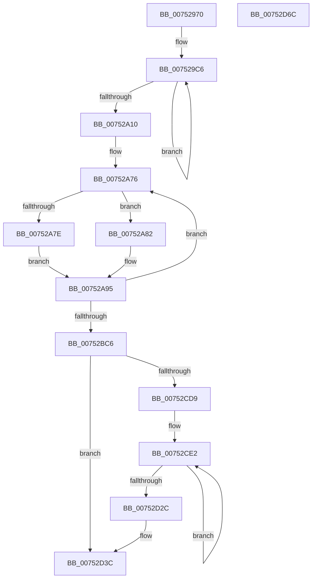

# PfSnParametersRead

- RVA: `0x00752970`–`0x00752D6D` (길이 `1,021` bytes)
- VA: `0x0000000140752970`
- 실행 섹션: `PAGE`
- PDB 이름 있음: `예`; PDB Function 태그: `아니요`
- unwind 정보 RVA: `0x000BBDB8`
- 디코드: `235`개 명령, `1,021/1,021` bytes 표시
- 미해석 바이트: `0` (있으면 어셈블리에 `.byte`로 보존)

> 이 문서는 커널 이미지의 기계어와 PDB 기호를 분석해 생성했습니다. 4번과 5번은 함수 원형과 자료형을 바이너리 사용 방식에서 추정한 C 해석이며 원본 소스 복구 결과는 아닙니다.

## 1. Dependencies

- 직접 호출 지점: **19**; 고유 호출 대상: **6**
- 직접 호출자로 확인된 함수: **2**
- RIP 상대 이미지 참조: **11**

### Outgoing calls
- `0x00752A4D` → [PfpGetParameter](PfpGetParameter_function_00752E80.md) (function, `0x00752E80`)
- `0x00752AA6` → [RtlStringCbCopyW](../../text/43/RtlStringCbCopyW_function_0043B910.md) (function, `0x0043B910`)
- `0x00752ABE` → [RtlStringCbCatW](../../text/45/RtlStringCbCatW_function_00453E24.md) (function, `0x00453E24`)
- `0x00752AEE` → [PfpGetParameter](PfpGetParameter_function_00752E80.md) (function, `0x00752E80`)
- `0x00752B02` → [RtlStringCbCopyW](../../text/43/RtlStringCbCopyW_function_0043B910.md) (function, `0x0043B910`)
- `0x00752B1A` → [RtlStringCbCatW](../../text/45/RtlStringCbCatW_function_00453E24.md) (function, `0x00453E24`)
- `0x00752B4A` → [PfpGetParameter](PfpGetParameter_function_00752E80.md) (function, `0x00752E80`)
- `0x00752B62` → [RtlStringCbCopyW](../../text/43/RtlStringCbCopyW_function_0043B910.md) (function, `0x0043B910`)
- `0x00752B78` → [RtlStringCbCatW](../../text/45/RtlStringCbCatW_function_00453E24.md) (function, `0x00453E24`)
- `0x00752BA1` → [PfpGetParameter](PfpGetParameter_function_00752E80.md) (function, `0x00752E80`)
- `0x00752BEA` → [PfpGetParameter](PfpGetParameter_function_00752E80.md) (function, `0x00752E80`)
- `0x00752C12` → [PfpGetParameter](PfpGetParameter_function_00752E80.md) (function, `0x00752E80`)
- `0x00752C38` → [PfpGetParameter](PfpGetParameter_function_00752E80.md) (function, `0x00752E80`)
- `0x00752C5E` → [PfpGetParameter](PfpGetParameter_function_00752E80.md) (function, `0x00752E80`)
- `0x00752C87` → [PfpGetParameter](PfpGetParameter_function_00752E80.md) (function, `0x00752E80`)
- `0x00752C99` → [wcsupr](../../text/50/wcsupr_function_005003A0.md) (function, `0x005003A0`)
- `0x00752CC1` → [PfpGetParameter](PfpGetParameter_function_00752E80.md) (function, `0x00752E80`)
- `0x00752CCB` → [PfSnParametersVerify](PfSnParametersVerify_function_00752D74.md) (function, `0x00752D74`)
- `0x00752D46` → [_security_check_cookie](../../text/6A/_security_check_cookie_function_006AC640.md) (function, `0x006AC640`)

### Direct callers
- [PfpParametersWatcher](PfpParametersWatcher_function_00753140.md) at `0x007532F0`
- [PfpParametersInitialize](../../init/C3/PfpParametersInitialize_function_00C3CEF0.md) at `0x00C3D009`

### Static image references
- `0x00752996` → RVA `0x00E0A740` (`.data`; read)
- `0x00752A36` → RVA `0x00B016E0` (` ?? ::NNGAKEGL::`string'`; read)
- `0x00752AAB` → RVA `0x00B016C0` (` ?? ::NNGAKEGL::`string'`; read)
- `0x00752B07` → RVA `0x00B016A0` (` ?? ::NNGAKEGL::`string'`; read)
- `0x00752B67` → RVA `0x00B01940` (` ?? ::NNGAKEGL::`string'`; read)
- `0x00752BE3` → RVA `0x00B01920` (` ?? ::NNGAKEGL::`string'`; read)
- `0x00752C08` → RVA `0x00B01900` (` ?? ::NNGAKEGL::`string'`; read)
- `0x00752C2E` → RVA `0x00B018D0` (` ?? ::NNGAKEGL::`string'`; read)
- `0x00752C54` → RVA `0x00B018A0` (` ?? ::NNGAKEGL::`string'`; read)
- `0x00752C80` → RVA `0x00B01880` (` ?? ::NNGAKEGL::`string'`; read)
- `0x00752CB7` → RVA `0x00B01860` (` ?? ::NNGAKEGL::`string'`; read)

## 2. Other-region calls and transfers

- 다른 실행 섹션으로 향하는 call: **8**
  - `0x00752AA6` → [RtlStringCbCopyW](../../text/43/RtlStringCbCopyW_function_0043B910.md) (`PAGE` → `.text`)
  - `0x00752ABE` → [RtlStringCbCatW](../../text/45/RtlStringCbCatW_function_00453E24.md) (`PAGE` → `.text`)
  - `0x00752B02` → [RtlStringCbCopyW](../../text/43/RtlStringCbCopyW_function_0043B910.md) (`PAGE` → `.text`)
  - `0x00752B1A` → [RtlStringCbCatW](../../text/45/RtlStringCbCatW_function_00453E24.md) (`PAGE` → `.text`)
  - `0x00752B62` → [RtlStringCbCopyW](../../text/43/RtlStringCbCopyW_function_0043B910.md) (`PAGE` → `.text`)
  - `0x00752B78` → [RtlStringCbCatW](../../text/45/RtlStringCbCatW_function_00453E24.md) (`PAGE` → `.text`)
  - `0x00752C99` → [wcsupr](../../text/50/wcsupr_function_005003A0.md) (`PAGE` → `.text`)
  - `0x00752D46` → [_security_check_cookie](../../text/6A/_security_check_cookie_function_006AC640.md) (`PAGE` → `.text`)
- 별도 외부 분기/꼬리 이동을 확인하지 못했습니다.

## 3. Assembly (complete function range)

```asm
00752970  48 8B C4                        mov rax, rsp
00752973  48 89 58 10                     mov qword ptr [rax + 0x10], rbx
00752977  48 89 70 18                     mov qword ptr [rax + 0x18], rsi
0075297B  48 89 78 20                     mov qword ptr [rax + 0x20], rdi
0075297F  55                              push rbp
00752980  41 54                           push r12
00752982  41 55                           push r13
00752984  41 56                           push r14
00752986  41 57                           push r15
00752988  48 8D A8 38 FE FF FF            lea rbp, [rax - 0x1c8]
0075298F  48 81 EC A0 02 00 00            sub rsp, 0x2a0
00752996  48 8B 05 A3 7D 6B 00            mov rax, qword ptr [rip + 0x6b7da3]
0075299D  48 33 C4                        xor rax, rsp
007529A0  48 89 85 90 01 00 00            mov qword ptr [rbp + 0x190], rax
007529A7  48 8D 59 60                     lea rbx, [rcx + 0x60]
007529AB  BF 03 00 00 00                  mov edi, 3
007529B0  4C 8B F1                        mov r14, rcx
007529B3  48 89 5C 24 40                  mov qword ptr [rsp + 0x40], rbx
007529B8  48 8B C3                        mov rax, rbx
007529BB  48 8D 54 24 50                  lea rdx, [rsp + 0x50]
007529C0  8B CF                           mov ecx, edi
007529C2  44 8D 47 7D                     lea r8d, [rdi + 0x7d]
007529C6  0F 10 00                        movups xmm0, xmmword ptr [rax]
007529C9  0F 10 48 10                     movups xmm1, xmmword ptr [rax + 0x10]
007529CD  0F 11 02                        movups xmmword ptr [rdx], xmm0
007529D0  0F 10 40 20                     movups xmm0, xmmword ptr [rax + 0x20]
007529D4  0F 11 4A 10                     movups xmmword ptr [rdx + 0x10], xmm1
007529D8  0F 10 48 30                     movups xmm1, xmmword ptr [rax + 0x30]
007529DC  0F 11 42 20                     movups xmmword ptr [rdx + 0x20], xmm0
007529E0  0F 10 40 40                     movups xmm0, xmmword ptr [rax + 0x40]
007529E4  0F 11 4A 30                     movups xmmword ptr [rdx + 0x30], xmm1
007529E8  0F 10 48 50                     movups xmm1, xmmword ptr [rax + 0x50]
007529EC  0F 11 42 40                     movups xmmword ptr [rdx + 0x40], xmm0
007529F0  0F 10 40 60                     movups xmm0, xmmword ptr [rax + 0x60]
007529F4  0F 11 4A 50                     movups xmmword ptr [rdx + 0x50], xmm1
007529F8  0F 10 48 70                     movups xmm1, xmmword ptr [rax + 0x70]
007529FC  49 03 C0                        add rax, r8
007529FF  0F 11 42 60                     movups xmmword ptr [rdx + 0x60], xmm0
00752A03  49 03 D0                        add rdx, r8
00752A06  0F 11 4A F0                     movups xmmword ptr [rdx - 0x10], xmm1
00752A0A  48 83 E9 01                     sub rcx, 1
00752A0E  75 B6                           jne 0x1407529c6
00752A10  0F 10 00                        movups xmm0, xmmword ptr [rax]
00752A13  48 8B 40 10                     mov rax, qword ptr [rax + 0x10]
00752A17  44 8D 41 04                     lea r8d, [rcx + 4]
00752A1B  4D 8B 7E 08                     mov r15, qword ptr [r14 + 8]
00752A1F  4C 8D 4C 24 34                  lea r9, [rsp + 0x34]
00752A24  0F 11 02                        movups xmmword ptr [rdx], xmm0
00752A27  48 89 42 10                     mov qword ptr [rdx + 0x10], rax
00752A2B  33 DB                           xor ebx, ebx
00752A2D  48 8D 44 24 30                  lea rax, [rsp + 0x30]
00752A32  89 5C 24 34                     mov dword ptr [rsp + 0x34], ebx
00752A36  48 8D 15 A3 EC 3A 00            lea rdx, [rip + 0x3aeca3]
00752A3D  48 89 44 24 20                  mov qword ptr [rsp + 0x20], rax
00752A42  49 8B CF                        mov rcx, r15
00752A45  C7 44 24 30 04 00 00 00         mov dword ptr [rsp + 0x30], 4
00752A4D  E8 2E 04 00 00                  call 0x140752e80
00752A52  85 C0                           test eax, eax
00752A54  48 8D 74 24 34                  lea rsi, [rsp + 0x34]
00752A59  48 8D 44 24 60                  lea rax, [rsp + 0x60]
00752A5E  44 8B E3                        mov r12d, ebx
00752A61  48 0F 48 F3                     cmovs rsi, rbx
00752A65  48 89 44 24 38                  mov qword ptr [rsp + 0x38], rax
00752A6A  48 8D 5C 24 50                  lea rbx, [rsp + 0x50]
00752A6F  49 81 C6 08 02 00 00            add r14, 0x208
00752A76  4D 8B 2E                        mov r13, qword ptr [r14]
00752A79  48 85 F6                        test rsi, rsi
00752A7C  75 04                           jne 0x140752a82
00752A7E  33 C0                           xor eax, eax
00752A80  EB 13                           jmp 0x140752a95
00752A82  41 8B CC                        mov ecx, r12d
00752A85  B8 01 00 00 00                  mov eax, 1
00752A8A  D3 E0                           shl eax, cl
00752A8C  23 06                           and eax, dword ptr [rsi]
00752A8E  F7 D8                           neg eax
00752A90  1B C0                           sbb eax, eax
00752A92  83 C0 02                        add eax, 2
00752A95  4D 8B C5                        mov r8, r13
00752A98  89 03                           mov dword ptr [rbx], eax
00752A9A  BA A0 00 00 00                  mov edx, 0xa0
00752A9F  48 8D 8D F0 00 00 00            lea rcx, [rbp + 0xf0]
00752AA6  E8 65 8E CE FF                  call 0x14043b910
00752AAB  4C 8D 05 0E EC 3A 00            lea r8, [rip + 0x3aec0e]
00752AB2  BA A0 00 00 00                  mov edx, 0xa0
00752AB7  48 8D 8D F0 00 00 00            lea rcx, [rbp + 0xf0]
00752ABE  E8 61 13 D0 FF                  call 0x140453e24
00752AC3  4C 8B 4C 24 38                  mov r9, qword ptr [rsp + 0x38]
00752AC8  48 8D 44 24 30                  lea rax, [rsp + 0x30]
00752ACD  49 83 C1 F8                     add r9, -8
00752AD1  C7 44 24 30 04 00 00 00         mov dword ptr [rsp + 0x30], 4
00752AD9  41 B8 04 00 00 00               mov r8d, 4
00752ADF  48 89 44 24 20                  mov qword ptr [rsp + 0x20], rax
00752AE4  48 8D 95 F0 00 00 00            lea rdx, [rbp + 0xf0]
00752AEB  49 8B CF                        mov rcx, r15
00752AEE  E8 8D 03 00 00                  call 0x140752e80
00752AF3  4D 8B C5                        mov r8, r13
00752AF6  48 8D 8D F0 00 00 00            lea rcx, [rbp + 0xf0]
00752AFD  BA A0 00 00 00                  mov edx, 0xa0
00752B02  E8 09 8E CE FF                  call 0x14043b910
00752B07  4C 8D 05 92 EB 3A 00            lea r8, [rip + 0x3aeb92]
00752B0E  BA A0 00 00 00                  mov edx, 0xa0
00752B13  48 8D 8D F0 00 00 00            lea rcx, [rbp + 0xf0]
00752B1A  E8 05 13 D0 FF                  call 0x140453e24
00752B1F  4C 8B 4C 24 38                  mov r9, qword ptr [rsp + 0x38]
00752B24  48 8D 44 24 30                  lea rax, [rsp + 0x30]
00752B29  49 83 C1 FC                     add r9, -4
00752B2D  C7 44 24 30 04 00 00 00         mov dword ptr [rsp + 0x30], 4
00752B35  41 B8 04 00 00 00               mov r8d, 4
00752B3B  48 89 44 24 20                  mov qword ptr [rsp + 0x20], rax
00752B40  48 8D 95 F0 00 00 00            lea rdx, [rbp + 0xf0]
00752B47  49 8B CF                        mov rcx, r15
00752B4A  E8 31 03 00 00                  call 0x140752e80
00752B4F  4D 8B C5                        mov r8, r13
00752B52  48 8D 8D F0 00 00 00            lea rcx, [rbp + 0xf0]
00752B59  41 BD A0 00 00 00               mov r13d, 0xa0
00752B5F  41 8B D5                        mov edx, r13d
00752B62  E8 A9 8D CE FF                  call 0x14043b910
00752B67  4C 8D 05 D2 ED 3A 00            lea r8, [rip + 0x3aedd2]
00752B6E  41 8B D5                        mov edx, r13d
00752B71  48 8D 8D F0 00 00 00            lea rcx, [rbp + 0xf0]
00752B78  E8 A7 12 D0 FF                  call 0x140453e24
00752B7D  4C 8B 4C 24 38                  mov r9, qword ptr [rsp + 0x38]
00752B82  48 8D 44 24 30                  lea rax, [rsp + 0x30]
00752B87  44 8B C7                        mov r8d, edi
00752B8A  48 89 44 24 20                  mov qword ptr [rsp + 0x20], rax
00752B8F  48 8D 95 F0 00 00 00            lea rdx, [rbp + 0xf0]
00752B96  C7 44 24 30 08 00 00 00         mov dword ptr [rsp + 0x30], 8
00752B9E  49 8B CF                        mov rcx, r15
00752BA1  E8 DA 02 00 00                  call 0x140752e80
00752BA6  48 83 44 24 38 10               add qword ptr [rsp + 0x38], 0x10
00752BAC  41 BD 04 00 00 00               mov r13d, 4
00752BB2  49 03 DD                        add rbx, r13
00752BB5  41 FF C4                        inc r12d
00752BB8  49 83 C6 08                     add r14, 8
00752BBC  41 83 FC 02                     cmp r12d, 2
00752BC0  0F 8C B0 FE FF FF               jl 0x140752a76
00752BC6  48 8D 44 24 30                  lea rax, [rsp + 0x30]
00752BCB  C7 44 24 30 60 00 00 00         mov dword ptr [rsp + 0x30], 0x60
00752BD3  4C 8D 4D 80                     lea r9, [rbp - 0x80]
00752BD7  48 89 44 24 20                  mov qword ptr [rsp + 0x20], rax
00752BDC  45 8D 45 FD                     lea r8d, [r13 - 3]
00752BE0  49 8B CF                        mov rcx, r15
00752BE3  48 8D 15 36 ED 3A 00            lea rdx, [rip + 0x3aed36]
00752BEA  E8 91 02 00 00                  call 0x140752e80
00752BEF  48 8D 44 24 30                  lea rax, [rsp + 0x30]
00752BF4  44 89 6C 24 30                  mov dword ptr [rsp + 0x30], r13d
00752BF9  4C 8D 8D E0 00 00 00            lea r9, [rbp + 0xe0]
00752C00  48 89 44 24 20                  mov qword ptr [rsp + 0x20], rax
00752C05  45 8B C5                        mov r8d, r13d
00752C08  48 8D 15 F1 EC 3A 00            lea rdx, [rip + 0x3aecf1]
00752C0F  49 8B CF                        mov rcx, r15
00752C12  E8 69 02 00 00                  call 0x140752e80
00752C17  48 8D 44 24 30                  lea rax, [rsp + 0x30]
00752C1C  44 89 6C 24 30                  mov dword ptr [rsp + 0x30], r13d
00752C21  4C 8D 4C 24 78                  lea r9, [rsp + 0x78]
00752C26  48 89 44 24 20                  mov qword ptr [rsp + 0x20], rax
00752C2B  45 8B C5                        mov r8d, r13d
00752C2E  48 8D 15 9B EC 3A 00            lea rdx, [rip + 0x3aec9b]
00752C35  49 8B CF                        mov rcx, r15
00752C38  E8 43 02 00 00                  call 0x140752e80
00752C3D  48 8D 44 24 30                  lea rax, [rsp + 0x30]
00752C42  44 89 6C 24 30                  mov dword ptr [rsp + 0x30], r13d
00752C47  4C 8D 4C 24 7C                  lea r9, [rsp + 0x7c]
00752C4C  48 89 44 24 20                  mov qword ptr [rsp + 0x20], rax
00752C51  45 8B C5                        mov r8d, r13d
00752C54  48 8D 15 45 EC 3A 00            lea rdx, [rip + 0x3aec45]
00752C5B  49 8B CF                        mov rcx, r15
00752C5E  E8 1D 02 00 00                  call 0x140752e80
00752C63  48 8D 44 24 30                  lea rax, [rsp + 0x30]
00752C68  C7 44 24 30 00 01 00 00         mov dword ptr [rsp + 0x30], 0x100
00752C70  4C 8D 4D E0                     lea r9, [rbp - 0x20]
00752C74  48 89 44 24 20                  mov qword ptr [rsp + 0x20], rax
00752C79  45 8D 45 FD                     lea r8d, [r13 - 3]
00752C7D  49 8B CF                        mov rcx, r15
00752C80  48 8D 15 F9 EB 3A 00            lea rdx, [rip + 0x3aebf9]
00752C87  E8 F4 01 00 00                  call 0x140752e80
00752C8C  33 F6                           xor esi, esi
00752C8E  48 8D 4D E0                     lea rcx, [rbp - 0x20]
00752C92  66 89 B5 DE 00 00 00            mov word ptr [rbp + 0xde], si
00752C99  E8 02 D7 DA FF                  call 0x1405003a0
00752C9E  48 8D 44 24 30                  lea rax, [rsp + 0x30]
00752CA3  44 89 6C 24 30                  mov dword ptr [rsp + 0x30], r13d
00752CA8  4C 8D 8D E4 00 00 00            lea r9, [rbp + 0xe4]
00752CAF  48 89 44 24 20                  mov qword ptr [rsp + 0x20], rax
00752CB4  45 8B C5                        mov r8d, r13d
00752CB7  48 8D 15 A2 EB 3A 00            lea rdx, [rip + 0x3aeba2]
00752CBE  49 8B CF                        mov rcx, r15
00752CC1  E8 BA 01 00 00                  call 0x140752e80
00752CC6  48 8D 4C 24 50                  lea rcx, [rsp + 0x50]
00752CCB  E8 A4 00 00 00                  call 0x140752d74
00752CD0  48 8B 5C 24 40                  mov rbx, qword ptr [rsp + 0x40]
00752CD5  85 C0                           test eax, eax
00752CD7  78 63                           js 0x140752d3c
00752CD9  48 8D 44 24 50                  lea rax, [rsp + 0x50]
00752CDE  41 8D 4D 7C                     lea ecx, [r13 + 0x7c]
00752CE2  0F 10 00                        movups xmm0, xmmword ptr [rax]
00752CE5  0F 10 48 10                     movups xmm1, xmmword ptr [rax + 0x10]
00752CE9  0F 11 03                        movups xmmword ptr [rbx], xmm0
00752CEC  0F 10 40 20                     movups xmm0, xmmword ptr [rax + 0x20]
00752CF0  0F 11 4B 10                     movups xmmword ptr [rbx + 0x10], xmm1
00752CF4  0F 10 48 30                     movups xmm1, xmmword ptr [rax + 0x30]
00752CF8  0F 11 43 20                     movups xmmword ptr [rbx + 0x20], xmm0
00752CFC  0F 10 40 40                     movups xmm0, xmmword ptr [rax + 0x40]
00752D00  0F 11 4B 30                     movups xmmword ptr [rbx + 0x30], xmm1
00752D04  0F 10 48 50                     movups xmm1, xmmword ptr [rax + 0x50]
00752D08  0F 11 43 40                     movups xmmword ptr [rbx + 0x40], xmm0
00752D0C  0F 10 40 60                     movups xmm0, xmmword ptr [rax + 0x60]
00752D10  0F 11 4B 50                     movups xmmword ptr [rbx + 0x50], xmm1
00752D14  0F 10 48 70                     movups xmm1, xmmword ptr [rax + 0x70]
00752D18  48 03 C1                        add rax, rcx
00752D1B  0F 11 43 60                     movups xmmword ptr [rbx + 0x60], xmm0
00752D1F  48 03 D9                        add rbx, rcx
00752D22  0F 11 4B F0                     movups xmmword ptr [rbx - 0x10], xmm1
00752D26  48 83 EF 01                     sub rdi, 1
00752D2A  75 B6                           jne 0x140752ce2
00752D2C  0F 10 00                        movups xmm0, xmmword ptr [rax]
00752D2F  48 8B 40 10                     mov rax, qword ptr [rax + 0x10]
00752D33  0F 11 03                        movups xmmword ptr [rbx], xmm0
00752D36  48 89 43 10                     mov qword ptr [rbx + 0x10], rax
00752D3A  8B C6                           mov eax, esi
00752D3C  48 8B 8D 90 01 00 00            mov rcx, qword ptr [rbp + 0x190]
00752D43  48 33 CC                        xor rcx, rsp
00752D46  E8 F5 98 F5 FF                  call 0x1406ac640
00752D4B  4C 8D 9C 24 A0 02 00 00         lea r11, [rsp + 0x2a0]
00752D53  49 8B 5B 38                     mov rbx, qword ptr [r11 + 0x38]
00752D57  49 8B 73 40                     mov rsi, qword ptr [r11 + 0x40]
00752D5B  49 8B 7B 48                     mov rdi, qword ptr [r11 + 0x48]
00752D5F  49 8B E3                        mov rsp, r11
00752D62  41 5F                           pop r15
00752D64  41 5E                           pop r14
00752D66  41 5D                           pop r13
00752D68  41 5C                           pop r12
00752D6A  5D                              pop rbp
00752D6B  C3                              ret
00752D6C  CC                              int3
```

## 4. C-style interpretation (structured pseudocode)

```c
__int64 __fastcall PfSnParametersRead(__int64 a1)
{
    __int64 result;
    __int64 v_r12;
    __int64 v_r14;
    __int64 v_rbx;
    __int64 v_rdi;
    __int64 v_rsi;
    __int64 v_rsp;
    unsigned __int64 v_stack_m24C;
    unsigned __int64 v_stack_m250;
    unsigned __int64 v_stack_m268;
    unsigned __int64 v_stack_m278;
    unsigned __int64 v_stack_m28;
    unsigned __int64 v_stack_m288;
    unsigned __int64 v_stack_m290;
    unsigned __int64 v_stack_m294;
    unsigned __int64 v_stack_m298;
    unsigned __int64 v_stack_m2A8;

    *(unsigned __int64 *)(v_rsp + 16) = v_rbx;
    *(unsigned __int64 *)(v_rsp + 24) = v_rsi;
    *(unsigned __int64 *)(v_rsp + 32) = v_rdi;
    v_rsp = (v_rsp) - (672);
    result = (*(unsigned __int64 *)(v_rip + 7044515)) ^ (v_rsp);
    *(unsigned __int64 *)(v_rsp - 456 + 400) = result;
    v_stack_m288 = a1 + 96;
loc_007529C6:
    *(unsigned __int64 *)(v_stack_m278) = v_xmm0;
    *(unsigned __int64 *)(v_stack_m278 + 16) = v_xmm1;
    *(unsigned __int64 *)(v_stack_m278 + 32) = v_xmm0;
    *(unsigned __int64 *)(v_stack_m278 + 48) = v_xmm1;
    *(unsigned __int64 *)(v_stack_m278 + 64) = v_xmm0;
    *(unsigned __int64 *)(v_stack_m278 + 80) = v_xmm1;
    result = (a1 + 96) + (3 + 125);
    *(unsigned __int64 *)(v_stack_m278 + 96) = v_xmm0;
    a2 = (v_stack_m278) + (3 + 125);
    *(unsigned __int64 *)(a2 - 16) = v_xmm1;
    a1 = (3) - (1);
    if (condition_is_not_equal) goto loc_007529C6;
    *(unsigned __int64 *)(a2) = v_xmm0;
    *(unsigned __int64 *)(a2 + 16) = *(unsigned __int64 *)(result + 16);
    v_rbx = 0;
    v_stack_m294 = 0;
    v_stack_m2A8 = v_stack_m298;
    v_stack_m298 = 4;
    result = PfpGetParameter(*(unsigned __int64 *)(a1 + 8), v_rip + 3861667, a1 + 4, v_stack_m294);
    v_rsi = v_stack_m294;
    if (sign_flag) { v_rsi = 0; }
    v_stack_m290 = v_stack_m268;
    v_r14 = (a1) + (520);
loc_00752A76:
    if (v_rsi != 0) goto loc_00752A82;
    result = 0;
    goto loc_00752A95;
loc_00752A82:
    result = (unsigned int)((1) << (0));
    result = (unsigned int)((result) & (*(unsigned int *)(v_rsi)));
    result = (unsigned int)(-(result));
    result = (unsigned int)((result) + (2));
loc_00752A95:
    *(unsigned int *)(v_stack_m278) = (unsigned int)(result);
    result = RtlStringCbCopyW(v_rsp - 456 + 240, 160, *(unsigned __int64 *)(v_r14), v_stack_m294);
    result = RtlStringCbCatW(v_rsp - 456 + 240, 160, v_rip + 3861518, v_stack_m294);
    a4 = (v_stack_m290) + (-8);
    v_stack_m298 = 4;
    v_stack_m2A8 = v_stack_m298;
    result = PfpGetParameter(*(unsigned __int64 *)(a1 + 8), v_rsp - 456 + 240, 4, a4);
    result = RtlStringCbCopyW(v_rsp - 456 + 240, 160, *(unsigned __int64 *)(v_r14), a4);
    result = RtlStringCbCatW(v_rsp - 456 + 240, 160, v_rip + 3861394, a4);
    a4 = (v_stack_m290) + (-4);
    v_stack_m298 = 4;
    v_stack_m2A8 = v_stack_m298;
    result = PfpGetParameter(*(unsigned __int64 *)(a1 + 8), v_rsp - 456 + 240, 4, a4);
    result = RtlStringCbCopyW(v_rsp - 456 + 240, 160, *(unsigned __int64 *)(v_r14), a4);
    result = RtlStringCbCatW(v_rsp - 456 + 240, 160, v_rip + 3861970, a4);
    v_stack_m2A8 = v_stack_m298;
    v_stack_m298 = 8;
    result = PfpGetParameter(*(unsigned __int64 *)(a1 + 8), v_rsp - 456 + 240, 3, v_stack_m290);
    v_rbx = (v_stack_m278) + (4);
    v_r12 = (unsigned int)((0) + 1);
    v_r14 = (v_r14) + (8);
    if (((unsigned int)(v_r12)) < 2) goto loc_00752A76;
    v_stack_m298 = 96;
    v_stack_m2A8 = v_stack_m298;
    result = PfpGetParameter(*(unsigned __int64 *)(a1 + 8), v_rip + 3861814, 4 - 3, v_rsp - 456 - 128);
    v_stack_m298 = 4;
    v_stack_m2A8 = v_stack_m298;
    result = PfpGetParameter(*(unsigned __int64 *)(a1 + 8), v_rip + 3861745, 4, v_rsp - 456 + 224);
    v_stack_m298 = 4;
    v_stack_m2A8 = v_stack_m298;
    result = PfpGetParameter(*(unsigned __int64 *)(a1 + 8), v_rip + 3861659, 4, v_stack_m250);
    v_stack_m298 = 4;
    v_stack_m2A8 = v_stack_m298;
    result = PfpGetParameter(*(unsigned __int64 *)(a1 + 8), v_rip + 3861573, 4, v_stack_m24C);
    v_stack_m298 = 256;
    v_stack_m2A8 = v_stack_m298;
    result = PfpGetParameter(*(unsigned __int64 *)(a1 + 8), v_rip + 3861497, 4 - 3, v_rsp - 456 - 32);
    v_rsi = 0;
    *(unsigned __int16 *)(v_rsp - 456 + 222) = 0;
    result = wcsupr(v_rsp - 456 - 32, v_rip + 3861497, 4 - 3, v_rsp - 456 - 32);
    v_stack_m298 = 4;
    v_stack_m2A8 = v_stack_m298;
    result = PfpGetParameter(*(unsigned __int64 *)(a1 + 8), v_rip + 3861410, 4, v_rsp - 456 + 228);
    result = PfSnParametersVerify(v_stack_m278, v_rip + 3861410, 4, v_rsp - 456 + 228);
    if (sign_flag) goto loc_00752D3C;
loc_00752CE2:
    *(unsigned __int64 *)(v_stack_m288) = v_xmm0;
    *(unsigned __int64 *)(v_stack_m288 + 16) = v_xmm1;
    *(unsigned __int64 *)(v_stack_m288 + 32) = v_xmm0;
    *(unsigned __int64 *)(v_stack_m288 + 48) = v_xmm1;
    *(unsigned __int64 *)(v_stack_m288 + 64) = v_xmm0;
    *(unsigned __int64 *)(v_stack_m288 + 80) = v_xmm1;
    result = (v_stack_m278) + (4 + 124);
    *(unsigned __int64 *)(v_stack_m288 + 96) = v_xmm0;
    v_rbx = (v_stack_m288) + (4 + 124);
    *(unsigned __int64 *)(v_rbx - 16) = v_xmm1;
    v_rdi = (3) - (1);
    if (condition_is_not_equal) goto loc_00752CE2;
    *(unsigned __int64 *)(v_rbx) = v_xmm0;
    *(unsigned __int64 *)(v_rbx + 16) = *(unsigned __int64 *)(result + 16);
loc_00752D3C:
    a1 = (*(unsigned __int64 *)(v_rsp - 456 + 400)) ^ (v_rsp);
    result = _security_check_cookie(a1, v_rip + 3861410, 4, v_rsp - 456 + 228);
    return result;
}
```

## 5. (Beta) C Style

```c
int64_t PfSnParametersRead(void *Arg1)
{
    uint8_t *arg1 = (uint8_t *)Arg1;

    int64_t result;
    int64_t local_r12;
    int64_t local_r14;
    int64_t local_rbx;
    int64_t local_rdi;
    int64_t local_rsi;
    int64_t local_rsp;
    uint64_t v_stack_m24C;
    uint64_t v_stack_m250;
    uint64_t v_stack_m268;
    uint64_t v_stack_m278;
    uint64_t v_stack_m28;
    uint64_t v_stack_m288;
    uint64_t v_stack_m290;
    uint64_t v_stack_m294;
    uint64_t v_stack_m298;
    uint64_t v_stack_m2A8;

    *(uint64_t *)(local_rsp + 0x10) = local_rbx;
    *(uint64_t *)(local_rsp + 0x18) = local_rsi;
    *(uint64_t *)(local_rsp + 0x20) = local_rdi;
    local_rsp = (local_rsp) - (672);
    result = (*(uint64_t *)(v_rip + 0x6B7DA3)) ^ (local_rsp);
    *(uint64_t *)(local_rsp - 0x1C8 + 0x190) = result;
    v_stack_m288 = Arg1 + 96;
loc_007529C6:
    *(uint64_t *)(v_stack_m278) = v_xmm0;
    *(uint64_t *)(v_stack_m278 + 0x10) = v_xmm1;
    *(uint64_t *)(v_stack_m278 + 0x20) = v_xmm0;
    *(uint64_t *)(v_stack_m278 + 0x30) = v_xmm1;
    *(uint64_t *)(v_stack_m278 + 0x40) = v_xmm0;
    *(uint64_t *)(v_stack_m278 + 0x50) = v_xmm1;
    result = (Arg1 + 96) + (3 + 125);
    *(uint64_t *)(v_stack_m278 + 0x60) = v_xmm0;
    a2 = (v_stack_m278) + (3 + 125);
    *(uint64_t *)(a2 - 0x10) = v_xmm1;
    Arg1 = (3) - (1);
    if (condition_is_not_equal) goto loc_007529C6;
    *(uint64_t *)(a2) = v_xmm0;
    *(uint64_t *)(a2 + 0x10) = *(uint64_t *)(result + 0x10);
    local_rbx = 0;
    v_stack_m294 = 0;
    v_stack_m2A8 = v_stack_m298;
    v_stack_m298 = 4;
    result = PfpGetParameter(*(uint64_t *)(arg1 + 0x8), v_rip + 3861667, Arg1 + 4, v_stack_m294);
    local_rsi = v_stack_m294;
    if (sign_flag) { local_rsi = 0; }
    v_stack_m290 = v_stack_m268;
    local_r14 = (Arg1) + (520);
loc_00752A76:
    if (local_rsi != 0) goto loc_00752A82;
    result = 0;
    goto loc_00752A95;
loc_00752A82:
    result = (uint32_t)((1) << (0));
    result = (uint32_t)((result) & (*(uint32_t *)(local_rsi)));
    result = (uint32_t)(-(result));
    result = (uint32_t)((result) + (2));
loc_00752A95:
    *(uint32_t *)(v_stack_m278) = (uint32_t)(result);
    result = RtlStringCbCopyW(local_rsp - 456 + 240, 160, *(uint64_t *)(local_r14), v_stack_m294);
    result = RtlStringCbCatW(local_rsp - 456 + 240, 160, v_rip + 3861518, v_stack_m294);
    a4 = (v_stack_m290) + (-8);
    v_stack_m298 = 4;
    v_stack_m2A8 = v_stack_m298;
    result = PfpGetParameter(*(uint64_t *)(arg1 + 0x8), local_rsp - 456 + 240, 4, a4);
    result = RtlStringCbCopyW(local_rsp - 456 + 240, 160, *(uint64_t *)(local_r14), a4);
    result = RtlStringCbCatW(local_rsp - 456 + 240, 160, v_rip + 3861394, a4);
    a4 = (v_stack_m290) + (-4);
    v_stack_m298 = 4;
    v_stack_m2A8 = v_stack_m298;
    result = PfpGetParameter(*(uint64_t *)(arg1 + 0x8), local_rsp - 456 + 240, 4, a4);
    result = RtlStringCbCopyW(local_rsp - 456 + 240, 160, *(uint64_t *)(local_r14), a4);
    result = RtlStringCbCatW(local_rsp - 456 + 240, 160, v_rip + 3861970, a4);
    v_stack_m2A8 = v_stack_m298;
    v_stack_m298 = 8;
    result = PfpGetParameter(*(uint64_t *)(arg1 + 0x8), local_rsp - 456 + 240, 3, v_stack_m290);
    local_rbx = (v_stack_m278) + (4);
    local_r12 = (uint32_t)((0) + 1);
    local_r14 = (local_r14) + (8);
    if (((uint32_t)(local_r12)) < 2) goto loc_00752A76;
    v_stack_m298 = 96;
    v_stack_m2A8 = v_stack_m298;
    result = PfpGetParameter(*(uint64_t *)(arg1 + 0x8), v_rip + 3861814, 4 - 3, local_rsp - 456 - 128);
    v_stack_m298 = 4;
    v_stack_m2A8 = v_stack_m298;
    result = PfpGetParameter(*(uint64_t *)(arg1 + 0x8), v_rip + 3861745, 4, local_rsp - 456 + 224);
    v_stack_m298 = 4;
    v_stack_m2A8 = v_stack_m298;
    result = PfpGetParameter(*(uint64_t *)(arg1 + 0x8), v_rip + 3861659, 4, v_stack_m250);
    v_stack_m298 = 4;
    v_stack_m2A8 = v_stack_m298;
    result = PfpGetParameter(*(uint64_t *)(arg1 + 0x8), v_rip + 3861573, 4, v_stack_m24C);
    v_stack_m298 = 256;
    v_stack_m2A8 = v_stack_m298;
    result = PfpGetParameter(*(uint64_t *)(arg1 + 0x8), v_rip + 3861497, 4 - 3, local_rsp - 456 - 32);
    local_rsi = 0;
    *(uint16_t *)(local_rsp - 0x1C8 + 0xDE) = 0;
    result = wcsupr(local_rsp - 456 - 32, v_rip + 3861497, 4 - 3, local_rsp - 456 - 32);
    v_stack_m298 = 4;
    v_stack_m2A8 = v_stack_m298;
    result = PfpGetParameter(*(uint64_t *)(arg1 + 0x8), v_rip + 3861410, 4, local_rsp - 456 + 228);
    result = PfSnParametersVerify(v_stack_m278, v_rip + 3861410, 4, local_rsp - 456 + 228);
    if (sign_flag) goto loc_00752D3C;
loc_00752CE2:
    *(uint64_t *)(v_stack_m288) = v_xmm0;
    *(uint64_t *)(v_stack_m288 + 0x10) = v_xmm1;
    *(uint64_t *)(v_stack_m288 + 0x20) = v_xmm0;
    *(uint64_t *)(v_stack_m288 + 0x30) = v_xmm1;
    *(uint64_t *)(v_stack_m288 + 0x40) = v_xmm0;
    *(uint64_t *)(v_stack_m288 + 0x50) = v_xmm1;
    result = (v_stack_m278) + (4 + 124);
    *(uint64_t *)(v_stack_m288 + 0x60) = v_xmm0;
    local_rbx = (v_stack_m288) + (4 + 124);
    *(uint64_t *)(local_rbx - 0x10) = v_xmm1;
    local_rdi = (3) - (1);
    if (condition_is_not_equal) goto loc_00752CE2;
    *(uint64_t *)(local_rbx) = v_xmm0;
    *(uint64_t *)(local_rbx + 0x10) = *(uint64_t *)(result + 0x10);
loc_00752D3C:
    Arg1 = (*(uint64_t *)(local_rsp - 0x1C8 + 0x190)) ^ (local_rsp);
    result = _security_check_cookie(Arg1, v_rip + 3861410, 4, local_rsp - 456 + 228);
    return result;
}
```

### 관측된 메모리 오프셋

구조체 형식이 확인되지 않은 접근은 인자 기준의 오프셋으로만 기록했습니다.

| 기준 인자 | 오프셋 표현 | 폭 (bit) | 접근 |
|---|---:|---:|---|
| `Arg1` | `+ 0x0` | `64` | `R` |
| `Arg1` | `+ 0x0` | `128` | `R` |
| `Arg1` | `+ 0x8` | `64` | `R` |
| `Arg1` | `+ 0x10` | `64` | `R` |
| `Arg1` | `+ 0x10` | `128` | `R` |
| `Arg1` | `+ 0x20` | `128` | `R` |
| `Arg1` | `+ 0x30` | `128` | `R` |
| `Arg1` | `+ 0x40` | `128` | `R` |
| `Arg1` | `+ 0x50` | `128` | `R` |
| `Arg1` | `+ 0x60` | `64` | `R` |
| `Arg1` | `+ 0x60` | `128` | `R` |
| `Arg1` | `+ 0x70` | `128` | `R` |

## 6. Execution-region graph

[열기: 2D/3D 그래프와 함수 탐색 컨트롤 패널](../../../control-panel.html?section=page&rva=0x00752970&view=graph)

- 2D 그래프는 위에서 아래로 흐르고, 3D 그래프는 빈 공간을 드래그해 회전합니다. Shift+드래그는 이동, 휠은 확대·축소, 함수 노드 선택은 대상 보고서 이동입니다.

### Static fallback


