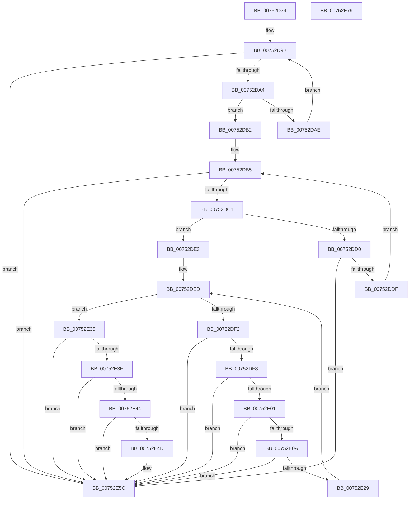

# PfSnParametersVerify

- RVA: `0x00752D74`–`0x00752E7A` (길이 `262` bytes)
- VA: `0x0000000140752D74`
- 실행 섹션: `PAGE`
- PDB 이름 있음: `예`; PDB Function 태그: `아니요`
- unwind 정보 RVA: `0x0005E6B4`
- 디코드: `71`개 명령, `262/262` bytes 표시
- 미해석 바이트: `0` (있으면 어셈블리에 `.byte`로 보존)

> 이 문서는 커널 이미지의 기계어와 PDB 기호를 분석해 생성했습니다. 4번과 5번은 함수 원형과 자료형을 바이너리 사용 방식에서 추정한 C 해석이며 원본 소스 복구 결과는 아닙니다.

## 1. Dependencies

- 직접 호출 지점: **1**; 고유 호출 대상: **1**
- 직접 호출자로 확인된 함수: **1**
- RIP 상대 이미지 참조: **0**

### Outgoing calls
- `0x00752DD0` → [towupper](../../text/50/towupper_function_00501910.md) (function, `0x00501910`)

### Direct callers
- [PfSnParametersRead](PfSnParametersRead_function_00752970.md) at `0x00752CCB`

### Static image references
- 디코드된 RIP-relative 메모리 참조가 없습니다.

## 2. Other-region calls and transfers

- 다른 실행 섹션으로 향하는 call: **1**
  - `0x00752DD0` → [towupper](../../text/50/towupper_function_00501910.md) (`PAGE` → `.text`)
- 별도 외부 분기/꼬리 이동을 확인하지 못했습니다.

## 3. Assembly (complete function range)

```asm
00752D74  48 8B C4                        mov rax, rsp
00752D77  48 89 58 08                     mov qword ptr [rax + 8], rbx
00752D7B  48 89 68 10                     mov qword ptr [rax + 0x10], rbp
00752D7F  48 89 70 18                     mov qword ptr [rax + 0x18], rsi
00752D83  48 89 78 20                     mov qword ptr [rax + 0x20], rdi
00752D87  41 56                           push r14
00752D89  48 83 EC 20                     sub rsp, 0x20
00752D8D  45 33 F6                        xor r14d, r14d
00752D90  48 8B D9                        mov rbx, rcx
00752D93  41 8B CE                        mov ecx, r14d
00752D96  BE 0D 00 00 C0                  mov esi, 0xc000000d
00752D9B  83 F9 30                        cmp ecx, 0x30
00752D9E  0F 83 B8 00 00 00               jae 0x140752e5c
00752DA4  8B C1                           mov eax, ecx
00752DA6  66 44 39 74 43 30               cmp word ptr [rbx + rax*2 + 0x30], r14w
00752DAC  74 04                           je 0x140752db2
00752DAE  FF C1                           inc ecx
00752DB0  EB E9                           jmp 0x140752d9b
00752DB2  41 8B FE                        mov edi, r14d
00752DB5  81 FF 80 00 00 00               cmp edi, 0x80
00752DBB  0F 83 9B 00 00 00               jae 0x140752e5c
00752DC1  8B EF                           mov ebp, edi
00752DC3  0F B7 8C 6B 90 00 00 00         movzx ecx, word ptr [rbx + rbp*2 + 0x90]
00752DCB  66 85 C9                        test cx, cx
00752DCE  74 13                           je 0x140752de3
00752DD0  E8 3B EB DA FF                  call 0x140501910
00752DD5  66 3B 84 6B 90 00 00 00         cmp ax, word ptr [rbx + rbp*2 + 0x90]
00752DDD  75 7D                           jne 0x140752e5c
00752DDF  FF C7                           inc edi
00752DE1  EB D2                           jmp 0x140752db5
00752DE3  41 8B D6                        mov edx, r14d
00752DE6  48 8D 4B 10                     lea rcx, [rbx + 0x10]
00752DEA  4C 8B C3                        mov r8, rbx
00752DED  83 FA 02                        cmp edx, 2
00752DF0  7D 43                           jge 0x140752e35
00752DF2  41 83 38 02                     cmp dword ptr [r8], 2
00752DF6  77 64                           ja 0x140752e5c
00752DF8  81 79 F8 00 00 10 00            cmp dword ptr [rcx - 8], 0x100000
00752DFF  77 5B                           ja 0x140752e5c
00752E01  81 79 FC 00 40 00 00            cmp dword ptr [rcx - 4], 0x4000
00752E08  77 52                           ja 0x140752e5c
00752E0A  48 8B 01                        mov rax, qword ptr [rcx]
00752E0D  49 B9 00 BC A0 65 01 00 00 00   movabs r9, 0x165a0bc00
00752E17  49 03 C1                        add rax, r9
00752E1A  49 B9 FF BB A0 65 01 00 00 00   movabs r9, 0x165a0bbff
00752E24  49 3B C1                        cmp rax, r9
00752E27  77 33                           ja 0x140752e5c
00752E29  FF C2                           inc edx
00752E2B  49 83 C0 04                     add r8, 4
00752E2F  48 83 C1 10                     add rcx, 0x10
00752E33  EB B8                           jmp 0x140752ded
00752E35  B8 00 10 00 00                  mov eax, 0x1000
00752E3A  39 43 28                        cmp dword ptr [rbx + 0x28], eax
00752E3D  77 1D                           ja 0x140752e5c
00752E3F  39 43 2C                        cmp dword ptr [rbx + 0x2c], eax
00752E42  77 18                           ja 0x140752e5c
00752E44  83 BB 90 01 00 00 20            cmp dword ptr [rbx + 0x190], 0x20
00752E4B  73 0F                           jae 0x140752e5c
00752E4D  8B 8B 94 01 00 00               mov ecx, dword ptr [rbx + 0x194]
00752E53  FF C9                           dec ecx
00752E55  83 F9 09                        cmp ecx, 9
00752E58  41 0F 46 F6                     cmovbe esi, r14d
00752E5C  48 8B 5C 24 30                  mov rbx, qword ptr [rsp + 0x30]
00752E61  8B C6                           mov eax, esi
00752E63  48 8B 74 24 40                  mov rsi, qword ptr [rsp + 0x40]
00752E68  48 8B 6C 24 38                  mov rbp, qword ptr [rsp + 0x38]
00752E6D  48 8B 7C 24 48                  mov rdi, qword ptr [rsp + 0x48]
00752E72  48 83 C4 20                     add rsp, 0x20
00752E76  41 5E                           pop r14
00752E78  C3                              ret
00752E79  CC                              int3
```

## 4. C-style interpretation (structured pseudocode)

```c
__int64 __fastcall PfSnParametersVerify(__int64 a1)
{
    __int64 result;
    __int64 v_r14;
    __int64 v_rdi;
    __int64 v_rsi;
    __int64 v_rsp;
    unsigned __int64 v_stack_p10;
    unsigned __int64 v_stack_p18;
    unsigned __int64 v_stack_p20;
    unsigned __int64 v_stack_p8;

    *(unsigned __int64 *)(v_rsp + 8) = v_rbx;
    *(unsigned __int64 *)(v_rsp + 16) = v_rbp;
    *(unsigned __int64 *)(v_rsp + 24) = v_rsi;
    *(unsigned __int64 *)(v_rsp + 32) = v_rdi;
    v_rsp = (v_rsp) - (32);
    v_r14 = 0;
loc_00752D9B:
    if (0 >= 48) goto loc_00752E5C;
    if ((*(unsigned __int16 *)(a1 + 0 * 2 + 48)) == 0) goto loc_00752DB2;
    a1 = (unsigned int)((0) + 1);
    goto loc_00752D9B;
loc_00752DB2:
loc_00752DB5:
    if (0 >= 128) goto loc_00752E5C;
    if ((unsigned __int16)(*(unsigned __int16 *)(a1 + 0 * 2 + 144)) == 0) goto loc_00752DE3;
    result = towupper(*(unsigned __int16 *)(a1 + 0 * 2 + 144), a2, a3, a4);
    if (((unsigned __int16)(result)) != (*(unsigned __int16 *)(a1 + 0 * 2 + 144))) goto loc_00752E5C;
    v_rdi = (unsigned int)((0) + 1);
    goto loc_00752DB5;
loc_00752DE3:
loc_00752DED:
    if (0 >= 2) goto loc_00752E35;
    if ((*(unsigned int *)(a1)) > 2) goto loc_00752E5C;
    if ((*(unsigned int *)(a1 + 16 - 8)) > 0x100000ULL) goto loc_00752E5C;
    if ((*(unsigned int *)(a1 + 16 - 4)) > 0x4000ULL) goto loc_00752E5C;
    result = (*(unsigned __int64 *)(a1 + 16)) + (a4);
    if (result > a4) goto loc_00752E5C;
    a2 = (unsigned int)((0) + 1);
    a3 = (a1) + (4);
    a1 = (a1 + 16) + (16);
    goto loc_00752DED;
loc_00752E35:
    if ((*(unsigned int *)(a1 + 40)) > ((unsigned int)((unsigned int)(0x1000ULL)))) goto loc_00752E5C;
    if ((*(unsigned int *)(a1 + 44)) > ((unsigned int)((unsigned int)(0x1000ULL)))) goto loc_00752E5C;
    v_rsi = (unsigned int)(0xC000000DULL);
    if ((*(unsigned int *)(a1 + 400)) < 32) {
        a1 = *(unsigned int *)(a1 + 404);
        a1 = (unsigned int)((a1) - 1);
        v_rsi = (unsigned int)(0xC000000DULL);
        if (((unsigned int)(a1)) <= 9) { v_rsi = 0; }
    }
    v_rsp = (v_rsp) + (32);
    return (unsigned int)((unsigned int)(v_rsi));
}
```

## 5. (Beta) C Style

```c
int64_t PfSnParametersVerify(void *Arg1)
{
    uint8_t *arg1 = (uint8_t *)Arg1;

    int64_t result;
    int64_t local_r14;
    int64_t local_rdi;
    int64_t local_rsi;
    int64_t local_rsp;
    uint64_t v_stack_p10;
    uint64_t v_stack_p18;
    uint64_t v_stack_p20;
    uint64_t v_stack_p8;

    *(uint64_t *)(local_rsp + 0x8) = local_rbx;
    *(uint64_t *)(local_rsp + 0x10) = local_rbp;
    *(uint64_t *)(local_rsp + 0x18) = local_rsi;
    *(uint64_t *)(local_rsp + 0x20) = local_rdi;
    local_rsp = (local_rsp) - (32);
    local_r14 = 0;
loc_00752D9B:
    if (0 >= 48) goto loc_00752E5C;
    if ((*(uint16_t *)(arg1 + 0x0 * 2 + 0x30)) == 0) goto loc_00752DB2;
    Arg1 = (uint32_t)((0) + 1);
    goto loc_00752D9B;
loc_00752DB2:
loc_00752DB5:
    if (0 >= 128) goto loc_00752E5C;
    if ((uint16_t)(*(uint16_t *)(arg1 + 0x0 * 2 + 0x90)) == 0) goto loc_00752DE3;
    result = towupper(*(uint16_t *)(arg1 + 0x0 * 2 + 0x90), a2, a3, a4);
    if (((uint16_t)(result)) != (*(uint16_t *)(arg1 + 0x0 * 2 + 0x90))) goto loc_00752E5C;
    local_rdi = (uint32_t)((0) + 1);
    goto loc_00752DB5;
loc_00752DE3:
loc_00752DED:
    if (0 >= 2) goto loc_00752E35;
    if ((*(uint32_t *)(arg1)) > 2) goto loc_00752E5C;
    if ((*(uint32_t *)(arg1 + 0x10 - 0x8)) > 0x100000ULL) goto loc_00752E5C;
    if ((*(uint32_t *)(arg1 + 0x10 - 0x4)) > 0x4000ULL) goto loc_00752E5C;
    result = (*(uint64_t *)(arg1 + 0x10)) + (a4);
    if (result > a4) goto loc_00752E5C;
    a2 = (uint32_t)((0) + 1);
    a3 = (Arg1) + (4);
    Arg1 = (Arg1 + 16) + (16);
    goto loc_00752DED;
loc_00752E35:
    if ((*(uint32_t *)(arg1 + 0x28)) > ((uint32_t)((uint32_t)(0x1000ULL)))) goto loc_00752E5C;
    if ((*(uint32_t *)(arg1 + 0x2C)) > ((uint32_t)((uint32_t)(0x1000ULL)))) goto loc_00752E5C;
    local_rsi = (uint32_t)(0xC000000DULL);
    if ((*(uint32_t *)(arg1 + 0x190)) < 32) {
        Arg1 = *(uint32_t *)(arg1 + 0x194);
        Arg1 = (uint32_t)((Arg1) - 1);
        local_rsi = (uint32_t)(0xC000000DULL);
        if (((uint32_t)(Arg1)) <= 9) { local_rsi = 0; }
    }
    local_rsp = (local_rsp) + (32);
    return (uint32_t)((uint32_t)(local_rsi));
}
```

### 관측된 메모리 오프셋

구조체 형식이 확인되지 않은 접근은 인자 기준의 오프셋으로만 기록했습니다.

| 기준 인자 | 오프셋 표현 | 폭 (bit) | 접근 |
|---|---:|---:|---|
| `Arg1` | `- 0x8` | `32` | `R` |
| `Arg1` | `- 0x4` | `32` | `R` |
| `Arg1` | `+ 0x0` | `32` | `R` |
| `Arg1` | `+ 0x0` | `64` | `R` |
| `Arg1` | `+ 0x10` | `64` | `R` |
| `Arg1` | `+ 0x28` | `32` | `R` |
| `Arg1` | `+ 0x2C` | `32` | `R` |
| `Arg1` | `+ 0x30 + rax*2` | `16` | `R` |
| `Arg1` | `+ 0x90 + rbp*2` | `16` | `R` |
| `Arg1` | `+ 0x190` | `32` | `R` |
| `Arg1` | `+ 0x194` | `32` | `R` |

## 6. Execution-region graph

[열기: 2D/3D 그래프와 함수 탐색 컨트롤 패널](../../../control-panel.html?section=page&rva=0x00752D74&view=graph)

- 2D 그래프는 위에서 아래로 흐르고, 3D 그래프는 빈 공간을 드래그해 회전합니다. Shift+드래그는 이동, 휠은 확대·축소, 함수 노드 선택은 대상 보고서 이동입니다.

### Static fallback


