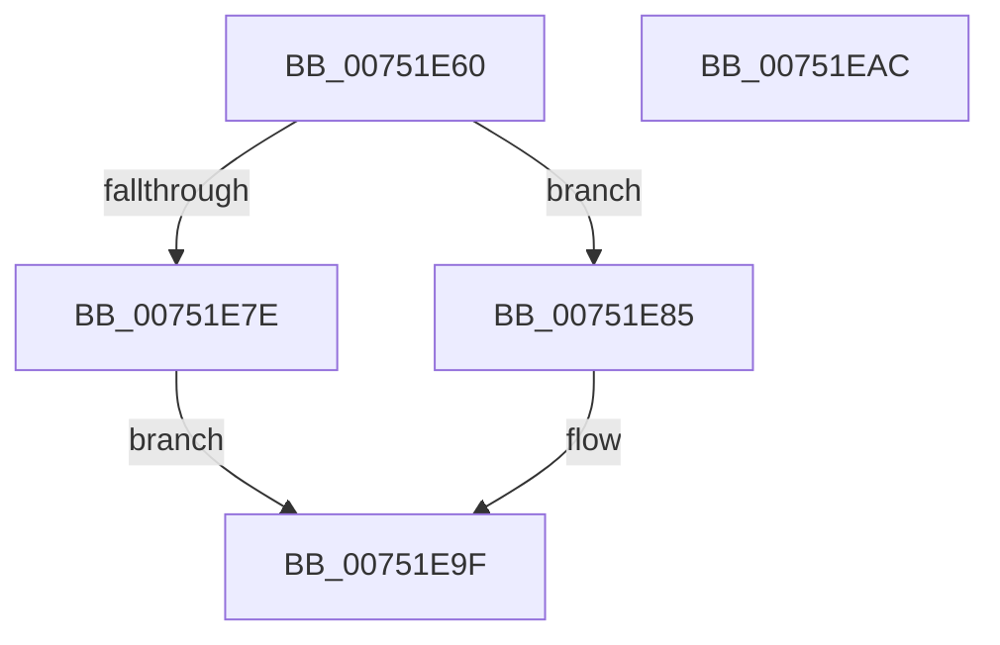

# PfSnQueueEnablePrefetcherTimer

- RVA: `0x00751E60`–`0x00751EAD` (길이 `77` bytes)
- VA: `0x0000000140751E60`
- 실행 섹션: `PAGE`
- PDB 이름 있음: `예`; PDB Function 태그: `아니요`
- unwind 정보 RVA: `0x0006E5F8`
- 디코드: `24`개 명령, `77/77` bytes 표시
- 미해석 바이트: `0` (있으면 어셈블리에 `.byte`로 보존)

> 이 문서는 커널 이미지의 기계어와 PDB 기호를 분석해 생성했습니다. 4번과 5번은 함수 원형과 자료형을 바이너리 사용 방식에서 추정한 C 해석이며 원본 소스 복구 결과는 아닙니다.

## 1. Dependencies

- 직접 호출 지점: **2**; 고유 호출 대상: **2**
- 직접 호출자로 확인된 함수: **1**
- RIP 상대 이미지 참조: **0**

### Outgoing calls
- `0x00751E72` → [PfSnAllocateEnablePrefetcherTimer](../../pagelk/B7/PfSnAllocateEnablePrefetcherTimer_function_00B7E1C8.md) (function, `0x00B7E1C8`)
- `0x00751E9A` → [KiSetTimerEx](../../text/23/KiSetTimerEx_function_00232CB0.md) (function, `0x00232CB0`)

### Direct callers
- [PfSnBeginBootPhase](../../pagelk/B6/PfSnBeginBootPhase_function_00B6BAC4.md) at `0x00B6BBAA`

### Static image references
- 디코드된 RIP-relative 메모리 참조가 없습니다.

## 2. Other-region calls and transfers

- 다른 실행 섹션으로 향하는 call: **2**
  - `0x00751E72` → [PfSnAllocateEnablePrefetcherTimer](../../pagelk/B7/PfSnAllocateEnablePrefetcherTimer_function_00B7E1C8.md) (`PAGE` → `PAGELK`)
  - `0x00751E9A` → [KiSetTimerEx](../../text/23/KiSetTimerEx_function_00232CB0.md) (`PAGE` → `.text`)
- 별도 외부 분기/꼬리 이동을 확인하지 못했습니다.

## 3. Assembly (complete function range)

```asm
00751E60  48 89 5C 24 08                  mov qword ptr [rsp + 8], rbx
00751E65  57                              push rdi
00751E66  48 83 EC 30                     sub rsp, 0x30
00751E6A  48 8B F9                        mov rdi, rcx
00751E6D  B9 01 00 00 00                  mov ecx, 1
00751E72  E8 51 C3 42 00                  call 0x140b7e1c8
00751E77  33 DB                           xor ebx, ebx
00751E79  48 85 C0                        test rax, rax
00751E7C  75 07                           jne 0x140751e85
00751E7E  BB 9A 00 00 C0                  mov ebx, 0xc000009a
00751E83  EB 1A                           jmp 0x140751e9f
00751E85  48 8B 17                        mov rdx, qword ptr [rdi]
00751E88  48 8D 48 40                     lea rcx, [rax + 0x40]
00751E8C  48 89 4C 24 20                  mov qword ptr [rsp + 0x20], rcx
00751E91  45 33 C9                        xor r9d, r9d
00751E94  48 8B C8                        mov rcx, rax
00751E97  45 33 C0                        xor r8d, r8d
00751E9A  E8 11 0E AE FF                  call 0x140232cb0
00751E9F  8B C3                           mov eax, ebx
00751EA1  48 8B 5C 24 40                  mov rbx, qword ptr [rsp + 0x40]
00751EA6  48 83 C4 30                     add rsp, 0x30
00751EAA  5F                              pop rdi
00751EAB  C3                              ret
00751EAC  CC                              int3
```

## 4. C-style interpretation (structured pseudocode)

```c
__int64 __fastcall PfSnQueueEnablePrefetcherTimer(__int64 a1, __int64 a2, int a3, int a4)
{
    __int64 result;
    __int64 v_rbx;
    __int64 v_rsp;
    unsigned __int64 v_stack_m18;
    unsigned __int64 v_stack_p8;

    v_stack_p8 = v_rbx;
    v_rsp = (v_rsp) - (48);
    result = PfSnAllocateEnablePrefetcherTimer(1, a2, a3, a4);
    v_rbx = 0;
    if (result != 0) goto loc_00751E85;
    goto loc_00751E9F;
loc_00751E85:
    v_stack_m18 = result + 64;
    a4 = 0;
    a3 = 0;
    result = KiSetTimerEx(result, *(unsigned __int64 *)(a1), a3, a4);
loc_00751E9F:
    v_rsp = (v_rsp) + (48);
    return (unsigned int)((unsigned int)((unsigned int)(0xC000009AULL)));
}
```

## 5. (Beta) C Style

```c
int64_t PfSnQueueEnablePrefetcherTimer(void *Arg1, int64_t Arg2, int32_t Arg3, int32_t Arg4)
{
    uint8_t *arg1 = (uint8_t *)Arg1;

    int64_t result;
    int64_t local_rbx;
    int64_t local_rsp;
    uint64_t v_stack_m18;
    uint64_t v_stack_p8;

    v_stack_p8 = local_rbx;
    local_rsp = (local_rsp) - (48);
    result = PfSnAllocateEnablePrefetcherTimer(1, Arg2, Arg3, Arg4);
    local_rbx = 0;
    if (result != 0) goto loc_00751E85;
    goto loc_00751E9F;
loc_00751E85:
    v_stack_m18 = result + 64;
    Arg4 = 0;
    Arg3 = 0;
    result = KiSetTimerEx(result, *(uint64_t *)(arg1), Arg3, Arg4);
loc_00751E9F:
    local_rsp = (local_rsp) + (48);
    return (uint32_t)((uint32_t)((uint32_t)(0xC000009AULL)));
}
```

### 관측된 메모리 오프셋

구조체 형식이 확인되지 않은 접근은 인자 기준의 오프셋으로만 기록했습니다.

| 기준 인자 | 오프셋 표현 | 폭 (bit) | 접근 |
|---|---:|---:|---|
| `Arg1` | `+ 0x0` | `64` | `R` |

## 6. Execution-region graph

[열기: 2D/3D 그래프와 함수 탐색 컨트롤 패널](../../../control-panel.html?section=page&rva=0x00751E60&view=graph)

- 2D 그래프는 위에서 아래로 흐르고, 3D 그래프는 빈 공간을 드래그해 회전합니다. Shift+드래그는 이동, 휠은 확대·축소, 함수 노드 선택은 대상 보고서 이동입니다.

### Static fallback


