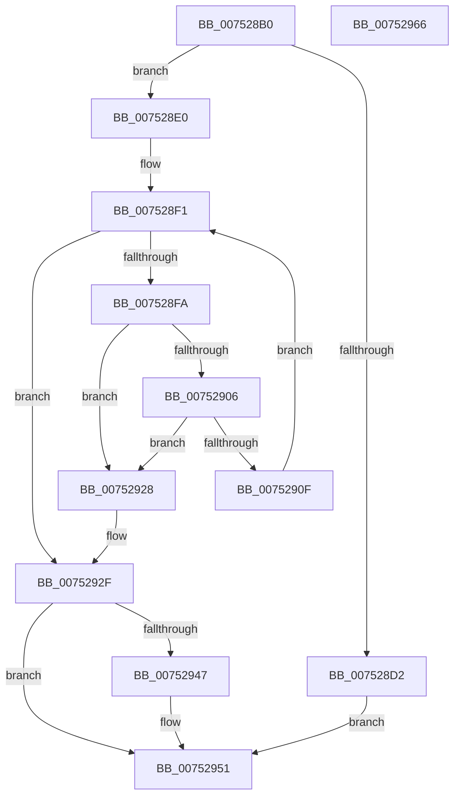

# PfSnTracingStateExWorkerRoutine

- RVA: `0x007528B0`–`0x00752967` (길이 `183` bytes)
- VA: `0x00000001407528B0`
- 실행 섹션: `PAGE`
- PDB 이름 있음: `예`; PDB Function 태그: `아니요`
- unwind 정보 RVA: `0x00085760`
- 디코드: `45`개 명령, `183/183` bytes 표시
- 미해석 바이트: `0` (있으면 어셈블리에 `.byte`로 보존)

> 이 문서는 커널 이미지의 기계어와 PDB 기호를 분석해 생성했습니다. 4번과 5번은 함수 원형과 자료형을 바이너리 사용 방식에서 추정한 C 해석이며 원본 소스 복구 결과는 아닙니다.

## 1. Dependencies

- 직접 호출 지점: **6**; 고유 호출 대상: **4**
- 직접 호출자로 확인된 함수: **0**
- RIP 상대 이미지 참조: **8**

### Outgoing calls
- `0x007528C4` → [ExAcquireFastMutex](../../text/20/ExAcquireFastMutex_function_0020E5A0.md) (function, `0x0020E5A0`)
- `0x007528D9` → [ExReleaseFastMutex](../../text/25/ExReleaseFastMutex_function_002519C0.md) (function, `0x002519C0`)
- `0x0075291B` → [ExFreePoolWithTag](../../poolcode/B8/ExFreePoolWithTag_function_00B82870.md) (function, `0x00B82870`)
- `0x00752936` → [ExReleaseFastMutex](../../text/25/ExReleaseFastMutex_function_002519C0.md) (function, `0x002519C0`)
- `0x0075294C` → [KeSetEvent](../../text/33/KeSetEvent_function_0033F310.md) (function, `0x0033F310`)
- `0x00752956` → [ExFreePoolWithTag](../../poolcode/B8/ExFreePoolWithTag_function_00B82870.md) (function, `0x00B82870`)

### Direct callers
- 이 함수 시작 RVA로 연결되는 직접 call은 확인되지 않았습니다. 간접 호출은 완전히 역산할 수 없습니다.

### Static image references
- `0x007528BD` → RVA `0x00E67278` (`.data`; read)
- `0x007528C9` → RVA `0x00E672B4` (`.data`; read)
- `0x007528E0` → RVA `0x00E672B4` (`.data`; write)
- `0x007528EA` → RVA `0x00E67268` (`.data`; read)
- `0x007528FA` → RVA `0x00E67270` (`.data`; read)
- `0x0075290F` → RVA `0x00E67270` (`.data`; write)
- `0x00752920` → RVA `0x00E672B0` (`.data`; read/write)
- `0x0075293B` → RVA `0x00E672B8` (`.data`; read)

## 2. Other-region calls and transfers

- 다른 실행 섹션으로 향하는 call: **6**
  - `0x007528C4` → [ExAcquireFastMutex](../../text/20/ExAcquireFastMutex_function_0020E5A0.md) (`PAGE` → `.text`)
  - `0x007528D9` → [ExReleaseFastMutex](../../text/25/ExReleaseFastMutex_function_002519C0.md) (`PAGE` → `.text`)
  - `0x0075291B` → [ExFreePoolWithTag](../../poolcode/B8/ExFreePoolWithTag_function_00B82870.md) (`PAGE` → `POOLCODE`)
  - `0x00752936` → [ExReleaseFastMutex](../../text/25/ExReleaseFastMutex_function_002519C0.md) (`PAGE` → `.text`)
  - `0x0075294C` → [KeSetEvent](../../text/33/KeSetEvent_function_0033F310.md) (`PAGE` → `.text`)
  - `0x00752956` → [ExFreePoolWithTag](../../poolcode/B8/ExFreePoolWithTag_function_00B82870.md) (`PAGE` → `POOLCODE`)
- 별도 외부 분기/꼬리 이동을 확인하지 못했습니다.

## 3. Assembly (complete function range)

```asm
007528B0  48 89 5C 24 08                  mov qword ptr [rsp + 8], rbx
007528B5  56                              push rsi
007528B6  48 83 EC 20                     sub rsp, 0x20
007528BA  48 8B D9                        mov rbx, rcx
007528BD  48 8D 0D B4 49 71 00            lea rcx, [rip + 0x7149b4]
007528C4  E8 D7 BC AB FF                  call 0x14020e5a0
007528C9  83 3D E4 49 71 00 02            cmp dword ptr [rip + 0x7149e4], 2
007528D0  75 0E                           jne 0x1407528e0
007528D2  48 8D 0D 9F 49 71 00            lea rcx, [rip + 0x71499f]
007528D9  E8 E2 F0 AF FF                  call 0x1402519c0
007528DE  EB 71                           jmp 0x140752951
007528E0  C7 05 CA 49 71 00 01 00 00 00   mov dword ptr [rip + 0x7149ca], 1
007528EA  48 8D 35 77 49 71 00            lea rsi, [rip + 0x714977]
007528F1  48 39 35 70 49 71 00            cmp qword ptr [rip + 0x714970], rsi
007528F8  74 35                           je 0x14075292f
007528FA  48 8B 0D 6F 49 71 00            mov rcx, qword ptr [rip + 0x71496f]
00752901  48 39 31                        cmp qword ptr [rcx], rsi
00752904  75 22                           jne 0x140752928
00752906  48 8B 41 08                     mov rax, qword ptr [rcx + 8]
0075290A  48 39 08                        cmp qword ptr [rax], rcx
0075290D  75 19                           jne 0x140752928
0075290F  48 89 05 5A 49 71 00            mov qword ptr [rip + 0x71495a], rax
00752916  33 D2                           xor edx, edx
00752918  48 89 30                        mov qword ptr [rax], rsi
0075291B  E8 50 FF 42 00                  call 0x140b82870
00752920  FF 0D 8A 49 71 00               dec dword ptr [rip + 0x71498a]
00752926  EB C9                           jmp 0x1407528f1
00752928  B9 03 00 00 00                  mov ecx, 3
0075292D  CD 29                           int 0x29
0075292F  48 8D 0D 42 49 71 00            lea rcx, [rip + 0x714942]
00752936  E8 85 F0 AF FF                  call 0x1402519c0
0075293B  48 8B 0D 76 49 71 00            mov rcx, qword ptr [rip + 0x714976]
00752942  48 85 C9                        test rcx, rcx
00752945  74 0A                           je 0x140752951
00752947  45 33 C0                        xor r8d, r8d
0075294A  33 D2                           xor edx, edx
0075294C  E8 BF C9 BE FF                  call 0x14033f310
00752951  33 D2                           xor edx, edx
00752953  48 8B CB                        mov rcx, rbx
00752956  E8 15 FF 42 00                  call 0x140b82870
0075295B  48 8B 5C 24 30                  mov rbx, qword ptr [rsp + 0x30]
00752960  48 83 C4 20                     add rsp, 0x20
00752964  5E                              pop rsi
00752965  C3                              ret
00752966  CC                              int3
```

## 4. C-style interpretation (structured pseudocode)

```c
__int64 __fastcall PfSnTracingStateExWorkerRoutine(__int64 a1, int a2, int a3)
{
    __int64 result;
    __int64 v_rsp;
    unsigned __int64 v_stack_p8;

    v_stack_p8 = v_rbx;
    v_rsp = (v_rsp) - (32);
    result = ExAcquireFastMutex(v_rip + 7424436, a2, a3, a4);
    if ((*(unsigned int *)(v_rip + 7424484)) != 2) goto loc_007528E0;
    result = ExReleaseFastMutex(v_rip + 7424415, a2, a3, a4);
    goto loc_00752951;
loc_007528E0:
    *(unsigned int *)(v_rip + 7424458) = 1;
loc_007528F1:
    if ((*(unsigned __int64 *)(v_rip + 7424368)) == (v_rip + 7424375)) goto loc_0075292F;
    if ((*(unsigned __int64 *)(*(unsigned __int64 *)(v_rip + 7424367))) != (v_rip + 7424375)) goto loc_00752928;
    if ((*(unsigned __int64 *)(*(unsigned __int64 *)(*(unsigned __int64 *)(v_rip + 7424367) + 8))) != (*(unsigned __int64 *)(v_rip + 7424367))) goto loc_00752928;
    *(unsigned __int64 *)(v_rip + 7424346) = *(unsigned __int64 *)(*(unsigned __int64 *)(v_rip + 7424367) + 8);
    a2 = 0;
    *(unsigned __int64 *)(*(unsigned __int64 *)(*(unsigned __int64 *)(v_rip + 7424367) + 8)) = v_rip + 7424375;
    result = ExFreePoolWithTag(*(unsigned __int64 *)(v_rip + 7424367), a2, a3, a4);
    goto loc_007528F1;
loc_00752928:
loc_0075292F:
    result = ExReleaseFastMutex(v_rip + 7424322, a2, a3, a4);
    if (*(unsigned __int64 *)(v_rip + 7424374) != 0) {
        a3 = 0;
        a2 = 0;
        result = KeSetEvent(*(unsigned __int64 *)(v_rip + 7424374), a2, a3, a4);
    }
    a2 = 0;
    result = ExFreePoolWithTag(a1, a2, a3, a4);
    v_rsp = (v_rsp) + (32);
    return result;
}
```

## 5. (Beta) C Style

```c
int64_t PfSnTracingStateExWorkerRoutine(int64_t Arg1, int32_t Arg2, int32_t Arg3)
{
    int64_t result;
    int64_t local_rsp;
    uint64_t v_stack_p8;

    v_stack_p8 = local_rbx;
    local_rsp = (local_rsp) - (32);
    result = ExAcquireFastMutex(v_rip + 7424436, Arg2, Arg3, a4);
    if ((*(uint32_t *)(v_rip + 0x7149E4)) != 2) goto loc_007528E0;
    result = ExReleaseFastMutex(v_rip + 7424415, Arg2, Arg3, a4);
    goto loc_00752951;
loc_007528E0:
    *(uint32_t *)(v_rip + 0x7149CA) = 1;
loc_007528F1:
    if ((*(uint64_t *)(v_rip + 0x714970)) == (v_rip + 7424375)) goto loc_0075292F;
    if ((*(uint64_t *)(*(uint64_t *)(v_rip + 0x71496F))) != (v_rip + 7424375)) goto loc_00752928;
    if ((*(uint64_t *)(*(uint64_t *)(*(uint64_t *)(v_rip + 0x71496F) + 0x8))) != (*(uint64_t *)(v_rip + 0x71496F))) goto loc_00752928;
    *(uint64_t *)(v_rip + 0x71495A) = *(uint64_t *)(*(uint64_t *)(v_rip + 0x71496F) + 0x8);
    Arg2 = 0;
    *(uint64_t *)(*(uint64_t *)(*(uint64_t *)(v_rip + 0x71496F) + 0x8)) = v_rip + 7424375;
    result = ExFreePoolWithTag(*(uint64_t *)(v_rip + 0x71496F), Arg2, Arg3, a4);
    goto loc_007528F1;
loc_00752928:
loc_0075292F:
    result = ExReleaseFastMutex(v_rip + 7424322, Arg2, Arg3, a4);
    if (*(uint64_t *)(v_rip + 0x714976) != 0) {
        Arg3 = 0;
        Arg2 = 0;
        result = KeSetEvent(*(uint64_t *)(v_rip + 0x714976), Arg2, Arg3, a4);
    }
    Arg2 = 0;
    result = ExFreePoolWithTag(Arg1, Arg2, Arg3, a4);
    local_rsp = (local_rsp) + (32);
    return result;
}
```

## 6. Execution-region graph

[열기: 2D/3D 그래프와 함수 탐색 컨트롤 패널](../../../control-panel.html?section=page&rva=0x007528B0&view=graph)

- 2D 그래프는 위에서 아래로 흐르고, 3D 그래프는 빈 공간을 드래그해 회전합니다. Shift+드래그는 이동, 휠은 확대·축소, 함수 노드 선택은 대상 보고서 이동입니다.

### Static fallback


