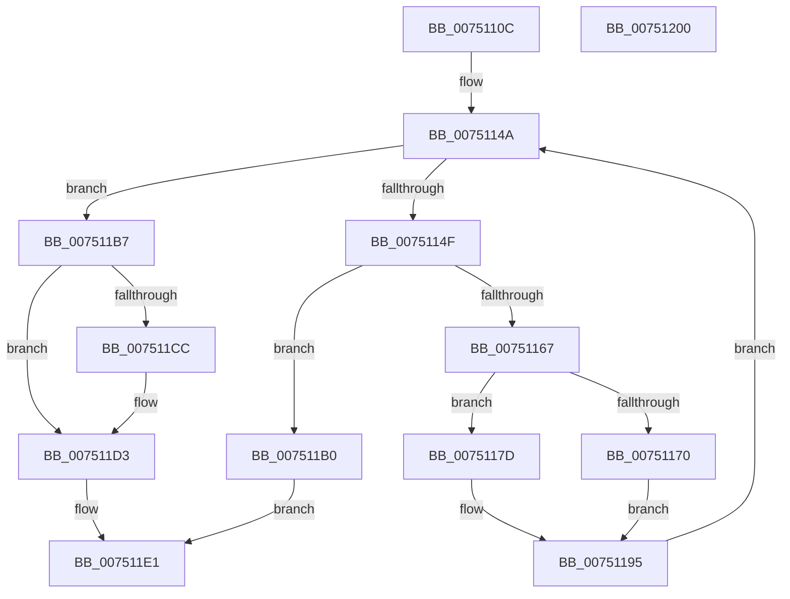

# PfTAllocateBuffers

- RVA: `0x0075110C`–`0x00751201` (길이 `245` bytes)
- VA: `0x000000014075110C`
- 실행 섹션: `PAGE`
- PDB 이름 있음: `예`; PDB Function 태그: `아니요`
- unwind 정보 RVA: `0x00075C18`
- 디코드: `78`개 명령, `245/245` bytes 표시
- 미해석 바이트: `0` (있으면 어셈블리에 `.byte`로 보존)

> 이 문서는 커널 이미지의 기계어와 PDB 기호를 분석해 생성했습니다. 4번과 5번은 함수 원형과 자료형을 바이너리 사용 방식에서 추정한 C 해석이며 원본 소스 복구 결과는 아닙니다.

## 1. Dependencies

- 직접 호출 지점: **4**; 고유 호출 대상: **4**
- 직접 호출자로 확인된 함수: **1**
- RIP 상대 이미지 참조: **0**

### Outgoing calls
- `0x0075115A` → [ExAllocatePool2](../../poolcode/B8/ExAllocatePool2_function_00B820F0.md) (function, `0x00B820F0`)
- `0x00751176` → [PfTLbInitialize](../A7/PfTLbInitialize_function_00A712F8.md) (function, `0x00A712F8`)
- `0x00751182` → [memset](../../text/6C/memset_function_006C6C40.md) (function, `0x006C6C40`)
- `0x007511BA` → [PfTGetFreeBuffer](../97/PfTGetFreeBuffer_function_0097CBD0.md) (function, `0x0097CBD0`)

### Direct callers
- [PfTStart](PfTStart_function_007517AC.md) at `0x007518A8`
- [PfTStart](PfTStart_function_007517AC.md) at `0x007518CF`

### Static image references
- 디코드된 RIP-relative 메모리 참조가 없습니다.

## 2. Other-region calls and transfers

- 다른 실행 섹션으로 향하는 call: **2**
  - `0x0075115A` → [ExAllocatePool2](../../poolcode/B8/ExAllocatePool2_function_00B820F0.md) (`PAGE` → `POOLCODE`)
  - `0x00751182` → [memset](../../text/6C/memset_function_006C6C40.md) (`PAGE` → `.text`)
- 별도 외부 분기/꼬리 이동을 확인하지 못했습니다.

## 3. Assembly (complete function range)

```asm
0075110C  48 89 5C 24 08                  mov qword ptr [rsp + 8], rbx
00751111  48 89 6C 24 10                  mov qword ptr [rsp + 0x10], rbp
00751116  48 89 74 24 18                  mov qword ptr [rsp + 0x18], rsi
0075111B  57                              push rdi
0075111C  41 54                           push r12
0075111E  41 55                           push r13
00751120  41 56                           push r14
00751122  41 57                           push r15
00751124  48 83 EC 20                     sub rsp, 0x20
00751128  44 8B 11                        mov r10d, dword ptr [rcx]
0075112B  8B C2                           mov eax, edx
0075112D  41 83 E2 0F                     and r10d, 0xf
00751131  C1 E0 04                        shl eax, 4
00751134  44 0B D0                        or r10d, eax
00751137  44 8B FA                        mov r15d, edx
0075113A  33 F6                           xor esi, esi
0075113C  44 89 11                        mov dword ptr [rcx], r10d
0075113F  8B EE                           mov ebp, esi
00751141  45 8B E9                        mov r13d, r9d
00751144  45 8B E0                        mov r12d, r8d
00751147  48 8B D9                        mov rbx, rcx
0075114A  41 3B EC                        cmp ebp, r12d
0075114D  73 68                           jae 0x1407511b7
0075114F  45 8B C5                        mov r8d, r13d
00751152  49 8B D7                        mov rdx, r15
00751155  B9 00 01 00 00                  mov ecx, 0x100
0075115A  E8 91 0F 43 00                  call 0x140b820f0
0075115F  48 8B F8                        mov rdi, rax
00751162  48 85 C0                        test rax, rax
00751165  74 49                           je 0x1407511b0
00751167  8B 03                           mov eax, dword ptr [rbx]
00751169  48 8B CF                        mov rcx, rdi
0075116C  A8 0F                           test al, 0xf
0075116E  75 0D                           jne 0x14075117d
00751170  45 33 C0                        xor r8d, r8d
00751173  41 8B D7                        mov edx, r15d
00751176  E8 7D 01 32 00                  call 0x140a712f8
0075117B  EB 18                           jmp 0x140751195
0075117D  4D 8B C7                        mov r8, r15
00751180  33 D2                           xor edx, edx
00751182  E8 B9 5A F7 FF                  call 0x1406c6c40
00751187  48 89 7F 08                     mov qword ptr [rdi + 8], rdi
0075118B  48 89 3F                        mov qword ptr [rdi], rdi
0075118E  C7 47 20 00 08 00 00            mov dword ptr [rdi + 0x20], 0x800
00751195  48 8B 43 10                     mov rax, qword ptr [rbx + 0x10]
00751199  48 89 07                        mov qword ptr [rdi], rax
0075119C  B8 01 00 00 00                  mov eax, 1
007511A1  48 89 7B 10                     mov qword ptr [rbx + 0x10], rdi
007511A5  66 01 43 0A                     add word ptr [rbx + 0xa], ax
007511A9  01 43 04                        add dword ptr [rbx + 4], eax
007511AC  03 E8                           add ebp, eax
007511AE  EB 9A                           jmp 0x14075114a
007511B0  BE 9A 00 00 C0                  mov esi, 0xc000009a
007511B5  EB 2A                           jmp 0x1407511e1
007511B7  48 8B CB                        mov rcx, rbx
007511BA  E8 11 BA 22 00                  call 0x14097cbd0
007511BF  48 83 C3 18                     add rbx, 0x18
007511C3  48 8B 0B                        mov rcx, qword ptr [rbx]
007511C6  48 39 59 08                     cmp qword ptr [rcx + 8], rbx
007511CA  74 07                           je 0x1407511d3
007511CC  B9 03 00 00 00                  mov ecx, 3
007511D1  CD 29                           int 0x29
007511D3  48 89 08                        mov qword ptr [rax], rcx
007511D6  48 89 58 08                     mov qword ptr [rax + 8], rbx
007511DA  48 89 41 08                     mov qword ptr [rcx + 8], rax
007511DE  48 89 03                        mov qword ptr [rbx], rax
007511E1  48 8B 5C 24 50                  mov rbx, qword ptr [rsp + 0x50]
007511E6  8B C6                           mov eax, esi
007511E8  48 8B 74 24 60                  mov rsi, qword ptr [rsp + 0x60]
007511ED  48 8B 6C 24 58                  mov rbp, qword ptr [rsp + 0x58]
007511F2  48 83 C4 20                     add rsp, 0x20
007511F6  41 5F                           pop r15
007511F8  41 5E                           pop r14
007511FA  41 5D                           pop r13
007511FC  41 5C                           pop r12
007511FE  5F                              pop rdi
007511FF  C3                              ret
00751200  CC                              int3
```

## 4. C-style interpretation (structured pseudocode)

```c
__int64 __fastcall PfTAllocateBuffers(__int64 a1, int a2, int a3, int a4)
{
    __int64 result;
    __int64 v_r10;
    __int64 v_rbp;
    __int64 v_rbx;
    __int64 v_rsi;
    __int64 v_rsp;
    unsigned __int64 v_stack_p10;
    unsigned __int64 v_stack_p18;
    unsigned __int64 v_stack_p8;

    v_stack_p8 = v_rbx;
    v_stack_p10 = v_rbp;
    v_stack_p18 = v_rsi;
    v_rsp = (v_rsp) - (32);
    v_r10 = (unsigned int)(((unsigned int)(*(unsigned int *)(a1))) & (15));
    result = (unsigned int)(((unsigned int)(a2)) << (4));
    v_r10 = (unsigned int)((v_r10) | ((unsigned int)(result)));
    v_rsi = 0;
    *(unsigned int *)(a1) = (unsigned int)(v_r10);
loc_0075114A:
    if (0 >= ((unsigned int)((unsigned int)(a3)))) goto loc_007511B7;
    result = ExAllocatePool2(256, (unsigned int)(a2), (unsigned int)((unsigned int)((unsigned int)(a4))), a4);
    if (result == 0) goto loc_007511B0;
    if ((((unsigned __int8)((unsigned int)(*(unsigned int *)(a1)))) & (15)) != 0) goto loc_0075117D;
    a3 = 0;
    result = PfTLbInitialize(result, (unsigned int)((unsigned int)((unsigned int)(a2))), a3, a4);
    goto loc_00751195;
loc_0075117D:
    a2 = 0;
    result = memset(result, a2, (unsigned int)(a2), a4);
    *(unsigned __int64 *)(result + 8) = result;
    *(unsigned __int64 *)(result) = result;
    *(unsigned int *)(result + 32) = 0x800ULL;
loc_00751195:
    *(unsigned __int64 *)(result) = *(unsigned __int64 *)(a1 + 16);
    *(unsigned __int64 *)(a1 + 16) = result;
    v_rbp = (unsigned int)((0) + (1));
    goto loc_0075114A;
loc_007511B0:
    goto loc_007511E1;
loc_007511B7:
    result = PfTGetFreeBuffer(a1, a2, (unsigned int)(a2), a4);
    v_rbx = (a1) + (24);
    if ((*(unsigned __int64 *)(*(unsigned __int64 *)(v_rbx) + 8)) != v_rbx) {
        a1 = 3;
    }
    *(unsigned __int64 *)(result) = a1;
    *(unsigned __int64 *)(result + 8) = v_rbx;
    *(unsigned __int64 *)(a1 + 8) = result;
    *(unsigned __int64 *)(v_rbx) = result;
loc_007511E1:
    v_rsp = (v_rsp) + (32);
    return (unsigned int)((unsigned int)((unsigned int)(0xC000009AULL)));
}
```

## 5. (Beta) C Style

```c
int64_t PfTAllocateBuffers(void *Arg1, int32_t Arg2, int32_t Arg3, int32_t Arg4)
{
    uint8_t *arg1 = (uint8_t *)Arg1;

    int64_t result;
    int64_t local_r10;
    int64_t local_rbp;
    int64_t local_rbx;
    int64_t local_rsi;
    int64_t local_rsp;
    uint64_t v_stack_p10;
    uint64_t v_stack_p18;
    uint64_t v_stack_p8;

    v_stack_p8 = local_rbx;
    v_stack_p10 = local_rbp;
    v_stack_p18 = local_rsi;
    local_rsp = (local_rsp) - (32);
    local_r10 = (uint32_t)(((uint32_t)(*(uint32_t *)(arg1))) & (15));
    result = (uint32_t)(((uint32_t)(Arg2)) << (4));
    local_r10 = (uint32_t)((local_r10) | ((uint32_t)(result)));
    local_rsi = 0;
    *(uint32_t *)(arg1) = (uint32_t)(local_r10);
loc_0075114A:
    if (0 >= ((uint32_t)((uint32_t)(Arg3)))) goto loc_007511B7;
    result = ExAllocatePool2(256, (uint32_t)(Arg2), (uint32_t)((uint32_t)((uint32_t)(Arg4))), Arg4);
    if (result == 0) goto loc_007511B0;
    if ((((uint8_t)((uint32_t)(*(uint32_t *)(arg1)))) & (15)) != 0) goto loc_0075117D;
    Arg3 = 0;
    result = PfTLbInitialize(result, (uint32_t)((uint32_t)((uint32_t)(Arg2))), Arg3, Arg4);
    goto loc_00751195;
loc_0075117D:
    Arg2 = 0;
    result = memset(result, Arg2, (uint32_t)(Arg2), Arg4);
    *(uint64_t *)(result + 0x8) = result;
    *(uint64_t *)(result) = result;
    *(uint32_t *)(result + 0x20) = 0x800ULL;
loc_00751195:
    *(uint64_t *)(result) = *(uint64_t *)(arg1 + 0x10);
    *(uint64_t *)(arg1 + 0x10) = result;
    local_rbp = (uint32_t)((0) + (1));
    goto loc_0075114A;
loc_007511B0:
    goto loc_007511E1;
loc_007511B7:
    result = PfTGetFreeBuffer(Arg1, Arg2, (uint32_t)(Arg2), Arg4);
    local_rbx = (Arg1) + (24);
    if ((*(uint64_t *)(*(uint64_t *)(local_rbx) + 0x8)) != local_rbx) {
        Arg1 = 3;
    }
    *(void **)(result) = Arg1;
    *(uint64_t *)(result + 0x8) = local_rbx;
    *(uint64_t *)(arg1 + 0x8) = result;
    *(uint64_t *)(local_rbx) = result;
loc_007511E1:
    local_rsp = (local_rsp) + (32);
    return (uint32_t)((uint32_t)((uint32_t)(0xC000009AULL)));
}
```

### 관측된 메모리 오프셋

구조체 형식이 확인되지 않은 접근은 인자 기준의 오프셋으로만 기록했습니다.

| 기준 인자 | 오프셋 표현 | 폭 (bit) | 접근 |
|---|---:|---:|---|
| `Arg1` | `+ 0x0` | `32` | `R` |
| `Arg1` | `+ 0x0` | `32` | `W` |
| `Arg1` | `+ 0x0` | `64` | `R` |
| `Arg1` | `+ 0x0` | `64` | `W` |
| `Arg1` | `+ 0x4` | `32` | `R/W` |
| `Arg1` | `+ 0xA` | `16` | `R/W` |
| `Arg1` | `+ 0x10` | `64` | `R` |
| `Arg1` | `+ 0x10` | `64` | `W` |

## 6. Execution-region graph

[열기: 2D/3D 그래프와 함수 탐색 컨트롤 패널](../../../control-panel.html?section=page&rva=0x0075110C&view=graph)

- 2D 그래프는 위에서 아래로 흐르고, 3D 그래프는 빈 공간을 드래그해 회전합니다. Shift+드래그는 이동, 휠은 확대·축소, 함수 노드 선택은 대상 보고서 이동입니다.

### Static fallback


