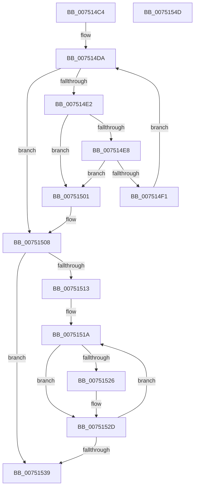

# PfTCleanupBuffers

- RVA: `0x007514C4`–`0x0075154E` (길이 `138` bytes)
- VA: `0x00000001407514C4`
- 실행 섹션: `PAGE`
- PDB 이름 있음: `예`; PDB Function 태그: `아니요`
- unwind 정보 RVA: `0x00060BC4`
- 디코드: `44`개 명령, `138/138` bytes 표시
- 미해석 바이트: `0` (있으면 어셈블리에 `.byte`로 보존)

> 이 문서는 커널 이미지의 기계어와 PDB 기호를 분석해 생성했습니다. 4번과 5번은 함수 원형과 자료형을 바이너리 사용 방식에서 추정한 C 해석이며 원본 소스 복구 결과는 아닙니다.

## 1. Dependencies

- 직접 호출 지점: **2**; 고유 호출 대상: **1**
- 직접 호출자로 확인된 함수: **1**
- RIP 상대 이미지 참조: **0**

### Outgoing calls
- `0x007514FA` → [ExFreePoolWithTag](../../poolcode/B8/ExFreePoolWithTag_function_00B82870.md) (function, `0x00B82870`)
- `0x0075152F` → [ExFreePoolWithTag](../../poolcode/B8/ExFreePoolWithTag_function_00B82870.md) (function, `0x00B82870`)

### Direct callers
- [PfTCleanup](PfTCleanup_function_00751208.md) at `0x007513F3`
- [PfTCleanup](PfTCleanup_function_00751208.md) at `0x007513FF`

### Static image references
- 디코드된 RIP-relative 메모리 참조가 없습니다.

## 2. Other-region calls and transfers

- 다른 실행 섹션으로 향하는 call: **2**
  - `0x007514FA` → [ExFreePoolWithTag](../../poolcode/B8/ExFreePoolWithTag_function_00B82870.md) (`PAGE` → `POOLCODE`)
  - `0x0075152F` → [ExFreePoolWithTag](../../poolcode/B8/ExFreePoolWithTag_function_00B82870.md) (`PAGE` → `POOLCODE`)
- 별도 외부 분기/꼬리 이동을 확인하지 못했습니다.

## 3. Assembly (complete function range)

```asm
007514C4  48 89 5C 24 08                  mov qword ptr [rsp + 8], rbx
007514C9  48 89 74 24 10                  mov qword ptr [rsp + 0x10], rsi
007514CE  57                              push rdi
007514CF  48 83 EC 20                     sub rsp, 0x20
007514D3  48 8B F9                        mov rdi, rcx
007514D6  48 8D 59 18                     lea rbx, [rcx + 0x18]
007514DA  48 8B 0B                        mov rcx, qword ptr [rbx]
007514DD  48 3B CB                        cmp rcx, rbx
007514E0  74 26                           je 0x140751508
007514E2  48 39 59 08                     cmp qword ptr [rcx + 8], rbx
007514E6  75 19                           jne 0x140751501
007514E8  48 8B 01                        mov rax, qword ptr [rcx]
007514EB  48 39 48 08                     cmp qword ptr [rax + 8], rcx
007514EF  75 10                           jne 0x140751501
007514F1  48 89 03                        mov qword ptr [rbx], rax
007514F4  33 D2                           xor edx, edx
007514F6  48 89 58 08                     mov qword ptr [rax + 8], rbx
007514FA  E8 71 13 43 00                  call 0x140b82870
007514FF  EB D9                           jmp 0x1407514da
00751501  B9 03 00 00 00                  mov ecx, 3
00751506  CD 29                           int 0x29
00751508  48 8B 5F 10                     mov rbx, qword ptr [rdi + 0x10]
0075150C  33 F6                           xor esi, esi
0075150E  48 85 DB                        test rbx, rbx
00751511  74 26                           je 0x140751539
00751513  48 8B 03                        mov rax, qword ptr [rbx]
00751516  48 89 47 10                     mov qword ptr [rdi + 0x10], rax
0075151A  48 8B CB                        mov rcx, rbx
0075151D  48 8B 5F 10                     mov rbx, qword ptr [rdi + 0x10]
00751521  48 85 DB                        test rbx, rbx
00751524  74 07                           je 0x14075152d
00751526  48 8B 03                        mov rax, qword ptr [rbx]
00751529  48 89 47 10                     mov qword ptr [rdi + 0x10], rax
0075152D  33 D2                           xor edx, edx
0075152F  E8 3C 13 43 00                  call 0x140b82870
00751534  48 85 DB                        test rbx, rbx
00751537  75 E1                           jne 0x14075151a
00751539  48 8B 5C 24 30                  mov rbx, qword ptr [rsp + 0x30]
0075153E  66 89 77 0A                     mov word ptr [rdi + 0xa], si
00751542  48 8B 74 24 38                  mov rsi, qword ptr [rsp + 0x38]
00751547  48 83 C4 20                     add rsp, 0x20
0075154B  5F                              pop rdi
0075154C  C3                              ret
0075154D  CC                              int3
```

## 4. C-style interpretation (structured pseudocode)

```c
__int64 __fastcall PfTCleanupBuffers(__int64 a1, int a2)
{
    __int64 result;
    __int64 v_rsi;
    __int64 v_rsp;
    unsigned __int64 v_stack_p10;
    unsigned __int64 v_stack_p8;

    v_stack_p8 = v_rbx;
    v_stack_p10 = v_rsi;
    v_rsp = (v_rsp) - (32);
loc_007514DA:
    if ((*(unsigned __int64 *)(a1 + 24)) == (a1 + 24)) goto loc_00751508;
    if ((*(unsigned __int64 *)(*(unsigned __int64 *)(a1 + 24) + 8)) != (a1 + 24)) goto loc_00751501;
    if ((*(unsigned __int64 *)(*(unsigned __int64 *)(*(unsigned __int64 *)(a1 + 24)) + 8)) != (*(unsigned __int64 *)(a1 + 24))) goto loc_00751501;
    *(unsigned __int64 *)(a1 + 24) = *(unsigned __int64 *)(*(unsigned __int64 *)(a1 + 24));
    a2 = 0;
    *(unsigned __int64 *)(*(unsigned __int64 *)(*(unsigned __int64 *)(a1 + 24)) + 8) = a1 + 24;
    result = ExFreePoolWithTag(*(unsigned __int64 *)(a1 + 24), a2, a3, a4);
    goto loc_007514DA;
loc_00751501:
loc_00751508:
    v_rsi = 0;
    if (*(unsigned __int64 *)(a1 + 16) == 0) goto loc_00751539;
    *(unsigned __int64 *)(a1 + 16) = *(unsigned __int64 *)(*(unsigned __int64 *)(a1 + 16));
loc_0075151A:
    result = *(unsigned __int64 *)(*(unsigned __int64 *)(a1 + 16));
    if (*(unsigned __int64 *)(a1 + 16) != 0) {
        result = *(unsigned __int64 *)(*(unsigned __int64 *)(a1 + 16));
        *(unsigned __int64 *)(a1 + 16) = result;
    }
    a2 = 0;
    result = ExFreePoolWithTag(*(unsigned __int64 *)(a1 + 16), a2, a3, a4);
    if (*(unsigned __int64 *)(a1 + 16) != 0) goto loc_0075151A;
loc_00751539:
    *(unsigned __int16 *)(a1 + 10) = 0;
    v_rsp = (v_rsp) + (32);
    return result;
}
```

## 5. (Beta) C Style

```c
int64_t PfTCleanupBuffers(void *Arg1, int32_t Arg2)
{
    uint8_t *arg1 = (uint8_t *)Arg1;

    int64_t result;
    int64_t local_rsi;
    int64_t local_rsp;
    uint64_t v_stack_p10;
    uint64_t v_stack_p8;

    v_stack_p8 = local_rbx;
    v_stack_p10 = local_rsi;
    local_rsp = (local_rsp) - (32);
loc_007514DA:
    if ((*(uint64_t *)(arg1 + 0x18)) == (Arg1 + 24)) goto loc_00751508;
    if ((*(uint64_t *)(*(uint64_t *)(arg1 + 0x18) + 0x8)) != (Arg1 + 24)) goto loc_00751501;
    if ((*(uint64_t *)(*(uint64_t *)(*(uint64_t *)(arg1 + 0x18)) + 0x8)) != (*(uint64_t *)(arg1 + 0x18))) goto loc_00751501;
    *(uint64_t *)(arg1 + 0x18) = *(uint64_t *)(*(uint64_t *)(arg1 + 0x18));
    Arg2 = 0;
    *(void **)(*(uint64_t *)(*(uint64_t *)(arg1 + 0x18)) + 0x8) = Arg1 + 24;
    result = ExFreePoolWithTag(*(uint64_t *)(arg1 + 0x18), Arg2, a3, a4);
    goto loc_007514DA;
loc_00751501:
loc_00751508:
    local_rsi = 0;
    if (*(uint64_t *)(arg1 + 0x10) == 0) goto loc_00751539;
    *(uint64_t *)(arg1 + 0x10) = *(uint64_t *)(*(uint64_t *)(arg1 + 0x10));
loc_0075151A:
    result = *(uint64_t *)(*(uint64_t *)(arg1 + 0x10));
    if (*(uint64_t *)(arg1 + 0x10) != 0) {
        result = *(uint64_t *)(*(uint64_t *)(arg1 + 0x10));
        *(uint64_t *)(arg1 + 0x10) = result;
    }
    Arg2 = 0;
    result = ExFreePoolWithTag(*(uint64_t *)(arg1 + 0x10), Arg2, a3, a4);
    if (*(uint64_t *)(arg1 + 0x10) != 0) goto loc_0075151A;
loc_00751539:
    *(uint16_t *)(arg1 + 0xA) = 0;
    local_rsp = (local_rsp) + (32);
    return result;
}
```

### 관측된 메모리 오프셋

구조체 형식이 확인되지 않은 접근은 인자 기준의 오프셋으로만 기록했습니다.

| 기준 인자 | 오프셋 표현 | 폭 (bit) | 접근 |
|---|---:|---:|---|
| `Arg1` | `+ 0x0` | `64` | `R` |
| `Arg1` | `+ 0x0` | `64` | `W` |
| `Arg1` | `+ 0xA` | `16` | `W` |
| `Arg1` | `+ 0x10` | `64` | `R` |
| `Arg1` | `+ 0x10` | `64` | `W` |
| `Arg1` | `+ 0x18` | `64` | `R` |

## 6. Execution-region graph

[열기: 2D/3D 그래프와 함수 탐색 컨트롤 패널](../../../control-panel.html?section=page&rva=0x007514C4&view=graph)

- 2D 그래프는 위에서 아래로 흐르고, 3D 그래프는 빈 공간을 드래그해 회전합니다. Shift+드래그는 이동, 휠은 확대·축소, 함수 노드 선택은 대상 보고서 이동입니다.

### Static fallback


