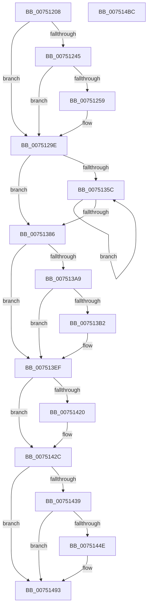

# PfTCleanup

- RVA: `0x00751208`–`0x007514BD` (길이 `693` bytes)
- VA: `0x0000000140751208`
- 실행 섹션: `PAGE`
- PDB 이름 있음: `예`; PDB Function 태그: `아니요`
- unwind 정보 RVA: `0x000CBB80`
- 디코드: `159`개 명령, `693/693` bytes 표시
- 미해석 바이트: `0` (있으면 어셈블리에 `.byte`로 보존)

> 이 문서는 커널 이미지의 기계어와 PDB 기호를 분석해 생성했습니다. 4번과 5번은 함수 원형과 자료형을 바이너리 사용 방식에서 추정한 C 해석이며 원본 소스 복구 결과는 아닙니다.

## 1. Dependencies

- 직접 호출 지점: **26**; 고유 호출 대상: **17**
- 직접 호출자로 확인된 함수: **3**
- RIP 상대 이미지 참조: **4**

### Outgoing calls
- `0x00751250` → [tlgKeywordOn](../../text/42/tlgKeywordOn_function_0042EAA0.md) (function, `0x0042EAA0`)
- `0x0075125C` → [PfpTraceLogPfPartitionId](../../text/5C/PfpTraceLogPfPartitionId_function_005CE1CC.md) (function, `0x005CE1CC`)
- `0x00751299` → [tlgWriteTransfer_EtwWriteTransfer](../../text/42/tlgWriteTransfer_EtwWriteTransfer_function_004260E0.md) (function, `0x004260E0`)
- `0x007512D3` → [PfTAccessTracingCleanup](../../pagelk/B6/PfTAccessTracingCleanup_function_00B6B8AC.md) (function, `0x00B6B8AC`)
- `0x007512E2` → [ExAcquireFastMutex](../../text/20/ExAcquireFastMutex_function_0020E5A0.md) (function, `0x0020E5A0`)
- `0x00751301` → [PfTTraceListTrim](PfTTraceListTrim_function_00751BB4.md) (function, `0x00751BB4`)
- `0x00751311` → [PfTTraceListTrim](PfTTraceListTrim_function_00751BB4.md) (function, `0x00751BB4`)
- `0x00751328` → [PfTAccessTracingCleanup](../../pagelk/B6/PfTAccessTracingCleanup_function_00B6B8AC.md) (function, `0x00B6B8AC`)
- `0x00751330` → [ExReleaseFastMutex](../../text/25/ExReleaseFastMutex_function_002519C0.md) (function, `0x002519C0`)
- `0x0075133C` → [PfTTraceListFree](../A6/PfTTraceListFree_function_00A60FA4.md) (function, `0x00A60FA4`)
- `0x0075134F` → [ExpInterlockedFlushSList](../../text/6B/ExpInterlockedFlushSList_function_006BA5F0.md) (function, `0x006BA5F0`)
- `0x0075137C` → [PfFbBufferListInsertInFree](../../text/48/PfFbBufferListInsertInFree_function_00484210.md) (function, `0x00484210`)
- `0x00751390` → [PfFbBufferListShutdown](../../text/5C/PfFbBufferListShutdown_function_005CE2CC.md) (function, `0x005CE2CC`)
- `0x0075139F` → [PfFbBufferListShutdown](../../text/5C/PfFbBufferListShutdown_function_005CE2CC.md) (function, `0x005CE2CC`)
- `0x007513BE` → [KeSetEvent](../../text/33/KeSetEvent_function_0033F310.md) (function, `0x0033F310`)
- `0x007513D7` → [KeWaitForSingleObject](../../text/20/KeWaitForSingleObject_function_0020E6B0.md) (function, `0x0020E6B0`)
- `0x007513E3` → [ObfDereferenceObject](../../text/2F/ObfDereferenceObject_function_002F9350.md) (function, `0x002F9350`)
- `0x007513F3` → [PfTCleanupBuffers](PfTCleanupBuffers_function_007514C4.md) (function, `0x007514C4`)
- `0x007513FF` → [PfTCleanupBuffers](PfTCleanupBuffers_function_007514C4.md) (function, `0x007514C4`)
- `0x00751407` → [PfFbBufferListCleanup](PfFbBufferListCleanup_function_00753680.md) (function, `0x00753680`)
- `0x0075140F` → [PfFbBufferListCleanup](PfFbBufferListCleanup_function_00753680.md) (function, `0x00753680`)
- `0x00751420` → [ObfDereferenceObject](../../text/2F/ObfDereferenceObject_function_002F9350.md) (function, `0x002F9350`)
- `0x00751445` → [tlgKeywordOn](../../text/42/tlgKeywordOn_function_0042EAA0.md) (function, `0x0042EAA0`)
- `0x00751451` → [PfpTraceLogPfPartitionId](../../text/5C/PfpTraceLogPfPartitionId_function_005CE1CC.md) (function, `0x005CE1CC`)
- `0x0075148E` → [tlgWriteTransfer_EtwWriteTransfer](../../text/42/tlgWriteTransfer_EtwWriteTransfer_function_004260E0.md) (function, `0x004260E0`)
- `0x0075149A` → [_security_check_cookie](../../text/6A/_security_check_cookie_function_006AC640.md) (function, `0x006AC640`)

### Direct callers
- [PfTStart](PfTStart_function_007517AC.md) at `0x007519E3`
- [PfpPartitionCleanup](PfpPartitionCleanup_function_00752050.md) at `0x0075205E`
- [PfSetSuperfetchInformation](../AD/PfSetSuperfetchInformation_function_00ADE6E8.md) at `0x00ADF036`
- [PfSetSuperfetchInformation](../AD/PfSetSuperfetchInformation_function_00ADE6E8.md) at `0x00ADF234`

### Static image references
- `0x00751226` → RVA `0x00E0A740` (`.data`; read)
- `0x00751239` → RVA `0x00E074D8` (`.data`; read)
- `0x00751264` → RVA `0x000489B1` (`.rdata`; read)
- `0x00751459` → RVA `0x000488ED` (`.rdata`; read)

## 2. Other-region calls and transfers

- 다른 실행 섹션으로 향하는 call: **19**
  - `0x00751250` → [tlgKeywordOn](../../text/42/tlgKeywordOn_function_0042EAA0.md) (`PAGE` → `.text`)
  - `0x0075125C` → [PfpTraceLogPfPartitionId](../../text/5C/PfpTraceLogPfPartitionId_function_005CE1CC.md) (`PAGE` → `.text`)
  - `0x00751299` → [tlgWriteTransfer_EtwWriteTransfer](../../text/42/tlgWriteTransfer_EtwWriteTransfer_function_004260E0.md) (`PAGE` → `.text`)
  - `0x007512D3` → [PfTAccessTracingCleanup](../../pagelk/B6/PfTAccessTracingCleanup_function_00B6B8AC.md) (`PAGE` → `PAGELK`)
  - `0x007512E2` → [ExAcquireFastMutex](../../text/20/ExAcquireFastMutex_function_0020E5A0.md) (`PAGE` → `.text`)
  - `0x00751328` → [PfTAccessTracingCleanup](../../pagelk/B6/PfTAccessTracingCleanup_function_00B6B8AC.md) (`PAGE` → `PAGELK`)
  - `0x00751330` → [ExReleaseFastMutex](../../text/25/ExReleaseFastMutex_function_002519C0.md) (`PAGE` → `.text`)
  - `0x0075134F` → [ExpInterlockedFlushSList](../../text/6B/ExpInterlockedFlushSList_function_006BA5F0.md) (`PAGE` → `.text`)
  - `0x0075137C` → [PfFbBufferListInsertInFree](../../text/48/PfFbBufferListInsertInFree_function_00484210.md) (`PAGE` → `.text`)
  - `0x00751390` → [PfFbBufferListShutdown](../../text/5C/PfFbBufferListShutdown_function_005CE2CC.md) (`PAGE` → `.text`)
  - `0x0075139F` → [PfFbBufferListShutdown](../../text/5C/PfFbBufferListShutdown_function_005CE2CC.md) (`PAGE` → `.text`)
  - `0x007513BE` → [KeSetEvent](../../text/33/KeSetEvent_function_0033F310.md) (`PAGE` → `.text`)
  - `0x007513D7` → [KeWaitForSingleObject](../../text/20/KeWaitForSingleObject_function_0020E6B0.md) (`PAGE` → `.text`)
  - `0x007513E3` → [ObfDereferenceObject](../../text/2F/ObfDereferenceObject_function_002F9350.md) (`PAGE` → `.text`)
  - `0x00751420` → [ObfDereferenceObject](../../text/2F/ObfDereferenceObject_function_002F9350.md) (`PAGE` → `.text`)
  - `0x00751445` → [tlgKeywordOn](../../text/42/tlgKeywordOn_function_0042EAA0.md) (`PAGE` → `.text`)
  - `0x00751451` → [PfpTraceLogPfPartitionId](../../text/5C/PfpTraceLogPfPartitionId_function_005CE1CC.md) (`PAGE` → `.text`)
  - `0x0075148E` → [tlgWriteTransfer_EtwWriteTransfer](../../text/42/tlgWriteTransfer_EtwWriteTransfer_function_004260E0.md) (`PAGE` → `.text`)
  - `0x0075149A` → [_security_check_cookie](../../text/6A/_security_check_cookie_function_006AC640.md) (`PAGE` → `.text`)
- 별도 외부 분기/꼬리 이동을 확인하지 못했습니다.

## 3. Assembly (complete function range)

```asm
00751208  48 89 5C 24 10                  mov qword ptr [rsp + 0x10], rbx
0075120D  48 89 74 24 18                  mov qword ptr [rsp + 0x18], rsi
00751212  48 89 7C 24 20                  mov qword ptr [rsp + 0x20], rdi
00751217  55                              push rbp
00751218  41 56                           push r14
0075121A  41 57                           push r15
0075121C  48 8B EC                        mov rbp, rsp
0075121F  48 81 EC 80 00 00 00            sub rsp, 0x80
00751226  48 8B 05 13 95 6B 00            mov rax, qword ptr [rip + 0x6b9513]
0075122D  48 33 C4                        xor rax, rsp
00751230  48 89 45 F8                     mov qword ptr [rbp - 8], rax
00751234  45 33 FF                        xor r15d, r15d
00751237  8B F2                           mov esi, edx
00751239  83 3D 98 62 6B 00 04            cmp dword ptr [rip + 0x6b6298], 4
00751240  48 8B F9                        mov rdi, rcx
00751243  76 59                           jbe 0x14075129e
00751245  41 8D 57 02                     lea edx, [r15 + 2]
00751249  48 8D 0D 88 62 6B 00            lea rcx, [rip + 0x6b6288]
00751250  E8 4B D8 CD FF                  call 0x14042eaa0
00751255  84 C0                           test al, al
00751257  74 45                           je 0x14075129e
00751259  48 8B CF                        mov rcx, rdi
0075125C  E8 6B CF E7 FF                  call 0x1405ce1cc
00751261  89 45 B0                        mov dword ptr [rbp - 0x50], eax
00751264  48 8D 15 46 77 8F FF            lea rdx, [rip - 0x7088ba]
0075126B  48 8D 45 B0                     lea rax, [rbp - 0x50]
0075126F  48 C7 45 F0 04 00 00 00         mov qword ptr [rbp - 0x10], 4
00751277  48 89 45 E8                     mov qword ptr [rbp - 0x18], rax
0075127B  48 8D 0D 56 62 6B 00            lea rcx, [rip + 0x6b6256]
00751282  48 8D 45 C8                     lea rax, [rbp - 0x38]
00751286  45 33 C9                        xor r9d, r9d
00751289  48 89 44 24 28                  mov qword ptr [rsp + 0x28], rax
0075128E  45 33 C0                        xor r8d, r8d
00751291  C7 44 24 20 03 00 00 00         mov dword ptr [rsp + 0x20], 3
00751299  E8 42 4E CD FF                  call 0x1404260e0
0075129E  B9 01 00 00 00                  mov ecx, 1
007512A3  45 0F B6 F7                     movzx r14d, r15b
007512A7  48 8D 45 B8                     lea rax, [rbp - 0x48]
007512AB  8B D1                           mov edx, ecx
007512AD  48 89 45 C0                     mov qword ptr [rbp - 0x40], rax
007512B1  44 8B C6                        mov r8d, esi
007512B4  48 8D 45 B8                     lea rax, [rbp - 0x48]
007512B8  48 89 45 B8                     mov qword ptr [rbp - 0x48], rax
007512BC  65 48 8B 04 25 88 01 00 00      mov rax, qword ptr gs:[0x188]
007512C5  48 3B 87 A8 00 00 00            cmp rax, qword ptr [rdi + 0xa8]
007512CC  44 0F 44 F1                     cmove r14d, ecx
007512D0  48 8B CF                        mov rcx, rdi
007512D3  E8 D4 A5 41 00                  call 0x140b6b8ac
007512D8  48 8D 9F 70 02 00 00            lea rbx, [rdi + 0x270]
007512DF  48 8B CB                        mov rcx, rbx
007512E2  E8 B9 D2 AB FF                  call 0x14020e5a0
007512E7  4C 8D 4D B8                     lea r9, [rbp - 0x48]
007512EB  44 89 BF 5C 02 00 00            mov dword ptr [rdi + 0x25c], r15d
007512F2  45 33 C0                        xor r8d, r8d
007512F5  44 89 BF 64 02 00 00            mov dword ptr [rdi + 0x264], r15d
007512FC  33 D2                           xor edx, edx
007512FE  48 8B CF                        mov rcx, rdi
00751301  E8 AE 08 00 00                  call 0x140751bb4
00751306  41 8D 50 01                     lea edx, [r8 + 1]
0075130A  48 8B CF                        mov rcx, rdi
0075130D  4C 8D 4D B8                     lea r9, [rbp - 0x48]
00751311  E8 9E 08 00 00                  call 0x140751bb4
00751316  BA 02 00 00 00                  mov edx, 2
0075131B  44 89 BF 68 02 00 00            mov dword ptr [rdi + 0x268], r15d
00751322  48 8B CF                        mov rcx, rdi
00751325  44 8B C6                        mov r8d, esi
00751328  E8 7F A5 41 00                  call 0x140b6b8ac
0075132D  48 8B CB                        mov rcx, rbx
00751330  E8 8B 06 B0 FF                  call 0x1402519c0
00751335  48 8D 55 B8                     lea rdx, [rbp - 0x48]
00751339  48 8B CF                        mov rcx, rdi
0075133C  E8 63 FC 30 00                  call 0x140a60fa4
00751341  48 8D 8F 20 02 00 00            lea rcx, [rdi + 0x220]
00751348  44 89 BF 30 02 00 00            mov dword ptr [rdi + 0x230], r15d
0075134F  E8 9C 92 F6 FF                  call 0x1406ba5f0
00751354  48 8B D8                        mov rbx, rax
00751357  48 85 C0                        test rax, rax
0075135A  74 2A                           je 0x140751386
0075135C  48 8B D3                        mov rdx, rbx
0075135F  C7 44 24 20 01 00 00 00         mov dword ptr [rsp + 0x20], 1
00751367  48 8B 1B                        mov rbx, qword ptr [rbx]
0075136A  48 8D 8F A0 01 00 00            lea rcx, [rdi + 0x1a0]
00751371  44 8B 42 20                     mov r8d, dword ptr [rdx + 0x20]
00751375  44 8B 4A 2C                     mov r9d, dword ptr [rdx + 0x2c]
00751379  44 2B C2                        sub r8d, edx
0075137C  E8 8F 2E D3 FF                  call 0x140484210
00751381  48 85 DB                        test rbx, rbx
00751384  75 D6                           jne 0x14075135c
00751386  48 8D 9F 20 01 00 00            lea rbx, [rdi + 0x120]
0075138D  48 8B CB                        mov rcx, rbx
00751390  E8 37 CF E7 FF                  call 0x1405ce2cc
00751395  48 8D B7 A0 01 00 00            lea rsi, [rdi + 0x1a0]
0075139C  48 8B CE                        mov rcx, rsi
0075139F  E8 28 CF E7 FF                  call 0x1405ce2cc
007513A4  45 84 F6                        test r14b, r14b
007513A7  75 46                           jne 0x1407513ef
007513A9  4C 39 BF A8 00 00 00            cmp qword ptr [rdi + 0xa8], r15
007513B0  74 3D                           je 0x1407513ef
007513B2  48 8D 8F 08 01 00 00            lea rcx, [rdi + 0x108]
007513B9  45 33 C0                        xor r8d, r8d
007513BC  33 D2                           xor edx, edx
007513BE  E8 4D DF BE FF                  call 0x14033f310
007513C3  48 8B 8F A8 00 00 00            mov rcx, qword ptr [rdi + 0xa8]
007513CA  45 33 C9                        xor r9d, r9d
007513CD  45 33 C0                        xor r8d, r8d
007513D0  4C 89 7C 24 20                  mov qword ptr [rsp + 0x20], r15
007513D5  33 D2                           xor edx, edx
007513D7  E8 D4 D2 AB FF                  call 0x14020e6b0
007513DC  48 8B 8F A8 00 00 00            mov rcx, qword ptr [rdi + 0xa8]
007513E3  E8 68 7F BA FF                  call 0x1402f9350
007513E8  4C 89 BF A8 00 00 00            mov qword ptr [rdi + 0xa8], r15
007513EF  48 8D 4F 58                     lea rcx, [rdi + 0x58]
007513F3  E8 CC 00 00 00                  call 0x1407514c4
007513F8  48 8D 8F 80 00 00 00            lea rcx, [rdi + 0x80]
007513FF  E8 C0 00 00 00                  call 0x1407514c4
00751404  48 8B CB                        mov rcx, rbx
00751407  E8 74 22 00 00                  call 0x140753680
0075140C  48 8B CE                        mov rcx, rsi
0075140F  E8 6C 22 00 00                  call 0x140753680
00751414  48 8B 8F A8 02 00 00            mov rcx, qword ptr [rdi + 0x2a8]
0075141B  48 85 C9                        test rcx, rcx
0075141E  74 0C                           je 0x14075142c
00751420  E8 2B 7F BA FF                  call 0x1402f9350
00751425  4C 89 BF A8 02 00 00            mov qword ptr [rdi + 0x2a8], r15
0075142C  44 89 7F 48                     mov dword ptr [rdi + 0x48], r15d
00751430  83 3D A1 60 6B 00 04            cmp dword ptr [rip + 0x6b60a1], 4
00751437  76 5A                           jbe 0x140751493
00751439  BA 02 00 00 00                  mov edx, 2
0075143E  48 8D 0D 93 60 6B 00            lea rcx, [rip + 0x6b6093]
00751445  E8 56 D6 CD FF                  call 0x14042eaa0
0075144A  84 C0                           test al, al
0075144C  74 45                           je 0x140751493
0075144E  48 8B CF                        mov rcx, rdi
00751451  E8 76 CD E7 FF                  call 0x1405ce1cc
00751456  89 45 B0                        mov dword ptr [rbp - 0x50], eax
00751459  48 8D 15 8D 74 8F FF            lea rdx, [rip - 0x708b73]
00751460  48 8D 45 B0                     lea rax, [rbp - 0x50]
00751464  48 C7 45 F0 04 00 00 00         mov qword ptr [rbp - 0x10], 4
0075146C  48 89 45 E8                     mov qword ptr [rbp - 0x18], rax
00751470  48 8D 0D 61 60 6B 00            lea rcx, [rip + 0x6b6061]
00751477  48 8D 45 C8                     lea rax, [rbp - 0x38]
0075147B  45 33 C9                        xor r9d, r9d
0075147E  48 89 44 24 28                  mov qword ptr [rsp + 0x28], rax
00751483  45 33 C0                        xor r8d, r8d
00751486  C7 44 24 20 03 00 00 00         mov dword ptr [rsp + 0x20], 3
0075148E  E8 4D 4C CD FF                  call 0x1404260e0
00751493  48 8B 4D F8                     mov rcx, qword ptr [rbp - 8]
00751497  48 33 CC                        xor rcx, rsp
0075149A  E8 A1 B1 F5 FF                  call 0x1406ac640
0075149F  4C 8D 9C 24 80 00 00 00         lea r11, [rsp + 0x80]
007514A7  49 8B 5B 28                     mov rbx, qword ptr [r11 + 0x28]
007514AB  49 8B 73 30                     mov rsi, qword ptr [r11 + 0x30]
007514AF  49 8B 7B 38                     mov rdi, qword ptr [r11 + 0x38]
007514B3  49 8B E3                        mov rsp, r11
007514B6  41 5F                           pop r15
007514B8  41 5E                           pop r14
007514BA  5D                              pop rbp
007514BB  C3                              ret
007514BC  CC                              int3
```

## 4. C-style interpretation (structured pseudocode)

```c
__int64 __fastcall PfTCleanup(__int64 a1, int a2, int a3, int a4)
{
    __int64 result;
    __int64 v_r14;
    __int64 v_r15;
    __int64 v_rsp;
    unsigned __int64 v_stack_m18;
    unsigned __int64 v_stack_m20;
    unsigned __int64 v_stack_m28;
    unsigned __int64 v_stack_m30;
    unsigned __int64 v_stack_m50;
    unsigned __int64 v_stack_m58;
    unsigned __int64 v_stack_m60;
    unsigned int v_stack_m68;
    unsigned __int64 v_stack_m70;
    unsigned int v_stack_m78;
    unsigned __int64 v_stack_p10;
    unsigned __int64 v_stack_p18;
    unsigned __int64 v_stack_p20;

    v_stack_p10 = v_rbx;
    v_stack_p18 = v_rsi;
    v_stack_p20 = v_rdi;
    v_rsp = (v_rsp) - (128);
    result = (*(unsigned __int64 *)(v_rip + 7050515)) ^ (v_rsp);
    v_stack_m20 = result;
    v_r15 = 0;
    if ((*(unsigned int *)(v_rip + 7037592)) <= 4) goto loc_0075129E;
    result = tlgKeywordOn(v_rip + 7037576, v_r15 + 2, a3, a4);
    if ((unsigned __int8)(result) != 0) {
        a1 = a1;
        result = PfpTraceLogPfPartitionId(a1, v_r15 + 2, a3, a4);
        v_stack_m68 = (unsigned int)(result);
        a2 = v_rip - 7375034;
        result = v_stack_m68;
        v_stack_m28 = 4;
        v_stack_m30 = result;
        a1 = v_rip + 7037526;
        result = v_stack_m50;
        a4 = 0;
        v_stack_m70 = result;
        a3 = 0;
        v_stack_m78 = 3;
        result = tlgWriteTransfer_EtwWriteTransfer(a1, a2, a3, a4);
    }
    v_stack_m58 = v_stack_m60;
    v_stack_m60 = v_stack_m60;
    v_r14 = 0;
    if ((*(unsigned __int64 *)(gs_base + (0 + 392))) == (*(unsigned __int64 *)(a1 + 168))) { v_r14 = 1; }
    result = PfTAccessTracingCleanup(a1, 1, (unsigned int)((unsigned int)((unsigned int)(a2))), a4);
    result = ExAcquireFastMutex(a1 + 624, 1, (unsigned int)((unsigned int)((unsigned int)(a2))), a4);
    *(unsigned int *)(a1 + 604) = 0;
    a3 = 0;
    *(unsigned int *)(a1 + 612) = 0;
    a2 = 0;
    result = PfTTraceListTrim(a1, a2, a3, v_stack_m60);
    result = PfTTraceListTrim(a1, a3 + 1, a3, v_stack_m60);
    *(unsigned int *)(a1 + 616) = 0;
    result = PfTAccessTracingCleanup(a1, 2, (unsigned int)((unsigned int)((unsigned int)(a2))), v_stack_m60);
    result = ExReleaseFastMutex(a1 + 624, 2, (unsigned int)((unsigned int)((unsigned int)(a2))), v_stack_m60);
    result = PfTTraceListFree(a1, v_stack_m60, (unsigned int)((unsigned int)((unsigned int)(a2))), v_stack_m60);
    *(unsigned int *)(a1 + 560) = 0;
    result = ExpInterlockedFlushSList(a1 + 544, v_stack_m60, (unsigned int)((unsigned int)((unsigned int)(a2))), v_stack_m60);
    if (result == 0) goto loc_00751386;
loc_0075135C:
    v_stack_m78 = 1;
    a3 = (unsigned int)(((unsigned int)(*(unsigned int *)(result + 32))) - ((unsigned int)(result)));
    result = PfFbBufferListInsertInFree(a1 + 416, result, a3, (unsigned int)(*(unsigned int *)(result + 44)));
    if (*(unsigned __int64 *)(result) != 0) goto loc_0075135C;
loc_00751386:
    result = PfFbBufferListShutdown(a1 + 288, result, a3, (unsigned int)(*(unsigned int *)(result + 44)));
    result = PfFbBufferListShutdown(a1 + 416, result, a3, (unsigned int)(*(unsigned int *)(result + 44)));
    if ((unsigned __int8)(v_r14) != 0) goto loc_007513EF;
    if ((*(unsigned __int64 *)(a1 + 168)) != 0) {
        a1 = a1 + 264;
        a3 = 0;
        a2 = 0;
        result = KeSetEvent(a1, a2, a3, (unsigned int)(*(unsigned int *)(result + 44)));
        a1 = *(unsigned __int64 *)(a1 + 168);
        a4 = 0;
        a3 = 0;
        v_stack_m78 = 0;
        a2 = 0;
        result = KeWaitForSingleObject(a1, a2, a3, a4);
        a1 = *(unsigned __int64 *)(a1 + 168);
        result = ObfDereferenceObject(a1, a2, a3, a4);
        *(unsigned __int64 *)(a1 + 168) = 0;
    }
    result = PfTCleanupBuffers(a1 + 88, a2, a3, a4);
    result = PfTCleanupBuffers(a1 + 128, a2, a3, a4);
    result = PfFbBufferListCleanup(a1 + 288, a2, a3, a4);
    result = PfFbBufferListCleanup(a1 + 416, a2, a3, a4);
    if (*(unsigned __int64 *)(a1 + 680) != 0) {
        result = ObfDereferenceObject(*(unsigned __int64 *)(a1 + 680), a2, a3, a4);
        *(unsigned __int64 *)(a1 + 680) = 0;
    }
    *(unsigned int *)(a1 + 72) = 0;
    if ((*(unsigned int *)(v_rip + 7037089)) <= 4) goto loc_00751493;
    result = tlgKeywordOn(v_rip + 7037075, 2, a3, a4);
    if ((unsigned __int8)(result) != 0) {
        a1 = a1;
        result = PfpTraceLogPfPartitionId(a1, 2, a3, a4);
        v_stack_m68 = (unsigned int)(result);
        a2 = v_rip - 7375731;
        result = v_stack_m68;
        v_stack_m28 = 4;
        v_stack_m30 = result;
        a1 = v_rip + 7037025;
        result = v_stack_m50;
        a4 = 0;
        v_stack_m70 = result;
        a3 = 0;
        v_stack_m78 = 3;
        result = tlgWriteTransfer_EtwWriteTransfer(a1, a2, a3, a4);
    }
    a1 = (v_stack_m20) ^ (v_rsp);
    result = _security_check_cookie(a1, a2, a3, a4);
    return result;
}
```

## 5. (Beta) C Style

```c
int64_t PfTCleanup(void *Arg1, int32_t Arg2, int32_t Arg3, int32_t Arg4)
{
    uint8_t *arg1 = (uint8_t *)Arg1;

    int64_t result;
    int64_t local_r14;
    int64_t local_r15;
    int64_t local_rsp;
    uint64_t v_stack_m18;
    uint64_t v_stack_m20;
    uint64_t v_stack_m28;
    uint64_t v_stack_m30;
    uint64_t v_stack_m50;
    uint64_t v_stack_m58;
    uint64_t v_stack_m60;
    uint32_t v_stack_m68;
    uint64_t v_stack_m70;
    uint32_t v_stack_m78;
    uint64_t v_stack_p10;
    uint64_t v_stack_p18;
    uint64_t v_stack_p20;

    v_stack_p10 = local_rbx;
    v_stack_p18 = local_rsi;
    v_stack_p20 = local_rdi;
    local_rsp = (local_rsp) - (128);
    result = (*(uint64_t *)(v_rip + 0x6B9513)) ^ (local_rsp);
    v_stack_m20 = result;
    local_r15 = 0;
    if ((*(uint32_t *)(v_rip + 0x6B6298)) <= 4) goto loc_0075129E;
    result = tlgKeywordOn(v_rip + 7037576, local_r15 + 2, Arg3, Arg4);
    if ((uint8_t)(result) != 0) {
        Arg1 = Arg1;
        result = PfpTraceLogPfPartitionId(Arg1, local_r15 + 2, Arg3, Arg4);
        v_stack_m68 = (uint32_t)(result);
        Arg2 = v_rip - 7375034;
        result = v_stack_m68;
        v_stack_m28 = 4;
        v_stack_m30 = result;
        Arg1 = v_rip + 7037526;
        result = v_stack_m50;
        Arg4 = 0;
        v_stack_m70 = result;
        Arg3 = 0;
        v_stack_m78 = 3;
        result = tlgWriteTransfer_EtwWriteTransfer(Arg1, Arg2, Arg3, Arg4);
    }
    v_stack_m58 = v_stack_m60;
    v_stack_m60 = v_stack_m60;
    local_r14 = 0;
    if ((*(uint64_t *)(gs_base + (0 + 0x188))) == (*(uint64_t *)(arg1 + 0xA8))) { local_r14 = 1; }
    result = PfTAccessTracingCleanup(Arg1, 1, (uint32_t)((uint32_t)((uint32_t)(Arg2))), Arg4);
    result = ExAcquireFastMutex(Arg1 + 624, 1, (uint32_t)((uint32_t)((uint32_t)(Arg2))), Arg4);
    *(uint32_t *)(arg1 + 0x25C) = 0;
    Arg3 = 0;
    *(uint32_t *)(arg1 + 0x264) = 0;
    Arg2 = 0;
    result = PfTTraceListTrim(Arg1, Arg2, Arg3, v_stack_m60);
    result = PfTTraceListTrim(Arg1, Arg3 + 1, Arg3, v_stack_m60);
    *(uint32_t *)(arg1 + 0x268) = 0;
    result = PfTAccessTracingCleanup(Arg1, 2, (uint32_t)((uint32_t)((uint32_t)(Arg2))), v_stack_m60);
    result = ExReleaseFastMutex(Arg1 + 624, 2, (uint32_t)((uint32_t)((uint32_t)(Arg2))), v_stack_m60);
    result = PfTTraceListFree(Arg1, v_stack_m60, (uint32_t)((uint32_t)((uint32_t)(Arg2))), v_stack_m60);
    *(uint32_t *)(arg1 + 0x230) = 0;
    result = ExpInterlockedFlushSList(Arg1 + 544, v_stack_m60, (uint32_t)((uint32_t)((uint32_t)(Arg2))), v_stack_m60);
    if (result == 0) goto loc_00751386;
loc_0075135C:
    v_stack_m78 = 1;
    Arg3 = (uint32_t)(((uint32_t)(*(uint32_t *)(result + 0x20))) - ((uint32_t)(result)));
    result = PfFbBufferListInsertInFree(Arg1 + 416, result, Arg3, (uint32_t)(*(uint32_t *)(result + 0x2C)));
    if (*(uint64_t *)(result) != 0) goto loc_0075135C;
loc_00751386:
    result = PfFbBufferListShutdown(Arg1 + 288, result, Arg3, (uint32_t)(*(uint32_t *)(result + 0x2C)));
    result = PfFbBufferListShutdown(Arg1 + 416, result, Arg3, (uint32_t)(*(uint32_t *)(result + 0x2C)));
    if ((uint8_t)(local_r14) != 0) goto loc_007513EF;
    if ((*(uint64_t *)(arg1 + 0xA8)) != 0) {
        Arg1 = Arg1 + 264;
        Arg3 = 0;
        Arg2 = 0;
        result = KeSetEvent(Arg1, Arg2, Arg3, (uint32_t)(*(uint32_t *)(result + 0x2C)));
        Arg1 = *(uint64_t *)(arg1 + 0xA8);
        Arg4 = 0;
        Arg3 = 0;
        v_stack_m78 = 0;
        Arg2 = 0;
        result = KeWaitForSingleObject(Arg1, Arg2, Arg3, Arg4);
        Arg1 = *(uint64_t *)(arg1 + 0xA8);
        result = ObfDereferenceObject(Arg1, Arg2, Arg3, Arg4);
        *(uint64_t *)(arg1 + 0xA8) = 0;
    }
    result = PfTCleanupBuffers(Arg1 + 88, Arg2, Arg3, Arg4);
    result = PfTCleanupBuffers(Arg1 + 128, Arg2, Arg3, Arg4);
    result = PfFbBufferListCleanup(Arg1 + 288, Arg2, Arg3, Arg4);
    result = PfFbBufferListCleanup(Arg1 + 416, Arg2, Arg3, Arg4);
    if (*(uint64_t *)(arg1 + 0x2A8) != 0) {
        result = ObfDereferenceObject(*(uint64_t *)(arg1 + 0x2A8), Arg2, Arg3, Arg4);
        *(uint64_t *)(arg1 + 0x2A8) = 0;
    }
    *(uint32_t *)(arg1 + 0x48) = 0;
    if ((*(uint32_t *)(v_rip + 0x6B60A1)) <= 4) goto loc_00751493;
    result = tlgKeywordOn(v_rip + 7037075, 2, Arg3, Arg4);
    if ((uint8_t)(result) != 0) {
        Arg1 = Arg1;
        result = PfpTraceLogPfPartitionId(Arg1, 2, Arg3, Arg4);
        v_stack_m68 = (uint32_t)(result);
        Arg2 = v_rip - 7375731;
        result = v_stack_m68;
        v_stack_m28 = 4;
        v_stack_m30 = result;
        Arg1 = v_rip + 7037025;
        result = v_stack_m50;
        Arg4 = 0;
        v_stack_m70 = result;
        Arg3 = 0;
        v_stack_m78 = 3;
        result = tlgWriteTransfer_EtwWriteTransfer(Arg1, Arg2, Arg3, Arg4);
    }
    Arg1 = (v_stack_m20) ^ (local_rsp);
    result = _security_check_cookie(Arg1, Arg2, Arg3, Arg4);
    return result;
}
```

### 관측된 메모리 오프셋

구조체 형식이 확인되지 않은 접근은 인자 기준의 오프셋으로만 기록했습니다.

| 기준 인자 | 오프셋 표현 | 폭 (bit) | 접근 |
|---|---:|---:|---|
| `Arg1` | `+ 0x48` | `32` | `W` |
| `Arg1` | `+ 0x58` | `64` | `R` |
| `Arg1` | `+ 0x80` | `64` | `R` |
| `Arg1` | `+ 0xA8` | `64` | `R` |
| `Arg1` | `+ 0xA8` | `64` | `W` |
| `Arg1` | `+ 0x108` | `64` | `R` |
| `Arg1` | `+ 0x120` | `64` | `R` |
| `Arg1` | `+ 0x1A0` | `64` | `R` |
| `Arg1` | `+ 0x220` | `64` | `R` |
| `Arg1` | `+ 0x230` | `32` | `W` |
| `Arg1` | `+ 0x25C` | `32` | `W` |
| `Arg1` | `+ 0x264` | `32` | `W` |
| `Arg1` | `+ 0x268` | `32` | `W` |
| `Arg1` | `+ 0x270` | `64` | `R` |
| `Arg1` | `+ 0x2A8` | `64` | `R` |
| `Arg1` | `+ 0x2A8` | `64` | `W` |

## 6. Execution-region graph

[열기: 2D/3D 그래프와 함수 탐색 컨트롤 패널](../../../control-panel.html?section=page&rva=0x00751208&view=graph)

- 2D 그래프는 위에서 아래로 흐르고, 3D 그래프는 빈 공간을 드래그해 회전합니다. Shift+드래그는 이동, 휠은 확대·축소, 함수 노드 선택은 대상 보고서 이동입니다.

### Static fallback


