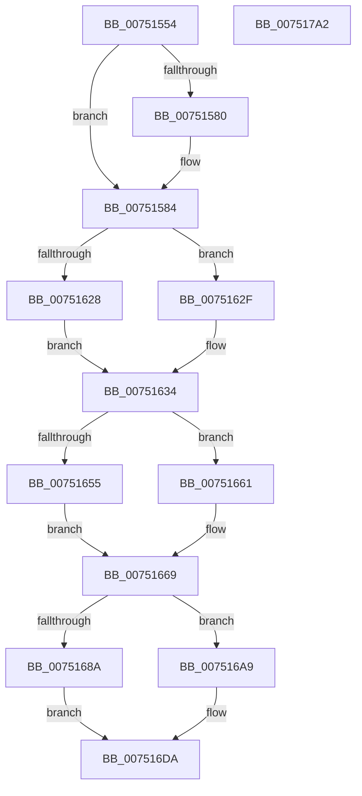

# PfTInitialize

- RVA: `0x00751554`–`0x007517A3` (길이 `591` bytes)
- VA: `0x0000000140751554`
- 실행 섹션: `PAGE`
- PDB 이름 있음: `예`; PDB Function 태그: `아니요`
- unwind 정보 RVA: `0x000C8B64`
- 디코드: `139`개 명령, `591/591` bytes 표시
- 미해석 바이트: `0` (있으면 어셈블리에 `.byte`로 보존)

> 이 문서는 커널 이미지의 기계어와 PDB 기호를 분석해 생성했습니다. 4번과 5번은 함수 원형과 자료형을 바이너리 사용 방식에서 추정한 C 해석이며 원본 소스 복구 결과는 아닙니다.

## 1. Dependencies

- 직접 호출 지점: **15**; 고유 호출 대상: **8**
- 직접 호출자로 확인된 함수: **3**
- RIP 상대 이미지 참조: **4**

### Outgoing calls
- `0x00751628` → [ExAcquireFastMutex](../../text/20/ExAcquireFastMutex_function_0020E5A0.md) (function, `0x0020E5A0`)
- `0x0075162F` → [KeInitializeGuardedMutex](../../text/46/KeInitializeGuardedMutex_function_00466E90.md) (function, `0x00466E90`)
- `0x0075165A` → [PfTAccessTracingInitialize](../../pagelk/B6/PfTAccessTracingInitialize_function_00B6B990.md) (function, `0x00B6B990`)
- `0x00751664` → [ExReleaseFastMutex](../../text/25/ExReleaseFastMutex_function_002519C0.md) (function, `0x002519C0`)
- `0x0075168A` → [KeResetEvent](../../text/24/KeResetEvent_function_00248350.md) (function, `0x00248350`)
- `0x00751692` → [KeResetEvent](../../text/24/KeResetEvent_function_00248350.md) (function, `0x00248350`)
- `0x0075169A` → [KeResetEvent](../../text/24/KeResetEvent_function_00248350.md) (function, `0x00248350`)
- `0x007516A2` → [KeResetEvent](../../text/24/KeResetEvent_function_00248350.md) (function, `0x00248350`)
- `0x007516AE` → [KeInitializeEvent](../../text/40/KeInitializeEvent_function_0040DD10.md) (function, `0x0040DD10`)
- `0x007516BB` → [KeInitializeEvent](../../text/40/KeInitializeEvent_function_0040DD10.md) (function, `0x0040DD10`)
- `0x007516C8` → [KeInitializeEvent](../../text/40/KeInitializeEvent_function_0040DD10.md) (function, `0x0040DD10`)
- `0x007516D5` → [KeInitializeEvent](../../text/40/KeInitializeEvent_function_0040DD10.md) (function, `0x0040DD10`)
- `0x00751723` → [PfFbBufferListInitialize](PfFbBufferListInitialize_function_0075371C.md) (function, `0x0075371C`)
- `0x0075172F` → [InitializeSListHead](../../text/46/InitializeSListHead_function_00468A90.md) (function, `0x00468A90`)
- `0x0075177F` → [PfFbBufferListInitialize](PfFbBufferListInitialize_function_0075371C.md) (function, `0x0075371C`)

### Direct callers
- [PfTStart](PfTStart_function_007517AC.md) at `0x007519ED`
- [PfpPartitionInitialize](PfpPartitionInitialize_function_0075221C.md) at `0x00752251`
- [PfSetSuperfetchInformation](../AD/PfSetSuperfetchInformation_function_00ADE6E8.md) at `0x00ADF041`
- [PfSetSuperfetchInformation](../AD/PfSetSuperfetchInformation_function_00ADE6E8.md) at `0x00ADF23F`

### Static image references
- `0x007516DA` → RVA `0x00A60D40` (`PfpSectInfoHandleFullBuffer`; read)
- `0x007516F0` → RVA `0x00751C50` (`PfpSectInfoHandleOutOfBuffers`; read)
- `0x0075173B` → RVA `0x0034A640` (`PfpEventHandleFullBuffer`; read)
- `0x0075174D` → RVA `0x004840D0` (`PfpEventHandleOutOfBuffers`; read)

## 2. Other-region calls and transfers

- 다른 실행 섹션으로 향하는 call: **13**
  - `0x00751628` → [ExAcquireFastMutex](../../text/20/ExAcquireFastMutex_function_0020E5A0.md) (`PAGE` → `.text`)
  - `0x0075162F` → [KeInitializeGuardedMutex](../../text/46/KeInitializeGuardedMutex_function_00466E90.md) (`PAGE` → `.text`)
  - `0x0075165A` → [PfTAccessTracingInitialize](../../pagelk/B6/PfTAccessTracingInitialize_function_00B6B990.md) (`PAGE` → `PAGELK`)
  - `0x00751664` → [ExReleaseFastMutex](../../text/25/ExReleaseFastMutex_function_002519C0.md) (`PAGE` → `.text`)
  - `0x0075168A` → [KeResetEvent](../../text/24/KeResetEvent_function_00248350.md) (`PAGE` → `.text`)
  - `0x00751692` → [KeResetEvent](../../text/24/KeResetEvent_function_00248350.md) (`PAGE` → `.text`)
  - `0x0075169A` → [KeResetEvent](../../text/24/KeResetEvent_function_00248350.md) (`PAGE` → `.text`)
  - `0x007516A2` → [KeResetEvent](../../text/24/KeResetEvent_function_00248350.md) (`PAGE` → `.text`)
  - `0x007516AE` → [KeInitializeEvent](../../text/40/KeInitializeEvent_function_0040DD10.md) (`PAGE` → `.text`)
  - `0x007516BB` → [KeInitializeEvent](../../text/40/KeInitializeEvent_function_0040DD10.md) (`PAGE` → `.text`)
  - `0x007516C8` → [KeInitializeEvent](../../text/40/KeInitializeEvent_function_0040DD10.md) (`PAGE` → `.text`)
  - `0x007516D5` → [KeInitializeEvent](../../text/40/KeInitializeEvent_function_0040DD10.md) (`PAGE` → `.text`)
  - `0x0075172F` → [InitializeSListHead](../../text/46/InitializeSListHead_function_00468A90.md) (`PAGE` → `.text`)
- 별도 외부 분기/꼬리 이동을 확인하지 못했습니다.

## 3. Assembly (complete function range)

```asm
00751554  48 8B C4                        mov rax, rsp
00751557  48 89 58 08                     mov qword ptr [rax + 8], rbx
0075155B  48 89 70 10                     mov qword ptr [rax + 0x10], rsi
0075155F  48 89 78 18                     mov qword ptr [rax + 0x18], rdi
00751563  4C 89 60 20                     mov qword ptr [rax + 0x20], r12
00751567  55                              push rbp
00751568  41 56                           push r14
0075156A  41 57                           push r15
0075156C  48 8B EC                        mov rbp, rsp
0075156F  48 83 EC 50                     sub rsp, 0x50
00751573  45 33 E4                        xor r12d, r12d
00751576  40 8A FA                        mov dil, dl
00751579  48 8B D9                        mov rbx, rcx
0075157C  84 D2                           test dl, dl
0075157E  75 04                           jne 0x140751584
00751580  4C 89 61 40                     mov qword ptr [rcx + 0x40], r12
00751584  33 C0                           xor eax, eax
00751586  48 8D B1 70 02 00 00            lea rsi, [rcx + 0x270]
0075158D  0F 57 C0                        xorps xmm0, xmm0
00751590  0F 57 C9                        xorps xmm1, xmm1
00751593  0F 11 81 C8 02 00 00            movups xmmword ptr [rcx + 0x2c8], xmm0
0075159A  0F 11 89 B0 02 00 00            movups xmmword ptr [rcx + 0x2b0], xmm1
007515A1  48 89 81 C0 02 00 00            mov qword ptr [rcx + 0x2c0], rax
007515A8  0F 11 41 58                     movups xmmword ptr [rcx + 0x58], xmm0
007515AC  0F 11 41 68                     movups xmmword ptr [rcx + 0x68], xmm0
007515B0  48 89 41 78                     mov qword ptr [rcx + 0x78], rax
007515B4  48 8D 41 70                     lea rax, [rcx + 0x70]
007515B8  66 44 89 61 62                  mov word ptr [rcx + 0x62], r12w
007515BD  4C 89 61 68                     mov qword ptr [rcx + 0x68], r12
007515C1  48 89 40 08                     mov qword ptr [rax + 8], rax
007515C5  48 89 00                        mov qword ptr [rax], rax
007515C8  33 C0                           xor eax, eax
007515CA  83 61 58 F0                     and dword ptr [rcx + 0x58], 0xfffffff0
007515CE  66 C7 41 60 02 00               mov word ptr [rcx + 0x60], 2
007515D4  0F 11 81 80 00 00 00            movups xmmword ptr [rcx + 0x80], xmm0
007515DB  0F 11 81 90 00 00 00            movups xmmword ptr [rcx + 0x90], xmm0
007515E2  48 89 81 A0 00 00 00            mov qword ptr [rcx + 0xa0], rax
007515E9  48 8D 81 98 00 00 00            lea rax, [rcx + 0x98]
007515F0  66 44 89 A1 8A 00 00 00         mov word ptr [rcx + 0x8a], r12w
007515F8  4C 89 A1 90 00 00 00            mov qword ptr [rcx + 0x90], r12
007515FF  48 89 40 08                     mov qword ptr [rax + 8], rax
00751603  48 89 00                        mov qword ptr [rax], rax
00751606  8B 81 80 00 00 00               mov eax, dword ptr [rcx + 0x80]
0075160C  83 E0 F1                        and eax, 0xfffffff1
0075160F  83 C8 01                        or eax, 1
00751612  89 81 80 00 00 00               mov dword ptr [rcx + 0x80], eax
00751618  66 44 89 A1 88 00 00 00         mov word ptr [rcx + 0x88], r12w
00751620  48 8B CE                        mov rcx, rsi
00751623  40 84 FF                        test dil, dil
00751626  74 07                           je 0x14075162f
00751628  E8 73 CF AB FF                  call 0x14020e5a0
0075162D  EB 05                           jmp 0x140751634
0075162F  E8 5C 58 D1 FF                  call 0x140466e90
00751634  48 8D 83 38 02 00 00            lea rax, [rbx + 0x238]
0075163B  48 89 40 08                     mov qword ptr [rax + 8], rax
0075163F  48 89 00                        mov qword ptr [rax], rax
00751642  48 8D 83 48 02 00 00            lea rax, [rbx + 0x248]
00751649  48 89 40 08                     mov qword ptr [rax + 8], rax
0075164D  48 89 00                        mov qword ptr [rax], rax
00751650  40 84 FF                        test dil, dil
00751653  75 0C                           jne 0x140751661
00751655  33 D2                           xor edx, edx
00751657  48 8B CB                        mov rcx, rbx
0075165A  E8 31 A3 41 00                  call 0x140b6b990
0075165F  EB 08                           jmp 0x140751669
00751661  48 8B CE                        mov rcx, rsi
00751664  E8 57 03 B0 FF                  call 0x1402519c0
00751669  48 8D 8B C8 00 00 00            lea rcx, [rbx + 0xc8]
00751670  48 8D B3 E0 00 00 00            lea rsi, [rbx + 0xe0]
00751677  4C 8D B3 B0 00 00 00            lea r14, [rbx + 0xb0]
0075167E  4C 8D BB 08 01 00 00            lea r15, [rbx + 0x108]
00751685  40 84 FF                        test dil, dil
00751688  74 1F                           je 0x1407516a9
0075168A  E8 C1 6C AF FF                  call 0x140248350
0075168F  48 8B CE                        mov rcx, rsi
00751692  E8 B9 6C AF FF                  call 0x140248350
00751697  49 8B CE                        mov rcx, r14
0075169A  E8 B1 6C AF FF                  call 0x140248350
0075169F  49 8B CF                        mov rcx, r15
007516A2  E8 A9 6C AF FF                  call 0x140248350
007516A7  EB 31                           jmp 0x1407516da
007516A9  45 33 C0                        xor r8d, r8d
007516AC  33 D2                           xor edx, edx
007516AE  E8 5D C6 CB FF                  call 0x14040dd10
007516B3  45 33 C0                        xor r8d, r8d
007516B6  33 D2                           xor edx, edx
007516B8  48 8B CE                        mov rcx, rsi
007516BB  E8 50 C6 CB FF                  call 0x14040dd10
007516C0  45 33 C0                        xor r8d, r8d
007516C3  33 D2                           xor edx, edx
007516C5  49 8B CE                        mov rcx, r14
007516C8  E8 43 C6 CB FF                  call 0x14040dd10
007516CD  45 33 C0                        xor r8d, r8d
007516D0  33 D2                           xor edx, edx
007516D2  49 8B CF                        mov rcx, r15
007516D5  E8 36 C6 CB FF                  call 0x14040dd10
007516DA  48 8D 05 5F F6 30 00            lea rax, [rip + 0x30f65f]
007516E1  4C 89 65 E8                     mov qword ptr [rbp - 0x18], r12
007516E5  48 89 45 F8                     mov qword ptr [rbp - 8], rax
007516E9  48 8D 8B 20 01 00 00            lea rcx, [rbx + 0x120]
007516F0  48 8D 05 59 05 00 00            lea rax, [rip + 0x559]
007516F7  C7 45 D0 01 00 B1 CE            mov dword ptr [rbp - 0x30], 0xceb10001
007516FE  BE 40 00 00 00                  mov esi, 0x40
00751703  48 89 45 F0                     mov qword ptr [rbp - 0x10], rax
00751707  44 8A C7                        mov r8b, dil
0075170A  C7 45 D4 50 66 4E 4C            mov dword ptr [rbp - 0x2c], 0x4c4e6650
00751711  48 8D 55 D0                     lea rdx, [rbp - 0x30]
00751715  48 C7 45 D8 00 01 00 00         mov qword ptr [rbp - 0x28], 0x100
0075171D  89 75 E0                        mov dword ptr [rbp - 0x20], esi
00751720  89 75 E4                        mov dword ptr [rbp - 0x1c], esi
00751723  E8 F4 1F 00 00                  call 0x14075371c
00751728  48 8D 8B 20 02 00 00            lea rcx, [rbx + 0x220]
0075172F  E8 5C 73 D1 FF                  call 0x140468a90
00751734  83 8B 30 02 00 00 FF            or dword ptr [rbx + 0x230], 0xffffffff
0075173B  48 8D 05 FE 8E BF FF            lea rax, [rip - 0x407102]
00751742  48 89 45 F8                     mov qword ptr [rbp - 8], rax
00751746  48 8D 8B A0 01 00 00            lea rcx, [rbx + 0x1a0]
0075174D  48 8D 05 7C 29 D3 FF            lea rax, [rip - 0x2cd684]
00751754  4C 89 65 E8                     mov qword ptr [rbp - 0x18], r12
00751758  44 8A C7                        mov r8b, dil
0075175B  48 89 45 F0                     mov qword ptr [rbp - 0x10], rax
0075175F  48 8D 55 D0                     lea rdx, [rbp - 0x30]
00751763  C7 45 D0 02 00 B1 CE            mov dword ptr [rbp - 0x30], 0xceb10002
0075176A  C7 45 D4 50 66 45 4C            mov dword ptr [rbp - 0x2c], 0x4c456650
00751771  48 89 75 D8                     mov qword ptr [rbp - 0x28], rsi
00751775  C7 45 E0 30 00 00 00            mov dword ptr [rbp - 0x20], 0x30
0075177C  89 75 E4                        mov dword ptr [rbp - 0x1c], esi
0075177F  E8 98 1F 00 00                  call 0x14075371c
00751784  4C 8D 5C 24 50                  lea r11, [rsp + 0x50]
00751789  49 8B 5B 20                     mov rbx, qword ptr [r11 + 0x20]
0075178D  49 8B 73 28                     mov rsi, qword ptr [r11 + 0x28]
00751791  49 8B 7B 30                     mov rdi, qword ptr [r11 + 0x30]
00751795  4D 8B 63 38                     mov r12, qword ptr [r11 + 0x38]
00751799  49 8B E3                        mov rsp, r11
0075179C  41 5F                           pop r15
0075179E  41 5E                           pop r14
007517A0  5D                              pop rbp
007517A1  C3                              ret
007517A2  CC                              int3
```

## 4. C-style interpretation (structured pseudocode)

```c
__int64 __fastcall PfTInitialize(__int64 a1, int a2, int a3)
{
    __int64 result;
    __int64 v_r12;
    __int64 v_rsp;
    unsigned __int64 v_stack_m18;
    unsigned __int64 v_stack_m20;
    unsigned __int64 v_stack_m28;
    unsigned __int64 v_stack_m30;
    unsigned int v_stack_m34;
    unsigned int v_stack_m38;
    unsigned __int64 v_stack_m40;
    unsigned int v_stack_m44;
    unsigned int v_stack_m48;

    *(unsigned __int64 *)(v_rsp + 8) = v_rbx;
    *(unsigned __int64 *)(v_rsp + 16) = v_rsi;
    *(unsigned __int64 *)(v_rsp + 24) = v_rdi;
    *(unsigned __int64 *)(v_rsp + 32) = v_r12;
    v_rsp = (v_rsp) - (80);
    v_r12 = 0;
    if ((unsigned __int8)(a2) == 0) {
        *(unsigned __int64 *)(a1 + 64) = 0;
    }
    result = 0;
    *(unsigned __int64 *)(a1 + 712) = v_xmm0;
    *(unsigned __int64 *)(a1 + 688) = v_xmm1;
    *(unsigned __int64 *)(a1 + 704) = 0;
    *(unsigned __int64 *)(a1 + 88) = v_xmm0;
    *(unsigned __int64 *)(a1 + 104) = v_xmm0;
    *(unsigned __int64 *)(a1 + 120) = 0;
    *(unsigned __int16 *)(a1 + 98) = 0;
    *(unsigned __int64 *)(a1 + 104) = 0;
    *(unsigned __int64 *)(a1 + 112 + 8) = a1 + 112;
    *(unsigned __int64 *)(a1 + 112) = a1 + 112;
    result = 0;
    *(unsigned __int16 *)(a1 + 96) = 2;
    *(unsigned __int64 *)(a1 + 128) = v_xmm0;
    *(unsigned __int64 *)(a1 + 144) = v_xmm0;
    *(unsigned __int64 *)(a1 + 160) = 0;
    *(unsigned __int16 *)(a1 + 138) = 0;
    *(unsigned __int64 *)(a1 + 144) = 0;
    *(unsigned __int64 *)(a1 + 152 + 8) = a1 + 152;
    *(unsigned __int64 *)(a1 + 152) = a1 + 152;
    result = (unsigned int)(((unsigned int)(*(unsigned int *)(a1 + 128))) & (0xFFFFFFF1ULL));
    result = (unsigned int)((result) | (1));
    *(unsigned int *)(a1 + 128) = (unsigned int)(result);
    *(unsigned __int16 *)(a1 + 136) = 0;
    if ((unsigned __int8)((unsigned __int8)(a2)) == 0) goto loc_0075162F;
    result = ExAcquireFastMutex(a1 + 624, a2, a3, a4);
    goto loc_00751634;
loc_0075162F:
    result = KeInitializeGuardedMutex(a1 + 624, a2, a3, a4);
loc_00751634:
    *(unsigned __int64 *)(a1 + 568 + 8) = a1 + 568;
    *(unsigned __int64 *)(a1 + 568) = a1 + 568;
    *(unsigned __int64 *)(a1 + 584 + 8) = a1 + 584;
    *(unsigned __int64 *)(a1 + 584) = a1 + 584;
    if ((unsigned __int8)((unsigned __int8)(a2)) != 0) goto loc_00751661;
    a2 = 0;
    result = PfTAccessTracingInitialize(a1, a2, a3, a4);
    goto loc_00751669;
loc_00751661:
    result = ExReleaseFastMutex(a1 + 624, a2, a3, a4);
loc_00751669:
    if ((unsigned __int8)((unsigned __int8)(a2)) == 0) goto loc_007516A9;
    result = KeResetEvent(a1 + 200, a2, a3, a4);
    result = KeResetEvent(a1 + 224, a2, a3, a4);
    result = KeResetEvent(a1 + 176, a2, a3, a4);
    result = KeResetEvent(a1 + 264, a2, a3, a4);
    goto loc_007516DA;
loc_007516A9:
    a3 = 0;
    a2 = 0;
    result = KeInitializeEvent(a1 + 264, a2, a3, a4);
    a3 = 0;
    a2 = 0;
    result = KeInitializeEvent(a1 + 224, a2, a3, a4);
    a3 = 0;
    a2 = 0;
    result = KeInitializeEvent(a1 + 176, a2, a3, a4);
    a3 = 0;
    a2 = 0;
    result = KeInitializeEvent(a1 + 264, a2, a3, a4);
loc_007516DA:
    v_stack_m30 = 0;
    v_stack_m20 = v_rip + 3208799;
    v_stack_m48 = 0xCEB10001ULL;
    v_stack_m28 = v_rip + 1369;
    v_stack_m44 = 0x4C4E6650ULL;
    v_stack_m40 = 256;
    v_stack_m38 = 64;
    v_stack_m34 = 64;
    result = PfFbBufferListInitialize(a1 + 288, v_stack_m48, (unsigned __int8)((unsigned __int8)(a2)), a4);
    result = InitializeSListHead(a1 + 544, v_stack_m48, (unsigned __int8)((unsigned __int8)(a2)), a4);
    v_stack_m20 = v_rip - 4223234;
    v_stack_m30 = 0;
    v_stack_m28 = v_rip - 2938500;
    v_stack_m48 = 0xCEB10002ULL;
    v_stack_m44 = 0x4C456650ULL;
    v_stack_m40 = 64;
    v_stack_m38 = 48;
    v_stack_m34 = 64;
    result = PfFbBufferListInitialize(a1 + 416, v_stack_m48, (unsigned __int8)((unsigned __int8)(a2)), a4);
    return result;
}
```

## 5. (Beta) C Style

```c
int64_t PfTInitialize(void *Arg1, int32_t Arg2, int32_t Arg3)
{
    uint8_t *arg1 = (uint8_t *)Arg1;

    int64_t result;
    int64_t local_r12;
    int64_t local_rsp;
    uint64_t v_stack_m18;
    uint64_t v_stack_m20;
    uint64_t v_stack_m28;
    uint64_t v_stack_m30;
    uint32_t v_stack_m34;
    uint32_t v_stack_m38;
    uint64_t v_stack_m40;
    uint32_t v_stack_m44;
    uint32_t v_stack_m48;

    *(uint64_t *)(local_rsp + 0x8) = local_rbx;
    *(uint64_t *)(local_rsp + 0x10) = local_rsi;
    *(uint64_t *)(local_rsp + 0x18) = local_rdi;
    *(uint64_t *)(local_rsp + 0x20) = local_r12;
    local_rsp = (local_rsp) - (80);
    local_r12 = 0;
    if ((uint8_t)(Arg2) == 0) {
        *(uint64_t *)(arg1 + 0x40) = 0;
    }
    result = 0;
    *(uint64_t *)(arg1 + 0x2C8) = v_xmm0;
    *(uint64_t *)(arg1 + 0x2B0) = v_xmm1;
    *(uint64_t *)(arg1 + 0x2C0) = 0;
    *(uint64_t *)(arg1 + 0x58) = v_xmm0;
    *(uint64_t *)(arg1 + 0x68) = v_xmm0;
    *(uint64_t *)(arg1 + 0x78) = 0;
    *(uint16_t *)(arg1 + 0x62) = 0;
    *(uint64_t *)(arg1 + 0x68) = 0;
    *(void **)(arg1 + 0x70 + 0x8) = Arg1 + 112;
    *(void **)(arg1 + 0x70) = Arg1 + 112;
    result = 0;
    *(uint16_t *)(arg1 + 0x60) = 2;
    *(uint64_t *)(arg1 + 0x80) = v_xmm0;
    *(uint64_t *)(arg1 + 0x90) = v_xmm0;
    *(uint64_t *)(arg1 + 0xA0) = 0;
    *(uint16_t *)(arg1 + 0x8A) = 0;
    *(uint64_t *)(arg1 + 0x90) = 0;
    *(void **)(arg1 + 0x98 + 0x8) = Arg1 + 152;
    *(void **)(arg1 + 0x98) = Arg1 + 152;
    result = (uint32_t)(((uint32_t)(*(uint32_t *)(arg1 + 0x80))) & (0xFFFFFFF1ULL));
    result = (uint32_t)((result) | (1));
    *(uint32_t *)(arg1 + 0x80) = (uint32_t)(result);
    *(uint16_t *)(arg1 + 0x88) = 0;
    if ((uint8_t)((uint8_t)(Arg2)) == 0) goto loc_0075162F;
    result = ExAcquireFastMutex(Arg1 + 624, Arg2, Arg3, a4);
    goto loc_00751634;
loc_0075162F:
    result = KeInitializeGuardedMutex(Arg1 + 624, Arg2, Arg3, a4);
loc_00751634:
    *(void **)(arg1 + 0x238 + 0x8) = Arg1 + 568;
    *(void **)(arg1 + 0x238) = Arg1 + 568;
    *(void **)(arg1 + 0x248 + 0x8) = Arg1 + 584;
    *(void **)(arg1 + 0x248) = Arg1 + 584;
    if ((uint8_t)((uint8_t)(Arg2)) != 0) goto loc_00751661;
    Arg2 = 0;
    result = PfTAccessTracingInitialize(Arg1, Arg2, Arg3, a4);
    goto loc_00751669;
loc_00751661:
    result = ExReleaseFastMutex(Arg1 + 624, Arg2, Arg3, a4);
loc_00751669:
    if ((uint8_t)((uint8_t)(Arg2)) == 0) goto loc_007516A9;
    result = KeResetEvent(Arg1 + 200, Arg2, Arg3, a4);
    result = KeResetEvent(Arg1 + 224, Arg2, Arg3, a4);
    result = KeResetEvent(Arg1 + 176, Arg2, Arg3, a4);
    result = KeResetEvent(Arg1 + 264, Arg2, Arg3, a4);
    goto loc_007516DA;
loc_007516A9:
    Arg3 = 0;
    Arg2 = 0;
    result = KeInitializeEvent(Arg1 + 264, Arg2, Arg3, a4);
    Arg3 = 0;
    Arg2 = 0;
    result = KeInitializeEvent(Arg1 + 224, Arg2, Arg3, a4);
    Arg3 = 0;
    Arg2 = 0;
    result = KeInitializeEvent(Arg1 + 176, Arg2, Arg3, a4);
    Arg3 = 0;
    Arg2 = 0;
    result = KeInitializeEvent(Arg1 + 264, Arg2, Arg3, a4);
loc_007516DA:
    v_stack_m30 = 0;
    v_stack_m20 = v_rip + 3208799;
    v_stack_m48 = 0xCEB10001ULL;
    v_stack_m28 = v_rip + 1369;
    v_stack_m44 = 0x4C4E6650ULL;
    v_stack_m40 = 256;
    v_stack_m38 = 64;
    v_stack_m34 = 64;
    result = PfFbBufferListInitialize(Arg1 + 288, v_stack_m48, (uint8_t)((uint8_t)(Arg2)), a4);
    result = InitializeSListHead(Arg1 + 544, v_stack_m48, (uint8_t)((uint8_t)(Arg2)), a4);
    v_stack_m20 = v_rip - 4223234;
    v_stack_m30 = 0;
    v_stack_m28 = v_rip - 2938500;
    v_stack_m48 = 0xCEB10002ULL;
    v_stack_m44 = 0x4C456650ULL;
    v_stack_m40 = 64;
    v_stack_m38 = 48;
    v_stack_m34 = 64;
    result = PfFbBufferListInitialize(Arg1 + 416, v_stack_m48, (uint8_t)((uint8_t)(Arg2)), a4);
    return result;
}
```

### 관측된 메모리 오프셋

구조체 형식이 확인되지 않은 접근은 인자 기준의 오프셋으로만 기록했습니다.

| 기준 인자 | 오프셋 표현 | 폭 (bit) | 접근 |
|---|---:|---:|---|
| `Arg1` | `+ 0x0` | `64` | `W` |
| `Arg1` | `+ 0x8` | `64` | `W` |
| `Arg1` | `+ 0x40` | `64` | `W` |
| `Arg1` | `+ 0x58` | `32` | `R/W` |
| `Arg1` | `+ 0x58` | `128` | `R` |
| `Arg1` | `+ 0x60` | `16` | `W` |
| `Arg1` | `+ 0x62` | `16` | `W` |
| `Arg1` | `+ 0x68` | `64` | `W` |
| `Arg1` | `+ 0x68` | `128` | `R` |
| `Arg1` | `+ 0x70` | `64` | `R` |
| `Arg1` | `+ 0x78` | `64` | `W` |
| `Arg1` | `+ 0x80` | `32` | `R` |
| `Arg1` | `+ 0x80` | `32` | `W` |
| `Arg1` | `+ 0x80` | `128` | `R` |
| `Arg1` | `+ 0x88` | `16` | `W` |
| `Arg1` | `+ 0x8A` | `16` | `W` |
| `Arg1` | `+ 0x90` | `64` | `W` |
| `Arg1` | `+ 0x90` | `128` | `R` |
| `Arg1` | `+ 0x98` | `64` | `R` |
| `Arg1` | `+ 0xA0` | `64` | `W` |
| `Arg1` | `+ 0xB0` | `64` | `R` |
| `Arg1` | `+ 0xC8` | `64` | `R` |
| `Arg1` | `+ 0xE0` | `64` | `R` |
| `Arg1` | `+ 0x108` | `64` | `R` |
| `Arg1` | `+ 0x120` | `64` | `R` |
| `Arg1` | `+ 0x1A0` | `64` | `R` |
| `Arg1` | `+ 0x220` | `64` | `R` |
| `Arg1` | `+ 0x230` | `32` | `R/W` |
| `Arg1` | `+ 0x238` | `64` | `R` |
| `Arg1` | `+ 0x248` | `64` | `R` |
| `Arg1` | `+ 0x270` | `64` | `R` |
| `Arg1` | `+ 0x2B0` | `128` | `R` |

추가 오프셋 2개는 표에서 생략했습니다.

## 6. Execution-region graph

[열기: 2D/3D 그래프와 함수 탐색 컨트롤 패널](../../../control-panel.html?section=page&rva=0x00751554&view=graph)

- 2D 그래프는 위에서 아래로 흐르고, 3D 그래프는 빈 공간을 드래그해 회전합니다. Shift+드래그는 이동, 휠은 확대·축소, 함수 노드 선택은 대상 보고서 이동입니다.

### Static fallback


