# PfTStart

- RVA: `0x007517AC`–`0x00751BAC` (길이 `1,024` bytes)
- VA: `0x00000001407517AC`
- 실행 섹션: `PAGE`
- PDB 이름 있음: `예`; PDB Function 태그: `아니요`
- unwind 정보 RVA: `0x000CBB58`
- 디코드: `250`개 명령, `1,024/1,024` bytes 표시
- 미해석 바이트: `0` (있으면 어셈블리에 `.byte`로 보존)

> 이 문서는 커널 이미지의 기계어와 PDB 기호를 분석해 생성했습니다. 4번과 5번은 함수 원형과 자료형을 바이너리 사용 방식에서 추정한 C 해석이며 원본 소스 복구 결과는 아닙니다.

## 1. Dependencies

- 직접 호출 지점: **27**; 고유 호출 대상: **19**
- 직접 호출자로 확인된 함수: **1**
- RIP 상대 이미지 참조: **14**

### Outgoing calls
- `0x007517FC` → [tlgKeywordOn](../../text/42/tlgKeywordOn_function_0042EAA0.md) (function, `0x0042EAA0`)
- `0x00751808` → [PfpTraceLogPfPartitionId](../../text/5C/PfpTraceLogPfPartitionId_function_005CE1CC.md) (function, `0x005CE1CC`)
- `0x00751845` → [tlgWriteTransfer_EtwWriteTransfer](../../text/42/tlgWriteTransfer_EtwWriteTransfer_function_004260E0.md) (function, `0x004260E0`)
- `0x007518A8` → [PfTAllocateBuffers](PfTAllocateBuffers_function_0075110C.md) (function, `0x0075110C`)
- `0x007518CF` → [PfTAllocateBuffers](PfTAllocateBuffers_function_0075110C.md) (function, `0x0075110C`)
- `0x007518E1` → [CsanRead64NoCheck](../../text/4C/CsanRead64NoCheck_function_004C82C0.md) (function, `0x004C82C0`)
- `0x00751919` → [PsCreateSystemThreadEx](../9E/PsCreateSystemThreadEx_function_009ED120.md) (function, `0x009ED120`)
- `0x0075194D` → [ObReferenceObjectByHandle](../86/ObReferenceObjectByHandle_function_00868DB0.md) (function, `0x00868DB0`)
- `0x00751963` → [ObCloseHandle](../8A/ObCloseHandle_function_008A1870.md) (function, `0x008A1870`)
- `0x00751987` → [PfpCreateEventInternal](PfpCreateEventInternal_function_00753480.md) (function, `0x00753480`)
- `0x007519D3` → [ObOpenObjectByPointer](../8B/ObOpenObjectByPointer_function_008B7420.md) (function, `0x008B7420`)
- `0x007519E3` → [PfTCleanup](PfTCleanup_function_00751208.md) (function, `0x00751208`)
- `0x007519ED` → [PfTInitialize](PfTInitialize_function_00751554.md) (function, `0x00751554`)
- `0x00751A02` → [ObCloseHandle](../8A/ObCloseHandle_function_008A1870.md) (function, `0x008A1870`)
- `0x00751A1D` → [PfFbBufferListUpdateMax](../../text/5C/PfFbBufferListUpdateMax_function_005CE2E4.md) (function, `0x005CE2E4`)
- `0x00751A3D` → [PfFbBufferListAllocate](../../text/5C/PfFbBufferListAllocate_function_005CE1EC.md) (function, `0x005CE1EC`)
- `0x00751A55` → [PfFbBufferListUpdateMax](../../text/5C/PfFbBufferListUpdateMax_function_005CE2E4.md) (function, `0x005CE2E4`)
- `0x00751A75` → [PfFbBufferListAllocate](../../text/5C/PfFbBufferListAllocate_function_005CE1EC.md) (function, `0x005CE1EC`)
- `0x00751A84` → [ExAcquireFastMutex](../../text/20/ExAcquireFastMutex_function_0020E5A0.md) (function, `0x0020E5A0`)
- `0x00751AB0` → [PfTAccessTracingStart](../../pagelk/B6/PfTAccessTracingStart_function_00B6B9F0.md) (function, `0x00B6B9F0`)
- `0x00751AC8` → [ExReleaseFastMutex](../../text/25/ExReleaseFastMutex_function_002519C0.md) (function, `0x002519C0`)
- `0x00751AE3` → [PsEnumProcesses](../91/PsEnumProcesses_function_0091BE84.md) (function, `0x0091BE84`)
- `0x00751AF0` → [PfTAccessTracingStart](../../pagelk/B6/PfTAccessTracingStart_function_00B6B9F0.md) (function, `0x00B6B9F0`)
- `0x00751B1A` → [tlgKeywordOn](../../text/42/tlgKeywordOn_function_0042EAA0.md) (function, `0x0042EAA0`)
- `0x00751B26` → [PfpTraceLogPfPartitionId](../../text/5C/PfpTraceLogPfPartitionId_function_005CE1CC.md) (function, `0x005CE1CC`)
- `0x00751B7D` → [tlgWriteTransfer_EtwWriteTransfer](../../text/42/tlgWriteTransfer_EtwWriteTransfer_function_004260E0.md) (function, `0x004260E0`)
- `0x00751B8B` → [_security_check_cookie](../../text/6A/_security_check_cookie_function_006AC640.md) (function, `0x006AC640`)

### Direct callers
- [PfSetSuperfetchInformation](../AD/PfSetSuperfetchInformation_function_00ADE6E8.md) at `0x00ADF05B`

### Static image references
- `0x007517C8` → RVA `0x00E0A740` (`.data`; read)
- `0x007517DC` → RVA `0x00E074D8` (`.data`; read)
- `0x00751810` → RVA `0x00048950` (`.rdata`; read)
- `0x00751854` → RVA `0x00E66EF4` (`.data`; read)
- `0x00751871` → RVA `0x00E66F10` (`.data`; read)
- `0x0075187A` → RVA `0x00E66F14` (`.data`; read)
- `0x00751908` → RVA `0x0097B140` (`PfTLoggingWorker`; read)
- `0x00751928` → RVA `0x00FC6AC8` (`ALMOSTRO`; read)
- `0x0075199E` → RVA `0x00FC6B80` (`ALMOSTRO`; read)
- `0x00751A22` → RVA `0x00FC6A80` (`ALMOSTRO`; read)
- `0x00751A8E` → RVA `0x00E66F00` (`.data`; read)
- `0x00751AB9` → RVA `0x00E66EFC` (`.data`; read)
- `0x00751ADC` → RVA `0x00960310` (`PfCalculateProcessHash`; read)
- `0x00751B2E` → RVA `0x00048976` (`.rdata`; read)

## 2. Other-region calls and transfers

- 다른 실행 섹션으로 향하는 call: **16**
  - `0x007517FC` → [tlgKeywordOn](../../text/42/tlgKeywordOn_function_0042EAA0.md) (`PAGE` → `.text`)
  - `0x00751808` → [PfpTraceLogPfPartitionId](../../text/5C/PfpTraceLogPfPartitionId_function_005CE1CC.md) (`PAGE` → `.text`)
  - `0x00751845` → [tlgWriteTransfer_EtwWriteTransfer](../../text/42/tlgWriteTransfer_EtwWriteTransfer_function_004260E0.md) (`PAGE` → `.text`)
  - `0x007518E1` → [CsanRead64NoCheck](../../text/4C/CsanRead64NoCheck_function_004C82C0.md) (`PAGE` → `.text`)
  - `0x00751A1D` → [PfFbBufferListUpdateMax](../../text/5C/PfFbBufferListUpdateMax_function_005CE2E4.md) (`PAGE` → `.text`)
  - `0x00751A3D` → [PfFbBufferListAllocate](../../text/5C/PfFbBufferListAllocate_function_005CE1EC.md) (`PAGE` → `.text`)
  - `0x00751A55` → [PfFbBufferListUpdateMax](../../text/5C/PfFbBufferListUpdateMax_function_005CE2E4.md) (`PAGE` → `.text`)
  - `0x00751A75` → [PfFbBufferListAllocate](../../text/5C/PfFbBufferListAllocate_function_005CE1EC.md) (`PAGE` → `.text`)
  - `0x00751A84` → [ExAcquireFastMutex](../../text/20/ExAcquireFastMutex_function_0020E5A0.md) (`PAGE` → `.text`)
  - `0x00751AB0` → [PfTAccessTracingStart](../../pagelk/B6/PfTAccessTracingStart_function_00B6B9F0.md) (`PAGE` → `PAGELK`)
  - `0x00751AC8` → [ExReleaseFastMutex](../../text/25/ExReleaseFastMutex_function_002519C0.md) (`PAGE` → `.text`)
  - `0x00751AF0` → [PfTAccessTracingStart](../../pagelk/B6/PfTAccessTracingStart_function_00B6B9F0.md) (`PAGE` → `PAGELK`)
  - `0x00751B1A` → [tlgKeywordOn](../../text/42/tlgKeywordOn_function_0042EAA0.md) (`PAGE` → `.text`)
  - `0x00751B26` → [PfpTraceLogPfPartitionId](../../text/5C/PfpTraceLogPfPartitionId_function_005CE1CC.md) (`PAGE` → `.text`)
  - `0x00751B7D` → [tlgWriteTransfer_EtwWriteTransfer](../../text/42/tlgWriteTransfer_EtwWriteTransfer_function_004260E0.md) (`PAGE` → `.text`)
  - `0x00751B8B` → [_security_check_cookie](../../text/6A/_security_check_cookie_function_006AC640.md) (`PAGE` → `.text`)
- 별도 외부 분기/꼬리 이동을 확인하지 못했습니다.

## 3. Assembly (complete function range)

```asm
007517AC  48 89 5C 24 10                  mov qword ptr [rsp + 0x10], rbx
007517B1  55                              push rbp
007517B2  56                              push rsi
007517B3  57                              push rdi
007517B4  41 54                           push r12
007517B6  41 55                           push r13
007517B8  41 56                           push r14
007517BA  41 57                           push r15
007517BC  48 8D 6C 24 D9                  lea rbp, [rsp - 0x27]
007517C1  48 81 EC D0 00 00 00            sub rsp, 0xd0
007517C8  48 8B 05 71 8F 6B 00            mov rax, qword ptr [rip + 0x6b8f71]
007517CF  48 33 C4                        xor rax, rsp
007517D2  48 89 45 17                     mov qword ptr [rbp + 0x17], rax
007517D6  45 33 ED                        xor r13d, r13d
007517D9  4D 8B E1                        mov r12, r9
007517DC  83 3D F5 5C 6B 00 04            cmp dword ptr [rip + 0x6b5cf5], 4
007517E3  45 8A F8                        mov r15b, r8b
007517E6  8B FA                           mov edi, edx
007517E8  4C 89 6D BF                     mov qword ptr [rbp - 0x41], r13
007517EC  48 8B D9                        mov rbx, rcx
007517EF  76 59                           jbe 0x14075184a
007517F1  41 8D 55 02                     lea edx, [r13 + 2]
007517F5  48 8D 0D DC 5C 6B 00            lea rcx, [rip + 0x6b5cdc]
007517FC  E8 9F D2 CD FF                  call 0x14042eaa0
00751801  84 C0                           test al, al
00751803  74 45                           je 0x14075184a
00751805  48 8B CB                        mov rcx, rbx
00751808  E8 BF C9 E7 FF                  call 0x1405ce1cc
0075180D  89 45 A7                        mov dword ptr [rbp - 0x59], eax
00751810  48 8D 15 39 71 8F FF            lea rdx, [rip - 0x708ec7]
00751817  48 8D 45 A7                     lea rax, [rbp - 0x59]
0075181B  48 C7 45 EF 04 00 00 00         mov qword ptr [rbp - 0x11], 4
00751823  48 89 45 E7                     mov qword ptr [rbp - 0x19], rax
00751827  48 8D 0D AA 5C 6B 00            lea rcx, [rip + 0x6b5caa]
0075182E  48 8D 45 C7                     lea rax, [rbp - 0x39]
00751832  45 33 C9                        xor r9d, r9d
00751835  48 89 44 24 28                  mov qword ptr [rsp + 0x28], rax
0075183A  45 33 C0                        xor r8d, r8d
0075183D  C7 44 24 20 03 00 00 00         mov dword ptr [rsp + 0x20], 3
00751845  E8 96 48 CD FF                  call 0x1404260e0
0075184A  4C 89 6D AF                     mov qword ptr [rbp - 0x51], r13
0075184E  40 F6 C7 01                     test dil, 1
00751852  74 0D                           je 0x140751861
00751854  8B 05 9A 56 71 00               mov eax, dword ptr [rip + 0x71569a]
0075185A  A8 01                           test al, 1
0075185C  75 03                           jne 0x140751861
0075185E  83 E7 FE                        and edi, 0xfffffffe
00751861  40 F6 C7 02                     test dil, 2
00751865  74 1F                           je 0x140751886
00751867  8B 05 87 56 71 00               mov eax, dword ptr [rip + 0x715687]
0075186D  A8 01                           test al, 1
0075186F  75 15                           jne 0x140751886
00751871  83 3D 98 56 71 00 01            cmp dword ptr [rip + 0x715698], 1
00751878  74 0C                           je 0x140751886
0075187A  83 3D 93 56 71 00 01            cmp dword ptr [rip + 0x715693], 1
00751881  74 03                           je 0x140751886
00751883  83 E7 FD                        and edi, 0xfffffffd
00751886  44 8B F7                        mov r14d, edi
00751889  41 83 E6 01                     and r14d, 1
0075188D  0F 84 D5 00 00 00               je 0x140751968
00751893  48 8D 4B 58                     lea rcx, [rbx + 0x58]
00751897  BA 00 80 00 00                  mov edx, 0x8000
0075189C  41 B9 50 66 4C 42               mov r9d, 0x424c6650
007518A2  41 B8 08 00 00 00               mov r8d, 8
007518A8  E8 5F F8 FF FF                  call 0x14075110c
007518AD  8B F0                           mov esi, eax
007518AF  85 C0                           test eax, eax
007518B1  0F 88 27 01 00 00               js 0x1407519de
007518B7  48 8D 8B 80 00 00 00            lea rcx, [rbx + 0x80]
007518BE  BA 28 40 01 00                  mov edx, 0x14028
007518C3  41 B9 50 66 45 54               mov r9d, 0x54456650
007518C9  41 B8 02 00 00 00               mov r8d, 2
007518CF  E8 38 F8 FF FF                  call 0x14075110c
007518D4  8B F0                           mov esi, eax
007518D6  85 C0                           test eax, eax
007518D8  0F 88 00 01 00 00               js 0x1407519de
007518DE  48 8B CB                        mov rcx, rbx
007518E1  E8 DA 69 D7 FF                  call 0x1404c82c0
007518E6  4C 89 6C 24 40                  mov qword ptr [rsp + 0x40], r13
007518EB  48 8D 4D BF                     lea rcx, [rbp - 0x41]
007518EF  4C 89 6C 24 38                  mov qword ptr [rsp + 0x38], r13
007518F4  45 33 C0                        xor r8d, r8d
007518F7  48 89 5C 24 30                  mov qword ptr [rsp + 0x30], rbx
007518FC  BA FF FF 1F 00                  mov edx, 0x1fffff
00751901  4C 8B 88 80 00 00 00            mov r9, qword ptr [rax + 0x80]
00751908  48 8D 05 31 98 22 00            lea rax, [rip + 0x229831]
0075190F  48 89 44 24 28                  mov qword ptr [rsp + 0x28], rax
00751914  4C 89 6C 24 20                  mov qword ptr [rsp + 0x20], r13
00751919  E8 02 B8 29 00                  call 0x1409ed120
0075191E  8B F0                           mov esi, eax
00751920  85 C0                           test eax, eax
00751922  0F 88 B6 00 00 00               js 0x1407519de
00751928  4C 8B 05 99 51 87 00            mov r8, qword ptr [rip + 0x875199]
0075192F  48 8D 45 B7                     lea rax, [rbp - 0x49]
00751933  48 8B 4D BF                     mov rcx, qword ptr [rbp - 0x41]
00751937  45 33 C9                        xor r9d, r9d
0075193A  4C 89 6C 24 28                  mov qword ptr [rsp + 0x28], r13
0075193F  BA FF FF 1F 00                  mov edx, 0x1fffff
00751944  48 89 44 24 20                  mov qword ptr [rsp + 0x20], rax
00751949  4C 89 6D B7                     mov qword ptr [rbp - 0x49], r13
0075194D  E8 5E 74 11 00                  call 0x140868db0
00751952  48 8B 45 B7                     mov rax, qword ptr [rbp - 0x49]
00751956  33 D2                           xor edx, edx
00751958  48 8B 4D BF                     mov rcx, qword ptr [rbp - 0x41]
0075195C  48 89 83 A8 00 00 00            mov qword ptr [rbx + 0xa8], rax
00751963  E8 08 FF 14 00                  call 0x1408a1870
00751968  40 F6 C7 03                     test dil, 3
0075196C  74 24                           je 0x140751992
0075196E  4C 8D 8B A8 02 00 00            lea r9, [rbx + 0x2a8]
00751975  4D 39 29                        cmp qword ptr [r9], r13
00751978  75 18                           jne 0x140751992
0075197A  BA 01 00 00 00                  mov edx, 1
0075197F  33 C9                           xor ecx, ecx
00751981  41 B8 00 02 00 00               mov r8d, 0x200
00751987  E8 F4 1A 00 00                  call 0x140753480
0075198C  8B F0                           mov esi, eax
0075198E  85 C0                           test eax, eax
00751990  78 4C                           js 0x1407519de
00751992  4C 8B 93 A8 02 00 00            mov r10, qword ptr [rbx + 0x2a8]
00751999  4D 85 D2                        test r10, r10
0075199C  74 6E                           je 0x140751a0c
0075199E  48 8B 0D DB 51 87 00            mov rcx, qword ptr [rip + 0x8751db]
007519A5  41 8A C7                        mov al, r15b
007519A8  F6 D8                           neg al
007519AA  41 B9 01 00 12 00               mov r9d, 0x120001
007519B0  48 8D 45 AF                     lea rax, [rbp - 0x51]
007519B4  1B D2                           sbb edx, edx
007519B6  48 89 44 24 30                  mov qword ptr [rsp + 0x30], rax
007519BB  F7 D2                           not edx
007519BD  44 88 7C 24 28                  mov byte ptr [rsp + 0x28], r15b
007519C2  48 89 4C 24 20                  mov qword ptr [rsp + 0x20], rcx
007519C7  81 E2 00 02 00 00               and edx, 0x200
007519CD  49 8B CA                        mov rcx, r10
007519D0  45 33 C0                        xor r8d, r8d
007519D3  E8 48 5A 16 00                  call 0x1408b7420
007519D8  8B F0                           mov esi, eax
007519DA  85 C0                           test eax, eax
007519DC  79 2E                           jns 0x140751a0c
007519DE  33 D2                           xor edx, edx
007519E0  48 8B CB                        mov rcx, rbx
007519E3  E8 20 F8 FF FF                  call 0x140751208
007519E8  B2 01                           mov dl, 1
007519EA  48 8B CB                        mov rcx, rbx
007519ED  E8 62 FB FF FF                  call 0x140751554
007519F2  48 8B 4D AF                     mov rcx, qword ptr [rbp - 0x51]
007519F6  48 85 C9                        test rcx, rcx
007519F9  0F 84 01 01 00 00               je 0x140751b00
007519FF  41 8A D7                        mov dl, r15b
00751A02  E8 69 FE 14 00                  call 0x1408a1870
00751A07  E9 F4 00 00 00                  jmp 0x140751b00
00751A0C  45 85 F6                        test r14d, r14d
00751A0F  74 31                           je 0x140751a42
00751A11  48 8D 8B A0 01 00 00            lea rcx, [rbx + 0x1a0]
00751A18  BA 00 00 10 00                  mov edx, 0x100000
00751A1D  E8 C2 C8 E7 FF                  call 0x1405ce2e4
00751A22  44 8B 05 57 50 87 00            mov r8d, dword ptr [rip + 0x875057]
00751A29  8B 15 51 50 87 00               mov edx, dword ptr [rip + 0x875051]
00751A2F  83 C2 02                        add edx, 2
00751A32  C1 E2 0C                        shl edx, 0xc
00751A35  46 8D 04 45 04 00 00 00         lea r8d, [r8*2 + 4]
00751A3D  E8 AA C7 E7 FF                  call 0x1405ce1ec
00751A42  8B F7                           mov esi, edi
00751A44  83 E6 02                        and esi, 2
00751A47  74 31                           je 0x140751a7a
00751A49  48 8D 8B 20 01 00 00            lea rcx, [rbx + 0x120]
00751A50  BA 00 00 00 01                  mov edx, 0x1000000
00751A55  E8 8A C8 E7 FF                  call 0x1405ce2e4
00751A5A  44 8B 05 1F 50 87 00            mov r8d, dword ptr [rip + 0x87501f]
00751A61  8B 15 19 50 87 00               mov edx, dword ptr [rip + 0x875019]
00751A67  83 C2 07                        add edx, 7
00751A6A  C1 E2 0F                        shl edx, 0xf
00751A6D  46 8D 04 45 0E 00 00 00         lea r8d, [r8*2 + 0xe]
00751A75  E8 72 C7 E7 FF                  call 0x1405ce1ec
00751A7A  4C 8D BB 70 02 00 00            lea r15, [rbx + 0x270]
00751A81  49 8B CF                        mov rcx, r15
00751A84  E8 17 CB AB FF                  call 0x14020e5a0
00751A89  45 85 F6                        test r14d, r14d
00751A8C  74 27                           je 0x140751ab5
00751A8E  8B 05 6C 54 71 00               mov eax, dword ptr [rip + 0x71546c]
00751A94  89 83 5C 02 00 00               mov dword ptr [rbx + 0x25c], eax
00751A9A  8B 05 60 54 71 00               mov eax, dword ptr [rip + 0x715460]
00751AA0  39 83 58 02 00 00               cmp dword ptr [rbx + 0x258], eax
00751AA6  73 0D                           jae 0x140751ab5
00751AA8  BA 02 00 00 00                  mov edx, 2
00751AAD  48 8B CB                        mov rcx, rbx
00751AB0  E8 3B 9F 41 00                  call 0x140b6b9f0
00751AB5  85 F6                           test esi, esi
00751AB7  74 0C                           je 0x140751ac5
00751AB9  8B 05 3D 54 71 00               mov eax, dword ptr [rip + 0x71543d]
00751ABF  89 83 64 02 00 00               mov dword ptr [rbx + 0x264], eax
00751AC5  49 8B CF                        mov rcx, r15
00751AC8  E8 F3 FE AF FF                  call 0x1402519c0
00751ACD  09 7B 48                        or dword ptr [rbx + 0x48], edi
00751AD0  45 85 F6                        test r14d, r14d
00751AD3  74 20                           je 0x140751af5
00751AD5  F0 44 09 2C 24                  lock or dword ptr [rsp], r13d
00751ADA  33 D2                           xor edx, edx
00751ADC  48 8D 0D 2D E8 20 00            lea rcx, [rip + 0x20e82d]
00751AE3  E8 9C A3 1C 00                  call 0x14091be84
00751AE8  BA 01 00 00 00                  mov edx, 1
00751AED  48 8B CB                        mov rcx, rbx
00751AF0  E8 FB 9E 41 00                  call 0x140b6b9f0
00751AF5  48 8B 45 AF                     mov rax, qword ptr [rbp - 0x51]
00751AF9  41 8B F5                        mov esi, r13d
00751AFC  49 89 04 24                     mov qword ptr [r12], rax
00751B00  41 B8 04 00 00 00               mov r8d, 4
00751B06  44 39 05 CB 59 6B 00            cmp dword ptr [rip + 0x6b59cb], r8d
00751B0D  76 73                           jbe 0x140751b82
00751B0F  41 8D 50 FE                     lea edx, [r8 - 2]
00751B13  48 8D 0D BE 59 6B 00            lea rcx, [rip + 0x6b59be]
00751B1A  E8 81 CF CD FF                  call 0x14042eaa0
00751B1F  84 C0                           test al, al
00751B21  74 5F                           je 0x140751b82
00751B23  48 8B CB                        mov rcx, rbx
00751B26  E8 A1 C6 E7 FF                  call 0x1405ce1cc
00751B2B  89 45 A7                        mov dword ptr [rbp - 0x59], eax
00751B2E  48 8D 15 41 6E 8F FF            lea rdx, [rip - 0x7091bf]
00751B35  48 8D 45 A7                     lea rax, [rbp - 0x59]
00751B39  4C 89 45 EF                     mov qword ptr [rbp - 0x11], r8
00751B3D  48 89 45 E7                     mov qword ptr [rbp - 0x19], rax
00751B41  48 8D 0D 90 59 6B 00            lea rcx, [rip + 0x6b5990]
00751B48  48 8D 45 B7                     lea rax, [rbp - 0x49]
00751B4C  4C 89 45 FF                     mov qword ptr [rbp - 1], r8
00751B50  48 89 45 F7                     mov qword ptr [rbp - 9], rax
00751B54  45 33 C9                        xor r9d, r9d
00751B57  48 8D 45 AF                     lea rax, [rbp - 0x51]
00751B5B  4C 89 45 0F                     mov qword ptr [rbp + 0xf], r8
00751B5F  48 89 45 07                     mov qword ptr [rbp + 7], rax
00751B63  45 33 C0                        xor r8d, r8d
00751B66  48 8D 45 C7                     lea rax, [rbp - 0x39]
00751B6A  89 7D B7                        mov dword ptr [rbp - 0x49], edi
00751B6D  48 89 44 24 28                  mov qword ptr [rsp + 0x28], rax
00751B72  C7 44 24 20 05 00 00 00         mov dword ptr [rsp + 0x20], 5
00751B7A  89 75 AF                        mov dword ptr [rbp - 0x51], esi
00751B7D  E8 5E 45 CD FF                  call 0x1404260e0
00751B82  8B C6                           mov eax, esi
00751B84  48 8B 4D 17                     mov rcx, qword ptr [rbp + 0x17]
00751B88  48 33 CC                        xor rcx, rsp
00751B8B  E8 B0 AA F5 FF                  call 0x1406ac640
00751B90  48 8B 9C 24 18 01 00 00         mov rbx, qword ptr [rsp + 0x118]
00751B98  48 81 C4 D0 00 00 00            add rsp, 0xd0
00751B9F  41 5F                           pop r15
00751BA1  41 5E                           pop r14
00751BA3  41 5D                           pop r13
00751BA5  41 5C                           pop r12
00751BA7  5F                              pop rdi
00751BA8  5E                              pop rsi
00751BA9  5D                              pop rbp
00751BAA  C3                              ret
00751BAB  CC                              int3
```

## 4. C-style interpretation (structured pseudocode)

```c
__int64 __fastcall PfTStart(__int64 a1, int a2, int a3, __int64 a4)
{
    __int64 result;
    __int64 v_r13;
    __int64 v_r14;
    __int64 v_rdi;
    __int64 v_rsi;
    __int64 v_rsp;
    unsigned int v_stack_m108;
    unsigned __int64 v_stack_m48;
    unsigned __int64 v_stack_m50;
    unsigned __int64 v_stack_m58;
    unsigned __int64 v_stack_m5F;
    unsigned __int64 v_stack_m60;
    unsigned __int64 v_stack_m68;
    unsigned __int64 v_stack_m70;
    unsigned __int64 v_stack_m78;
    unsigned __int64 v_stack_m98;
    unsigned __int64 v_stack_mA0;
    unsigned __int64 v_stack_mA8;
    unsigned __int64 v_stack_mB0;
    unsigned int v_stack_mB8;
    unsigned __int64 v_stack_mC8;
    unsigned __int64 v_stack_mD0;
    unsigned __int64 v_stack_mD8;
    unsigned __int64 v_stack_mE0;
    unsigned int v_stack_mE8;
    unsigned __int64 v_stack_p10;

    v_stack_p10 = v_rbx;
    v_rsp = (v_rsp) - (208);
    result = (*(unsigned __int64 *)(v_rip + 7049073)) ^ (v_rsp);
    v_stack_m48 = result;
    v_r13 = 0;
    v_stack_mA0 = 0;
    if ((*(unsigned int *)(v_rip + 7036149)) <= 4) goto loc_0075184A;
    result = tlgKeywordOn(v_rip + 7036124, v_r13 + 2, a3, a4);
    if ((unsigned __int8)(result) != 0) {
        a1 = a1;
        result = PfpTraceLogPfPartitionId(a1, v_r13 + 2, a3, a4);
        v_stack_mB8 = (unsigned int)(result);
        a2 = v_rip - 7376583;
        result = v_stack_mB8;
        v_stack_m70 = 4;
        v_stack_m78 = result;
        a1 = v_rip + 7036074;
        result = v_stack_m98;
        a4 = 0;
        v_stack_mE0 = result;
        a3 = 0;
        v_stack_mE8 = 3;
        result = tlgWriteTransfer_EtwWriteTransfer(a1, a2, a3, a4);
    }
    v_stack_mB0 = 0;
    if ((((unsigned __int8)((unsigned int)(a2))) & (1)) == 0) goto loc_00751861;
    v_rdi = (unsigned int)(a2);
    if ((((unsigned __int8)((unsigned int)(*(unsigned int *)(v_rip + 7427738)))) & (1)) == 0) {
        v_rdi = (unsigned int)(((unsigned int)(a2)) & (0xFFFFFFFEULL));
    }
    if ((((unsigned __int8)(v_rdi)) & (2)) == 0) goto loc_00751886;
    if ((((unsigned __int8)((unsigned int)(*(unsigned int *)(v_rip + 7427719)))) & (1)) != 0) goto loc_00751886;
    if ((*(unsigned int *)(v_rip + 7427736)) == 1) goto loc_00751886;
    if ((*(unsigned int *)(v_rip + 7427731)) != 1) {
        v_rdi = (unsigned int)((v_rdi) & (0xFFFFFFFDULL));
    }
    v_r14 = (unsigned int)(((unsigned int)((unsigned int)(v_rdi))) & (1));
    if (condition_is_equal) goto loc_00751968;
    result = PfTAllocateBuffers(a1 + 88, (unsigned int)(0x8000ULL), 8, (unsigned int)(0x424C6650ULL));
    if (sign_flag) goto loc_007519DE;
    result = PfTAllocateBuffers(a1 + 128, (unsigned int)(0x14028ULL), 2, (unsigned int)(0x54456650ULL));
    if (sign_flag) goto loc_007519DE;
    result = CsanRead64NoCheck(a1, (unsigned int)(0x14028ULL), 2, (unsigned int)(0x54456650ULL));
    v_stack_mC8 = 0;
    v_stack_mD0 = 0;
    a3 = 0;
    v_stack_mD8 = a1;
    v_stack_mE0 = v_rip + 2267185;
    v_stack_mE8 = 0;
    result = PsCreateSystemThreadEx(v_stack_mA0, (unsigned int)(0x1FFFFFULL), a3, *(unsigned __int64 *)(result + 128));
    if (sign_flag) goto loc_007519DE;
    a4 = 0;
    v_stack_mE0 = 0;
    v_stack_mE8 = v_stack_mA8;
    v_stack_mA8 = 0;
    result = ObReferenceObjectByHandle(v_stack_mA0, (unsigned int)(0x1FFFFFULL), *(unsigned __int64 *)(v_rip + 8868249), a4);
    a2 = 0;
    *(unsigned __int64 *)(a1 + 168) = v_stack_mA8;
    result = ObCloseHandle(v_stack_mA0, a2, *(unsigned __int64 *)(v_rip + 8868249), a4);
loc_00751968:
    if ((((unsigned __int8)(v_rdi)) & (3)) == 0) goto loc_00751992;
    if ((*(unsigned __int64 *)(a1 + 680)) != 0) goto loc_00751992;
    a1 = 0;
    result = PfpCreateEventInternal(a1, 1, 512, a1 + 680);
    if (sign_flag) goto loc_007519DE;
loc_00751992:
    if (*(unsigned __int64 *)(a1 + 680) == 0) goto loc_00751A0C;
    result = (unsigned __int8)(-((unsigned __int8)((unsigned __int8)(a3))));
    v_stack_mD8 = v_stack_mB0;
    a2 = (unsigned int)(~(1));
    v_stack_mE0 = (unsigned __int8)((unsigned __int8)(a3));
    v_stack_mE8 = *(unsigned __int64 *)(v_rip + 8868315);
    a2 = (unsigned int)((a2) & (512));
    a3 = 0;
    result = ObOpenObjectByPointer(*(unsigned __int64 *)(a1 + 680), a2, a3, (unsigned int)(0x120001ULL));
    if (!sign_flag) goto loc_00751A0C;
loc_007519DE:
    a2 = 0;
    result = PfTCleanup(0, a2, a3, (unsigned int)(0x120001ULL));
    result = PfTInitialize(0, 1, a3, (unsigned int)(0x120001ULL));
    if (v_stack_mB0 == 0) goto loc_00751B00;
    result = ObCloseHandle(v_stack_mB0, (unsigned __int8)((unsigned __int8)(a3)), a3, (unsigned int)(0x120001ULL));
    goto loc_00751B00;
loc_00751A0C:
    if ((unsigned int)(v_r14) != 0) {
        a1 = a1 + 416;
        a2 = 0x100000ULL;
        result = PfFbBufferListUpdateMax(a1, a2, a3, (unsigned int)(0x120001ULL));
        a3 = *(unsigned int *)(v_rip + 8867927);
        a2 = *(unsigned int *)(v_rip + 8867921);
        a2 = (unsigned int)((a2) + (2));
        a2 = (unsigned int)((a2) << (12));
        a3 = a3 * 2 + 4;
        result = PfFbBufferListAllocate(a1, a2, a3, (unsigned int)(0x120001ULL));
    }
    v_rsi = (unsigned int)(((unsigned int)((unsigned int)(v_rdi))) & (2));
    if (!(condition_is_equal)) {
        a1 = a1 + 288;
        a2 = 0x1000000ULL;
        result = PfFbBufferListUpdateMax(a1, a2, a3, (unsigned int)(0x120001ULL));
        a3 = *(unsigned int *)(v_rip + 8867871);
        a2 = *(unsigned int *)(v_rip + 8867865);
        a2 = (unsigned int)((a2) + (7));
        a2 = (unsigned int)((a2) << (15));
        a3 = a3 * 2 + 14;
        result = PfFbBufferListAllocate(a1, a2, a3, (unsigned int)(0x120001ULL));
    }
    result = ExAcquireFastMutex(a1 + 624, a2, a3, (unsigned int)(0x120001ULL));
    if ((unsigned int)(v_r14) == 0) goto loc_00751AB5;
    *(unsigned int *)(a1 + 604) = (unsigned int)((unsigned int)(*(unsigned int *)(v_rip + 7427180)));
    result = (unsigned int)(*(unsigned int *)(v_rip + 7427168));
    if ((*(unsigned int *)(a1 + 600)) < ((unsigned int)((unsigned int)(*(unsigned int *)(v_rip + 7427168))))) {
        a2 = 2;
        a1 = a1;
        result = PfTAccessTracingStart(a1, a2, a3, (unsigned int)(0x120001ULL));
    }
    if ((unsigned int)(v_rsi) != 0) {
        result = *(unsigned int *)(v_rip + 7427133);
        *(unsigned int *)(a1 + 612) = (unsigned int)(result);
    }
    result = ExReleaseFastMutex(a1 + 624, a2, a3, (unsigned int)(0x120001ULL));
    if ((unsigned int)(v_r14) != 0) {
        a2 = 0;
        a1 = v_rip + 2156589;
        result = PsEnumProcesses(a1, a2, a3, (unsigned int)(0x120001ULL));
        a2 = 1;
        a1 = a1;
        result = PfTAccessTracingStart(a1, a2, a3, (unsigned int)(0x120001ULL));
    }
    *(unsigned __int64 *)(a4) = v_stack_mB0;
loc_00751B00:
    if ((*(unsigned int *)(v_rip + 7035339)) <= 4) goto loc_00751B82;
    result = tlgKeywordOn(v_rip + 7035326, 4 - 2, 4, (unsigned int)(0x120001ULL));
    if ((unsigned __int8)(result) != 0) {
        a1 = a1;
        result = PfpTraceLogPfPartitionId(a1, 4 - 2, 4, (unsigned int)(0x120001ULL));
        v_stack_mB8 = (unsigned int)(result);
        a2 = v_rip - 7377343;
        result = v_stack_mB8;
        v_stack_m70 = 4;
        v_stack_m78 = result;
        a1 = v_rip + 7035280;
        result = v_stack_mA8;
        v_stack_m60 = 4;
        v_stack_m68 = result;
        a4 = 0;
        result = v_stack_mB0;
        v_stack_m50 = 4;
        v_stack_m58 = result;
        a3 = 0;
        result = v_stack_m98;
        v_stack_mA8 = (unsigned int)(v_rdi);
        v_stack_mE0 = result;
        v_stack_mE8 = 5;
        v_stack_mB0 = 0;
        result = tlgWriteTransfer_EtwWriteTransfer(a1, a2, a3, a4);
    }
    a1 = (v_stack_m48) ^ (v_rsp);
    result = _security_check_cookie(a1, a2, a3, a4);
    v_rsp = (v_rsp) + (208);
    return result;
}
```

## 5. (Beta) C Style

```c
int64_t PfTStart(void *Arg1, int32_t Arg2, int32_t Arg3, void *Arg4)
{
    uint8_t *arg1 = (uint8_t *)Arg1;
    uint8_t *arg4 = (uint8_t *)Arg4;

    int64_t result;
    int64_t local_r13;
    int64_t local_r14;
    int64_t local_rdi;
    int64_t local_rsi;
    int64_t local_rsp;
    uint32_t v_stack_m108;
    uint64_t v_stack_m48;
    uint64_t v_stack_m50;
    uint64_t v_stack_m58;
    uint64_t v_stack_m5F;
    uint64_t v_stack_m60;
    uint64_t v_stack_m68;
    uint64_t v_stack_m70;
    uint64_t v_stack_m78;
    uint64_t v_stack_m98;
    uint64_t v_stack_mA0;
    uint64_t v_stack_mA8;
    uint64_t v_stack_mB0;
    uint32_t v_stack_mB8;
    uint64_t v_stack_mC8;
    uint64_t v_stack_mD0;
    uint64_t v_stack_mD8;
    uint64_t v_stack_mE0;
    uint32_t v_stack_mE8;
    uint64_t v_stack_p10;

    v_stack_p10 = local_rbx;
    local_rsp = (local_rsp) - (208);
    result = (*(uint64_t *)(v_rip + 0x6B8F71)) ^ (local_rsp);
    v_stack_m48 = result;
    local_r13 = 0;
    v_stack_mA0 = 0;
    if ((*(uint32_t *)(v_rip + 0x6B5CF5)) <= 4) goto loc_0075184A;
    result = tlgKeywordOn(v_rip + 7036124, local_r13 + 2, Arg3, Arg4);
    if ((uint8_t)(result) != 0) {
        Arg1 = Arg1;
        result = PfpTraceLogPfPartitionId(Arg1, local_r13 + 2, Arg3, Arg4);
        v_stack_mB8 = (uint32_t)(result);
        Arg2 = v_rip - 7376583;
        result = v_stack_mB8;
        v_stack_m70 = 4;
        v_stack_m78 = result;
        Arg1 = v_rip + 7036074;
        result = v_stack_m98;
        Arg4 = 0;
        v_stack_mE0 = result;
        Arg3 = 0;
        v_stack_mE8 = 3;
        result = tlgWriteTransfer_EtwWriteTransfer(Arg1, Arg2, Arg3, Arg4);
    }
    v_stack_mB0 = 0;
    if ((((uint8_t)((uint32_t)(Arg2))) & (1)) == 0) goto loc_00751861;
    local_rdi = (uint32_t)(Arg2);
    if ((((uint8_t)((uint32_t)(*(uint32_t *)(v_rip + 0x71569A)))) & (1)) == 0) {
        local_rdi = (uint32_t)(((uint32_t)(Arg2)) & (0xFFFFFFFEULL));
    }
    if ((((uint8_t)(local_rdi)) & (2)) == 0) goto loc_00751886;
    if ((((uint8_t)((uint32_t)(*(uint32_t *)(v_rip + 0x715687)))) & (1)) != 0) goto loc_00751886;
    if ((*(uint32_t *)(v_rip + 0x715698)) == 1) goto loc_00751886;
    if ((*(uint32_t *)(v_rip + 0x715693)) != 1) {
        local_rdi = (uint32_t)((local_rdi) & (0xFFFFFFFDULL));
    }
    local_r14 = (uint32_t)(((uint32_t)((uint32_t)(local_rdi))) & (1));
    if (condition_is_equal) goto loc_00751968;
    result = PfTAllocateBuffers(Arg1 + 88, (uint32_t)(0x8000ULL), 8, (uint32_t)(0x424C6650ULL));
    if (sign_flag) goto loc_007519DE;
    result = PfTAllocateBuffers(Arg1 + 128, (uint32_t)(0x14028ULL), 2, (uint32_t)(0x54456650ULL));
    if (sign_flag) goto loc_007519DE;
    result = CsanRead64NoCheck(Arg1, (uint32_t)(0x14028ULL), 2, (uint32_t)(0x54456650ULL));
    v_stack_mC8 = 0;
    v_stack_mD0 = 0;
    Arg3 = 0;
    v_stack_mD8 = Arg1;
    v_stack_mE0 = v_rip + 2267185;
    v_stack_mE8 = 0;
    result = PsCreateSystemThreadEx(v_stack_mA0, (uint32_t)(0x1FFFFFULL), Arg3, *(uint64_t *)(result + 0x80));
    if (sign_flag) goto loc_007519DE;
    Arg4 = 0;
    v_stack_mE0 = 0;
    v_stack_mE8 = v_stack_mA8;
    v_stack_mA8 = 0;
    result = ObReferenceObjectByHandle(v_stack_mA0, (uint32_t)(0x1FFFFFULL), *(uint64_t *)(v_rip + 0x875199), Arg4);
    Arg2 = 0;
    *(uint64_t *)(arg1 + 0xA8) = v_stack_mA8;
    result = ObCloseHandle(v_stack_mA0, Arg2, *(uint64_t *)(v_rip + 0x875199), Arg4);
loc_00751968:
    if ((((uint8_t)(local_rdi)) & (3)) == 0) goto loc_00751992;
    if ((*(uint64_t *)(arg1 + 0x2A8)) != 0) goto loc_00751992;
    Arg1 = 0;
    result = PfpCreateEventInternal(Arg1, 1, 512, Arg1 + 680);
    if (sign_flag) goto loc_007519DE;
loc_00751992:
    if (*(uint64_t *)(arg1 + 0x2A8) == 0) goto loc_00751A0C;
    result = (uint8_t)(-((uint8_t)((uint8_t)(Arg3))));
    v_stack_mD8 = v_stack_mB0;
    Arg2 = (uint32_t)(~(1));
    v_stack_mE0 = (uint8_t)((uint8_t)(Arg3));
    v_stack_mE8 = *(uint64_t *)(v_rip + 0x8751DB);
    Arg2 = (uint32_t)((Arg2) & (512));
    Arg3 = 0;
    result = ObOpenObjectByPointer(*(uint64_t *)(arg1 + 0x2A8), Arg2, Arg3, (uint32_t)(0x120001ULL));
    if (!sign_flag) goto loc_00751A0C;
loc_007519DE:
    Arg2 = 0;
    result = PfTCleanup(0, Arg2, Arg3, (uint32_t)(0x120001ULL));
    result = PfTInitialize(0, 1, Arg3, (uint32_t)(0x120001ULL));
    if (v_stack_mB0 == 0) goto loc_00751B00;
    result = ObCloseHandle(v_stack_mB0, (uint8_t)((uint8_t)(Arg3)), Arg3, (uint32_t)(0x120001ULL));
    goto loc_00751B00;
loc_00751A0C:
    if ((uint32_t)(local_r14) != 0) {
        Arg1 = Arg1 + 416;
        Arg2 = 0x100000ULL;
        result = PfFbBufferListUpdateMax(Arg1, Arg2, Arg3, (uint32_t)(0x120001ULL));
        Arg3 = *(uint32_t *)(v_rip + 0x875057);
        Arg2 = *(uint32_t *)(v_rip + 0x875051);
        Arg2 = (uint32_t)((Arg2) + (2));
        Arg2 = (uint32_t)((Arg2) << (12));
        Arg3 = Arg3 * 2 + 4;
        result = PfFbBufferListAllocate(Arg1, Arg2, Arg3, (uint32_t)(0x120001ULL));
    }
    local_rsi = (uint32_t)(((uint32_t)((uint32_t)(local_rdi))) & (2));
    if (!(condition_is_equal)) {
        Arg1 = Arg1 + 288;
        Arg2 = 0x1000000ULL;
        result = PfFbBufferListUpdateMax(Arg1, Arg2, Arg3, (uint32_t)(0x120001ULL));
        Arg3 = *(uint32_t *)(v_rip + 0x87501F);
        Arg2 = *(uint32_t *)(v_rip + 0x875019);
        Arg2 = (uint32_t)((Arg2) + (7));
        Arg2 = (uint32_t)((Arg2) << (15));
        Arg3 = Arg3 * 2 + 14;
        result = PfFbBufferListAllocate(Arg1, Arg2, Arg3, (uint32_t)(0x120001ULL));
    }
    result = ExAcquireFastMutex(Arg1 + 624, Arg2, Arg3, (uint32_t)(0x120001ULL));
    if ((uint32_t)(local_r14) == 0) goto loc_00751AB5;
    *(uint32_t *)(arg1 + 0x25C) = (uint32_t)((uint32_t)(*(uint32_t *)(v_rip + 0x71546C)));
    result = (uint32_t)(*(uint32_t *)(v_rip + 0x715460));
    if ((*(uint32_t *)(arg1 + 0x258)) < ((uint32_t)((uint32_t)(*(uint32_t *)(v_rip + 0x715460))))) {
        Arg2 = 2;
        Arg1 = Arg1;
        result = PfTAccessTracingStart(Arg1, Arg2, Arg3, (uint32_t)(0x120001ULL));
    }
    if ((uint32_t)(local_rsi) != 0) {
        result = *(uint32_t *)(v_rip + 0x71543D);
        *(uint32_t *)(arg1 + 0x264) = (uint32_t)(result);
    }
    result = ExReleaseFastMutex(Arg1 + 624, Arg2, Arg3, (uint32_t)(0x120001ULL));
    if ((uint32_t)(local_r14) != 0) {
        Arg2 = 0;
        Arg1 = v_rip + 2156589;
        result = PsEnumProcesses(Arg1, Arg2, Arg3, (uint32_t)(0x120001ULL));
        Arg2 = 1;
        Arg1 = Arg1;
        result = PfTAccessTracingStart(Arg1, Arg2, Arg3, (uint32_t)(0x120001ULL));
    }
    *(uint64_t *)(arg4) = v_stack_mB0;
loc_00751B00:
    if ((*(uint32_t *)(v_rip + 0x6B59CB)) <= 4) goto loc_00751B82;
    result = tlgKeywordOn(v_rip + 7035326, 4 - 2, 4, (uint32_t)(0x120001ULL));
    if ((uint8_t)(result) != 0) {
        Arg1 = Arg1;
        result = PfpTraceLogPfPartitionId(Arg1, 4 - 2, 4, (uint32_t)(0x120001ULL));
        v_stack_mB8 = (uint32_t)(result);
        Arg2 = v_rip - 7377343;
        result = v_stack_mB8;
        v_stack_m70 = 4;
        v_stack_m78 = result;
        Arg1 = v_rip + 7035280;
        result = v_stack_mA8;
        v_stack_m60 = 4;
        v_stack_m68 = result;
        Arg4 = 0;
        result = v_stack_mB0;
        v_stack_m50 = 4;
        v_stack_m58 = result;
        Arg3 = 0;
        result = v_stack_m98;
        v_stack_mA8 = (uint32_t)(local_rdi);
        v_stack_mE0 = result;
        v_stack_mE8 = 5;
        v_stack_mB0 = 0;
        result = tlgWriteTransfer_EtwWriteTransfer(Arg1, Arg2, Arg3, Arg4);
    }
    Arg1 = (v_stack_m48) ^ (local_rsp);
    result = _security_check_cookie(Arg1, Arg2, Arg3, Arg4);
    local_rsp = (local_rsp) + (208);
    return result;
}
```

### 관측된 메모리 오프셋

구조체 형식이 확인되지 않은 접근은 인자 기준의 오프셋으로만 기록했습니다.

| 기준 인자 | 오프셋 표현 | 폭 (bit) | 접근 |
|---|---:|---:|---|
| `Arg1` | `+ 0x0` | `64` | `R` |
| `Arg1` | `+ 0x48` | `32` | `R/W` |
| `Arg1` | `+ 0x58` | `64` | `R` |
| `Arg1` | `+ 0x80` | `64` | `R` |
| `Arg1` | `+ 0xA8` | `64` | `W` |
| `Arg1` | `+ 0x120` | `64` | `R` |
| `Arg1` | `+ 0x1A0` | `64` | `R` |
| `Arg1` | `+ 0x258` | `32` | `R` |
| `Arg1` | `+ 0x25C` | `32` | `W` |
| `Arg1` | `+ 0x264` | `32` | `W` |
| `Arg1` | `+ 0x270` | `64` | `R` |
| `Arg1` | `+ 0x2A8` | `64` | `R` |
| `Arg4` | `+ 0x0` | `64` | `W` |

## 6. Execution-region graph

[열기: 2D/3D 그래프와 함수 탐색 컨트롤 패널](../../../control-panel.html?section=page&rva=0x007517AC&view=graph)

- 2D 그래프는 위에서 아래로 흐르고, 3D 그래프는 빈 공간을 드래그해 회전합니다. Shift+드래그는 이동, 휠은 확대·축소, 함수 노드 선택은 대상 보고서 이동입니다.

### Static fallback

```mermaid
flowchart TD
  bb_007517AC[BB_007517AC]
  bb_007517F1[BB_007517F1]
  bb_00751805[BB_00751805]
  bb_0075184A[BB_0075184A]
  bb_00751854[BB_00751854]
  bb_0075185E[BB_0075185E]
  bb_00751861[BB_00751861]
  bb_00751867[BB_00751867]
  bb_00751871[BB_00751871]
  bb_0075187A[BB_0075187A]
  bb_00751883[BB_00751883]
  bb_00751886[BB_00751886]
  bb_00751893[BB_00751893]
  bb_007518B7[BB_007518B7]
  bb_007518DE[BB_007518DE]
  bb_00751928[BB_00751928]
  bb_00751968[BB_00751968]
  bb_0075196E[BB_0075196E]
  bb_0075197A[BB_0075197A]
  bb_00751992[BB_00751992]
  bb_0075199E[BB_0075199E]
  bb_007519DE[BB_007519DE]
  bb_007519FF[BB_007519FF]
  bb_00751A0C[BB_00751A0C]
  bb_00751A11[BB_00751A11]
  bb_00751A42[BB_00751A42]
  bb_00751A49[BB_00751A49]
  bb_00751A7A[BB_00751A7A]
  bb_00751A8E[BB_00751A8E]
  bb_00751AA8[BB_00751AA8]
  bb_00751AB5[BB_00751AB5]
  bb_00751AB9[BB_00751AB9]
  bb_00751AC5[BB_00751AC5]
  bb_00751AD5[BB_00751AD5]
  bb_00751AF5[BB_00751AF5]
  bb_00751B00[BB_00751B00]
  bb_00751B0F[BB_00751B0F]
  bb_00751B23[BB_00751B23]
  bb_00751B82[BB_00751B82]
  bb_00751BAB[BB_00751BAB]
  bb_007517AC -->|branch| bb_0075184A
  bb_007517AC -->|fallthrough| bb_007517F1
  bb_007517F1 -->|branch| bb_0075184A
  bb_007517F1 -->|fallthrough| bb_00751805
  bb_00751805 -->|flow| bb_0075184A
  bb_0075184A -->|branch| bb_00751861
  bb_0075184A -->|fallthrough| bb_00751854
  bb_00751854 -->|branch| bb_00751861
  bb_00751854 -->|fallthrough| bb_0075185E
  bb_0075185E -->|flow| bb_00751861
  bb_00751861 -->|branch| bb_00751886
  bb_00751861 -->|fallthrough| bb_00751867
  bb_00751867 -->|branch| bb_00751886
  bb_00751867 -->|fallthrough| bb_00751871
  bb_00751871 -->|branch| bb_00751886
  bb_00751871 -->|fallthrough| bb_0075187A
  bb_0075187A -->|branch| bb_00751886
  bb_0075187A -->|fallthrough| bb_00751883
  bb_00751883 -->|flow| bb_00751886
  bb_00751886 -->|branch| bb_00751968
  bb_00751886 -->|fallthrough| bb_00751893
  bb_00751893 -->|branch| bb_007519DE
  bb_00751893 -->|fallthrough| bb_007518B7
  bb_007518B7 -->|branch| bb_007519DE
  bb_007518B7 -->|fallthrough| bb_007518DE
  bb_007518DE -->|branch| bb_007519DE
  bb_007518DE -->|fallthrough| bb_00751928
  bb_00751928 -->|flow| bb_00751968
  bb_00751968 -->|branch| bb_00751992
  bb_00751968 -->|fallthrough| bb_0075196E
  bb_0075196E -->|branch| bb_00751992
  bb_0075196E -->|fallthrough| bb_0075197A
  bb_0075197A -->|branch| bb_007519DE
  bb_0075197A -->|fallthrough| bb_00751992
  bb_00751992 -->|branch| bb_00751A0C
  bb_00751992 -->|fallthrough| bb_0075199E
  bb_0075199E -->|branch| bb_00751A0C
  bb_0075199E -->|fallthrough| bb_007519DE
  bb_007519DE -->|branch| bb_00751B00
  bb_007519DE -->|fallthrough| bb_007519FF
  bb_007519FF -->|branch| bb_00751B00
  bb_00751A0C -->|branch| bb_00751A42
  bb_00751A0C -->|fallthrough| bb_00751A11
  bb_00751A11 -->|flow| bb_00751A42
  bb_00751A42 -->|branch| bb_00751A7A
  bb_00751A42 -->|fallthrough| bb_00751A49
  bb_00751A49 -->|flow| bb_00751A7A
  bb_00751A7A -->|branch| bb_00751AB5
  bb_00751A7A -->|fallthrough| bb_00751A8E
  bb_00751A8E -->|branch| bb_00751AB5
  bb_00751A8E -->|fallthrough| bb_00751AA8
  bb_00751AA8 -->|flow| bb_00751AB5
  bb_00751AB5 -->|branch| bb_00751AC5
  bb_00751AB5 -->|fallthrough| bb_00751AB9
  bb_00751AB9 -->|flow| bb_00751AC5
  bb_00751AC5 -->|branch| bb_00751AF5
  bb_00751AC5 -->|fallthrough| bb_00751AD5
  bb_00751AD5 -->|flow| bb_00751AF5
  bb_00751AF5 -->|flow| bb_00751B00
  bb_00751B00 -->|branch| bb_00751B82
  bb_00751B00 -->|fallthrough| bb_00751B0F
  bb_00751B0F -->|branch| bb_00751B82
  bb_00751B0F -->|fallthrough| bb_00751B23
  bb_00751B23 -->|flow| bb_00751B82
```


