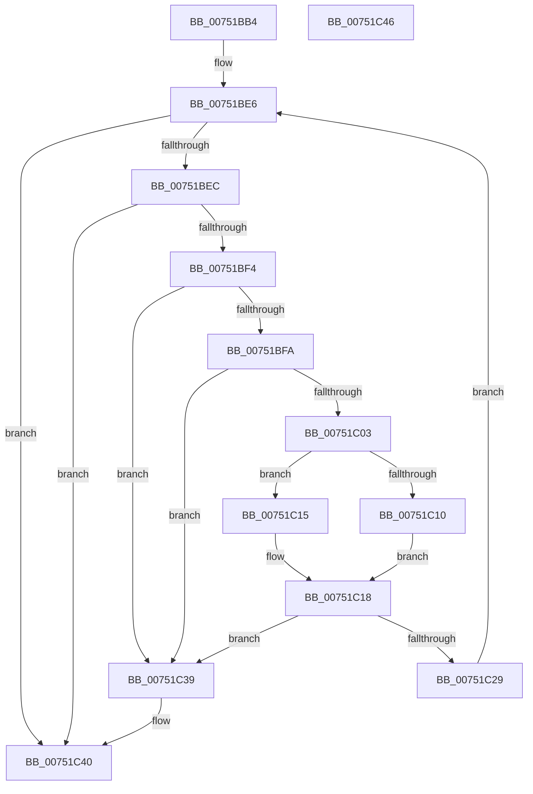

# PfTTraceListTrim

- RVA: `0x00751BB4`–`0x00751C47` (길이 `147` bytes)
- VA: `0x0000000140751BB4`
- 실행 섹션: `PAGE`
- PDB 이름 있음: `예`; PDB Function 태그: `아니요`
- unwind 정보 RVA: `0x00071750`
- 디코드: `45`개 명령, `147/147` bytes 표시
- 미해석 바이트: `0` (있으면 어셈블리에 `.byte`로 보존)

> 이 문서는 커널 이미지의 기계어와 PDB 기호를 분석해 생성했습니다. 4번과 5번은 함수 원형과 자료형을 바이너리 사용 방식에서 추정한 C 해석이며 원본 소스 복구 결과는 아닙니다.

## 1. Dependencies

- 직접 호출 지점: **0**; 고유 호출 대상: **0**
- 직접 호출자로 확인된 함수: **2**
- RIP 상대 이미지 참조: **0**

### Outgoing calls
- 직접 디코드된 call 명령이 없습니다.

### Direct callers
- [PfTCleanup](PfTCleanup_function_00751208.md) at `0x00751301`
- [PfTCleanup](PfTCleanup_function_00751208.md) at `0x00751311`
- [PfTTraceListAdd](../A6/PfTTraceListAdd_function_00A60E00.md) at `0x00A60F92`

### Static image references
- 디코드된 RIP-relative 메모리 참조가 없습니다.

## 2. Other-region calls and transfers

- 다른 실행 섹션으로 향하는 call: **0**
- 별도 외부 분기/꼬리 이동을 확인하지 못했습니다.

## 3. Assembly (complete function range)

```asm
00751BB4  48 89 5C 24 08                  mov qword ptr [rsp + 8], rbx
00751BB9  83 FA 01                        cmp edx, 1
00751BBC  BB C4 02 00 00                  mov ebx, 0x2c4
00751BC1  4C 8B D1                        mov r10, rcx
00751BC4  8D 43 FC                        lea eax, [rbx - 4]
00751BC7  0F 45 D8                        cmovne ebx, eax
00751BCA  B8 58 02 00 00                  mov eax, 0x258
00751BCF  44 8D 58 08                     lea r11d, [rax + 8]
00751BD3  44 0F 45 D8                     cmovne r11d, eax
00751BD7  B8 48 02 00 00                  mov eax, 0x248
00751BDC  8D 48 F0                        lea ecx, [rax - 0x10]
00751BDF  0F 45 C1                        cmovne eax, ecx
00751BE2  4A 8D 0C 10                     lea rcx, [rax + r10]
00751BE6  47 39 04 13                     cmp dword ptr [r11 + r10], r8d
00751BEA  76 54                           jbe 0x140751c40
00751BEC  48 8B 01                        mov rax, qword ptr [rcx]
00751BEF  48 3B C1                        cmp rax, rcx
00751BF2  74 4C                           je 0x140751c40
00751BF4  48 39 48 08                     cmp qword ptr [rax + 8], rcx
00751BF8  75 3F                           jne 0x140751c39
00751BFA  48 8B 10                        mov rdx, qword ptr [rax]
00751BFD  48 39 42 08                     cmp qword ptr [rdx + 8], rax
00751C01  75 36                           jne 0x140751c39
00751C03  48 89 11                        mov qword ptr [rcx], rdx
00751C06  48 89 4A 08                     mov qword ptr [rdx + 8], rcx
00751C0A  83 78 1C 00                     cmp dword ptr [rax + 0x1c], 0
00751C0E  75 05                           jne 0x140751c15
00751C10  8B 50 24                        mov edx, dword ptr [rax + 0x24]
00751C13  EB 03                           jmp 0x140751c18
00751C15  8B 50 30                        mov edx, dword ptr [rax + 0x30]
00751C18  43 FF 0C 13                     dec dword ptr [r11 + r10]
00751C1C  42 01 14 13                     add dword ptr [rbx + r10], edx
00751C20  49 8B 51 08                     mov rdx, qword ptr [r9 + 8]
00751C24  4C 39 0A                        cmp qword ptr [rdx], r9
00751C27  75 10                           jne 0x140751c39
00751C29  4C 89 08                        mov qword ptr [rax], r9
00751C2C  48 89 50 08                     mov qword ptr [rax + 8], rdx
00751C30  48 89 02                        mov qword ptr [rdx], rax
00751C33  49 89 41 08                     mov qword ptr [r9 + 8], rax
00751C37  EB AD                           jmp 0x140751be6
00751C39  B9 03 00 00 00                  mov ecx, 3
00751C3E  CD 29                           int 0x29
00751C40  48 8B 5C 24 08                  mov rbx, qword ptr [rsp + 8]
00751C45  C3                              ret
00751C46  CC                              int3
```

## 4. C-style interpretation (structured pseudocode)

```c
__int64 __fastcall PfTTraceListTrim(__int64 a1, int a2, int a3, __int64 a4)
{
    __int64 result;
    __int64 v_r11;
    __int64 v_rbx;
    unsigned __int64 v_stack_p8;

    v_stack_p8 = v_rbx;
    v_rbx = 708;
    if (a2 != 1) { v_rbx = (unsigned int)(708 - 4); }
    v_r11 = 600 + 8;
    if (a2 != 1) { v_r11 = 600; }
    result = 584;
    if (a2 != 1) { result = (unsigned int)(584 - 16); }
loc_00751BE6:
    if ((*(unsigned int *)(v_r11 + a1 * 1)) <= a3) goto loc_00751C40;
    if ((*(unsigned __int64 *)(result + a1 * 1)) == (result + a1 * 1)) goto loc_00751C40;
    if ((*(unsigned __int64 *)(*(unsigned __int64 *)(result + a1 * 1) + 8)) != (result + a1 * 1)) goto loc_00751C39;
    if ((*(unsigned __int64 *)(*(unsigned __int64 *)(*(unsigned __int64 *)(result + a1 * 1)) + 8)) != (*(unsigned __int64 *)(result + a1 * 1))) goto loc_00751C39;
    *(unsigned __int64 *)(result + a1 * 1) = *(unsigned __int64 *)(*(unsigned __int64 *)(result + a1 * 1));
    *(unsigned __int64 *)(*(unsigned __int64 *)(*(unsigned __int64 *)(result + a1 * 1)) + 8) = result + a1 * 1;
    if ((*(unsigned int *)(*(unsigned __int64 *)(result + a1 * 1) + 28)) != 0) goto loc_00751C15;
    goto loc_00751C18;
loc_00751C15:
loc_00751C18:
    if ((*(unsigned __int64 *)(*(unsigned __int64 *)(a4 + 8))) != a4) goto loc_00751C39;
    *(unsigned __int64 *)(*(unsigned __int64 *)(result + a1 * 1)) = a4;
    *(unsigned __int64 *)(*(unsigned __int64 *)(result + a1 * 1) + 8) = *(unsigned __int64 *)(a4 + 8);
    *(unsigned __int64 *)(*(unsigned __int64 *)(a4 + 8)) = *(unsigned __int64 *)(result + a1 * 1);
    *(unsigned __int64 *)(a4 + 8) = *(unsigned __int64 *)(result + a1 * 1);
    goto loc_00751BE6;
loc_00751C39:
loc_00751C40:
    return *(unsigned __int64 *)(result + a1 * 1);
}
```

## 5. (Beta) C Style

```c
int64_t PfTTraceListTrim(int64_t Arg1, int32_t Arg2, int32_t Arg3, void *Arg4)
{
    uint8_t *arg4 = (uint8_t *)Arg4;

    int64_t result;
    int64_t local_r11;
    int64_t local_rbx;
    uint64_t v_stack_p8;

    v_stack_p8 = local_rbx;
    local_rbx = 708;
    if (Arg2 != 1) { local_rbx = (uint32_t)(708 - 4); }
    local_r11 = 600 + 8;
    if (Arg2 != 1) { local_r11 = 600; }
    result = 584;
    if (Arg2 != 1) { result = (uint32_t)(584 - 16); }
loc_00751BE6:
    if ((*(uint32_t *)(local_r11 + Arg1 * 1)) <= Arg3) goto loc_00751C40;
    if ((*(uint64_t *)(result + Arg1 * 1)) == (result + Arg1 * 1)) goto loc_00751C40;
    if ((*(uint64_t *)(*(uint64_t *)(result + Arg1 * 1) + 0x8)) != (result + Arg1 * 1)) goto loc_00751C39;
    if ((*(uint64_t *)(*(uint64_t *)(*(uint64_t *)(result + Arg1 * 1)) + 0x8)) != (*(uint64_t *)(result + Arg1 * 1))) goto loc_00751C39;
    *(uint64_t *)(result + Arg1 * 1) = *(uint64_t *)(*(uint64_t *)(result + Arg1 * 1));
    *(uint64_t *)(*(uint64_t *)(*(uint64_t *)(result + Arg1 * 1)) + 0x8) = result + Arg1 * 1;
    if ((*(uint32_t *)(*(uint64_t *)(result + Arg1 * 1) + 0x1C)) != 0) goto loc_00751C15;
    goto loc_00751C18;
loc_00751C15:
loc_00751C18:
    if ((*(uint64_t *)(*(uint64_t *)(arg4 + 0x8))) != Arg4) goto loc_00751C39;
    *(void **)(*(uint64_t *)(result + Arg1 * 1)) = Arg4;
    *(uint64_t *)(*(uint64_t *)(result + Arg1 * 1) + 0x8) = *(uint64_t *)(arg4 + 0x8);
    *(uint64_t *)(*(uint64_t *)(arg4 + 0x8)) = *(uint64_t *)(result + Arg1 * 1);
    *(uint64_t *)(arg4 + 0x8) = *(uint64_t *)(result + Arg1 * 1);
    goto loc_00751BE6;
loc_00751C39:
loc_00751C40:
    return *(uint64_t *)(result + Arg1 * 1);
}
```

### 관측된 메모리 오프셋

구조체 형식이 확인되지 않은 접근은 인자 기준의 오프셋으로만 기록했습니다.

| 기준 인자 | 오프셋 표현 | 폭 (bit) | 접근 |
|---|---:|---:|---|
| `Arg4` | `+ 0x8` | `64` | `R` |
| `Arg4` | `+ 0x8` | `64` | `W` |

## 6. Execution-region graph

[열기: 2D/3D 그래프와 함수 탐색 컨트롤 패널](../../../control-panel.html?section=page&rva=0x00751BB4&view=graph)

- 2D 그래프는 위에서 아래로 흐르고, 3D 그래프는 빈 공간을 드래그해 회전합니다. Shift+드래그는 이동, 휠은 확대·축소, 함수 노드 선택은 대상 보고서 이동입니다.

### Static fallback


