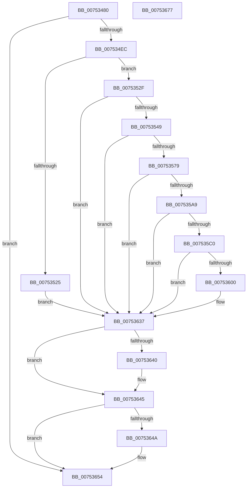

# PfpCreateEventInternal

- RVA: `0x00753480`–`0x00753678` (길이 `504` bytes)
- VA: `0x0000000140753480`
- 실행 섹션: `PAGE`
- PDB 이름 있음: `예`; PDB Function 태그: `아니요`
- unwind 정보 RVA: `0x000CBCB4`
- 디코드: `138`개 명령, `504/504` bytes 표시
- 미해석 바이트: `0` (있으면 어셈블리에 `.byte`로 보존)

> 이 문서는 커널 이미지의 기계어와 PDB 기호를 분석해 생성했습니다. 4번과 5번은 함수 원형과 자료형을 바이너리 사용 방식에서 추정한 C 해석이며 원본 소스 복구 결과는 아닙니다.

## 1. Dependencies

- 직접 호출 지점: **12**; 고유 호출 대상: **10**
- 직접 호출자로 확인된 함수: **3**
- RIP 상대 이미지 참조: **3**

### Outgoing calls
- `0x007534DD` → [RtlCreateSecurityDescriptor](../9F/RtlCreateSecurityDescriptor_function_009F1DF0.md) (function, `0x009F1DF0`)
- `0x007534F3` → [RtlLengthSid](../../text/45/RtlLengthSid_function_0045D270.md) (function, `0x0045D270`)
- `0x00753501` → [RtlLengthSid](../../text/45/RtlLengthSid_function_0045D270.md) (function, `0x0045D270`)
- `0x00753518` → [ExAllocatePool2](../../poolcode/B8/ExAllocatePool2_function_00B820F0.md) (function, `0x00B820F0`)
- `0x0075353A` → [RtlCreateAcl](../91/RtlCreateAcl_function_00916F00.md) (function, `0x00916F00`)
- `0x0075356A` → [RtlpAddKnownAce](../92/RtlpAddKnownAce_function_00929A20.md) (function, `0x00929A20`)
- `0x0075359A` → [RtlpAddKnownAce](../92/RtlpAddKnownAce_function_00929A20.md) (function, `0x00929A20`)
- `0x007535B5` → [RtlSetDaclSecurityDescriptor](../9E/RtlSetDaclSecurityDescriptor_function_009EC210.md) (function, `0x009EC210`)
- `0x007535F5` → [ZwCreateEvent](../../text/6A/ZwCreateEvent_function_006AD9D0.md) (function, `0x006AD9D0`)
- `0x00753622` → [ObReferenceObjectByHandle](../86/ObReferenceObjectByHandle_function_00868DB0.md) (function, `0x00868DB0`)
- `0x00753640` → [ZwClose](../../text/6A/ZwClose_function_006AD2B0.md) (function, `0x006AD2B0`)
- `0x0075364F` → [ExFreePoolWithTag](../../poolcode/B8/ExFreePoolWithTag_function_00B82870.md) (function, `0x00B82870`)

### Direct callers
- [PfpScenCtxStart](PfpScenCtxStart_function_00750FD4.md) at `0x00751007`
- [PfTStart](PfTStart_function_007517AC.md) at `0x00751987`
- [PfpCreateEvent](PfpCreateEvent_function_00753460.md) at `0x0075346D`

### Static image references
- `0x007534EC` → RVA `0x00FD9A68` (`PAGEDATA`; read)
- `0x007534F8` → RVA `0x00E67D58` (`.data`; read)
- `0x00753600` → RVA `0x00FC6B80` (`ALMOSTRO`; read)

## 2. Other-region calls and transfers

- 다른 실행 섹션으로 향하는 call: **6**
  - `0x007534F3` → [RtlLengthSid](../../text/45/RtlLengthSid_function_0045D270.md) (`PAGE` → `.text`)
  - `0x00753501` → [RtlLengthSid](../../text/45/RtlLengthSid_function_0045D270.md) (`PAGE` → `.text`)
  - `0x00753518` → [ExAllocatePool2](../../poolcode/B8/ExAllocatePool2_function_00B820F0.md) (`PAGE` → `POOLCODE`)
  - `0x007535F5` → [ZwCreateEvent](../../text/6A/ZwCreateEvent_function_006AD9D0.md) (`PAGE` → `.text`)
  - `0x00753640` → [ZwClose](../../text/6A/ZwClose_function_006AD2B0.md) (`PAGE` → `.text`)
  - `0x0075364F` → [ExFreePoolWithTag](../../poolcode/B8/ExFreePoolWithTag_function_00B82870.md) (`PAGE` → `POOLCODE`)
- 별도 외부 분기/꼬리 이동을 확인하지 못했습니다.

## 3. Assembly (complete function range)

```asm
00753480  48 8B C4                        mov rax, rsp
00753483  48 89 58 08                     mov qword ptr [rax + 8], rbx
00753487  48 89 70 10                     mov qword ptr [rax + 0x10], rsi
0075348B  48 89 78 18                     mov qword ptr [rax + 0x18], rdi
0075348F  55                              push rbp
00753490  41 54                           push r12
00753492  41 55                           push r13
00753494  41 56                           push r14
00753496  41 57                           push r15
00753498  48 8D 68 A1                     lea rbp, [rax - 0x5f]
0075349C  48 81 EC A0 00 00 00            sub rsp, 0xa0
007534A3  33 C0                           xor eax, eax
007534A5  0F 57 C0                        xorps xmm0, xmm0
007534A8  44 8B F2                        mov r14d, edx
007534AB  48 89 45 1F                     mov qword ptr [rbp + 0x1f], rax
007534AF  4C 8B F9                        mov r15, rcx
007534B2  89 45 27                        mov dword ptr [rbp + 0x27], eax
007534B5  45 33 ED                        xor r13d, r13d
007534B8  48 89 45 F7                     mov qword ptr [rbp - 9], rax
007534BC  8D 50 01                        lea edx, [rax + 1]
007534BF  4C 89 6D C7                     mov qword ptr [rbp - 0x39], r13
007534C3  48 8D 4D D7                     lea rcx, [rbp - 0x29]
007534C7  4D 8B E1                        mov r12, r9
007534CA  41 8B F0                        mov esi, r8d
007534CD  0F 11 45 FF                     movups xmmword ptr [rbp - 1], xmm0
007534D1  0F 11 45 0F                     movups xmmword ptr [rbp + 0xf], xmm0
007534D5  0F 11 45 D7                     movups xmmword ptr [rbp - 0x29], xmm0
007534D9  0F 11 45 E7                     movups xmmword ptr [rbp - 0x19], xmm0
007534DD  E8 0E E9 29 00                  call 0x1409f1df0
007534E2  8B D8                           mov ebx, eax
007534E4  85 C0                           test eax, eax
007534E6  0F 88 68 01 00 00               js 0x140753654
007534EC  48 8B 0D 75 65 88 00            mov rcx, qword ptr [rip + 0x886575]
007534F3  E8 78 9D D0 FF                  call 0x14045d270
007534F8  48 8B 0D 59 48 71 00            mov rcx, qword ptr [rip + 0x714859]
007534FF  8B D8                           mov ebx, eax
00753501  E8 6A 9D D0 FF                  call 0x14045d270
00753506  83 C0 20                        add eax, 0x20
00753509  B9 00 01 00 00                  mov ecx, 0x100
0075350E  03 D8                           add ebx, eax
00753510  41 B8 44 61 63 6C               mov r8d, 0x6c636144
00753516  8B D3                           mov edx, ebx
00753518  E8 D3 EB 42 00                  call 0x140b820f0
0075351D  48 8B F8                        mov rdi, rax
00753520  48 85 C0                        test rax, rax
00753523  75 0A                           jne 0x14075352f
00753525  BB 9A 00 00 C0                  mov ebx, 0xc000009a
0075352A  E9 08 01 00 00                  jmp 0x140753637
0075352F  41 B8 02 00 00 00               mov r8d, 2
00753535  8B D3                           mov edx, ebx
00753537  48 8B CF                        mov rcx, rdi
0075353A  E8 C1 39 1C 00                  call 0x140916f00
0075353F  8B D8                           mov ebx, eax
00753541  85 C0                           test eax, eax
00753543  0F 88 EE 00 00 00               js 0x140753637
00753549  48 8B 05 18 65 88 00            mov rax, qword ptr [rip + 0x886518]
00753550  45 33 C0                        xor r8d, r8d
00753553  44 88 6C 24 28                  mov byte ptr [rsp + 0x28], r13b
00753558  41 B9 03 00 1F 00               mov r9d, 0x1f0003
0075355E  48 8B CF                        mov rcx, rdi
00753561  48 89 44 24 20                  mov qword ptr [rsp + 0x20], rax
00753566  41 8D 50 02                     lea edx, [r8 + 2]
0075356A  E8 B1 64 1D 00                  call 0x140929a20
0075356F  8B D8                           mov ebx, eax
00753571  85 C0                           test eax, eax
00753573  0F 88 BE 00 00 00               js 0x140753637
00753579  48 8B 05 D8 47 71 00            mov rax, qword ptr [rip + 0x7147d8]
00753580  45 33 C0                        xor r8d, r8d
00753583  44 88 6C 24 28                  mov byte ptr [rsp + 0x28], r13b
00753588  41 B9 03 00 1F 00               mov r9d, 0x1f0003
0075358E  48 8B CF                        mov rcx, rdi
00753591  48 89 44 24 20                  mov qword ptr [rsp + 0x20], rax
00753596  41 8D 50 02                     lea edx, [r8 + 2]
0075359A  E8 81 64 1D 00                  call 0x140929a20
0075359F  8B D8                           mov ebx, eax
007535A1  85 C0                           test eax, eax
007535A3  0F 88 8E 00 00 00               js 0x140753637
007535A9  45 33 C9                        xor r9d, r9d
007535AC  48 8D 4D D7                     lea rcx, [rbp - 0x29]
007535B0  4C 8B C7                        mov r8, rdi
007535B3  B2 01                           mov dl, 1
007535B5  E8 56 8C 29 00                  call 0x1409ec210
007535BA  8B D8                           mov ebx, eax
007535BC  85 C0                           test eax, eax
007535BE  78 77                           js 0x140753637
007535C0  89 75 17                        mov dword ptr [rbp + 0x17], esi
007535C3  48 8D 45 D7                     lea rax, [rbp - 0x29]
007535C7  BE 03 00 1F 00                  mov esi, 0x1f0003
007535CC  C7 45 FF 30 00 00 00            mov dword ptr [rbp - 1], 0x30
007535D3  8B D6                           mov edx, esi
007535D5  4C 89 6D 07                     mov qword ptr [rbp + 7], r13
007535D9  45 8B CE                        mov r9d, r14d
007535DC  4C 89 7D 0F                     mov qword ptr [rbp + 0xf], r15
007535E0  4C 8D 45 FF                     lea r8, [rbp - 1]
007535E4  48 89 45 1F                     mov qword ptr [rbp + 0x1f], rax
007535E8  48 8D 4D C7                     lea rcx, [rbp - 0x39]
007535EC  4C 89 6D 27                     mov qword ptr [rbp + 0x27], r13
007535F0  44 88 6C 24 20                  mov byte ptr [rsp + 0x20], r13b
007535F5  E8 D6 A3 F5 FF                  call 0x1406ad9d0
007535FA  8B D8                           mov ebx, eax
007535FC  85 C0                           test eax, eax
007535FE  78 37                           js 0x140753637
00753600  4C 8B 05 79 35 87 00            mov r8, qword ptr [rip + 0x873579]
00753607  48 8D 45 CF                     lea rax, [rbp - 0x31]
0075360B  48 8B 4D C7                     mov rcx, qword ptr [rbp - 0x39]
0075360F  45 33 C9                        xor r9d, r9d
00753612  4C 89 6C 24 28                  mov qword ptr [rsp + 0x28], r13
00753617  8B D6                           mov edx, esi
00753619  48 89 44 24 20                  mov qword ptr [rsp + 0x20], rax
0075361E  4C 89 6D CF                     mov qword ptr [rbp - 0x31], r13
00753622  E8 89 57 11 00                  call 0x140868db0
00753627  8B D8                           mov ebx, eax
00753629  48 8B 45 CF                     mov rax, qword ptr [rbp - 0x31]
0075362D  85 DB                           test ebx, ebx
0075362F  49 89 04 24                     mov qword ptr [r12], rax
00753633  41 0F 49 DD                     cmovns ebx, r13d
00753637  48 8B 4D C7                     mov rcx, qword ptr [rbp - 0x39]
0075363B  48 85 C9                        test rcx, rcx
0075363E  74 05                           je 0x140753645
00753640  E8 6B 9C F5 FF                  call 0x1406ad2b0
00753645  48 85 FF                        test rdi, rdi
00753648  74 0A                           je 0x140753654
0075364A  33 D2                           xor edx, edx
0075364C  48 8B CF                        mov rcx, rdi
0075364F  E8 1C F2 42 00                  call 0x140b82870
00753654  4C 8D 9C 24 A0 00 00 00         lea r11, [rsp + 0xa0]
0075365C  8B C3                           mov eax, ebx
0075365E  49 8B 5B 30                     mov rbx, qword ptr [r11 + 0x30]
00753662  49 8B 73 38                     mov rsi, qword ptr [r11 + 0x38]
00753666  49 8B 7B 40                     mov rdi, qword ptr [r11 + 0x40]
0075366A  49 8B E3                        mov rsp, r11
0075366D  41 5F                           pop r15
0075366F  41 5E                           pop r14
00753671  41 5D                           pop r13
00753673  41 5C                           pop r12
00753675  5D                              pop rbp
00753676  C3                              ret
00753677  CC                              int3
```

## 4. C-style interpretation (structured pseudocode)

```c
__int64 __fastcall PfpCreateEventInternal(__int64 a1, int a2, int a3, __int64 a4)
{
    __int64 result;
    __int64 v_r13;
    __int64 v_rbx;
    __int64 v_rsp;
    unsigned __int64 v_stack_m28;
    unsigned __int8 v_stack_mA0;
    unsigned __int64 v_stack_mA8;

    *(unsigned __int64 *)(v_rsp + 8) = v_rbx;
    *(unsigned __int64 *)(v_rsp + 16) = v_rsi;
    *(unsigned __int64 *)(v_rsp + 24) = v_rdi;
    v_rsp = (v_rsp) - (160);
    result = 0;
    *(unsigned __int64 *)(v_rsp - 95 + 31) = 0;
    *(unsigned int *)(v_rsp - 95 + 39) = 0;
    v_r13 = 0;
    *(unsigned __int64 *)(v_rsp - 95 - 9) = 0;
    *(unsigned __int64 *)(v_rsp - 95 - 57) = 0;
    *(unsigned __int64 *)(v_rsp - 95 - 1) = v_xmm0;
    *(unsigned __int64 *)(v_rsp - 95 + 15) = v_xmm0;
    *(unsigned __int64 *)(v_rsp - 95 - 41) = v_xmm0;
    *(unsigned __int64 *)(v_rsp - 95 - 25) = v_xmm0;
    result = RtlCreateSecurityDescriptor(v_rsp - 95 - 41, result + 1, a3, a4);
    if (sign_flag) goto loc_00753654;
    result = RtlLengthSid(*(unsigned __int64 *)(v_rip + 8938869), result + 1, a3, a4);
    result = RtlLengthSid(*(unsigned __int64 *)(v_rip + 7424089), result + 1, a3, a4);
    result = (unsigned int)((result) + (32));
    v_rbx = (unsigned int)(((unsigned int)((unsigned int)(result))) + ((unsigned int)(result)));
    result = ExAllocatePool2(256, (unsigned int)((unsigned int)(v_rbx)), (unsigned int)(0x6C636144ULL), a4);
    if (result != 0) goto loc_0075352F;
    goto loc_00753637;
loc_0075352F:
    result = RtlCreateAcl(result, (unsigned int)((unsigned int)((unsigned int)(0xC000009AULL))), 2, a4);
    if (sign_flag) goto loc_00753637;
    a3 = 0;
    v_stack_mA0 = 0;
    v_stack_mA8 = *(unsigned __int64 *)(v_rip + 8938776);
    result = RtlpAddKnownAce(result, a3 + 2, a3, (unsigned int)(0x1F0003ULL));
    if (sign_flag) goto loc_00753637;
    a3 = 0;
    v_stack_mA0 = 0;
    v_stack_mA8 = *(unsigned __int64 *)(v_rip + 7423960);
    result = RtlpAddKnownAce(result, a3 + 2, a3, (unsigned int)(0x1F0003ULL));
    if (sign_flag) goto loc_00753637;
    a4 = 0;
    result = RtlSetDaclSecurityDescriptor(v_rsp - 95 - 41, 1, result, a4);
    if (sign_flag) goto loc_00753637;
    *(unsigned int *)(v_rsp - 95 + 23) = (unsigned int)((unsigned int)(a3));
    *(unsigned int *)(v_rsp - 95 - 1) = 48;
    *(unsigned __int64 *)(v_rsp - 95 + 7) = 0;
    *(unsigned __int64 *)(v_rsp - 95 + 15) = a1;
    *(unsigned __int64 *)(v_rsp - 95 + 31) = v_rsp - 95 - 41;
    *(unsigned __int64 *)(v_rsp - 95 + 39) = 0;
    v_stack_mA8 = 0;
    result = ZwCreateEvent(v_rsp - 95 - 57, (unsigned int)((unsigned int)((unsigned int)(0x1F0003ULL))), v_rsp - 95 - 1, (unsigned int)((unsigned int)((unsigned int)(a2))));
    v_rbx = (unsigned int)((unsigned int)(result));
    if (!(sign_flag)) {
        a3 = *(unsigned __int64 *)(v_rip + 8861049);
        result = v_rsp - 95 - 49;
        a1 = *(unsigned __int64 *)(v_rsp - 95 - 57);
        a4 = 0;
        v_stack_mA0 = 0;
        a2 = (unsigned int)((unsigned int)(0x1F0003ULL));
        v_stack_mA8 = result;
        *(unsigned __int64 *)(v_rsp - 95 - 49) = 0;
        result = ObReferenceObjectByHandle(a1, a2, a3, a4);
        v_rbx = (unsigned int)(result);
        result = *(unsigned __int64 *)(v_rsp - 95 - 49);
        *(unsigned __int64 *)(a4) = result;
        if (!sign_flag) { v_rbx = 0; }
    }
    if (*(unsigned __int64 *)(v_rsp - 95 - 57) != 0) {
        result = ZwClose(*(unsigned __int64 *)(v_rsp - 95 - 57), a2, a3, a4);
    }
    if (result != 0) {
        a2 = 0;
        a1 = result;
        result = ExFreePoolWithTag(a1, a2, a3, a4);
    }
    return (unsigned int)((unsigned int)(v_rbx));
}
```

## 5. (Beta) C Style

```c
int64_t PfpCreateEventInternal(int64_t Arg1, int32_t Arg2, int32_t Arg3, void *Arg4)
{
    uint8_t *arg4 = (uint8_t *)Arg4;

    int64_t result;
    int64_t local_r13;
    int64_t local_rbx;
    int64_t local_rsp;
    uint64_t v_stack_m28;
    uint8_t v_stack_mA0;
    uint64_t v_stack_mA8;

    *(uint64_t *)(local_rsp + 0x8) = local_rbx;
    *(uint64_t *)(local_rsp + 0x10) = local_rsi;
    *(uint64_t *)(local_rsp + 0x18) = local_rdi;
    local_rsp = (local_rsp) - (160);
    result = 0;
    *(uint64_t *)(local_rsp - 0x5F + 0x1F) = 0;
    *(uint32_t *)(local_rsp - 0x5F + 0x27) = 0;
    local_r13 = 0;
    *(uint64_t *)(local_rsp - 0x5F - 0x9) = 0;
    *(uint64_t *)(local_rsp - 0x5F - 0x39) = 0;
    *(uint64_t *)(local_rsp - 0x5F - 0x1) = v_xmm0;
    *(uint64_t *)(local_rsp - 0x5F + 0xF) = v_xmm0;
    *(uint64_t *)(local_rsp - 0x5F - 0x29) = v_xmm0;
    *(uint64_t *)(local_rsp - 0x5F - 0x19) = v_xmm0;
    result = RtlCreateSecurityDescriptor(local_rsp - 95 - 41, result + 1, Arg3, Arg4);
    if (sign_flag) goto loc_00753654;
    result = RtlLengthSid(*(uint64_t *)(v_rip + 0x886575), result + 1, Arg3, Arg4);
    result = RtlLengthSid(*(uint64_t *)(v_rip + 0x714859), result + 1, Arg3, Arg4);
    result = (uint32_t)((result) + (32));
    local_rbx = (uint32_t)(((uint32_t)((uint32_t)(result))) + ((uint32_t)(result)));
    result = ExAllocatePool2(256, (uint32_t)((uint32_t)(local_rbx)), (uint32_t)(0x6C636144ULL), Arg4);
    if (result != 0) goto loc_0075352F;
    goto loc_00753637;
loc_0075352F:
    result = RtlCreateAcl(result, (uint32_t)((uint32_t)((uint32_t)(0xC000009AULL))), 2, Arg4);
    if (sign_flag) goto loc_00753637;
    Arg3 = 0;
    v_stack_mA0 = 0;
    v_stack_mA8 = *(uint64_t *)(v_rip + 0x886518);
    result = RtlpAddKnownAce(result, Arg3 + 2, Arg3, (uint32_t)(0x1F0003ULL));
    if (sign_flag) goto loc_00753637;
    Arg3 = 0;
    v_stack_mA0 = 0;
    v_stack_mA8 = *(uint64_t *)(v_rip + 0x7147D8);
    result = RtlpAddKnownAce(result, Arg3 + 2, Arg3, (uint32_t)(0x1F0003ULL));
    if (sign_flag) goto loc_00753637;
    Arg4 = 0;
    result = RtlSetDaclSecurityDescriptor(local_rsp - 95 - 41, 1, result, Arg4);
    if (sign_flag) goto loc_00753637;
    *(uint32_t *)(local_rsp - 0x5F + 0x17) = (uint32_t)((uint32_t)(Arg3));
    *(uint32_t *)(local_rsp - 0x5F - 0x1) = 48;
    *(uint64_t *)(local_rsp - 0x5F + 0x7) = 0;
    *(uint64_t *)(local_rsp - 0x5F + 0xF) = Arg1;
    *(uint64_t *)(local_rsp - 0x5F + 0x1F) = local_rsp - 95 - 41;
    *(uint64_t *)(local_rsp - 0x5F + 0x27) = 0;
    v_stack_mA8 = 0;
    result = ZwCreateEvent(local_rsp - 95 - 57, (uint32_t)((uint32_t)((uint32_t)(0x1F0003ULL))), local_rsp - 95 - 1, (uint32_t)((uint32_t)((uint32_t)(Arg2))));
    local_rbx = (uint32_t)((uint32_t)(result));
    if (!(sign_flag)) {
        Arg3 = *(uint64_t *)(v_rip + 0x873579);
        result = local_rsp - 95 - 49;
        Arg1 = *(uint64_t *)(local_rsp - 0x5F - 0x39);
        Arg4 = 0;
        v_stack_mA0 = 0;
        Arg2 = (uint32_t)((uint32_t)(0x1F0003ULL));
        v_stack_mA8 = result;
        *(uint64_t *)(local_rsp - 0x5F - 0x31) = 0;
        result = ObReferenceObjectByHandle(Arg1, Arg2, Arg3, Arg4);
        local_rbx = (uint32_t)(result);
        result = *(uint64_t *)(local_rsp - 0x5F - 0x31);
        *(uint64_t *)(arg4) = result;
        if (!sign_flag) { local_rbx = 0; }
    }
    if (*(uint64_t *)(local_rsp - 0x5F - 0x39) != 0) {
        result = ZwClose(*(uint64_t *)(local_rsp - 0x5F - 0x39), Arg2, Arg3, Arg4);
    }
    if (result != 0) {
        Arg2 = 0;
        Arg1 = result;
        result = ExFreePoolWithTag(Arg1, Arg2, Arg3, Arg4);
    }
    return (uint32_t)((uint32_t)(local_rbx));
}
```

### 관측된 메모리 오프셋

구조체 형식이 확인되지 않은 접근은 인자 기준의 오프셋으로만 기록했습니다.

| 기준 인자 | 오프셋 표현 | 폭 (bit) | 접근 |
|---|---:|---:|---|
| `Arg4` | `+ 0x0` | `64` | `W` |

## 6. Execution-region graph

[열기: 2D/3D 그래프와 함수 탐색 컨트롤 패널](../../../control-panel.html?section=page&rva=0x00753480&view=graph)

- 2D 그래프는 위에서 아래로 흐르고, 3D 그래프는 빈 공간을 드래그해 회전합니다. Shift+드래그는 이동, 휠은 확대·축소, 함수 노드 선택은 대상 보고서 이동입니다.

### Static fallback


