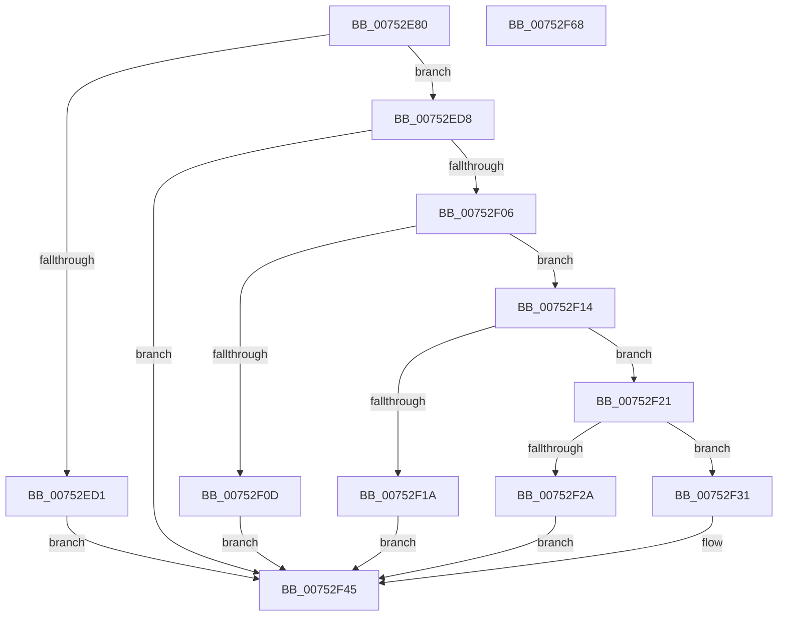

# PfpGetParameter

- RVA: `0x00752E80`–`0x00752F69` (길이 `233` bytes)
- VA: `0x0000000140752E80`
- 실행 섹션: `PAGE`
- PDB 이름 있음: `예`; PDB Function 태그: `아니요`
- unwind 정보 RVA: `0x000CBC38`
- 디코드: `61`개 명령, `233/233` bytes 표시
- 미해석 바이트: `0` (있으면 어셈블리에 `.byte`로 보존)

> 이 문서는 커널 이미지의 기계어와 PDB 기호를 분석해 생성했습니다. 4번과 5번은 함수 원형과 자료형을 바이너리 사용 방식에서 추정한 C 해석이며 원본 소스 복구 결과는 아닙니다.

## 1. Dependencies

- 직접 호출 지점: **4**; 고유 호출 대상: **4**
- 직접 호출자로 확인된 함수: **4**
- RIP 상대 이미지 참조: **1**

### Outgoing calls
- `0x00752EC7` → [RtlInitUnicodeString](../../text/42/RtlInitUnicodeString_function_0042A780.md) (function, `0x0042A780`)
- `0x00752EFD` → [ZwQueryValueKey](../../text/6A/ZwQueryValueKey_function_006AD3B0.md) (function, `0x006AD3B0`)
- `0x00752F3C` → [memcpy](../../text/6C/memcpy_function_006C6840.md) (function, `0x006C6840`)
- `0x00752F50` → [_security_check_cookie](../../text/6A/_security_check_cookie_function_006AC640.md) (function, `0x006AC640`)

### Direct callers
- [PfSnParametersRead](PfSnParametersRead_function_00752970.md) at `0x00752A4D`
- [PfSnParametersRead](PfSnParametersRead_function_00752970.md) at `0x00752AEE`
- [PfSnParametersRead](PfSnParametersRead_function_00752970.md) at `0x00752B4A`
- [PfSnParametersRead](PfSnParametersRead_function_00752970.md) at `0x00752BA1`
- [PfSnParametersRead](PfSnParametersRead_function_00752970.md) at `0x00752BEA`
- [PfSnParametersRead](PfSnParametersRead_function_00752970.md) at `0x00752C12`
- [PfSnParametersRead](PfSnParametersRead_function_00752970.md) at `0x00752C38`
- [PfSnParametersRead](PfSnParametersRead_function_00752970.md) at `0x00752C5E`
- [PfSnParametersRead](PfSnParametersRead_function_00752970.md) at `0x00752C87`
- [PfSnParametersRead](PfSnParametersRead_function_00752970.md) at `0x00752CC1`
- [PfpParametersRead](PfpParametersRead_function_00752F70.md) at `0x00752FD6`
- [PfpParametersRead](PfpParametersRead_function_00752F70.md) at `0x0075300E`
- [PfpParametersRead](PfpParametersRead_function_00752F70.md) at `0x00753031`
- [PfpParametersRead](PfpParametersRead_function_00752F70.md) at `0x00753055`
- [PfpParametersRead](PfpParametersRead_function_00752F70.md) at `0x00753079`
- [PfpParametersRead](PfpParametersRead_function_00752F70.md) at `0x0075309D`
- [PfpSetBaseTime](PfpSetBaseTime_function_0075333C.md) at `0x007533D9`
- [PfpParametersInitialize](../../init/C3/PfpParametersInitialize_function_00C3CEF0.md) at `0x00C3D030`

### Static image references
- `0x00752E8F` → RVA `0x00E0A740` (`.data`; read)

## 2. Other-region calls and transfers

- 다른 실행 섹션으로 향하는 call: **4**
  - `0x00752EC7` → [RtlInitUnicodeString](../../text/42/RtlInitUnicodeString_function_0042A780.md) (`PAGE` → `.text`)
  - `0x00752EFD` → [ZwQueryValueKey](../../text/6A/ZwQueryValueKey_function_006AD3B0.md) (`PAGE` → `.text`)
  - `0x00752F3C` → [memcpy](../../text/6C/memcpy_function_006C6840.md) (`PAGE` → `.text`)
  - `0x00752F50` → [_security_check_cookie](../../text/6A/_security_check_cookie_function_006AC640.md) (`PAGE` → `.text`)
- 별도 외부 분기/꼬리 이동을 확인하지 못했습니다.

## 3. Assembly (complete function range)

```asm
00752E80  48 89 5C 24 18                  mov qword ptr [rsp + 0x18], rbx
00752E85  55                              push rbp
00752E86  56                              push rsi
00752E87  57                              push rdi
00752E88  48 81 EC 70 01 00 00            sub rsp, 0x170
00752E8F  48 8B 05 AA 78 6B 00            mov rax, qword ptr [rip + 0x6b78aa]
00752E96  48 33 C4                        xor rax, rsp
00752E99  48 89 84 24 60 01 00 00         mov qword ptr [rsp + 0x160], rax
00752EA1  48 8B BC 24 B0 01 00 00         mov rdi, qword ptr [rsp + 0x1b0]
00752EA9  48 8B F1                        mov rsi, rcx
00752EAC  0F 57 C0                        xorps xmm0, xmm0
00752EAF  C7 44 24 30 10 01 00 00         mov dword ptr [rsp + 0x30], 0x110
00752EB7  48 8D 4C 24 38                  lea rcx, [rsp + 0x38]
00752EBC  49 8B E9                        mov rbp, r9
00752EBF  0F 11 44 24 38                  movups xmmword ptr [rsp + 0x38], xmm0
00752EC4  41 8B D8                        mov ebx, r8d
00752EC7  E8 B4 78 CD FF                  call 0x14042a780
00752ECC  48 85 F6                        test rsi, rsi
00752ECF  75 07                           jne 0x140752ed8
00752ED1  B8 0D 00 00 C0                  mov eax, 0xc000000d
00752ED6  EB 6D                           jmp 0x140752f45
00752ED8  48 8D 44 24 30                  lea rax, [rsp + 0x30]
00752EDD  41 B8 02 00 00 00               mov r8d, 2
00752EE3  48 89 44 24 28                  mov qword ptr [rsp + 0x28], rax
00752EE8  4C 8D 4C 24 50                  lea r9, [rsp + 0x50]
00752EED  8B 44 24 30                     mov eax, dword ptr [rsp + 0x30]
00752EF1  48 8D 54 24 38                  lea rdx, [rsp + 0x38]
00752EF6  48 8B CE                        mov rcx, rsi
00752EF9  89 44 24 20                     mov dword ptr [rsp + 0x20], eax
00752EFD  E8 AE A4 F5 FF                  call 0x1406ad3b0
00752F02  85 C0                           test eax, eax
00752F04  78 3F                           js 0x140752f45
00752F06  83 7C 24 30 10                  cmp dword ptr [rsp + 0x30], 0x10
00752F0B  73 07                           jae 0x140752f14
00752F0D  B8 01 00 00 C0                  mov eax, 0xc0000001
00752F12  EB 31                           jmp 0x140752f45
00752F14  39 5C 24 54                     cmp dword ptr [rsp + 0x54], ebx
00752F18  74 07                           je 0x140752f21
00752F1A  B8 24 00 00 C0                  mov eax, 0xc0000024
00752F1F  EB 24                           jmp 0x140752f45
00752F21  48 8B 5C 24 58                  mov rbx, qword ptr [rsp + 0x58]
00752F26  3B 1F                           cmp ebx, dword ptr [rdi]
00752F28  76 07                           jbe 0x140752f31
00752F2A  B8 23 00 00 C0                  mov eax, 0xc0000023
00752F2F  EB 14                           jmp 0x140752f45
00752F31  44 8B C3                        mov r8d, ebx
00752F34  48 8D 54 24 5C                  lea rdx, [rsp + 0x5c]
00752F39  48 8B CD                        mov rcx, rbp
00752F3C  E8 FF 38 F7 FF                  call 0x1406c6840
00752F41  33 C0                           xor eax, eax
00752F43  89 1F                           mov dword ptr [rdi], ebx
00752F45  48 8B 8C 24 60 01 00 00         mov rcx, qword ptr [rsp + 0x160]
00752F4D  48 33 CC                        xor rcx, rsp
00752F50  E8 EB 96 F5 FF                  call 0x1406ac640
00752F55  48 8B 9C 24 A0 01 00 00         mov rbx, qword ptr [rsp + 0x1a0]
00752F5D  48 81 C4 70 01 00 00            add rsp, 0x170
00752F64  5F                              pop rdi
00752F65  5E                              pop rsi
00752F66  5D                              pop rbp
00752F67  C3                              ret
00752F68  CC                              int3
```

## 4. C-style interpretation (structured pseudocode)

```c
__int64 __fastcall PfpGetParameter(__int64 a1, __int64 a2, int a3, __int64 a4, __int64 a5)
{
    __int64 result;
    __int64 v_rsp;
    unsigned __int64 v_stack_m12C;
    unsigned __int64 v_stack_m130;
    unsigned int v_stack_m134;
    unsigned __int64 v_stack_m138;
    unsigned __int64 v_stack_m150;
    unsigned int v_stack_m158;
    unsigned __int64 v_stack_m160;
    unsigned int v_stack_m168;
    unsigned __int64 v_stack_m28;
    unsigned __int64 v_stack_p18;

    v_stack_p18 = v_rbx;
    v_rsp = (v_rsp) - (368);
    result = (*(unsigned __int64 *)(v_rip + 7043242)) ^ (v_rsp);
    v_stack_m28 = result;
    v_stack_m158 = 272;
    v_stack_m150 = v_xmm0;
    result = RtlInitUnicodeString(v_stack_m150, a2, a3, a4);
    if (a1 != 0) goto loc_00752ED8;
    goto loc_00752F45;
loc_00752ED8:
    v_stack_m160 = v_stack_m158;
    v_stack_m168 = (unsigned int)((unsigned int)(v_stack_m158));
    result = ZwQueryValueKey(a1, v_stack_m150, 2, v_stack_m138);
    if (sign_flag) goto loc_00752F45;
    if (v_stack_m158 >= 16) goto loc_00752F14;
    goto loc_00752F45;
loc_00752F14:
    if (v_stack_m134 == ((unsigned int)((unsigned int)(a3)))) goto loc_00752F21;
    goto loc_00752F45;
loc_00752F21:
    if (((unsigned int)(v_stack_m130)) <= (*(unsigned int *)(a5))) goto loc_00752F31;
    goto loc_00752F45;
loc_00752F31:
    result = memcpy(a4, v_stack_m12C, (unsigned int)((unsigned int)(v_stack_m130)), v_stack_m138);
    result = 0;
    *(unsigned int *)(a5) = (unsigned int)(v_stack_m130);
loc_00752F45:
    a1 = (v_stack_m28) ^ (v_rsp);
    result = _security_check_cookie(a1, v_stack_m12C, (unsigned int)((unsigned int)(v_stack_m130)), v_stack_m138);
    v_rsp = (v_rsp) + (368);
    return result;
}
```

## 5. (Beta) C Style

```c
int64_t PfpGetParameter(int64_t Arg1, int64_t Arg2, int32_t Arg3, int64_t Arg4, void *Arg5)
{
    uint8_t *arg5 = (uint8_t *)Arg5;

    int64_t result;
    int64_t local_rsp;
    uint64_t v_stack_m12C;
    uint64_t v_stack_m130;
    uint32_t v_stack_m134;
    uint64_t v_stack_m138;
    uint64_t v_stack_m150;
    uint32_t v_stack_m158;
    uint64_t v_stack_m160;
    uint32_t v_stack_m168;
    uint64_t v_stack_m28;
    uint64_t v_stack_p18;

    v_stack_p18 = local_rbx;
    local_rsp = (local_rsp) - (368);
    result = (*(uint64_t *)(v_rip + 0x6B78AA)) ^ (local_rsp);
    v_stack_m28 = result;
    v_stack_m158 = 272;
    v_stack_m150 = v_xmm0;
    result = RtlInitUnicodeString(v_stack_m150, Arg2, Arg3, Arg4);
    if (Arg1 != 0) goto loc_00752ED8;
    goto loc_00752F45;
loc_00752ED8:
    v_stack_m160 = v_stack_m158;
    v_stack_m168 = (uint32_t)((uint32_t)(v_stack_m158));
    result = ZwQueryValueKey(Arg1, v_stack_m150, 2, v_stack_m138);
    if (sign_flag) goto loc_00752F45;
    if (v_stack_m158 >= 16) goto loc_00752F14;
    goto loc_00752F45;
loc_00752F14:
    if (v_stack_m134 == ((uint32_t)((uint32_t)(Arg3)))) goto loc_00752F21;
    goto loc_00752F45;
loc_00752F21:
    if (((uint32_t)(v_stack_m130)) <= (*(uint32_t *)(arg5))) goto loc_00752F31;
    goto loc_00752F45;
loc_00752F31:
    result = memcpy(Arg4, v_stack_m12C, (uint32_t)((uint32_t)(v_stack_m130)), v_stack_m138);
    result = 0;
    *(uint32_t *)(arg5) = (uint32_t)(v_stack_m130);
loc_00752F45:
    Arg1 = (v_stack_m28) ^ (local_rsp);
    result = _security_check_cookie(Arg1, v_stack_m12C, (uint32_t)((uint32_t)(v_stack_m130)), v_stack_m138);
    local_rsp = (local_rsp) + (368);
    return result;
}
```

### 관측된 메모리 오프셋

구조체 형식이 확인되지 않은 접근은 인자 기준의 오프셋으로만 기록했습니다.

| 기준 인자 | 오프셋 표현 | 폭 (bit) | 접근 |
|---|---:|---:|---|
| `Arg5` | `+ 0x0` | `32` | `R` |
| `Arg5` | `+ 0x0` | `32` | `W` |

## 6. Execution-region graph

[열기: 2D/3D 그래프와 함수 탐색 컨트롤 패널](../../../control-panel.html?section=page&rva=0x00752E80&view=graph)

- 2D 그래프는 위에서 아래로 흐르고, 3D 그래프는 빈 공간을 드래그해 회전합니다. Shift+드래그는 이동, 휠은 확대·축소, 함수 노드 선택은 대상 보고서 이동입니다.

### Static fallback


