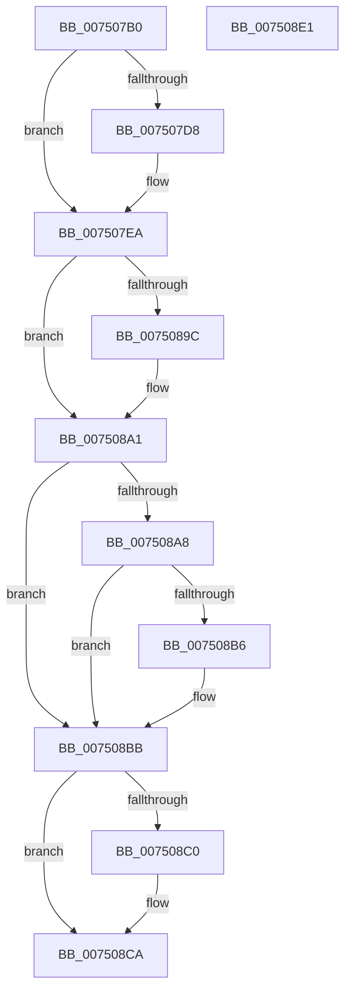

# PfpLogScenarioEventCallback

- RVA: `0x007507B0`–`0x007508E2` (길이 `306` bytes)
- VA: `0x00000001407507B0`
- 실행 섹션: `PAGE`
- PDB 이름 있음: `예`; PDB Function 태그: `아니요`
- unwind 정보 RVA: `0x0007D3C0`
- 디코드: `87`개 명령, `306/306` bytes 표시
- 미해석 바이트: `0` (있으면 어셈블리에 `.byte`로 보존)

> 이 문서는 커널 이미지의 기계어와 PDB 기호를 분석해 생성했습니다. 4번과 5번은 함수 원형과 자료형을 바이너리 사용 방식에서 추정한 C 해석이며 원본 소스 복구 결과는 아닙니다.

## 1. Dependencies

- 직접 호출 지점: **8**; 고유 호출 대상: **6**
- 직접 호출자로 확인된 함수: **0**
- RIP 상대 이미지 참조: **1**

### Outgoing calls
- `0x007507CF` → [PfTAccessTracingCheck](../../text/5C/PfTAccessTracingCheck_function_005CDD50.md) (function, `0x005CDD50`)
- `0x007507D8` → [CsanRead64NoCheck](../../text/4C/CsanRead64NoCheck_function_004C82C0.md) (function, `0x004C82C0`)
- `0x007507E5` → [MmPerformMemoryListCommand](../../pagelk/B7/MmPerformMemoryListCommand_function_00B7D730.md) (function, `0x00B7D730`)
- `0x007507F2` → [PfTSetTraceWorkerPriority](../../text/5C/PfTSetTraceWorkerPriority_function_005CDD60.md) (function, `0x005CDD60`)
- `0x00750801` → [PfGenerateTrace](PfGenerateTrace_function_0075101C.md) (function, `0x0075101C`)
- `0x00750893` → [PfLogEvent](../../text/34/PfLogEvent_function_00349BA8.md) (function, `0x00349BA8`)
- `0x007508AD` → [PfGenerateTrace](PfGenerateTrace_function_0075101C.md) (function, `0x0075101C`)
- `0x007508C5` → [PfTSetTraceWorkerPriority](../../text/5C/PfTSetTraceWorkerPriority_function_005CDD60.md) (function, `0x005CDD60`)

### Direct callers
- 이 함수 시작 RVA로 연결되는 직접 call은 확인되지 않았습니다. 간접 호출은 완전히 역산할 수 없습니다.

### Static image references
- `0x0075088C` → RVA `0x00E670CC` (`.data`; read)

## 2. Other-region calls and transfers

- 다른 실행 섹션으로 향하는 call: **6**
  - `0x007507CF` → [PfTAccessTracingCheck](../../text/5C/PfTAccessTracingCheck_function_005CDD50.md) (`PAGE` → `.text`)
  - `0x007507D8` → [CsanRead64NoCheck](../../text/4C/CsanRead64NoCheck_function_004C82C0.md) (`PAGE` → `.text`)
  - `0x007507E5` → [MmPerformMemoryListCommand](../../pagelk/B7/MmPerformMemoryListCommand_function_00B7D730.md) (`PAGE` → `PAGELK`)
  - `0x007507F2` → [PfTSetTraceWorkerPriority](../../text/5C/PfTSetTraceWorkerPriority_function_005CDD60.md) (`PAGE` → `.text`)
  - `0x00750893` → [PfLogEvent](../../text/34/PfLogEvent_function_00349BA8.md) (`PAGE` → `.text`)
  - `0x007508C5` → [PfTSetTraceWorkerPriority](../../text/5C/PfTSetTraceWorkerPriority_function_005CDD60.md) (`PAGE` → `.text`)
- 별도 외부 분기/꼬리 이동을 확인하지 못했습니다.

## 3. Assembly (complete function range)

```asm
007507B0  48 8B C4                        mov rax, rsp
007507B3  48 89 58 08                     mov qword ptr [rax + 8], rbx
007507B7  48 89 68 10                     mov qword ptr [rax + 0x10], rbp
007507BB  48 89 70 18                     mov qword ptr [rax + 0x18], rsi
007507BF  57                              push rdi
007507C0  48 83 EC 40                     sub rsp, 0x40
007507C4  48 83 60 F0 00                  and qword ptr [rax - 0x10], 0
007507C9  48 8B F2                        mov rsi, rdx
007507CC  48 8B F9                        mov rdi, rcx
007507CF  E8 7C D5 E7 FF                  call 0x1405cdd50
007507D4  85 C0                           test eax, eax
007507D6  75 12                           jne 0x1407507ea
007507D8  E8 E3 7A D7 FF                  call 0x1404c82c0
007507DD  48 8B D0                        mov rdx, rax
007507E0  B9 01 00 00 00                  mov ecx, 1
007507E5  E8 46 CF 42 00                  call 0x140b7d730
007507EA  BA 10 00 00 00                  mov edx, 0x10
007507EF  48 8B CF                        mov rcx, rdi
007507F2  E8 69 D5 E7 FF                  call 0x1405cdd60
007507F7  BA 01 00 00 00                  mov edx, 1
007507FC  48 8B CF                        mov rcx, rdi
007507FF  8B E8                           mov ebp, eax
00750801  E8 16 08 00 00                  call 0x14075101c
00750806  48 63 0E                        movsxd rcx, dword ptr [rsi]
00750809  4C 8D 4C 24 30                  lea r9, [rsp + 0x30]
0075080E  8B 56 08                        mov edx, dword ptr [rsi + 8]
00750811  33 DB                           xor ebx, ebx
00750813  85 C0                           test eax, eax
00750815  48 89 4C 24 30                  mov qword ptr [rsp + 0x30], rcx
0075081A  C7 44 24 20 10 00 00 00         mov dword ptr [rsp + 0x20], 0x10
00750822  0F 48 D8                        cmovs ebx, eax
00750825  8B 46 0C                        mov eax, dword ptr [rsi + 0xc]
00750828  0F B7 C8                        movzx ecx, ax
0075082B  83 E2 03                        and edx, 3
0075082E  8B 46 04                        mov eax, dword ptr [rsi + 4]
00750831  83 E0 03                        and eax, 3
00750834  C1 E2 10                        shl edx, 0x10
00750837  0B D1                           or edx, ecx
00750839  48 B9 04 00 00 00 80 F7 FF FF   movabs rcx, 0xfffff78000000004
00750843  C1 E2 02                        shl edx, 2
00750846  0B D0                           or edx, eax
00750848  8B 44 24 38                     mov eax, dword ptr [rsp + 0x38]
0075084C  25 00 00 F0 FF                  and eax, 0xfff00000
00750851  0B D0                           or edx, eax
00750853  48 B8 20 03 00 00 80 F7 FF FF   movabs rax, 0xfffff78000000320
0075085D  89 54 24 38                     mov dword ptr [rsp + 0x38], edx
00750861  BA 1B 00 00 00                  mov edx, 0x1b
00750866  48 8B 00                        mov rax, qword ptr [rax]
00750869  8B 09                           mov ecx, dword ptr [rcx]
0075086B  44 8B C0                        mov r8d, eax
0075086E  4C 0F AF C1                     imul r8, rcx
00750872  48 C1 E8 20                     shr rax, 0x20
00750876  49 C1 E8 18                     shr r8, 0x18
0075087A  48 0F AF C1                     imul rax, rcx
0075087E  48 8B CF                        mov rcx, rdi
00750881  48 C1 E0 08                     shl rax, 8
00750885  4C 03 C0                        add r8, rax
00750888  49 C1 E8 0A                     shr r8, 0xa
0075088C  44 03 05 39 68 71 00            add r8d, dword ptr [rip + 0x716839]
00750893  E8 10 93 BF FF                  call 0x140349ba8
00750898  85 C0                           test eax, eax
0075089A  79 05                           jns 0x1407508a1
0075089C  85 DB                           test ebx, ebx
0075089E  0F 49 D8                        cmovns ebx, eax
007508A1  8B 46 10                        mov eax, dword ptr [rsi + 0x10]
007508A4  A8 01                           test al, 1
007508A6  74 13                           je 0x1407508bb
007508A8  33 D2                           xor edx, edx
007508AA  48 8B CF                        mov rcx, rdi
007508AD  E8 6A 07 00 00                  call 0x14075101c
007508B2  85 C0                           test eax, eax
007508B4  79 05                           jns 0x1407508bb
007508B6  85 DB                           test ebx, ebx
007508B8  0F 49 D8                        cmovns ebx, eax
007508BB  83 FD 1F                        cmp ebp, 0x1f
007508BE  7F 0A                           jg 0x1407508ca
007508C0  8B D5                           mov edx, ebp
007508C2  48 8B CF                        mov rcx, rdi
007508C5  E8 96 D4 E7 FF                  call 0x1405cdd60
007508CA  48 8B 6C 24 58                  mov rbp, qword ptr [rsp + 0x58]
007508CF  8B C3                           mov eax, ebx
007508D1  48 8B 5C 24 50                  mov rbx, qword ptr [rsp + 0x50]
007508D6  48 8B 74 24 60                  mov rsi, qword ptr [rsp + 0x60]
007508DB  48 83 C4 40                     add rsp, 0x40
007508DF  5F                              pop rdi
007508E0  C3                              ret
007508E1  CC                              int3
```

## 4. C-style interpretation (structured pseudocode)

```c
__int64 __fastcall PfpLogScenarioEventCallback(__int64 a1, __int64 a2)
{
    __int64 result;
    __int64 v_rbx;
    __int64 v_rsp;
    unsigned int v_stack_m10;
    unsigned __int64 v_stack_m18;
    unsigned int v_stack_m28;
    unsigned __int64 v_stack_p10;
    unsigned __int64 v_stack_p18;
    unsigned __int64 v_stack_p8;

    *(unsigned __int64 *)(v_rsp + 8) = v_rbx;
    *(unsigned __int64 *)(v_rsp + 16) = v_rbp;
    *(unsigned __int64 *)(v_rsp + 24) = v_rsi;
    v_rsp = (v_rsp) - (64);
    result = PfTAccessTracingCheck(a1, a2, a3, a4);
    if ((unsigned int)(result) == 0) {
        result = CsanRead64NoCheck(a1, a2, a3, a4);
        a2 = result;
        a1 = 1;
        result = MmPerformMemoryListCommand(a1, a2, a3, a4);
    }
    result = PfTSetTraceWorkerPriority(a1, 16, a3, a4);
    result = PfGenerateTrace(a1, 1, a3, a4);
    v_rbx = 0;
    v_stack_m18 = (int)(*(unsigned int *)(a2));
    v_stack_m28 = 16;
    if (sign_flag) { v_rbx = (unsigned int)(result); }
    a2 = (unsigned int)(((unsigned int)(*(unsigned int *)(a2 + 8))) & (3));
    result = (unsigned int)(((unsigned int)(*(unsigned int *)(a2 + 4))) & (3));
    a2 = (unsigned int)((a2) << (16));
    a2 = (unsigned int)((a2) | ((unsigned int)((unsigned __int16)((unsigned int)(*(unsigned int *)(a2 + 12))))));
    a2 = (unsigned int)((a2) << (2));
    a2 = (unsigned int)((a2) | ((unsigned int)(result)));
    result = (unsigned int)(((unsigned int)(v_stack_m10)) & (0xFFF00000ULL));
    a2 = (unsigned int)((a2) | ((unsigned int)(result)));
    v_stack_m10 = (unsigned int)(a2);
    a3 = ((unsigned int)((unsigned int)(*(unsigned __int64 *)(result)))) * ((unsigned int)(*(unsigned int *)((unsigned __int16)((unsigned int)(*(unsigned int *)(a2 + 12))))));
    result = (*(unsigned __int64 *)(result)) >> (32);
    a3 = (a3) >> (24);
    result = (result) * ((unsigned int)(*(unsigned int *)((unsigned __int16)((unsigned int)(*(unsigned int *)(a2 + 12))))));
    result = (result) << (8);
    a3 = (a3) + (result);
    a3 = (a3) >> (10);
    a3 = (unsigned int)((a3) + (*(unsigned int *)(v_rip + 7432249)));
    result = PfLogEvent(a1, 27, a3, v_stack_m18);
    if (sign_flag) {
        if (!sign_flag) { v_rbx = (unsigned int)(result); }
    }
    if ((((unsigned __int8)((unsigned int)(*(unsigned int *)(a2 + 16)))) & (1)) == 0) goto loc_007508BB;
    a2 = 0;
    result = PfGenerateTrace(a1, a2, a3, v_stack_m18);
    if (sign_flag) {
        if (!sign_flag) { v_rbx = (unsigned int)(result); }
    }
    if (((unsigned int)((unsigned int)((unsigned int)(result)))) <= 31) {
        a2 = (unsigned int)((unsigned int)((unsigned int)(result)));
        a1 = a1;
        result = PfTSetTraceWorkerPriority(a1, a2, a3, v_stack_m18);
    }
    v_rsp = (v_rsp) + (64);
    return (unsigned int)((unsigned int)(v_rbx));
}
```

## 5. (Beta) C Style

```c
int64_t PfpLogScenarioEventCallback(int64_t Arg1, void *Arg2)
{
    uint8_t *arg2 = (uint8_t *)Arg2;

    int64_t result;
    int64_t local_rbx;
    int64_t local_rsp;
    uint32_t v_stack_m10;
    uint64_t v_stack_m18;
    uint32_t v_stack_m28;
    uint64_t v_stack_p10;
    uint64_t v_stack_p18;
    uint64_t v_stack_p8;

    *(uint64_t *)(local_rsp + 0x8) = local_rbx;
    *(uint64_t *)(local_rsp + 0x10) = local_rbp;
    *(uint64_t *)(local_rsp + 0x18) = local_rsi;
    local_rsp = (local_rsp) - (64);
    result = PfTAccessTracingCheck(Arg1, Arg2, a3, a4);
    if ((uint32_t)(result) == 0) {
        result = CsanRead64NoCheck(Arg1, Arg2, a3, a4);
        Arg2 = result;
        Arg1 = 1;
        result = MmPerformMemoryListCommand(Arg1, Arg2, a3, a4);
    }
    result = PfTSetTraceWorkerPriority(Arg1, 16, a3, a4);
    result = PfGenerateTrace(Arg1, 1, a3, a4);
    local_rbx = 0;
    v_stack_m18 = (int32_t)(*(uint32_t *)(arg2));
    v_stack_m28 = 16;
    if (sign_flag) { local_rbx = (uint32_t)(result); }
    Arg2 = (uint32_t)(((uint32_t)(*(uint32_t *)(arg2 + 0x8))) & (3));
    result = (uint32_t)(((uint32_t)(*(uint32_t *)(arg2 + 0x4))) & (3));
    Arg2 = (uint32_t)((Arg2) << (16));
    Arg2 = (uint32_t)((Arg2) | ((uint32_t)((uint16_t)((uint32_t)(*(uint32_t *)(arg2 + 0xC))))));
    Arg2 = (uint32_t)((Arg2) << (2));
    Arg2 = (uint32_t)((Arg2) | ((uint32_t)(result)));
    result = (uint32_t)(((uint32_t)(v_stack_m10)) & (0xFFF00000ULL));
    Arg2 = (uint32_t)((Arg2) | ((uint32_t)(result)));
    v_stack_m10 = (uint32_t)(Arg2);
    a3 = ((uint32_t)((uint32_t)(*(uint64_t *)(result)))) * ((uint32_t)(*(uint32_t *)((uint16_t)((uint32_t)(*(uint32_t *)(arg2 + 0xC))))));
    result = (*(uint64_t *)(result)) >> (32);
    a3 = (a3) >> (24);
    result = (result) * ((uint32_t)(*(uint32_t *)((uint16_t)((uint32_t)(*(uint32_t *)(arg2 + 0xC))))));
    result = (result) << (8);
    a3 = (a3) + (result);
    a3 = (a3) >> (10);
    a3 = (uint32_t)((a3) + (*(uint32_t *)(v_rip + 0x716839)));
    result = PfLogEvent(Arg1, 27, a3, v_stack_m18);
    if (sign_flag) {
        if (!sign_flag) { local_rbx = (uint32_t)(result); }
    }
    if ((((uint8_t)((uint32_t)(*(uint32_t *)(arg2 + 0x10)))) & (1)) == 0) goto loc_007508BB;
    Arg2 = 0;
    result = PfGenerateTrace(Arg1, Arg2, a3, v_stack_m18);
    if (sign_flag) {
        if (!sign_flag) { local_rbx = (uint32_t)(result); }
    }
    if (((uint32_t)((uint32_t)((uint32_t)(result)))) <= 31) {
        Arg2 = (uint32_t)((uint32_t)((uint32_t)(result)));
        Arg1 = Arg1;
        result = PfTSetTraceWorkerPriority(Arg1, Arg2, a3, v_stack_m18);
    }
    local_rsp = (local_rsp) + (64);
    return (uint32_t)((uint32_t)(local_rbx));
}
```

### 관측된 메모리 오프셋

구조체 형식이 확인되지 않은 접근은 인자 기준의 오프셋으로만 기록했습니다.

| 기준 인자 | 오프셋 표현 | 폭 (bit) | 접근 |
|---|---:|---:|---|
| `Arg2` | `+ 0x0` | `32` | `R` |
| `Arg2` | `+ 0x4` | `32` | `R` |
| `Arg2` | `+ 0x8` | `32` | `R` |
| `Arg2` | `+ 0xC` | `32` | `R` |
| `Arg2` | `+ 0x10` | `32` | `R` |

## 6. Execution-region graph

[열기: 2D/3D 그래프와 함수 탐색 컨트롤 패널](../../../control-panel.html?section=page&rva=0x007507B0&view=graph)

- 2D 그래프는 위에서 아래로 흐르고, 3D 그래프는 빈 공간을 드래그해 회전합니다. Shift+드래그는 이동, 휠은 확대·축소, 함수 노드 선택은 대상 보고서 이동입니다.

### Static fallback


