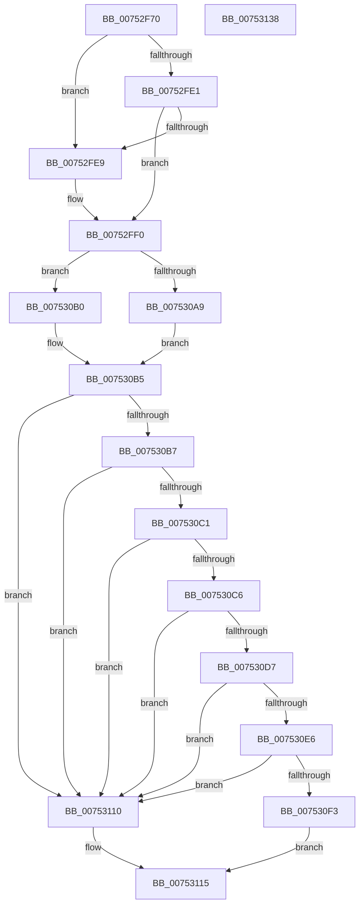

# PfpParametersRead

- RVA: `0x00752F70`–`0x00753139` (길이 `457` bytes)
- VA: `0x0000000140752F70`
- 실행 섹션: `PAGE`
- PDB 이름 있음: `예`; PDB Function 태그: `아니요`
- unwind 정보 RVA: `0x000CBC78`
- 디코드: `119`개 명령, `457/457` bytes 표시
- 미해석 바이트: `0` (있으면 어셈블리에 `.byte`로 보존)

> 이 문서는 커널 이미지의 기계어와 PDB 기호를 분석해 생성했습니다. 4번과 5번은 함수 원형과 자료형을 바이너리 사용 방식에서 추정한 C 해석이며 원본 소스 복구 결과는 아닙니다.

## 1. Dependencies

- 직접 호출 지점: **7**; 고유 호출 대상: **2**
- 직접 호출자로 확인된 함수: **2**
- RIP 상대 이미지 참조: **8**

### Outgoing calls
- `0x00752FD6` → [PfpGetParameter](PfpGetParameter_function_00752E80.md) (function, `0x00752E80`)
- `0x0075300E` → [PfpGetParameter](PfpGetParameter_function_00752E80.md) (function, `0x00752E80`)
- `0x00753031` → [PfpGetParameter](PfpGetParameter_function_00752E80.md) (function, `0x00752E80`)
- `0x00753055` → [PfpGetParameter](PfpGetParameter_function_00752E80.md) (function, `0x00752E80`)
- `0x00753079` → [PfpGetParameter](PfpGetParameter_function_00752E80.md) (function, `0x00752E80`)
- `0x0075309D` → [PfpGetParameter](PfpGetParameter_function_00752E80.md) (function, `0x00752E80`)
- `0x0075311E` → [_security_check_cookie](../../text/6A/_security_check_cookie_function_006AC640.md) (function, `0x006AC640`)

### Direct callers
- [PfpParametersWatcher](PfpParametersWatcher_function_00753140.md) at `0x007532A4`
- [PfpParametersInitialize](../../init/C3/PfpParametersInitialize_function_00C3CEF0.md) at `0x00C3D001`

### Static image references
- `0x00752F85` → RVA `0x00E0A740` (`.data`; read)
- `0x00752F9E` → RVA `0x00B01670` (` ?? ::NNGAKEGL::`string'`; read)
- `0x00752FE1` → RVA `0x00FC41C4` (`.data`; read)
- `0x00753004` → RVA `0x00B01640` (` ?? ::NNGAKEGL::`string'`; read)
- `0x00753027` → RVA `0x00B01600` (` ?? ::NNGAKEGL::`string'`; read)
- `0x0075304E` → RVA `0x00B015D0` (` ?? ::NNGAKEGL::`string'`; read)
- `0x00753072` → RVA `0x00B01820` (` ?? ::NNGAKEGL::`string'`; read)
- `0x00753096` → RVA `0x00B017E0` (` ?? ::NNGAKEGL::`string'`; read)

## 2. Other-region calls and transfers

- 다른 실행 섹션으로 향하는 call: **1**
  - `0x0075311E` → [_security_check_cookie](../../text/6A/_security_check_cookie_function_006AC640.md) (`PAGE` → `.text`)
- 별도 외부 분기/꼬리 이동을 확인하지 못했습니다.

## 3. Assembly (complete function range)

```asm
00752F70  48 89 5C 24 10                  mov qword ptr [rsp + 0x10], rbx
00752F75  48 89 74 24 18                  mov qword ptr [rsp + 0x18], rsi
00752F7A  55                              push rbp
00752F7B  57                              push rdi
00752F7C  41 56                           push r14
00752F7E  48 8B EC                        mov rbp, rsp
00752F81  48 83 EC 60                     sub rsp, 0x60
00752F85  48 8B 05 B4 77 6B 00            mov rax, qword ptr [rip + 0x6b77b4]
00752F8C  48 33 C4                        xor rax, rsp
00752F8F  48 89 45 F8                     mov qword ptr [rbp - 8], rax
00752F93  8B 41 5C                        mov eax, dword ptr [rcx + 0x5c]
00752F96  4C 8D 4D D8                     lea r9, [rbp - 0x28]
00752F9A  0F 10 41 44                     movups xmm0, xmmword ptr [rcx + 0x44]
00752F9E  48 8D 15 CB E6 3A 00            lea rdx, [rip + 0x3ae6cb]
00752FA5  48 8B 71 08                     mov rsi, qword ptr [rcx + 8]
00752FA9  F2 0F 10 49 54                  movsd xmm1, qword ptr [rcx + 0x54]
00752FAE  41 BE 04 00 00 00               mov r14d, 4
00752FB4  89 45 F0                        mov dword ptr [rbp - 0x10], eax
00752FB7  48 8B D9                        mov rbx, rcx
00752FBA  48 8D 45 D0                     lea rax, [rbp - 0x30]
00752FBE  F2 0F 11 4D E8                  movsd qword ptr [rbp - 0x18], xmm1
00752FC3  45 8B C6                        mov r8d, r14d
00752FC6  48 89 44 24 20                  mov qword ptr [rsp + 0x20], rax
00752FCB  48 8B CE                        mov rcx, rsi
00752FCE  44 89 75 D0                     mov dword ptr [rbp - 0x30], r14d
00752FD2  0F 11 45 D8                     movups xmmword ptr [rbp - 0x28], xmm0
00752FD6  E8 A5 FE FF FF                  call 0x140752e80
00752FDB  33 FF                           xor edi, edi
00752FDD  85 C0                           test eax, eax
00752FDF  78 08                           js 0x140752fe9
00752FE1  39 3D DD 11 87 00               cmp dword ptr [rip + 0x8711dd], edi
00752FE7  74 07                           je 0x140752ff0
00752FE9  C7 45 D8 00 00 00 80            mov dword ptr [rbp - 0x28], 0x80000000
00752FF0  48 8D 45 D0                     lea rax, [rbp - 0x30]
00752FF4  44 89 75 D0                     mov dword ptr [rbp - 0x30], r14d
00752FF8  4C 8D 4D E0                     lea r9, [rbp - 0x20]
00752FFC  48 89 44 24 20                  mov qword ptr [rsp + 0x20], rax
00753001  45 8B C6                        mov r8d, r14d
00753004  48 8D 15 35 E6 3A 00            lea rdx, [rip + 0x3ae635]
0075300B  48 8B CE                        mov rcx, rsi
0075300E  E8 6D FE FF FF                  call 0x140752e80
00753013  48 8D 45 D0                     lea rax, [rbp - 0x30]
00753017  44 89 75 D0                     mov dword ptr [rbp - 0x30], r14d
0075301B  4C 8D 4D E4                     lea r9, [rbp - 0x1c]
0075301F  48 89 44 24 20                  mov qword ptr [rsp + 0x20], rax
00753024  45 8B C6                        mov r8d, r14d
00753027  48 8D 15 D2 E5 3A 00            lea rdx, [rip + 0x3ae5d2]
0075302E  48 8B CE                        mov rcx, rsi
00753031  E8 4A FE FF FF                  call 0x140752e80
00753036  48 8B 4B 08                     mov rcx, qword ptr [rbx + 8]
0075303A  48 8D 45 D0                     lea rax, [rbp - 0x30]
0075303E  4C 8D 4D E8                     lea r9, [rbp - 0x18]
00753042  48 89 44 24 20                  mov qword ptr [rsp + 0x20], rax
00753047  45 8B C6                        mov r8d, r14d
0075304A  44 89 75 D0                     mov dword ptr [rbp - 0x30], r14d
0075304E  48 8D 15 7B E5 3A 00            lea rdx, [rip + 0x3ae57b]
00753055  E8 26 FE FF FF                  call 0x140752e80
0075305A  48 8B 4B 08                     mov rcx, qword ptr [rbx + 8]
0075305E  48 8D 45 D0                     lea rax, [rbp - 0x30]
00753062  4C 8D 4D EC                     lea r9, [rbp - 0x14]
00753066  48 89 44 24 20                  mov qword ptr [rsp + 0x20], rax
0075306B  45 8B C6                        mov r8d, r14d
0075306E  44 89 75 D0                     mov dword ptr [rbp - 0x30], r14d
00753072  48 8D 15 A7 E7 3A 00            lea rdx, [rip + 0x3ae7a7]
00753079  E8 02 FE FF FF                  call 0x140752e80
0075307E  48 8B 4B 08                     mov rcx, qword ptr [rbx + 8]
00753082  48 8D 45 D0                     lea rax, [rbp - 0x30]
00753086  4C 8D 4D F0                     lea r9, [rbp - 0x10]
0075308A  48 89 44 24 20                  mov qword ptr [rsp + 0x20], rax
0075308F  45 8B C6                        mov r8d, r14d
00753092  44 89 75 D0                     mov dword ptr [rbp - 0x30], r14d
00753096  48 8D 15 43 E7 3A 00            lea rdx, [rip + 0x3ae743]
0075309D  E8 DE FD FF FF                  call 0x140752e80
007530A2  8B 45 D8                        mov eax, dword ptr [rbp - 0x28]
007530A5  85 C0                           test eax, eax
007530A7  79 07                           jns 0x1407530b0
007530A9  3D 00 00 00 80                  cmp eax, 0x80000000
007530AE  EB 05                           jmp 0x1407530b5
007530B0  A9 FC FF FF FF                  test eax, 0xfffffffc
007530B5  75 59                           jne 0x140753110
007530B7  B8 00 00 01 00                  mov eax, 0x10000
007530BC  39 45 E0                        cmp dword ptr [rbp - 0x20], eax
007530BF  77 4F                           ja 0x140753110
007530C1  39 45 E4                        cmp dword ptr [rbp - 0x1c], eax
007530C4  77 4A                           ja 0x140753110
007530C6  8B 45 E8                        mov eax, dword ptr [rbp - 0x18]
007530C9  BA 9C E0 00 00                  mov edx, 0xe09c
007530CE  05 3C F6 FF FF                  add eax, 0xfffff63c
007530D3  3B C2                           cmp eax, edx
007530D5  77 39                           ja 0x140753110
007530D7  8B 45 EC                        mov eax, dword ptr [rbp - 0x14]
007530DA  05 78 EC FF FF                  add eax, 0xffffec78
007530DF  3D D8 D6 00 00                  cmp eax, 0xd6d8
007530E4  77 2A                           ja 0x140753110
007530E6  8B 4D F0                        mov ecx, dword ptr [rbp - 0x10]
007530E9  8D 81 3C F6 FF FF               lea eax, [rcx - 0x9c4]
007530EF  3B C2                           cmp eax, edx
007530F1  77 1D                           ja 0x140753110
007530F3  0F 10 45 D8                     movups xmm0, xmmword ptr [rbp - 0x28]
007530F7  FF 83 00 02 00 00               inc dword ptr [rbx + 0x200]
007530FD  F2 0F 10 4D E8                  movsd xmm1, qword ptr [rbp - 0x18]
00753102  0F 11 43 44                     movups xmmword ptr [rbx + 0x44], xmm0
00753106  F2 0F 11 4B 54                  movsd qword ptr [rbx + 0x54], xmm1
0075310B  89 4B 5C                        mov dword ptr [rbx + 0x5c], ecx
0075310E  EB 05                           jmp 0x140753115
00753110  BF 0D 00 00 C0                  mov edi, 0xc000000d
00753115  8B C7                           mov eax, edi
00753117  48 8B 4D F8                     mov rcx, qword ptr [rbp - 8]
0075311B  48 33 CC                        xor rcx, rsp
0075311E  E8 1D 95 F5 FF                  call 0x1406ac640
00753123  4C 8D 5C 24 60                  lea r11, [rsp + 0x60]
00753128  49 8B 5B 28                     mov rbx, qword ptr [r11 + 0x28]
0075312C  49 8B 73 30                     mov rsi, qword ptr [r11 + 0x30]
00753130  49 8B E3                        mov rsp, r11
00753133  41 5E                           pop r14
00753135  5F                              pop rdi
00753136  5D                              pop rbp
00753137  C3                              ret
00753138  CC                              int3
```

## 4. C-style interpretation (structured pseudocode)

```c
__int64 __fastcall PfpParametersRead(__int64 a1)
{
    __int64 result;
    __int64 v_rdi;
    __int64 v_rsp;
    unsigned __int64 v_stack_m18;
    unsigned __int64 v_stack_m20;
    unsigned int v_stack_m28;
    unsigned __int64 v_stack_m2C;
    unsigned __int64 v_stack_m30;
    unsigned __int64 v_stack_m34;
    unsigned __int64 v_stack_m38;
    unsigned __int64 v_stack_m40;
    unsigned __int64 v_stack_m48;
    unsigned __int64 v_stack_m58;
    unsigned __int64 v_stack_p10;
    unsigned __int64 v_stack_p18;

    v_stack_p10 = v_rbx;
    v_stack_p18 = v_rsi;
    v_rsp = (v_rsp) - (96);
    result = (*(unsigned __int64 *)(v_rip + 7042996)) ^ (v_rsp);
    v_stack_m20 = result;
    v_stack_m28 = (unsigned int)((unsigned int)(*(unsigned int *)(a1 + 92)));
    v_stack_m30 = v_xmm1;
    v_stack_m58 = v_stack_m48;
    v_stack_m48 = 4;
    v_stack_m40 = v_xmm0;
    result = PfpGetParameter(*(unsigned __int64 *)(a1 + 8), v_rip + 3860171, 4, v_stack_m40);
    v_rdi = 0;
    if (sign_flag) goto loc_00752FE9;
    if ((*(unsigned int *)(v_rip + 8851933)) != 0) {
        v_stack_m40 = 0x80000000ULL;
    }
    v_stack_m48 = 4;
    v_stack_m58 = v_stack_m48;
    result = PfpGetParameter(*(unsigned __int64 *)(a1 + 8), v_rip + 3860021, 4, v_stack_m38);
    v_stack_m48 = 4;
    v_stack_m58 = v_stack_m48;
    result = PfpGetParameter(*(unsigned __int64 *)(a1 + 8), v_rip + 3859922, 4, v_stack_m34);
    v_stack_m58 = v_stack_m48;
    v_stack_m48 = 4;
    result = PfpGetParameter(*(unsigned __int64 *)(a1 + 8), v_rip + 3859835, 4, v_stack_m30);
    v_stack_m58 = v_stack_m48;
    v_stack_m48 = 4;
    result = PfpGetParameter(*(unsigned __int64 *)(a1 + 8), v_rip + 3860391, 4, v_stack_m2C);
    v_stack_m58 = v_stack_m48;
    v_stack_m48 = 4;
    result = PfpGetParameter(*(unsigned __int64 *)(a1 + 8), v_rip + 3860291, 4, v_stack_m28);
    if (!sign_flag) goto loc_007530B0;
    goto loc_007530B5;
loc_007530B0:
loc_007530B5:
    if ((((unsigned int)((unsigned int)(v_stack_m40))) & (0xFFFFFFFCULL)) != 0) goto loc_00753110;
    if (v_stack_m38 > ((unsigned int)((unsigned int)(0x10000ULL)))) goto loc_00753110;
    if (v_stack_m34 > ((unsigned int)((unsigned int)(0x10000ULL)))) goto loc_00753110;
    result = (unsigned int)(((unsigned int)(v_stack_m30)) + (0xFFFFF63CULL));
    if (((unsigned int)(result)) > ((unsigned int)((unsigned int)(0xE09CULL)))) goto loc_00753110;
    result = (unsigned int)(((unsigned int)(v_stack_m2C)) + (0xFFFFEC78ULL));
    if (((unsigned int)(result)) > 0xD6D8ULL) goto loc_00753110;
    if (((unsigned int)((unsigned int)(v_stack_m28) - 2500)) > ((unsigned int)((unsigned int)(0xE09CULL)))) goto loc_00753110;
    *(unsigned __int64 *)(a1 + 68) = v_xmm0;
    *(unsigned __int64 *)(a1 + 84) = v_xmm1;
    *(unsigned int *)(a1 + 92) = (unsigned int)((unsigned int)(v_stack_m28));
    goto loc_00753115;
loc_00753110:
loc_00753115:
    a1 = (v_stack_m20) ^ (v_rsp);
    result = _security_check_cookie(a1, (unsigned int)(0xE09CULL), 4, v_stack_m28);
    return result;
}
```

## 5. (Beta) C Style

```c
int64_t PfpParametersRead(void *Arg1)
{
    uint8_t *arg1 = (uint8_t *)Arg1;

    int64_t result;
    int64_t local_rdi;
    int64_t local_rsp;
    uint64_t v_stack_m18;
    uint64_t v_stack_m20;
    uint32_t v_stack_m28;
    uint64_t v_stack_m2C;
    uint64_t v_stack_m30;
    uint64_t v_stack_m34;
    uint64_t v_stack_m38;
    uint64_t v_stack_m40;
    uint64_t v_stack_m48;
    uint64_t v_stack_m58;
    uint64_t v_stack_p10;
    uint64_t v_stack_p18;

    v_stack_p10 = local_rbx;
    v_stack_p18 = local_rsi;
    local_rsp = (local_rsp) - (96);
    result = (*(uint64_t *)(v_rip + 0x6B77B4)) ^ (local_rsp);
    v_stack_m20 = result;
    v_stack_m28 = (uint32_t)((uint32_t)(*(uint32_t *)(arg1 + 0x5C)));
    v_stack_m30 = v_xmm1;
    v_stack_m58 = v_stack_m48;
    v_stack_m48 = 4;
    v_stack_m40 = v_xmm0;
    result = PfpGetParameter(*(uint64_t *)(arg1 + 0x8), v_rip + 3860171, 4, v_stack_m40);
    local_rdi = 0;
    if (sign_flag) goto loc_00752FE9;
    if ((*(uint32_t *)(v_rip + 0x8711DD)) != 0) {
        v_stack_m40 = 0x80000000ULL;
    }
    v_stack_m48 = 4;
    v_stack_m58 = v_stack_m48;
    result = PfpGetParameter(*(uint64_t *)(arg1 + 0x8), v_rip + 3860021, 4, v_stack_m38);
    v_stack_m48 = 4;
    v_stack_m58 = v_stack_m48;
    result = PfpGetParameter(*(uint64_t *)(arg1 + 0x8), v_rip + 3859922, 4, v_stack_m34);
    v_stack_m58 = v_stack_m48;
    v_stack_m48 = 4;
    result = PfpGetParameter(*(uint64_t *)(arg1 + 0x8), v_rip + 3859835, 4, v_stack_m30);
    v_stack_m58 = v_stack_m48;
    v_stack_m48 = 4;
    result = PfpGetParameter(*(uint64_t *)(arg1 + 0x8), v_rip + 3860391, 4, v_stack_m2C);
    v_stack_m58 = v_stack_m48;
    v_stack_m48 = 4;
    result = PfpGetParameter(*(uint64_t *)(arg1 + 0x8), v_rip + 3860291, 4, v_stack_m28);
    if (!sign_flag) goto loc_007530B0;
    goto loc_007530B5;
loc_007530B0:
loc_007530B5:
    if ((((uint32_t)((uint32_t)(v_stack_m40))) & (0xFFFFFFFCULL)) != 0) goto loc_00753110;
    if (v_stack_m38 > ((uint32_t)((uint32_t)(0x10000ULL)))) goto loc_00753110;
    if (v_stack_m34 > ((uint32_t)((uint32_t)(0x10000ULL)))) goto loc_00753110;
    result = (uint32_t)(((uint32_t)(v_stack_m30)) + (0xFFFFF63CULL));
    if (((uint32_t)(result)) > ((uint32_t)((uint32_t)(0xE09CULL)))) goto loc_00753110;
    result = (uint32_t)(((uint32_t)(v_stack_m2C)) + (0xFFFFEC78ULL));
    if (((uint32_t)(result)) > 0xD6D8ULL) goto loc_00753110;
    if (((uint32_t)((uint32_t)(v_stack_m28) - 2500)) > ((uint32_t)((uint32_t)(0xE09CULL)))) goto loc_00753110;
    *(uint64_t *)(arg1 + 0x44) = v_xmm0;
    *(uint64_t *)(arg1 + 0x54) = v_xmm1;
    *(uint32_t *)(arg1 + 0x5C) = (uint32_t)((uint32_t)(v_stack_m28));
    goto loc_00753115;
loc_00753110:
loc_00753115:
    Arg1 = (v_stack_m20) ^ (local_rsp);
    result = _security_check_cookie(Arg1, (uint32_t)(0xE09CULL), 4, v_stack_m28);
    return result;
}
```

### 관측된 메모리 오프셋

구조체 형식이 확인되지 않은 접근은 인자 기준의 오프셋으로만 기록했습니다.

| 기준 인자 | 오프셋 표현 | 폭 (bit) | 접근 |
|---|---:|---:|---|
| `Arg1` | `+ 0x8` | `64` | `R` |
| `Arg1` | `+ 0x44` | `128` | `R` |
| `Arg1` | `+ 0x54` | `64` | `R` |
| `Arg1` | `+ 0x54` | `64` | `W` |
| `Arg1` | `+ 0x5C` | `32` | `R` |
| `Arg1` | `+ 0x5C` | `32` | `W` |
| `Arg1` | `+ 0x200` | `32` | `R/W` |

## 6. Execution-region graph

[열기: 2D/3D 그래프와 함수 탐색 컨트롤 패널](../../../control-panel.html?section=page&rva=0x00752F70&view=graph)

- 2D 그래프는 위에서 아래로 흐르고, 3D 그래프는 빈 공간을 드래그해 회전합니다. Shift+드래그는 이동, 휠은 확대·축소, 함수 노드 선택은 대상 보고서 이동입니다.

### Static fallback


