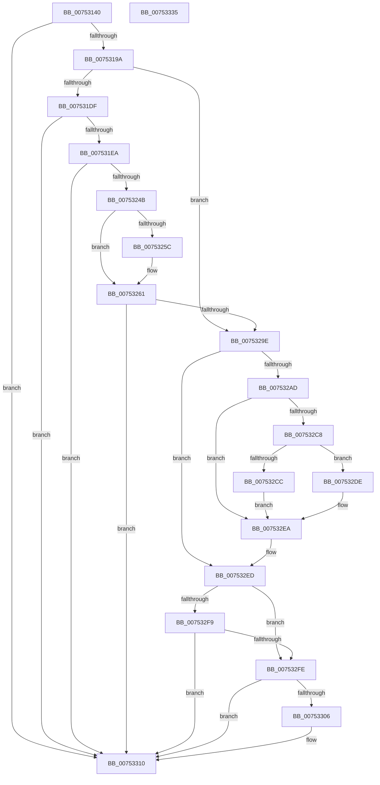

# PfpParametersWatcher

- RVA: `0x00753140`–`0x00753336` (길이 `502` bytes)
- VA: `0x0000000140753140`
- 실행 섹션: `PAGE`
- PDB 이름 있음: `예`; PDB Function 태그: `아니요`
- unwind 정보 RVA: `0x000CBC58`
- 디코드: `125`개 명령, `502/502` bytes 표시
- 미해석 바이트: `0` (있으면 어셈블리에 `.byte`로 보존)

> 이 문서는 커널 이미지의 기계어와 PDB 기호를 분석해 생성했습니다. 4번과 5번은 함수 원형과 자료형을 바이너리 사용 방식에서 추정한 C 해석이며 원본 소스 복구 결과는 아닙니다.

## 1. Dependencies

- 직접 호출 지점: **11**; 고유 호출 대상: **10**
- 직접 호출자로 확인된 함수: **0**
- RIP 상대 이미지 참조: **5**

### Outgoing calls
- `0x00753188` → [FsRtlAcquirePushLockExclusive](../../text/4A/FsRtlAcquirePushLockExclusive_function_004A05F4.md) (function, `0x004A05F4`)
- `0x007531D2` → [ZwNotifyChangeKey](../../text/6A/ZwNotifyChangeKey_function_006AF550.md) (function, `0x006AF550`)
- `0x007531F5` → [RtlInitUnicodeString](../../text/42/RtlInitUnicodeString_function_0042A780.md) (function, `0x0042A780`)
- `0x0075323E` → [ZwCreateKey](../../text/6A/ZwCreateKey_function_006AD470.md) (function, `0x006AD470`)
- `0x0075325C` → [ZwClose](../../text/6A/ZwClose_function_006AD2B0.md) (function, `0x006AD2B0`)
- `0x00753295` → [ZwNotifyChangeKey](../../text/6A/ZwNotifyChangeKey_function_006AF550.md) (function, `0x006AF550`)
- `0x007532A4` → [PfpParametersRead](PfpParametersRead_function_00752F70.md) (function, `0x00752F70`)
- `0x007532E5` → [PfpRpShutdown](PfpRpShutdown_function_00751C70.md) (function, `0x00751C70`)
- `0x007532F0` → [PfSnParametersRead](PfSnParametersRead_function_00752970.md) (function, `0x00752970`)
- `0x0075330B` → [KeSetEvent](../../text/33/KeSetEvent_function_0033F310.md) (function, `0x0033F310`)
- `0x00753313` → [PfLockExclusiveRelease](../../text/49/PfLockExclusiveRelease_function_00491D88.md) (function, `0x00491D88`)

### Direct callers
- 이 함수 시작 RVA로 연결되는 직접 call은 확인되지 않았습니다. 간접 호출은 완전히 역산할 수 없습니다.

### Static image references
- `0x007531EA` → RVA `0x00B01710` (` ?? ::NNGAKEGL::`string'`; read)
- `0x007532B5` → RVA `0x00E671E0` (`.data`; read)
- `0x007532CE` → RVA `0x00E671D0` (`.data`; read/write)
- `0x007532D5` → RVA `0x00E671E0` (`.data`; read/write)
- `0x007532DE` → RVA `0x00E67148` (`.data`; read)

## 2. Other-region calls and transfers

- 다른 실행 섹션으로 향하는 call: **8**
  - `0x00753188` → [FsRtlAcquirePushLockExclusive](../../text/4A/FsRtlAcquirePushLockExclusive_function_004A05F4.md) (`PAGE` → `.text`)
  - `0x007531D2` → [ZwNotifyChangeKey](../../text/6A/ZwNotifyChangeKey_function_006AF550.md) (`PAGE` → `.text`)
  - `0x007531F5` → [RtlInitUnicodeString](../../text/42/RtlInitUnicodeString_function_0042A780.md) (`PAGE` → `.text`)
  - `0x0075323E` → [ZwCreateKey](../../text/6A/ZwCreateKey_function_006AD470.md) (`PAGE` → `.text`)
  - `0x0075325C` → [ZwClose](../../text/6A/ZwClose_function_006AD2B0.md) (`PAGE` → `.text`)
  - `0x00753295` → [ZwNotifyChangeKey](../../text/6A/ZwNotifyChangeKey_function_006AF550.md) (`PAGE` → `.text`)
  - `0x0075330B` → [KeSetEvent](../../text/33/KeSetEvent_function_0033F310.md) (`PAGE` → `.text`)
  - `0x00753313` → [PfLockExclusiveRelease](../../text/49/PfLockExclusiveRelease_function_00491D88.md) (`PAGE` → `.text`)
- 별도 외부 분기/꼬리 이동을 확인하지 못했습니다.

## 3. Assembly (complete function range)

```asm
00753140  48 8B C4                        mov rax, rsp
00753143  48 89 58 10                     mov qword ptr [rax + 0x10], rbx
00753147  48 89 70 18                     mov qword ptr [rax + 0x18], rsi
0075314B  48 89 78 20                     mov qword ptr [rax + 0x20], rdi
0075314F  55                              push rbp
00753150  41 56                           push r14
00753152  41 57                           push r15
00753154  48 8D 68 A1                     lea rbp, [rax - 0x5f]
00753158  48 81 EC 90 00 00 00            sub rsp, 0x90
0075315F  0F 57 C0                        xorps xmm0, xmm0
00753162  48 8D B1 F8 01 00 00            lea rsi, [rcx + 0x1f8]
00753169  33 C0                           xor eax, eax
0075316B  48 8B D9                        mov rbx, rcx
0075316E  48 21 45 67                     and qword ptr [rbp + 0x67], rax
00753172  48 8B CE                        mov rcx, rsi
00753175  0F 11 45 07                     movups xmmword ptr [rbp + 7], xmm0
00753179  48 89 45 37                     mov qword ptr [rbp + 0x37], rax
0075317D  0F 11 45 17                     movups xmmword ptr [rbp + 0x17], xmm0
00753181  89 45 3F                        mov dword ptr [rbp + 0x3f], eax
00753184  0F 11 45 27                     movups xmmword ptr [rbp + 0x27], xmm0
00753188  E8 67 D4 D4 FF                  call 0x1404a05f4
0075318D  48 8B 4B 08                     mov rcx, qword ptr [rbx + 8]
00753191  48 85 C9                        test rcx, rcx
00753194  0F 84 76 01 00 00               je 0x140753310
0075319A  C6 44 24 48 01                  mov byte ptr [rsp + 0x48], 1
0075319F  48 8D 7B 40                     lea rdi, [rbx + 0x40]
007531A3  C7 44 24 40 04 00 00 00         mov dword ptr [rsp + 0x40], 4
007531AB  4C 8D 73 10                     lea r14, [rbx + 0x10]
007531AF  48 89 7C 24 38                  mov qword ptr [rsp + 0x38], rdi
007531B4  4C 8D 43 20                     lea r8, [rbx + 0x20]
007531B8  C6 44 24 30 00                  mov byte ptr [rsp + 0x30], 0
007531BD  41 B9 01 00 00 00               mov r9d, 1
007531C3  C7 44 24 28 0F 00 00 10         mov dword ptr [rsp + 0x28], 0x1000000f
007531CB  33 D2                           xor edx, edx
007531CD  4C 89 74 24 20                  mov qword ptr [rsp + 0x20], r14
007531D2  E8 79 C3 F5 FF                  call 0x1406af550
007531D7  85 C0                           test eax, eax
007531D9  0F 89 BF 00 00 00               jns 0x14075329e
007531DF  3D 7C 01 00 C0                  cmp eax, 0xc000017c
007531E4  0F 85 26 01 00 00               jne 0x140753310
007531EA  48 8D 15 1F E5 3A 00            lea rdx, [rip + 0x3ae51f]
007531F1  48 8D 4D 07                     lea rcx, [rbp + 7]
007531F5  E8 86 75 CD FF                  call 0x14042a780
007531FA  48 83 64 24 30 00               and qword ptr [rsp + 0x30], 0
00753200  48 8D 45 07                     lea rax, [rbp + 7]
00753204  83 64 24 28 00                  and dword ptr [rsp + 0x28], 0
00753209  4C 8D 45 17                     lea r8, [rbp + 0x17]
0075320D  48 83 65 1F 00                  and qword ptr [rbp + 0x1f], 0
00753212  48 8D 4D 67                     lea rcx, [rbp + 0x67]
00753216  48 83 64 24 20 00               and qword ptr [rsp + 0x20], 0
0075321C  0F 57 C0                        xorps xmm0, xmm0
0075321F  45 33 C9                        xor r9d, r9d
00753222  48 89 45 27                     mov qword ptr [rbp + 0x27], rax
00753226  BA 3F 00 0F 00                  mov edx, 0xf003f
0075322B  C7 45 17 30 00 00 00            mov dword ptr [rbp + 0x17], 0x30
00753232  F3 0F 7F 45 37                  movdqu xmmword ptr [rbp + 0x37], xmm0
00753237  C7 45 2F 40 02 00 00            mov dword ptr [rbp + 0x2f], 0x240
0075323E  E8 2D A2 F5 FF                  call 0x1406ad470
00753243  85 C0                           test eax, eax
00753245  0F 88 C5 00 00 00               js 0x140753310
0075324B  48 8B 4B 08                     mov rcx, qword ptr [rbx + 8]
0075324F  48 8B 45 67                     mov rax, qword ptr [rbp + 0x67]
00753253  48 89 43 08                     mov qword ptr [rbx + 8], rax
00753257  48 85 C9                        test rcx, rcx
0075325A  74 05                           je 0x140753261
0075325C  E8 4F A0 F5 FF                  call 0x1406ad2b0
00753261  48 8B 4B 08                     mov rcx, qword ptr [rbx + 8]
00753265  4C 8D 43 20                     lea r8, [rbx + 0x20]
00753269  C6 44 24 48 01                  mov byte ptr [rsp + 0x48], 1
0075326E  41 B9 01 00 00 00               mov r9d, 1
00753274  C7 44 24 40 04 00 00 00         mov dword ptr [rsp + 0x40], 4
0075327C  33 D2                           xor edx, edx
0075327E  48 89 7C 24 38                  mov qword ptr [rsp + 0x38], rdi
00753283  C6 44 24 30 00                  mov byte ptr [rsp + 0x30], 0
00753288  C7 44 24 28 0F 00 00 10         mov dword ptr [rsp + 0x28], 0x1000000f
00753290  4C 89 74 24 20                  mov qword ptr [rsp + 0x20], r14
00753295  E8 B6 C2 F5 FF                  call 0x1406af550
0075329A  85 C0                           test eax, eax
0075329C  78 72                           js 0x140753310
0075329E  48 8B CB                        mov rcx, rbx
007532A1  40 32 FF                        xor dil, dil
007532A4  E8 C7 FC FF FF                  call 0x140752f70
007532A9  85 C0                           test eax, eax
007532AB  78 40                           js 0x1407532ed
007532AD  8B 53 44                        mov edx, dword ptr [rbx + 0x44]
007532B0  B9 00 00 00 00                  mov ecx, 0
007532B5  8B 05 25 3F 71 00               mov eax, dword ptr [rip + 0x713f25]
007532BB  83 E2 02                        and edx, 2
007532BE  0F 95 C1                        setne cl
007532C1  83 E0 01                        and eax, 1
007532C4  3B C8                           cmp ecx, eax
007532C6  74 22                           je 0x1407532ea
007532C8  85 D2                           test edx, edx
007532CA  74 12                           je 0x1407532de
007532CC  33 C0                           xor eax, eax
007532CE  48 87 05 FB 3E 71 00            xchg qword ptr [rip + 0x713efb], rax
007532D5  83 0D 04 3F 71 00 01            or dword ptr [rip + 0x713f04], 1
007532DC  EB 0C                           jmp 0x1407532ea
007532DE  48 8D 0D 63 3E 71 00            lea rcx, [rip + 0x713e63]
007532E5  E8 86 E9 FF FF                  call 0x140751c70
007532EA  40 B7 01                        mov dil, 1
007532ED  48 8B CB                        mov rcx, rbx
007532F0  E8 7B F6 FF FF                  call 0x140752970
007532F5  85 C0                           test eax, eax
007532F7  79 05                           jns 0x1407532fe
007532F9  40 84 FF                        test dil, dil
007532FC  74 12                           je 0x140753310
007532FE  48 8B 0B                        mov rcx, qword ptr [rbx]
00753301  48 85 C9                        test rcx, rcx
00753304  74 0A                           je 0x140753310
00753306  45 33 C0                        xor r8d, r8d
00753309  33 D2                           xor edx, edx
0075330B  E8 00 C0 BE FF                  call 0x14033f310
00753310  48 8B CE                        mov rcx, rsi
00753313  E8 70 EA D3 FF                  call 0x140491d88
00753318  4C 8D 9C 24 90 00 00 00         lea r11, [rsp + 0x90]
00753320  49 8B 5B 28                     mov rbx, qword ptr [r11 + 0x28]
00753324  49 8B 73 30                     mov rsi, qword ptr [r11 + 0x30]
00753328  49 8B 7B 38                     mov rdi, qword ptr [r11 + 0x38]
0075332C  49 8B E3                        mov rsp, r11
0075332F  41 5F                           pop r15
00753331  41 5E                           pop r14
00753333  5D                              pop rbp
00753334  C3                              ret
00753335  CC                              int3
```

## 4. C-style interpretation (structured pseudocode)

```c
__int64 __fastcall PfpParametersWatcher(__int64 a1, int a2)
{
    __int64 result;
    __int64 v_rdi;
    __int64 v_rsp;
    unsigned __int64 v_stack_m18;
    unsigned __int8 v_stack_m60;
    unsigned int v_stack_m68;
    unsigned __int64 v_stack_m70;
    unsigned __int8 v_stack_m78;
    unsigned int v_stack_m80;
    unsigned __int64 v_stack_m88;

    *(unsigned __int64 *)(v_rsp + 16) = v_rbx;
    *(unsigned __int64 *)(v_rsp + 24) = v_rsi;
    *(unsigned __int64 *)(v_rsp + 32) = v_rdi;
    v_rsp = (v_rsp) - (144);
    result = 0;
    *(unsigned __int64 *)(v_rsp - 95 + 7) = v_xmm0;
    *(unsigned __int64 *)(v_rsp - 95 + 55) = 0;
    *(unsigned __int64 *)(v_rsp - 95 + 23) = v_xmm0;
    *(unsigned int *)(v_rsp - 95 + 63) = 0;
    *(unsigned __int64 *)(v_rsp - 95 + 39) = v_xmm0;
    result = FsRtlAcquirePushLockExclusive(a1 + 504, a2, a3, a4);
    if (*(unsigned __int64 *)(a1 + 8) == 0) goto loc_00753310;
    v_stack_m60 = 1;
    v_stack_m68 = 4;
    v_stack_m70 = a1 + 64;
    v_stack_m78 = 0;
    v_stack_m80 = 0x1000000FULL;
    a2 = 0;
    v_stack_m88 = a1 + 16;
    result = ZwNotifyChangeKey(*(unsigned __int64 *)(a1 + 8), a2, a1 + 32, 1);
    if (!sign_flag) goto loc_0075329E;
    if (((unsigned int)(result)) != 0xC000017CULL) goto loc_00753310;
    result = RtlInitUnicodeString(v_rsp - 95 + 7, v_rip + 3859743, a1 + 32, 1);
    a4 = 0;
    *(unsigned __int64 *)(v_rsp - 95 + 39) = v_rsp - 95 + 7;
    *(unsigned int *)(v_rsp - 95 + 23) = 48;
    *(unsigned __int64 *)(v_rsp - 95 + 55) = v_xmm0;
    *(unsigned int *)(v_rsp - 95 + 47) = 576;
    result = ZwCreateKey(v_rsp - 95 + 103, (unsigned int)(0xF003FULL), v_rsp - 95 + 23, a4);
    if (sign_flag) goto loc_00753310;
    *(unsigned __int64 *)(a1 + 8) = *(unsigned __int64 *)(v_rsp - 95 + 103);
    result = *(unsigned __int64 *)(v_rsp - 95 + 103);
    if (*(unsigned __int64 *)(a1 + 8) != 0) {
        result = ZwClose(*(unsigned __int64 *)(a1 + 8), (unsigned int)(0xF003FULL), v_rsp - 95 + 23, a4);
    }
    v_stack_m60 = 1;
    v_stack_m68 = 4;
    a2 = 0;
    v_stack_m70 = a1 + 64;
    v_stack_m78 = 0;
    v_stack_m80 = 0x1000000FULL;
    v_stack_m88 = a1 + 16;
    result = ZwNotifyChangeKey(*(unsigned __int64 *)(a1 + 8), a2, a1 + 32, 1);
    if (sign_flag) goto loc_00753310;
loc_0075329E:
    v_rdi = 0;
    result = PfpParametersRead(a1, a2, a1 + 32, 1);
    if (sign_flag) goto loc_007532ED;
    a2 = (unsigned int)(((unsigned int)(*(unsigned int *)(a1 + 68))) & (2));
    a1 = (condition_is_not_equal) ? 1 : 0;
    result = (unsigned int)(((unsigned int)(*(unsigned int *)(v_rip + 7421733))) & (1));
    if (((unsigned int)(a1)) == ((unsigned int)(result))) goto loc_007532EA;
    if (a2 == 0) goto loc_007532DE;
    result = 0;
    goto loc_007532EA;
loc_007532DE:
    result = PfpRpShutdown(v_rip + 7421539, a2, a1 + 32, 1);
loc_007532EA:
loc_007532ED:
    result = PfSnParametersRead(a1, a2, a1 + 32, 1);
    if (!sign_flag) goto loc_007532FE;
    if (1 == 0) goto loc_00753310;
loc_007532FE:
    if (*(unsigned __int64 *)(a1) != 0) {
        a3 = 0;
        a2 = 0;
        result = KeSetEvent(*(unsigned __int64 *)(a1), a2, a3, 1);
    }
    result = PfLockExclusiveRelease(a1 + 504, a2, a3, 1);
    return result;
}
```

## 5. (Beta) C Style

```c
int64_t PfpParametersWatcher(void *Arg1, int32_t Arg2)
{
    uint8_t *arg1 = (uint8_t *)Arg1;

    int64_t result;
    int64_t local_rdi;
    int64_t local_rsp;
    uint64_t v_stack_m18;
    uint8_t v_stack_m60;
    uint32_t v_stack_m68;
    uint64_t v_stack_m70;
    uint8_t v_stack_m78;
    uint32_t v_stack_m80;
    uint64_t v_stack_m88;

    *(uint64_t *)(local_rsp + 0x10) = local_rbx;
    *(uint64_t *)(local_rsp + 0x18) = local_rsi;
    *(uint64_t *)(local_rsp + 0x20) = local_rdi;
    local_rsp = (local_rsp) - (144);
    result = 0;
    *(uint64_t *)(local_rsp - 0x5F + 0x7) = v_xmm0;
    *(uint64_t *)(local_rsp - 0x5F + 0x37) = 0;
    *(uint64_t *)(local_rsp - 0x5F + 0x17) = v_xmm0;
    *(uint32_t *)(local_rsp - 0x5F + 0x3F) = 0;
    *(uint64_t *)(local_rsp - 0x5F + 0x27) = v_xmm0;
    result = FsRtlAcquirePushLockExclusive(Arg1 + 504, Arg2, a3, a4);
    if (*(uint64_t *)(arg1 + 0x8) == 0) goto loc_00753310;
    v_stack_m60 = 1;
    v_stack_m68 = 4;
    v_stack_m70 = Arg1 + 64;
    v_stack_m78 = 0;
    v_stack_m80 = 0x1000000FULL;
    Arg2 = 0;
    v_stack_m88 = Arg1 + 16;
    result = ZwNotifyChangeKey(*(uint64_t *)(arg1 + 0x8), Arg2, Arg1 + 32, 1);
    if (!sign_flag) goto loc_0075329E;
    if (((uint32_t)(result)) != 0xC000017CULL) goto loc_00753310;
    result = RtlInitUnicodeString(local_rsp - 95 + 7, v_rip + 3859743, Arg1 + 32, 1);
    a4 = 0;
    *(uint64_t *)(local_rsp - 0x5F + 0x27) = local_rsp - 95 + 7;
    *(uint32_t *)(local_rsp - 0x5F + 0x17) = 48;
    *(uint64_t *)(local_rsp - 0x5F + 0x37) = v_xmm0;
    *(uint32_t *)(local_rsp - 0x5F + 0x2F) = 576;
    result = ZwCreateKey(local_rsp - 95 + 103, (uint32_t)(0xF003FULL), local_rsp - 95 + 23, a4);
    if (sign_flag) goto loc_00753310;
    *(uint64_t *)(arg1 + 0x8) = *(uint64_t *)(local_rsp - 0x5F + 0x67);
    result = *(uint64_t *)(local_rsp - 0x5F + 0x67);
    if (*(uint64_t *)(arg1 + 0x8) != 0) {
        result = ZwClose(*(uint64_t *)(arg1 + 0x8), (uint32_t)(0xF003FULL), local_rsp - 95 + 23, a4);
    }
    v_stack_m60 = 1;
    v_stack_m68 = 4;
    Arg2 = 0;
    v_stack_m70 = Arg1 + 64;
    v_stack_m78 = 0;
    v_stack_m80 = 0x1000000FULL;
    v_stack_m88 = Arg1 + 16;
    result = ZwNotifyChangeKey(*(uint64_t *)(arg1 + 0x8), Arg2, Arg1 + 32, 1);
    if (sign_flag) goto loc_00753310;
loc_0075329E:
    local_rdi = 0;
    result = PfpParametersRead(Arg1, Arg2, Arg1 + 32, 1);
    if (sign_flag) goto loc_007532ED;
    Arg2 = (uint32_t)(((uint32_t)(*(uint32_t *)(arg1 + 0x44))) & (2));
    Arg1 = (condition_is_not_equal) ? 1 : 0;
    result = (uint32_t)(((uint32_t)(*(uint32_t *)(v_rip + 0x713F25))) & (1));
    if (((uint32_t)(Arg1)) == ((uint32_t)(result))) goto loc_007532EA;
    if (Arg2 == 0) goto loc_007532DE;
    result = 0;
    goto loc_007532EA;
loc_007532DE:
    result = PfpRpShutdown(v_rip + 7421539, Arg2, Arg1 + 32, 1);
loc_007532EA:
loc_007532ED:
    result = PfSnParametersRead(Arg1, Arg2, Arg1 + 32, 1);
    if (!sign_flag) goto loc_007532FE;
    if (1 == 0) goto loc_00753310;
loc_007532FE:
    if (*(uint64_t *)(arg1) != 0) {
        a3 = 0;
        Arg2 = 0;
        result = KeSetEvent(*(uint64_t *)(arg1), Arg2, a3, 1);
    }
    result = PfLockExclusiveRelease(Arg1 + 504, Arg2, a3, 1);
    return result;
}
```

### 관측된 메모리 오프셋

구조체 형식이 확인되지 않은 접근은 인자 기준의 오프셋으로만 기록했습니다.

| 기준 인자 | 오프셋 표현 | 폭 (bit) | 접근 |
|---|---:|---:|---|
| `Arg1` | `+ 0x0` | `64` | `R` |
| `Arg1` | `+ 0x8` | `64` | `R` |
| `Arg1` | `+ 0x8` | `64` | `W` |
| `Arg1` | `+ 0x10` | `64` | `R` |
| `Arg1` | `+ 0x20` | `64` | `R` |
| `Arg1` | `+ 0x40` | `64` | `R` |
| `Arg1` | `+ 0x44` | `32` | `R` |
| `Arg1` | `+ 0x1F8` | `64` | `R` |

## 6. Execution-region graph

[열기: 2D/3D 그래프와 함수 탐색 컨트롤 패널](../../../control-panel.html?section=page&rva=0x00753140&view=graph)

- 2D 그래프는 위에서 아래로 흐르고, 3D 그래프는 빈 공간을 드래그해 회전합니다. Shift+드래그는 이동, 휠은 확대·축소, 함수 노드 선택은 대상 보고서 이동입니다.

### Static fallback


