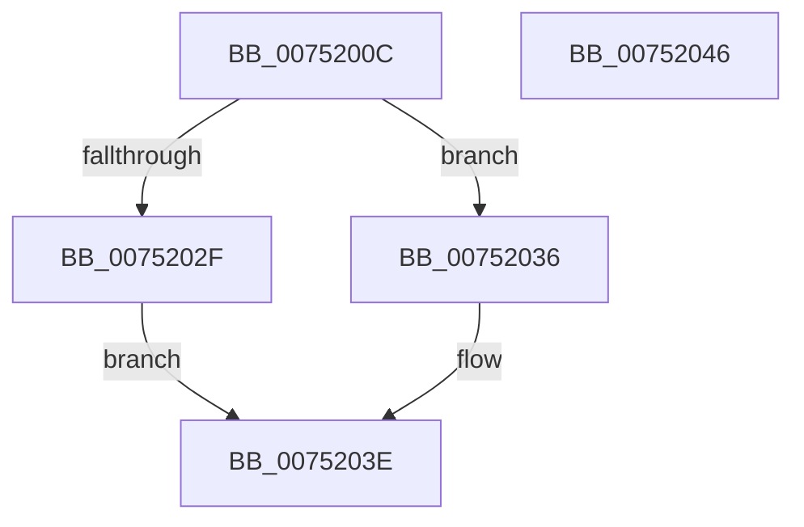

# PfpPartitionAllocateState

- RVA: `0x0075200C`–`0x00752047` (길이 `59` bytes)
- VA: `0x000000014075200C`
- 실행 섹션: `PAGE`
- PDB 이름 있음: `예`; PDB Function 태그: `아니요`
- unwind 정보 RVA: `0x0005CF00`
- 디코드: `19`개 명령, `59/59` bytes 표시
- 미해석 바이트: `0` (있으면 어셈블리에 `.byte`로 보존)

> 이 문서는 커널 이미지의 기계어와 PDB 기호를 분석해 생성했습니다. 4번과 5번은 함수 원형과 자료형을 바이너리 사용 방식에서 추정한 C 해석이며 원본 소스 복구 결과는 아닙니다.

## 1. Dependencies

- 직접 호출 지점: **2**; 고유 호출 대상: **2**
- 직접 호출자로 확인된 함수: **1**
- RIP 상대 이미지 참조: **0**

### Outgoing calls
- `0x0075201F` → [ExAllocateCacheAwareRundownProtection](../9A/ExAllocateCacheAwareRundownProtection_function_009A5790.md) (function, `0x009A5790`)
- `0x00752039` → [ExWaitForRundownProtectionReleaseCacheAware](../../text/46/ExWaitForRundownProtectionReleaseCacheAware_function_004643A0.md) (function, `0x004643A0`)

### Direct callers
- [PfpPartitionCreate](../../text/5C/PfpPartitionCreate_function_005CDE8C.md) at `0x005CDF58`

### Static image references
- 디코드된 RIP-relative 메모리 참조가 없습니다.

## 2. Other-region calls and transfers

- 다른 실행 섹션으로 향하는 call: **1**
  - `0x00752039` → [ExWaitForRundownProtectionReleaseCacheAware](../../text/46/ExWaitForRundownProtectionReleaseCacheAware_function_004643A0.md) (`PAGE` → `.text`)
- 별도 외부 분기/꼬리 이동을 확인하지 못했습니다.

## 3. Assembly (complete function range)

```asm
0075200C  40 53                           push rbx
0075200E  48 83 EC 20                     sub rsp, 0x20
00752012  48 8B D9                        mov rbx, rcx
00752015  BA 50 66 50 74                  mov edx, 0x74506650
0075201A  B9 00 02 00 00                  mov ecx, 0x200
0075201F  E8 6C 37 25 00                  call 0x1409a5790
00752024  48 89 43 10                     mov qword ptr [rbx + 0x10], rax
00752028  33 DB                           xor ebx, ebx
0075202A  48 85 C0                        test rax, rax
0075202D  75 07                           jne 0x140752036
0075202F  BB 9A 00 00 C0                  mov ebx, 0xc000009a
00752034  EB 08                           jmp 0x14075203e
00752036  48 8B C8                        mov rcx, rax
00752039  E8 62 23 D1 FF                  call 0x1404643a0
0075203E  8B C3                           mov eax, ebx
00752040  48 83 C4 20                     add rsp, 0x20
00752044  5B                              pop rbx
00752045  C3                              ret
00752046  CC                              int3
```

## 4. C-style interpretation (structured pseudocode)

```c
__int64 __fastcall PfpPartitionAllocateState(__int64 a1)
{
    __int64 result;
    __int64 v_rbx;
    __int64 v_rsp;

    v_rsp = (v_rsp) - (32);
    result = ExAllocateCacheAwareRundownProtection(512, (unsigned int)(0x74506650ULL), a3, a4);
    *(unsigned __int64 *)(a1 + 16) = result;
    v_rbx = 0;
    if (result != 0) goto loc_00752036;
    goto loc_0075203E;
loc_00752036:
    result = ExWaitForRundownProtectionReleaseCacheAware(result, (unsigned int)(0x74506650ULL), a3, a4);
loc_0075203E:
    v_rsp = (v_rsp) + (32);
    return (unsigned int)((unsigned int)((unsigned int)(0xC000009AULL)));
}
```

## 5. (Beta) C Style

```c
int64_t PfpPartitionAllocateState(void *Arg1)
{
    uint8_t *arg1 = (uint8_t *)Arg1;

    int64_t result;
    int64_t local_rbx;
    int64_t local_rsp;

    local_rsp = (local_rsp) - (32);
    result = ExAllocateCacheAwareRundownProtection(512, (uint32_t)(0x74506650ULL), a3, a4);
    *(uint64_t *)(arg1 + 0x10) = result;
    local_rbx = 0;
    if (result != 0) goto loc_00752036;
    goto loc_0075203E;
loc_00752036:
    result = ExWaitForRundownProtectionReleaseCacheAware(result, (uint32_t)(0x74506650ULL), a3, a4);
loc_0075203E:
    local_rsp = (local_rsp) + (32);
    return (uint32_t)((uint32_t)((uint32_t)(0xC000009AULL)));
}
```

### 관측된 메모리 오프셋

구조체 형식이 확인되지 않은 접근은 인자 기준의 오프셋으로만 기록했습니다.

| 기준 인자 | 오프셋 표현 | 폭 (bit) | 접근 |
|---|---:|---:|---|
| `Arg1` | `+ 0x10` | `64` | `W` |

## 6. Execution-region graph

[열기: 2D/3D 그래프와 함수 탐색 컨트롤 패널](../../../control-panel.html?section=page&rva=0x0075200C&view=graph)

- 2D 그래프는 위에서 아래로 흐르고, 3D 그래프는 빈 공간을 드래그해 회전합니다. Shift+드래그는 이동, 휠은 확대·축소, 함수 노드 선택은 대상 보고서 이동입니다.

### Static fallback


