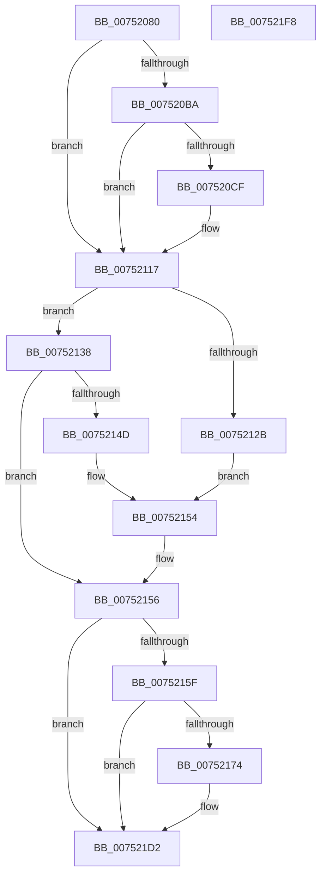

# PfpPartitionFindOrCreate

- RVA: `0x00752080`–`0x007521F9` (길이 `377` bytes)
- VA: `0x0000000140752080`
- 실행 섹션: `PAGE`
- PDB 이름 있음: `예`; PDB Function 태그: `아니요`
- unwind 정보 RVA: `0x000CBBC0`
- 디코드: `95`개 명령, `377/377` bytes 표시
- 미해석 바이트: `0` (있으면 어셈블리에 `.byte`로 보존)

> 이 문서는 커널 이미지의 기계어와 PDB 기호를 분석해 생성했습니다. 4번과 5번은 함수 원형과 자료형을 바이너리 사용 방식에서 추정한 C 해석이며 원본 소스 복구 결과는 아닙니다.

## 1. Dependencies

- 직접 호출 지점: **10**; 고유 호출 대상: **7**
- 직접 호출자로 확인된 함수: **1**
- RIP 상대 이미지 참조: **4**

### Outgoing calls
- `0x007520C6` → [tlgKeywordOn](../../text/42/tlgKeywordOn_function_0042EAA0.md) (function, `0x0042EAA0`)
- `0x007520D2` → [PfpTraceLogPartitionId](../../text/5C/PfpTraceLogPartitionId_function_005CE1B0.md) (function, `0x005CE1B0`)
- `0x00752112` → [tlgWriteTransfer_EtwWriteTransfer](../../text/42/tlgWriteTransfer_EtwWriteTransfer_function_004260E0.md) (function, `0x004260E0`)
- `0x0075211A` → [MiReadReverseMapAttributes](../../text/4A/MiReadReverseMapAttributes_function_004A32D4.md) (function, `0x004A32D4`)
- `0x0075212E` → [PfpPartitionRundownProtectionAcquire](../../text/48/PfpPartitionRundownProtectionAcquire_function_0048402C.md) (function, `0x0048402C`)
- `0x00752142` → [PfpPartitionCreate](../../text/5C/PfpPartitionCreate_function_005CDE8C.md) (function, `0x005CDE8C`)
- `0x0075216B` → [tlgKeywordOn](../../text/42/tlgKeywordOn_function_0042EAA0.md) (function, `0x0042EAA0`)
- `0x00752177` → [PfpTraceLogPartitionId](../../text/5C/PfpTraceLogPartitionId_function_005CE1B0.md) (function, `0x005CE1B0`)
- `0x007521CD` → [tlgWriteTransfer_EtwWriteTransfer](../../text/42/tlgWriteTransfer_EtwWriteTransfer_function_004260E0.md) (function, `0x004260E0`)
- `0x007521DB` → [_security_check_cookie](../../text/6A/_security_check_cookie_function_006AC640.md) (function, `0x006AC640`)

### Direct callers
- [PfSetSuperfetchInformation](../AD/PfSetSuperfetchInformation_function_00ADE6E8.md) at `0x00ADEFD1`

### Static image references
- `0x0075209A` → RVA `0x00E0A740` (`.data`; read)
- `0x007520A8` → RVA `0x00E074D8` (`.data`; read)
- `0x007520DB` → RVA `0x00048B4B` (`.rdata`; read)
- `0x00752180` → RVA `0x000489FF` (`.rdata`; read)

## 2. Other-region calls and transfers

- 다른 실행 섹션으로 향하는 call: **10**
  - `0x007520C6` → [tlgKeywordOn](../../text/42/tlgKeywordOn_function_0042EAA0.md) (`PAGE` → `.text`)
  - `0x007520D2` → [PfpTraceLogPartitionId](../../text/5C/PfpTraceLogPartitionId_function_005CE1B0.md) (`PAGE` → `.text`)
  - `0x00752112` → [tlgWriteTransfer_EtwWriteTransfer](../../text/42/tlgWriteTransfer_EtwWriteTransfer_function_004260E0.md) (`PAGE` → `.text`)
  - `0x0075211A` → [MiReadReverseMapAttributes](../../text/4A/MiReadReverseMapAttributes_function_004A32D4.md) (`PAGE` → `.text`)
  - `0x0075212E` → [PfpPartitionRundownProtectionAcquire](../../text/48/PfpPartitionRundownProtectionAcquire_function_0048402C.md) (`PAGE` → `.text`)
  - `0x00752142` → [PfpPartitionCreate](../../text/5C/PfpPartitionCreate_function_005CDE8C.md) (`PAGE` → `.text`)
  - `0x0075216B` → [tlgKeywordOn](../../text/42/tlgKeywordOn_function_0042EAA0.md) (`PAGE` → `.text`)
  - `0x00752177` → [PfpTraceLogPartitionId](../../text/5C/PfpTraceLogPartitionId_function_005CE1B0.md) (`PAGE` → `.text`)
  - `0x007521CD` → [tlgWriteTransfer_EtwWriteTransfer](../../text/42/tlgWriteTransfer_EtwWriteTransfer_function_004260E0.md) (`PAGE` → `.text`)
  - `0x007521DB` → [_security_check_cookie](../../text/6A/_security_check_cookie_function_006AC640.md) (`PAGE` → `.text`)
- 별도 외부 분기/꼬리 이동을 확인하지 못했습니다.

## 3. Assembly (complete function range)

```asm
00752080  48 89 5C 24 10                  mov qword ptr [rsp + 0x10], rbx
00752085  48 89 74 24 20                  mov qword ptr [rsp + 0x20], rsi
0075208A  55                              push rbp
0075208B  57                              push rdi
0075208C  41 56                           push r14
0075208E  48 8D 6C 24 B9                  lea rbp, [rsp - 0x47]
00752093  48 81 EC 90 00 00 00            sub rsp, 0x90
0075209A  48 8B 05 9F 86 6B 00            mov rax, qword ptr [rip + 0x6b869f]
007520A1  48 33 C4                        xor rax, rsp
007520A4  48 89 45 37                     mov qword ptr [rbp + 0x37], rax
007520A8  83 3D 29 54 6B 00 04            cmp dword ptr [rip + 0x6b5429], 4
007520AF  49 8B F8                        mov rdi, r8
007520B2  4C 8B F2                        mov r14, rdx
007520B5  48 8B F1                        mov rsi, rcx
007520B8  76 5D                           jbe 0x140752117
007520BA  BA 01 00 00 00                  mov edx, 1
007520BF  48 8D 0D 12 54 6B 00            lea rcx, [rip + 0x6b5412]
007520C6  E8 D5 C9 CD FF                  call 0x14042eaa0
007520CB  84 C0                           test al, al
007520CD  74 48                           je 0x140752117
007520CF  49 8B C8                        mov rcx, r8
007520D2  E8 D9 C0 E7 FF                  call 0x1405ce1b0
007520D7  83 65 23 00                     and dword ptr [rbp + 0x23], 0
007520DB  48 8D 15 69 6A 8F FF            lea rdx, [rip - 0x709597]
007520E2  89 45 E7                        mov dword ptr [rbp - 0x19], eax
007520E5  48 8D 0D EC 53 6B 00            lea rcx, [rip + 0x6b53ec]
007520EC  48 8D 45 E7                     lea rax, [rbp - 0x19]
007520F0  C7 45 1F 04 00 00 00            mov dword ptr [rbp + 0x1f], 4
007520F7  48 89 45 17                     mov qword ptr [rbp + 0x17], rax
007520FB  45 33 C9                        xor r9d, r9d
007520FE  48 8D 45 F7                     lea rax, [rbp - 9]
00752102  45 33 C0                        xor r8d, r8d
00752105  48 89 44 24 28                  mov qword ptr [rsp + 0x28], rax
0075210A  C7 44 24 20 03 00 00 00         mov dword ptr [rsp + 0x20], 3
00752112  E8 C9 3F CD FF                  call 0x1404260e0
00752117  48 8B CF                        mov rcx, rdi
0075211A  E8 B5 11 D5 FF                  call 0x1404a32d4
0075211F  48 89 45 EF                     mov qword ptr [rbp - 0x11], rax
00752123  48 8B D8                        mov rbx, rax
00752126  48 85 C0                        test rax, rax
00752129  74 0D                           je 0x140752138
0075212B  48 8B C8                        mov rcx, rax
0075212E  E8 F9 1E D3 FF                  call 0x14048402c
00752133  48 89 1E                        mov qword ptr [rsi], rbx
00752136  EB 1C                           jmp 0x140752154
00752138  4C 8B C7                        mov r8, rdi
0075213B  48 8D 4D EF                     lea rcx, [rbp - 0x11]
0075213F  49 8B D6                        mov rdx, r14
00752142  E8 45 BD E7 FF                  call 0x1405cde8c
00752147  8B D8                           mov ebx, eax
00752149  85 C0                           test eax, eax
0075214B  78 09                           js 0x140752156
0075214D  48 8B 45 EF                     mov rax, qword ptr [rbp - 0x11]
00752151  48 89 06                        mov qword ptr [rsi], rax
00752154  33 DB                           xor ebx, ebx
00752156  83 3D 7B 53 6B 00 04            cmp dword ptr [rip + 0x6b537b], 4
0075215D  76 73                           jbe 0x1407521d2
0075215F  BA 01 00 00 00                  mov edx, 1
00752164  48 8D 0D 6D 53 6B 00            lea rcx, [rip + 0x6b536d]
0075216B  E8 30 C9 CD FF                  call 0x14042eaa0
00752170  84 C0                           test al, al
00752172  74 5E                           je 0x1407521d2
00752174  48 8B CF                        mov rcx, rdi
00752177  E8 34 C0 E7 FF                  call 0x1405ce1b0
0075217C  83 65 23 00                     and dword ptr [rbp + 0x23], 0
00752180  48 8D 15 78 68 8F FF            lea rdx, [rip - 0x709788]
00752187  83 65 33 00                     and dword ptr [rbp + 0x33], 0
0075218B  48 8D 0D 46 53 6B 00            lea rcx, [rip + 0x6b5346]
00752192  89 45 E7                        mov dword ptr [rbp - 0x19], eax
00752195  45 33 C9                        xor r9d, r9d
00752198  48 8D 45 E7                     lea rax, [rbp - 0x19]
0075219C  C7 45 1F 04 00 00 00            mov dword ptr [rbp + 0x1f], 4
007521A3  48 89 45 17                     mov qword ptr [rbp + 0x17], rax
007521A7  45 33 C0                        xor r8d, r8d
007521AA  48 8D 45 EF                     lea rax, [rbp - 0x11]
007521AE  89 5D EF                        mov dword ptr [rbp - 0x11], ebx
007521B1  48 89 45 27                     mov qword ptr [rbp + 0x27], rax
007521B5  48 8D 45 F7                     lea rax, [rbp - 9]
007521B9  48 89 44 24 28                  mov qword ptr [rsp + 0x28], rax
007521BE  C7 44 24 20 04 00 00 00         mov dword ptr [rsp + 0x20], 4
007521C6  C7 45 2F 04 00 00 00            mov dword ptr [rbp + 0x2f], 4
007521CD  E8 0E 3F CD FF                  call 0x1404260e0
007521D2  8B C3                           mov eax, ebx
007521D4  48 8B 4D 37                     mov rcx, qword ptr [rbp + 0x37]
007521D8  48 33 CC                        xor rcx, rsp
007521DB  E8 60 A4 F5 FF                  call 0x1406ac640
007521E0  4C 8D 9C 24 90 00 00 00         lea r11, [rsp + 0x90]
007521E8  49 8B 5B 28                     mov rbx, qword ptr [r11 + 0x28]
007521EC  49 8B 73 38                     mov rsi, qword ptr [r11 + 0x38]
007521F0  49 8B E3                        mov rsp, r11
007521F3  41 5E                           pop r14
007521F5  5F                              pop rdi
007521F6  5D                              pop rbp
007521F7  C3                              ret
007521F8  CC                              int3
```

## 4. C-style interpretation (structured pseudocode)

```c
__int64 __fastcall PfpPartitionFindOrCreate(__int64 a1, __int64 a2, __int64 a3, int a4)
{
    __int64 result;
    __int64 v_rbx;
    __int64 v_rsp;
    unsigned __int64 v_stack_m18;
    unsigned __int64 v_stack_m28;
    unsigned int v_stack_m2C;
    unsigned int v_stack_m30;
    unsigned __int64 v_stack_m38;
    unsigned int v_stack_m3C;
    unsigned int v_stack_m40;
    unsigned __int64 v_stack_m48;
    unsigned __int64 v_stack_m5F;
    unsigned __int64 v_stack_m68;
    unsigned __int64 v_stack_m70;
    unsigned int v_stack_m78;
    unsigned __int64 v_stack_m80;
    unsigned int v_stack_m88;
    unsigned __int64 v_stack_p10;
    unsigned __int64 v_stack_p20;

    v_stack_p10 = v_rbx;
    v_stack_p20 = v_rsi;
    v_rsp = (v_rsp) - (144);
    result = (*(unsigned __int64 *)(v_rip + 7046815)) ^ (v_rsp);
    v_stack_m28 = result;
    if ((*(unsigned int *)(v_rip + 7033897)) <= 4) goto loc_00752117;
    result = tlgKeywordOn(v_rip + 7033874, 1, a3, a4);
    if ((unsigned __int8)(result) != 0) {
        a1 = a3;
        result = PfpTraceLogPartitionId(a1, 1, a3, a4);
        a2 = v_rip - 7378327;
        v_stack_m78 = (unsigned int)(result);
        a1 = v_rip + 7033836;
        result = v_stack_m78;
        v_stack_m40 = 4;
        v_stack_m48 = result;
        a4 = 0;
        result = v_stack_m68;
        a3 = 0;
        v_stack_m80 = result;
        v_stack_m88 = 3;
        result = tlgWriteTransfer_EtwWriteTransfer(a1, a2, a3, a4);
    }
    result = MiReadReverseMapAttributes(0, a2, a3, a4);
    v_stack_m70 = result;
    if (result == 0) goto loc_00752138;
    result = PfpPartitionRundownProtectionAcquire(result, a2, a3, a4);
    *(unsigned __int64 *)(a1) = result;
    goto loc_00752154;
loc_00752138:
    result = PfpPartitionCreate(v_stack_m70, a2, 0, a4);
    if (sign_flag) goto loc_00752156;
    *(unsigned __int64 *)(a1) = v_stack_m70;
loc_00752154:
    v_rbx = 0;
loc_00752156:
    if ((*(unsigned int *)(v_rip + 7033723)) <= 4) goto loc_007521D2;
    result = tlgKeywordOn(v_rip + 7033709, 1, 0, a4);
    if ((unsigned __int8)(result) != 0) {
        a1 = 0;
        result = PfpTraceLogPartitionId(a1, 1, 0, a4);
        a2 = v_rip - 7378824;
        a1 = v_rip + 7033670;
        v_stack_m78 = (unsigned int)(result);
        a4 = 0;
        result = v_stack_m78;
        v_stack_m40 = 4;
        v_stack_m48 = result;
        a3 = 0;
        result = v_stack_m70;
        v_stack_m70 = 0;
        v_stack_m38 = result;
        result = v_stack_m68;
        v_stack_m80 = result;
        v_stack_m88 = 4;
        v_stack_m30 = 4;
        result = tlgWriteTransfer_EtwWriteTransfer(a1, a2, a3, a4);
    }
    a1 = (v_stack_m28) ^ (v_rsp);
    result = _security_check_cookie(a1, a2, a3, a4);
    return result;
}
```

## 5. (Beta) C Style

```c
int64_t PfpPartitionFindOrCreate(void *Arg1, int64_t Arg2, int64_t Arg3, int32_t Arg4)
{
    uint8_t *arg1 = (uint8_t *)Arg1;

    int64_t result;
    int64_t local_rbx;
    int64_t local_rsp;
    uint64_t v_stack_m18;
    uint64_t v_stack_m28;
    uint32_t v_stack_m2C;
    uint32_t v_stack_m30;
    uint64_t v_stack_m38;
    uint32_t v_stack_m3C;
    uint32_t v_stack_m40;
    uint64_t v_stack_m48;
    uint64_t v_stack_m5F;
    uint64_t v_stack_m68;
    uint64_t v_stack_m70;
    uint32_t v_stack_m78;
    uint64_t v_stack_m80;
    uint32_t v_stack_m88;
    uint64_t v_stack_p10;
    uint64_t v_stack_p20;

    v_stack_p10 = local_rbx;
    v_stack_p20 = local_rsi;
    local_rsp = (local_rsp) - (144);
    result = (*(uint64_t *)(v_rip + 0x6B869F)) ^ (local_rsp);
    v_stack_m28 = result;
    if ((*(uint32_t *)(v_rip + 0x6B5429)) <= 4) goto loc_00752117;
    result = tlgKeywordOn(v_rip + 7033874, 1, Arg3, Arg4);
    if ((uint8_t)(result) != 0) {
        Arg1 = Arg3;
        result = PfpTraceLogPartitionId(Arg1, 1, Arg3, Arg4);
        Arg2 = v_rip - 7378327;
        v_stack_m78 = (uint32_t)(result);
        Arg1 = v_rip + 7033836;
        result = v_stack_m78;
        v_stack_m40 = 4;
        v_stack_m48 = result;
        Arg4 = 0;
        result = v_stack_m68;
        Arg3 = 0;
        v_stack_m80 = result;
        v_stack_m88 = 3;
        result = tlgWriteTransfer_EtwWriteTransfer(Arg1, Arg2, Arg3, Arg4);
    }
    result = MiReadReverseMapAttributes(0, Arg2, Arg3, Arg4);
    v_stack_m70 = result;
    if (result == 0) goto loc_00752138;
    result = PfpPartitionRundownProtectionAcquire(result, Arg2, Arg3, Arg4);
    *(uint64_t *)(arg1) = result;
    goto loc_00752154;
loc_00752138:
    result = PfpPartitionCreate(v_stack_m70, Arg2, 0, Arg4);
    if (sign_flag) goto loc_00752156;
    *(uint64_t *)(arg1) = v_stack_m70;
loc_00752154:
    local_rbx = 0;
loc_00752156:
    if ((*(uint32_t *)(v_rip + 0x6B537B)) <= 4) goto loc_007521D2;
    result = tlgKeywordOn(v_rip + 7033709, 1, 0, Arg4);
    if ((uint8_t)(result) != 0) {
        Arg1 = 0;
        result = PfpTraceLogPartitionId(Arg1, 1, 0, Arg4);
        Arg2 = v_rip - 7378824;
        Arg1 = v_rip + 7033670;
        v_stack_m78 = (uint32_t)(result);
        Arg4 = 0;
        result = v_stack_m78;
        v_stack_m40 = 4;
        v_stack_m48 = result;
        Arg3 = 0;
        result = v_stack_m70;
        v_stack_m70 = 0;
        v_stack_m38 = result;
        result = v_stack_m68;
        v_stack_m80 = result;
        v_stack_m88 = 4;
        v_stack_m30 = 4;
        result = tlgWriteTransfer_EtwWriteTransfer(Arg1, Arg2, Arg3, Arg4);
    }
    Arg1 = (v_stack_m28) ^ (local_rsp);
    result = _security_check_cookie(Arg1, Arg2, Arg3, Arg4);
    return result;
}
```

### 관측된 메모리 오프셋

구조체 형식이 확인되지 않은 접근은 인자 기준의 오프셋으로만 기록했습니다.

| 기준 인자 | 오프셋 표현 | 폭 (bit) | 접근 |
|---|---:|---:|---|
| `Arg1` | `+ 0x0` | `64` | `W` |

## 6. Execution-region graph

[열기: 2D/3D 그래프와 함수 탐색 컨트롤 패널](../../../control-panel.html?section=page&rva=0x00752080&view=graph)

- 2D 그래프는 위에서 아래로 흐르고, 3D 그래프는 빈 공간을 드래그해 회전합니다. Shift+드래그는 이동, 휠은 확대·축소, 함수 노드 선택은 대상 보고서 이동입니다.

### Static fallback


