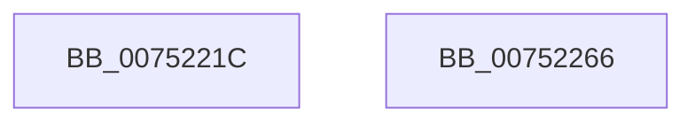

# PfpPartitionInitialize

- RVA: `0x0075221C`–`0x00752267` (길이 `75` bytes)
- VA: `0x000000014075221C`
- 실행 섹션: `PAGE`
- PDB 이름 있음: `예`; PDB Function 태그: `아니요`
- unwind 정보 RVA: `0x00060BC4`
- 디코드: `22`개 명령, `75/75` bytes 표시
- 미해석 바이트: `0` (있으면 어셈블리에 `.byte`로 보존)

> 이 문서는 커널 이미지의 기계어와 PDB 기호를 분석해 생성했습니다. 4번과 5번은 함수 원형과 자료형을 바이너리 사용 방식에서 추정한 C 해석이며 원본 소스 복구 결과는 아닙니다.

## 1. Dependencies

- 직접 호출 지점: **2**; 고유 호출 대상: **2**
- 직접 호출자로 확인된 함수: **1**
- RIP 상대 이미지 참조: **0**

### Outgoing calls
- `0x00752240` → [memset](../../text/6C/memset_function_006C6C40.md) (function, `0x006C6C40`)
- `0x00752251` → [PfTInitialize](PfTInitialize_function_00751554.md) (function, `0x00751554`)

### Direct callers
- [PfpPartitionCreate](../../text/5C/PfpPartitionCreate_function_005CDE8C.md) at `0x005CDF50`

### Static image references
- 디코드된 RIP-relative 메모리 참조가 없습니다.

## 2. Other-region calls and transfers

- 다른 실행 섹션으로 향하는 call: **1**
  - `0x00752240` → [memset](../../text/6C/memset_function_006C6C40.md) (`PAGE` → `.text`)
- 별도 외부 분기/꼬리 이동을 확인하지 못했습니다.

## 3. Assembly (complete function range)

```asm
0075221C  48 89 5C 24 08                  mov qword ptr [rsp + 8], rbx
00752221  48 89 74 24 10                  mov qword ptr [rsp + 0x10], rsi
00752226  57                              push rdi
00752227  48 83 EC 20                     sub rsp, 0x20
0075222B  49 8B F8                        mov rdi, r8
0075222E  48 8B DA                        mov rbx, rdx
00752231  48 8B F1                        mov rsi, rcx
00752234  33 D2                           xor edx, edx
00752236  48 83 C1 10                     add rcx, 0x10
0075223A  41 B8 10 03 00 00               mov r8d, 0x310
00752240  E8 FB 49 F7 FF                  call 0x1406c6c40
00752245  33 D2                           xor edx, edx
00752247  48 89 1E                        mov qword ptr [rsi], rbx
0075224A  48 8B CE                        mov rcx, rsi
0075224D  48 89 7E 08                     mov qword ptr [rsi + 8], rdi
00752251  E8 FE F2 FF FF                  call 0x140751554
00752256  48 8B 5C 24 30                  mov rbx, qword ptr [rsp + 0x30]
0075225B  48 8B 74 24 38                  mov rsi, qword ptr [rsp + 0x38]
00752260  48 83 C4 20                     add rsp, 0x20
00752264  5F                              pop rdi
00752265  C3                              ret
00752266  CC                              int3
```

## 4. C-style interpretation (structured pseudocode)

```c
__int64 __fastcall PfpPartitionInitialize(__int64 a1, __int64 a2, __int64 a3)
{
    __int64 result;
    __int64 v_rsp;
    unsigned __int64 v_stack_p10;
    unsigned __int64 v_stack_p8;

    v_stack_p8 = v_rbx;
    v_stack_p10 = v_rsi;
    v_rsp = (v_rsp) - (32);
    a2 = 0;
    a1 = (a1) + (16);
    result = memset(a1, a2, 784, a4);
    a2 = 0;
    *(unsigned __int64 *)(a1) = 0;
    *(unsigned __int64 *)(a1 + 8) = a3;
    result = PfTInitialize(a1, a2, 784, a4);
    v_rsp = (v_rsp) + (32);
    return result;
}
```

## 5. (Beta) C Style

```c
int64_t PfpPartitionInitialize(void *Arg1, int64_t Arg2, int64_t Arg3)
{
    uint8_t *arg1 = (uint8_t *)Arg1;

    int64_t result;
    int64_t local_rsp;
    uint64_t v_stack_p10;
    uint64_t v_stack_p8;

    v_stack_p8 = local_rbx;
    v_stack_p10 = local_rsi;
    local_rsp = (local_rsp) - (32);
    Arg2 = 0;
    Arg1 = (Arg1) + (16);
    result = memset(Arg1, Arg2, 784, a4);
    Arg2 = 0;
    *(uint64_t *)(arg1) = 0;
    *(uint64_t *)(arg1 + 0x8) = Arg3;
    result = PfTInitialize(Arg1, Arg2, 784, a4);
    local_rsp = (local_rsp) + (32);
    return result;
}
```

### 관측된 메모리 오프셋

구조체 형식이 확인되지 않은 접근은 인자 기준의 오프셋으로만 기록했습니다.

| 기준 인자 | 오프셋 표현 | 폭 (bit) | 접근 |
|---|---:|---:|---|
| `Arg1` | `+ 0x0` | `64` | `W` |
| `Arg1` | `+ 0x8` | `64` | `W` |

## 6. Execution-region graph

[열기: 2D/3D 그래프와 함수 탐색 컨트롤 패널](../../../control-panel.html?section=page&rva=0x0075221C&view=graph)

- 2D 그래프는 위에서 아래로 흐르고, 3D 그래프는 빈 공간을 드래그해 회전합니다. Shift+드래그는 이동, 휠은 확대·축소, 함수 노드 선택은 대상 보고서 이동입니다.

### Static fallback


