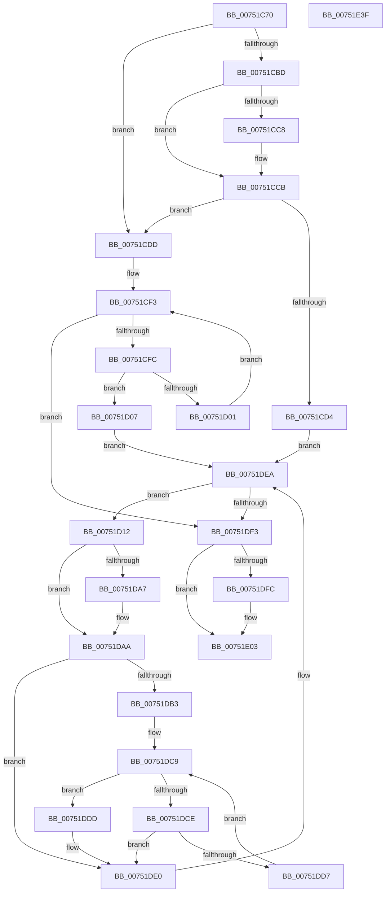

# PfpRpShutdown

- RVA: `0x00751C70`–`0x00751E40` (길이 `464` bytes)
- VA: `0x0000000140751C70`
- 실행 섹션: `PAGE`
- PDB 이름 있음: `예`; PDB Function 태그: `아니요`
- unwind 정보 RVA: `0x000CBBA4`
- 디코드: `129`개 명령, `464/464` bytes 표시
- 미해석 바이트: `0` (있으면 어셈블리에 `.byte`로 보존)

> 이 문서는 커널 이미지의 기계어와 PDB 기호를 분석해 생성했습니다. 4번과 5번은 함수 원형과 자료형을 바이너리 사용 방식에서 추정한 C 해석이며 원본 소스 복구 결과는 아닙니다.

## 1. Dependencies

- 직접 호출 지점: **6**; 고유 호출 대상: **5**
- 직접 호출자로 확인된 함수: **1**
- RIP 상대 이미지 참조: **0**

### Outgoing calls
- `0x00751C99` → [ExWaitForRundownProtectionRelease](../../text/2A/ExWaitForRundownProtectionRelease_function_002A4CB0.md) (function, `0x002A4CB0`)
- `0x00751CA2` → [FsRtlAcquirePushLockExclusive](../../text/4A/FsRtlAcquirePushLockExclusive_function_004A05F4.md) (function, `0x004A05F4`)
- `0x00751DE5` → [ExFreePoolWithTag](../../poolcode/B8/ExFreePoolWithTag_function_00B82870.md) (function, `0x00B82870`)
- `0x00751DFE` → [ExFreePoolWithTag](../../poolcode/B8/ExFreePoolWithTag_function_00B82870.md) (function, `0x00B82870`)
- `0x00751E19` → [PfLockExclusiveRelease](../../text/49/PfLockExclusiveRelease_function_00491D88.md) (function, `0x00491D88`)
- `0x00751E21` → [PfpRpControlRequestReset](../AB/PfpRpControlRequestReset_function_00AB4D2C.md) (function, `0x00AB4D2C`)

### Direct callers
- [PfpParametersWatcher](PfpParametersWatcher_function_00753140.md) at `0x007532E5`

### Static image references
- 디코드된 RIP-relative 메모리 참조가 없습니다.

## 2. Other-region calls and transfers

- 다른 실행 섹션으로 향하는 call: **5**
  - `0x00751C99` → [ExWaitForRundownProtectionRelease](../../text/2A/ExWaitForRundownProtectionRelease_function_002A4CB0.md) (`PAGE` → `.text`)
  - `0x00751CA2` → [FsRtlAcquirePushLockExclusive](../../text/4A/FsRtlAcquirePushLockExclusive_function_004A05F4.md) (`PAGE` → `.text`)
  - `0x00751DE5` → [ExFreePoolWithTag](../../poolcode/B8/ExFreePoolWithTag_function_00B82870.md) (`PAGE` → `POOLCODE`)
  - `0x00751DFE` → [ExFreePoolWithTag](../../poolcode/B8/ExFreePoolWithTag_function_00B82870.md) (`PAGE` → `POOLCODE`)
  - `0x00751E19` → [PfLockExclusiveRelease](../../text/49/PfLockExclusiveRelease_function_00491D88.md) (`PAGE` → `.text`)
- 별도 외부 분기/꼬리 이동을 확인하지 못했습니다.

## 3. Assembly (complete function range)

```asm
00751C70  48 89 5C 24 10                  mov qword ptr [rsp + 0x10], rbx
00751C75  48 89 6C 24 18                  mov qword ptr [rsp + 0x18], rbp
00751C7A  48 89 74 24 20                  mov qword ptr [rsp + 0x20], rsi
00751C7F  57                              push rdi
00751C80  41 54                           push r12
00751C82  41 56                           push r14
00751C84  48 83 EC 20                     sub rsp, 0x20
00751C88  83 A1 98 00 00 00 FE            and dword ptr [rcx + 0x98], 0xfffffffe
00751C8F  48 8B D9                        mov rbx, rcx
00751C92  48 81 C1 88 00 00 00            add rcx, 0x88
00751C99  E8 12 30 B5 FF                  call 0x1402a4cb0
00751C9E  48 8D 4B 30                     lea rcx, [rbx + 0x30]
00751CA2  E8 4D E9 D4 FF                  call 0x1404a05f4
00751CA7  48 8B 4B 08                     mov rcx, qword ptr [rbx + 8]
00751CAB  45 33 F6                        xor r14d, r14d
00751CAE  49 BC 02 00 00 00 00 00 00 80   movabs r12, 0x8000000000000002
00751CB8  48 85 C9                        test rcx, rcx
00751CBB  74 20                           je 0x140751cdd
00751CBD  48 8B 01                        mov rax, qword ptr [rcx]
00751CC0  49 23 C4                        and rax, r12
00751CC3  49 3B C4                        cmp rax, r12
00751CC6  75 03                           jne 0x140751ccb
00751CC8  49 8B 06                        mov rax, qword ptr [r14]
00751CCB  48 8B 39                        mov rdi, qword ptr [rcx]
00751CCE  40 F6 C7 01                     test dil, 1
00751CD2  75 09                           jne 0x140751cdd
00751CD4  48 8D 73 04                     lea rsi, [rbx + 4]
00751CD8  E9 0D 01 00 00                  jmp 0x140751dea
00751CDD  48 8B 43 08                     mov rax, qword ptr [rbx + 8]
00751CE1  48 8D 79 08                     lea rdi, [rcx + 8]
00751CE5  48 8D 73 04                     lea rsi, [rbx + 4]
00751CE9  8B 0E                           mov ecx, dword ptr [rsi]
00751CEB  48 C1 E9 05                     shr rcx, 5
00751CEF  48 8D 14 C8                     lea rdx, [rax + rcx*8]
00751CF3  48 3B FA                        cmp rdi, rdx
00751CF6  0F 83 F7 00 00 00               jae 0x140751df3
00751CFC  F6 07 01                        test byte ptr [rdi], 1
00751CFF  74 06                           je 0x140751d07
00751D01  48 83 C7 08                     add rdi, 8
00751D05  EB EC                           jmp 0x140751cf3
00751D07  0F AE E8                        lfence
00751D0A  48 8B 3F                        mov rdi, qword ptr [rdi]
00751D0D  E9 D8 00 00 00                  jmp 0x140751dea
00751D12  44 8B 06                        mov r8d, dword ptr [rsi]
00751D15  48 83 C8 FF                     or rax, 0xffffffffffffffff
00751D19  41 8B C8                        mov ecx, r8d
00751D1C  4C 8B CF                        mov r9, rdi
00751D1F  83 E1 1F                        and ecx, 0x1f
00751D22  41 C1 E8 05                     shr r8d, 5
00751D26  48 D3 E0                        shl rax, cl
00751D29  48 23 47 08                     and rax, qword ptr [rdi + 8]
00751D2D  48 89 44 24 40                  mov qword ptr [rsp + 0x40], rax
00751D32  0F B6 C0                        movzx eax, al
00751D35  48 05 CB 5D B1 00               add rax, 0xb15dcb
00751D3B  48 6B C8 25                     imul rcx, rax, 0x25
00751D3F  0F B6 44 24 41                  movzx eax, byte ptr [rsp + 0x41]
00751D44  48 03 C8                        add rcx, rax
00751D47  0F B6 44 24 42                  movzx eax, byte ptr [rsp + 0x42]
00751D4C  48 6B D1 25                     imul rdx, rcx, 0x25
00751D50  48 03 D0                        add rdx, rax
00751D53  0F B6 44 24 43                  movzx eax, byte ptr [rsp + 0x43]
00751D58  48 6B CA 25                     imul rcx, rdx, 0x25
00751D5C  48 03 C8                        add rcx, rax
00751D5F  0F B6 44 24 44                  movzx eax, byte ptr [rsp + 0x44]
00751D64  48 6B D1 25                     imul rdx, rcx, 0x25
00751D68  48 03 D0                        add rdx, rax
00751D6B  0F B6 44 24 45                  movzx eax, byte ptr [rsp + 0x45]
00751D70  48 6B CA 25                     imul rcx, rdx, 0x25
00751D74  48 03 C8                        add rcx, rax
00751D77  0F B6 44 24 46                  movzx eax, byte ptr [rsp + 0x46]
00751D7C  48 6B D1 25                     imul rdx, rcx, 0x25
00751D80  48 03 D0                        add rdx, rax
00751D83  0F B6 44 24 47                  movzx eax, byte ptr [rsp + 0x47]
00751D88  48 6B CA 25                     imul rcx, rdx, 0x25
00751D8C  41 8D 50 FF                     lea edx, [r8 - 1]
00751D90  48 03 C1                        add rax, rcx
00751D93  48 8B 4B 08                     mov rcx, qword ptr [rbx + 8]
00751D97  8B C0                           mov eax, eax
00751D99  48 23 D0                        and rdx, rax
00751D9C  48 8B 07                        mov rax, qword ptr [rdi]
00751D9F  49 23 C4                        and rax, r12
00751DA2  49 3B C4                        cmp rax, r12
00751DA5  75 03                           jne 0x140751daa
00751DA7  49 8B 06                        mov rax, qword ptr [r14]
00751DAA  48 8B 3F                        mov rdi, qword ptr [rdi]
00751DAD  40 F6 C7 01                     test dil, 1
00751DB1  74 2D                           je 0x140751de0
00751DB3  48 8B 43 08                     mov rax, qword ptr [rbx + 8]
00751DB7  48 83 C1 08                     add rcx, 8
00751DBB  48 8D 14 D1                     lea rdx, [rcx + rdx*8]
00751DBF  8B 0E                           mov ecx, dword ptr [rsi]
00751DC1  48 C1 E9 05                     shr rcx, 5
00751DC5  4C 8D 04 C8                     lea r8, [rax + rcx*8]
00751DC9  49 3B D0                        cmp rdx, r8
00751DCC  73 0F                           jae 0x140751ddd
00751DCE  48 8B 3A                        mov rdi, qword ptr [rdx]
00751DD1  40 F6 C7 01                     test dil, 1
00751DD5  74 09                           je 0x140751de0
00751DD7  48 83 C2 08                     add rdx, 8
00751DDB  EB EC                           jmp 0x140751dc9
00751DDD  49 8B FE                        mov rdi, r14
00751DE0  33 D2                           xor edx, edx
00751DE2  49 8B C9                        mov rcx, r9
00751DE5  E8 86 0A 43 00                  call 0x140b82870
00751DEA  48 85 FF                        test rdi, rdi
00751DED  0F 85 1F FF FF FF               jne 0x140751d12
00751DF3  48 8B 4B 08                     mov rcx, qword ptr [rbx + 8]
00751DF7  48 85 C9                        test rcx, rcx
00751DFA  74 07                           je 0x140751e03
00751DFC  33 D2                           xor edx, edx
00751DFE  E8 6D 0A 43 00                  call 0x140b82870
00751E03  48 8D 43 18                     lea rax, [rbx + 0x18]
00751E07  48 89 43 10                     mov qword ptr [rbx + 0x10], rax
00751E0B  48 8D 4B 30                     lea rcx, [rbx + 0x30]
00751E0F  44 89 33                        mov dword ptr [rbx], r14d
00751E12  4C 89 73 08                     mov qword ptr [rbx + 8], r14
00751E16  44 89 36                        mov dword ptr [rsi], r14d
00751E19  E8 6A FF D3 FF                  call 0x140491d88
00751E1E  48 8B CB                        mov rcx, rbx
00751E21  E8 06 2F 36 00                  call 0x140ab4d2c
00751E26  48 8B 5C 24 48                  mov rbx, qword ptr [rsp + 0x48]
00751E2B  48 8B 6C 24 50                  mov rbp, qword ptr [rsp + 0x50]
00751E30  48 8B 74 24 58                  mov rsi, qword ptr [rsp + 0x58]
00751E35  48 83 C4 20                     add rsp, 0x20
00751E39  41 5E                           pop r14
00751E3B  41 5C                           pop r12
00751E3D  5F                              pop rdi
00751E3E  C3                              ret
00751E3F  CC                              int3
```

## 4. C-style interpretation (structured pseudocode)

```c
__int64 __fastcall PfpRpShutdown(__int64 a1)
{
    __int64 result;
    __int64 v_r14;
    __int64 v_rdi;
    __int64 v_rsp;
    unsigned __int64 v_stack_p10;
    unsigned __int64 v_stack_p18;
    unsigned __int64 v_stack_p20;
    unsigned __int64 v_stack_p8;
    unsigned __int8 v_stack_p9;
    unsigned __int8 v_stack_pA;
    unsigned __int8 v_stack_pB;
    unsigned __int8 v_stack_pC;
    unsigned __int8 v_stack_pD;
    unsigned __int8 v_stack_pE;
    unsigned __int8 v_stack_pF;

    v_stack_p10 = v_rbx;
    v_stack_p18 = v_rbp;
    v_stack_p20 = v_rsi;
    v_rsp = (v_rsp) - (32);
    a1 = (a1) + (136);
    result = ExWaitForRundownProtectionRelease(a1, a2, a3, a4);
    result = FsRtlAcquirePushLockExclusive(a1 + 48, a2, a3, a4);
    v_r14 = 0;
    if (*(unsigned __int64 *)(a1 + 8) == 0) goto loc_00751CDD;
    result = (*(unsigned __int64 *)(*(unsigned __int64 *)(a1 + 8))) & (v_r12);
    if (result == v_r12) {
        result = *(unsigned __int64 *)(v_r14);
    }
    if ((((unsigned __int8)(*(unsigned __int64 *)(*(unsigned __int64 *)(a1 + 8)))) & (1)) != 0) goto loc_00751CDD;
    goto loc_00751DEA;
loc_00751CDD:
    a1 = ((unsigned int)(*(unsigned int *)(a1 + 4))) >> (5);
loc_00751CF3:
    if ((*(unsigned __int64 *)(a1 + 8) + 8) >= (*(unsigned __int64 *)(a1 + 8) + a1 * 8)) goto loc_00751DF3;
    if (((*(unsigned __int8 *)(*(unsigned __int64 *)(a1 + 8) + 8)) & (1)) == 0) goto loc_00751D07;
    v_rdi = (*(unsigned __int64 *)(a1 + 8) + 8) + (8);
    goto loc_00751CF3;
loc_00751D07:
    goto loc_00751DEA;
loc_00751D12:
    result = (*(unsigned __int64 *)(a1 + 8)) | (-1);
    a1 = (unsigned int)(((unsigned int)((unsigned int)((unsigned int)(*(unsigned int *)(a1 + 4))))) & (31));
    a3 = (unsigned int)(((unsigned int)(*(unsigned int *)(a1 + 4))) >> (5));
    result = (result) << ((unsigned __int8)(a1));
    result = (result) & (*(unsigned __int64 *)(*(unsigned __int64 *)(v_rdi) + 8));
    v_stack_p8 = result;
    result = ((unsigned __int8)(result)) + (0xB15DCBULL);
    a1 = (a1) * (result);
    a1 = (a1) + (v_stack_p9);
    a2 = (*(unsigned __int64 *)(a1 + 8) + a1 * 8) * (a1);
    a2 = (a2) + (v_stack_pA);
    a1 = (a1) * (a2);
    a1 = (a1) + (v_stack_pB);
    a2 = (a2) * (a1);
    a2 = (a2) + (v_stack_pC);
    a1 = (a1) * (a2);
    a1 = (a1) + (v_stack_pD);
    a2 = (a2) * (a1);
    a2 = (a2) + (v_stack_pE);
    a1 = (a1) * (a2);
    result = (v_stack_pF) + (a1);
    a2 = (a3 - 1) & ((unsigned int)((unsigned int)(result)));
    result = (*(unsigned __int64 *)(*(unsigned __int64 *)(v_rdi))) & (v_r12);
    if (result == v_r12) {
        result = *(unsigned __int64 *)(v_r14);
    }
    if ((((unsigned __int8)(*(unsigned __int64 *)(*(unsigned __int64 *)(v_rdi)))) & (1)) == 0) goto loc_00751DE0;
    a1 = (*(unsigned __int64 *)(a1 + 8)) + (8);
    a1 = ((unsigned int)(*(unsigned int *)(a1 + 4))) >> (5);
loc_00751DC9:
    if ((a1 + a2 * 8) >= (*(unsigned __int64 *)(a1 + 8) + a1 * 8)) goto loc_00751DDD;
    if ((((unsigned __int8)(*(unsigned __int64 *)(a1 + a2 * 8))) & (1)) == 0) goto loc_00751DE0;
    a2 = (a1 + a2 * 8) + (8);
    goto loc_00751DC9;
loc_00751DDD:
loc_00751DE0:
    a2 = 0;
    result = ExFreePoolWithTag(*(unsigned __int64 *)(v_rdi), a2, *(unsigned __int64 *)(a1 + 8) + a1 * 8, *(unsigned __int64 *)(v_rdi));
loc_00751DEA:
    if (0 != 0) goto loc_00751D12;
loc_00751DF3:
    if (*(unsigned __int64 *)(a1 + 8) != 0) {
        a2 = 0;
        result = ExFreePoolWithTag(*(unsigned __int64 *)(a1 + 8), a2, *(unsigned __int64 *)(a1 + 8) + a1 * 8, *(unsigned __int64 *)(v_rdi));
    }
    *(unsigned __int64 *)(a1 + 16) = a1 + 24;
    *(unsigned int *)(a1) = 0;
    *(unsigned __int64 *)(a1 + 8) = 0;
    *(unsigned int *)(a1 + 4) = 0;
    result = PfLockExclusiveRelease(a1 + 48, a2, *(unsigned __int64 *)(a1 + 8) + a1 * 8, *(unsigned __int64 *)(v_rdi));
    result = PfpRpControlRequestReset(a1, a2, *(unsigned __int64 *)(a1 + 8) + a1 * 8, *(unsigned __int64 *)(v_rdi));
    v_rsp = (v_rsp) + (32);
    return result;
}
```

## 5. (Beta) C Style

```c
int64_t PfpRpShutdown(void *Arg1)
{
    uint8_t *arg1 = (uint8_t *)Arg1;

    int64_t result;
    int64_t local_r14;
    int64_t local_rdi;
    int64_t local_rsp;
    uint64_t v_stack_p10;
    uint64_t v_stack_p18;
    uint64_t v_stack_p20;
    uint64_t v_stack_p8;
    uint8_t v_stack_p9;
    uint8_t v_stack_pA;
    uint8_t v_stack_pB;
    uint8_t v_stack_pC;
    uint8_t v_stack_pD;
    uint8_t v_stack_pE;
    uint8_t v_stack_pF;

    v_stack_p10 = local_rbx;
    v_stack_p18 = local_rbp;
    v_stack_p20 = local_rsi;
    local_rsp = (local_rsp) - (32);
    Arg1 = (Arg1) + (136);
    result = ExWaitForRundownProtectionRelease(Arg1, a2, a3, a4);
    result = FsRtlAcquirePushLockExclusive(Arg1 + 48, a2, a3, a4);
    local_r14 = 0;
    if (*(uint64_t *)(arg1 + 0x8) == 0) goto loc_00751CDD;
    result = (*(uint64_t *)(*(uint64_t *)(arg1 + 0x8))) & (local_r12);
    if (result == local_r12) {
        result = *(uint64_t *)(local_r14);
    }
    if ((((uint8_t)(*(uint64_t *)(*(uint64_t *)(arg1 + 0x8)))) & (1)) != 0) goto loc_00751CDD;
    goto loc_00751DEA;
loc_00751CDD:
    Arg1 = ((uint32_t)(*(uint32_t *)(arg1 + 0x4))) >> (5);
loc_00751CF3:
    if ((*(uint64_t *)(arg1 + 0x8) + 8) >= (*(uint64_t *)(arg1 + 0x8) + Arg1 * 8)) goto loc_00751DF3;
    if (((*(uint8_t *)(*(uint64_t *)(arg1 + 0x8) + 0x8)) & (1)) == 0) goto loc_00751D07;
    local_rdi = (*(uint64_t *)(arg1 + 0x8) + 8) + (8);
    goto loc_00751CF3;
loc_00751D07:
    goto loc_00751DEA;
loc_00751D12:
    result = (*(uint64_t *)(arg1 + 0x8)) | (-1);
    Arg1 = (uint32_t)(((uint32_t)((uint32_t)((uint32_t)(*(uint32_t *)(arg1 + 0x4))))) & (31));
    a3 = (uint32_t)(((uint32_t)(*(uint32_t *)(arg1 + 0x4))) >> (5));
    result = (result) << ((uint8_t)(Arg1));
    result = (result) & (*(uint64_t *)(*(uint64_t *)(local_rdi) + 0x8));
    v_stack_p8 = result;
    result = ((uint8_t)(result)) + (0xB15DCBULL);
    Arg1 = (Arg1) * (result);
    Arg1 = (Arg1) + (v_stack_p9);
    a2 = (*(uint64_t *)(arg1 + 0x8) + Arg1 * 8) * (Arg1);
    a2 = (a2) + (v_stack_pA);
    Arg1 = (Arg1) * (a2);
    Arg1 = (Arg1) + (v_stack_pB);
    a2 = (a2) * (Arg1);
    a2 = (a2) + (v_stack_pC);
    Arg1 = (Arg1) * (a2);
    Arg1 = (Arg1) + (v_stack_pD);
    a2 = (a2) * (Arg1);
    a2 = (a2) + (v_stack_pE);
    Arg1 = (Arg1) * (a2);
    result = (v_stack_pF) + (Arg1);
    a2 = (a3 - 1) & ((uint32_t)((uint32_t)(result)));
    result = (*(uint64_t *)(*(uint64_t *)(local_rdi))) & (local_r12);
    if (result == local_r12) {
        result = *(uint64_t *)(local_r14);
    }
    if ((((uint8_t)(*(uint64_t *)(*(uint64_t *)(local_rdi)))) & (1)) == 0) goto loc_00751DE0;
    Arg1 = (*(uint64_t *)(arg1 + 0x8)) + (8);
    Arg1 = ((uint32_t)(*(uint32_t *)(arg1 + 0x4))) >> (5);
loc_00751DC9:
    if ((Arg1 + a2 * 8) >= (*(uint64_t *)(arg1 + 0x8) + Arg1 * 8)) goto loc_00751DDD;
    if ((((uint8_t)(*(uint64_t *)(arg1 + a2 * 8))) & (1)) == 0) goto loc_00751DE0;
    a2 = (Arg1 + a2 * 8) + (8);
    goto loc_00751DC9;
loc_00751DDD:
loc_00751DE0:
    a2 = 0;
    result = ExFreePoolWithTag(*(uint64_t *)(local_rdi), a2, *(uint64_t *)(arg1 + 0x8) + Arg1 * 8, *(uint64_t *)(local_rdi));
loc_00751DEA:
    if (0 != 0) goto loc_00751D12;
loc_00751DF3:
    if (*(uint64_t *)(arg1 + 0x8) != 0) {
        a2 = 0;
        result = ExFreePoolWithTag(*(uint64_t *)(arg1 + 0x8), a2, *(uint64_t *)(arg1 + 0x8) + Arg1 * 8, *(uint64_t *)(local_rdi));
    }
    *(void **)(arg1 + 0x10) = Arg1 + 24;
    *(uint32_t *)(arg1) = 0;
    *(uint64_t *)(arg1 + 0x8) = 0;
    *(uint32_t *)(arg1 + 0x4) = 0;
    result = PfLockExclusiveRelease(Arg1 + 48, a2, *(uint64_t *)(arg1 + 0x8) + Arg1 * 8, *(uint64_t *)(local_rdi));
    result = PfpRpControlRequestReset(Arg1, a2, *(uint64_t *)(arg1 + 0x8) + Arg1 * 8, *(uint64_t *)(local_rdi));
    local_rsp = (local_rsp) + (32);
    return result;
}
```

### 관측된 메모리 오프셋

구조체 형식이 확인되지 않은 접근은 인자 기준의 오프셋으로만 기록했습니다.

| 기준 인자 | 오프셋 표현 | 폭 (bit) | 접근 |
|---|---:|---:|---|
| `Arg1` | `+ 0x0` | `32` | `R` |
| `Arg1` | `+ 0x0` | `32` | `W` |
| `Arg1` | `+ 0x4` | `64` | `R` |
| `Arg1` | `+ 0x8` | `64` | `R` |
| `Arg1` | `+ 0x8` | `64` | `W` |
| `Arg1` | `+ 0x10` | `64` | `W` |
| `Arg1` | `+ 0x18` | `64` | `R` |
| `Arg1` | `+ 0x30` | `64` | `R` |
| `Arg1` | `+ 0x98` | `32` | `R/W` |

## 6. Execution-region graph

[열기: 2D/3D 그래프와 함수 탐색 컨트롤 패널](../../../control-panel.html?section=page&rva=0x00751C70&view=graph)

- 2D 그래프는 위에서 아래로 흐르고, 3D 그래프는 빈 공간을 드래그해 회전합니다. Shift+드래그는 이동, 휠은 확대·축소, 함수 노드 선택은 대상 보고서 이동입니다.

### Static fallback


