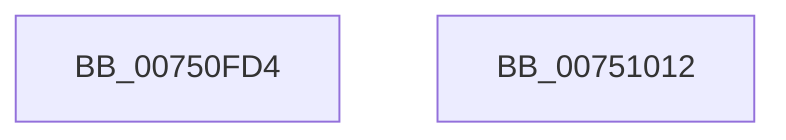

# PfpScenCtxStart

- RVA: `0x00750FD4`–`0x00751013` (길이 `63` bytes)
- VA: `0x0000000140750FD4`
- 실행 섹션: `PAGE`
- PDB 이름 있음: `예`; PDB Function 태그: `아니요`
- unwind 정보 RVA: `0x00064C80`
- 디코드: `17`개 명령, `63/63` bytes 표시
- 미해석 바이트: `0` (있으면 어셈블리에 `.byte`로 보존)

> 이 문서는 커널 이미지의 기계어와 PDB 기호를 분석해 생성했습니다. 4번과 5번은 함수 원형과 자료형을 바이너리 사용 방식에서 추정한 C 해석이며 원본 소스 복구 결과는 아닙니다.

## 1. Dependencies

- 직접 호출 지점: **2**; 고유 호출 대상: **2**
- 직접 호출자로 확인된 함수: **1**
- RIP 상대 이미지 참조: **1**

### Outgoing calls
- `0x00750FF1` → [RtlInitUnicodeString](../../text/42/RtlInitUnicodeString_function_0042A780.md) (function, `0x0042A780`)
- `0x00751007` → [PfpCreateEventInternal](PfpCreateEventInternal_function_00753480.md) (function, `0x00753480`)

### Direct callers
- [PfInitializeSuperfetch](../../init/C3/PfInitializeSuperfetch_function_00C3CACC.md) at `0x00C3CBA9`

### Static image references
- `0x00750FDD` → RVA `0x00B01490` (` ?? ::NNGAKEGL::`string'`; read)

## 2. Other-region calls and transfers

- 다른 실행 섹션으로 향하는 call: **1**
  - `0x00750FF1` → [RtlInitUnicodeString](../../text/42/RtlInitUnicodeString_function_0042A780.md) (`PAGE` → `.text`)
- 별도 외부 분기/꼬리 이동을 확인하지 못했습니다.

## 3. Assembly (complete function range)

```asm
00750FD4  40 53                           push rbx
00750FD6  48 83 EC 30                     sub rsp, 0x30
00750FDA  48 8B D9                        mov rbx, rcx
00750FDD  48 8D 15 AC 04 3B 00            lea rdx, [rip + 0x3b04ac]
00750FE4  0F 57 C0                        xorps xmm0, xmm0
00750FE7  48 8D 4C 24 20                  lea rcx, [rsp + 0x20]
00750FEC  0F 11 44 24 20                  movups xmmword ptr [rsp + 0x20], xmm0
00750FF1  E8 8A 97 CD FF                  call 0x14042a780
00750FF6  4C 8D 4B 40                     lea r9, [rbx + 0x40]
00750FFA  33 D2                           xor edx, edx
00750FFC  41 B8 90 02 00 00               mov r8d, 0x290
00751002  48 8D 4C 24 20                  lea rcx, [rsp + 0x20]
00751007  E8 74 24 00 00                  call 0x140753480
0075100C  48 83 C4 30                     add rsp, 0x30
00751010  5B                              pop rbx
00751011  C3                              ret
00751012  CC                              int3
```

## 4. C-style interpretation (structured pseudocode)

```c
__int64 __fastcall PfpScenCtxStart(__int64 a1)
{
    __int64 result;
    __int64 v_rsp;
    unsigned __int64 v_stack_m18;

    v_rsp = (v_rsp) - (48);
    v_stack_m18 = v_xmm0;
    result = RtlInitUnicodeString(v_stack_m18, v_rip + 3867820, a3, a4);
    a2 = 0;
    result = PfpCreateEventInternal(v_stack_m18, a2, 656, a1 + 64);
    v_rsp = (v_rsp) + (48);
    return result;
}
```

## 5. (Beta) C Style

```c
int64_t PfpScenCtxStart(void *Arg1)
{
    uint8_t *arg1 = (uint8_t *)Arg1;

    int64_t result;
    int64_t local_rsp;
    uint64_t v_stack_m18;

    local_rsp = (local_rsp) - (48);
    v_stack_m18 = v_xmm0;
    result = RtlInitUnicodeString(v_stack_m18, v_rip + 3867820, a3, a4);
    a2 = 0;
    result = PfpCreateEventInternal(v_stack_m18, a2, 656, Arg1 + 64);
    local_rsp = (local_rsp) + (48);
    return result;
}
```

### 관측된 메모리 오프셋

구조체 형식이 확인되지 않은 접근은 인자 기준의 오프셋으로만 기록했습니다.

| 기준 인자 | 오프셋 표현 | 폭 (bit) | 접근 |
|---|---:|---:|---|
| `Arg1` | `+ 0x40` | `64` | `R` |

## 6. Execution-region graph

[열기: 2D/3D 그래프와 함수 탐색 컨트롤 패널](../../../control-panel.html?section=page&rva=0x00750FD4&view=graph)

- 2D 그래프는 위에서 아래로 흐르고, 3D 그래프는 빈 공간을 드래그해 회전합니다. Shift+드래그는 이동, 휠은 확대·축소, 함수 노드 선택은 대상 보고서 이동입니다.

### Static fallback


