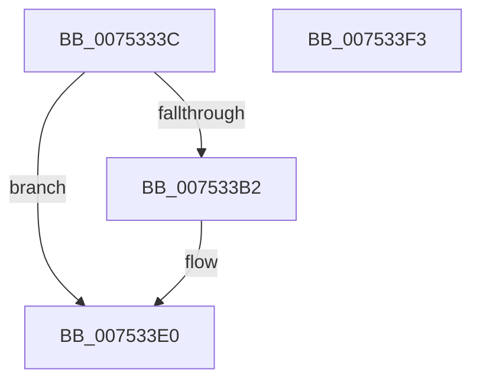

# PfpSetBaseTime

- RVA: `0x0075333C`–`0x007533F4` (길이 `184` bytes)
- VA: `0x000000014075333C`
- 실행 섹션: `PAGE`
- PDB 이름 있음: `예`; PDB Function 태그: `아니요`
- unwind 정보 RVA: `0x0006E5F8`
- 디코드: `44`개 명령, `184/184` bytes 표시
- 미해석 바이트: `0` (있으면 어셈블리에 `.byte`로 보존)

> 이 문서는 커널 이미지의 기계어와 PDB 기호를 분석해 생성했습니다. 4번과 5번은 함수 원형과 자료형을 바이너리 사용 방식에서 추정한 C 해석이며 원본 소스 복구 결과는 아닙니다.

## 1. Dependencies

- 직접 호출 지점: **2**; 고유 호출 대상: **2**
- 직접 호출자로 확인된 함수: **1**
- RIP 상대 이미지 참조: **1**

### Outgoing calls
- `0x007533A7` → [PfpSetParameter](PfpSetParameter_function_007533FC.md) (function, `0x007533FC`)
- `0x007533D9` → [PfpGetParameter](PfpGetParameter_function_00752E80.md) (function, `0x00752E80`)

### Direct callers
- [PfpParametersInitialize](../../init/C3/PfpParametersInitialize_function_00C3CEF0.md) at `0x00C3D061`

### Static image references
- `0x007533A0` → RVA `0x00B014E0` (` ?? ::NNGAKEGL::`string'`; read)

## 2. Other-region calls and transfers

- 다른 실행 섹션으로 향하는 call: **0**
- 별도 외부 분기/꼬리 이동을 확인하지 못했습니다.

## 3. Assembly (complete function range)

```asm
0075333C  48 89 5C 24 08                  mov qword ptr [rsp + 8], rbx
00753341  57                              push rdi
00753342  48 83 EC 30                     sub rsp, 0x30
00753346  48 8B DA                        mov rbx, rdx
00753349  C7 44 24 20 04 00 00 00         mov dword ptr [rsp + 0x20], 4
00753351  48 8B F9                        mov rdi, rcx
00753354  45 33 C0                        xor r8d, r8d
00753357  48 B8 14 00 00 00 80 F7 FF FF   movabs rax, 0xfffff78000000014
00753361  48 B9 00 40 62 37 7A 8C 3F FE   movabs rcx, 0xfe3f8c7a37624000
0075336B  4C 8B 08                        mov r9, qword ptr [rax]
0075336E  48 B8 4B 59 86 38 D6 C5 6D 34   movabs rax, 0x346dc5d63886594b
00753378  4C 03 C9                        add r9, rcx
0075337B  48 8B CF                        mov rcx, rdi
0075337E  4D 0F 49 C1                     cmovns r8, r9
00753382  4C 8D 4C 24 48                  lea r9, [rsp + 0x48]
00753387  49 F7 E8                        imul r8
0075338A  48 C1 FA 0B                     sar rdx, 0xb
0075338E  48 8B C2                        mov rax, rdx
00753391  48 C1 E8 3F                     shr rax, 0x3f
00753395  48 03 D0                        add rdx, rax
00753398  48 C1 FA 0A                     sar rdx, 0xa
0075339C  89 54 24 48                     mov dword ptr [rsp + 0x48], edx
007533A0  48 8D 15 39 E1 3A 00            lea rdx, [rip + 0x3ae139]
007533A7  E8 50 00 00 00                  call 0x1407533fc
007533AC  8B C8                           mov ecx, eax
007533AE  85 C0                           test eax, eax
007533B0  79 2E                           jns 0x1407533e0
007533B2  48 8D 44 24 50                  lea rax, [rsp + 0x50]
007533B7  C7 44 24 50 04 00 00 00         mov dword ptr [rsp + 0x50], 4
007533BF  4C 8D 4C 24 48                  lea r9, [rsp + 0x48]
007533C4  48 89 44 24 20                  mov qword ptr [rsp + 0x20], rax
007533C9  41 B8 04 00 00 00               mov r8d, 4
007533CF  48 8D 15 0A E1 3A 00            lea rdx, [rip + 0x3ae10a]
007533D6  48 8B CF                        mov rcx, rdi
007533D9  E8 A2 FA FF FF                  call 0x140752e80
007533DE  8B C8                           mov ecx, eax
007533E0  8B 44 24 48                     mov eax, dword ptr [rsp + 0x48]
007533E4  89 03                           mov dword ptr [rbx], eax
007533E6  8B C1                           mov eax, ecx
007533E8  48 8B 5C 24 40                  mov rbx, qword ptr [rsp + 0x40]
007533ED  48 83 C4 30                     add rsp, 0x30
007533F1  5F                              pop rdi
007533F2  C3                              ret
007533F3  CC                              int3
```

## 4. C-style interpretation (structured pseudocode)

```c
__int64 __fastcall PfpSetBaseTime(__int64 a1, __int64 a2, int a3)
{
    __int64 result;
    __int64 v_rsp;
    unsigned int v_stack_m18;
    unsigned __int64 v_stack_p10;
    unsigned __int64 v_stack_p18;
    unsigned __int64 v_stack_p8;

    v_stack_p8 = v_rbx;
    v_rsp = (v_rsp) - (48);
    v_stack_m18 = 4;
    a3 = 0;
    a4 = (*(unsigned __int64 *)(result)) + (a1);
    if (!sign_flag) { a3 = a4; }
    a2 = (a2) >> (11);
    result = (a2) >> (63);
    a2 = (a2) + (result);
    a2 = (a2) >> (10);
    v_stack_p10 = (unsigned int)(a2);
    result = PfpSetParameter(a1, v_rip + 3858745, a3, v_stack_p10);
    if (sign_flag) {
        result = v_stack_p18;
        v_stack_p18 = 4;
        a4 = v_stack_p10;
        v_stack_m18 = result;
        a3 = 4;
        a2 = v_rip + 3858698;
        a1 = a1;
        result = PfpGetParameter(a1, a2, a3, a4);
        a1 = (unsigned int)(result);
    }
    *(unsigned int *)(a2) = (unsigned int)((unsigned int)(v_stack_p10));
    v_rsp = (v_rsp) + (48);
    return (unsigned int)((unsigned int)(a1));
}
```

## 5. (Beta) C Style

```c
int64_t PfpSetBaseTime(int64_t Arg1, void *Arg2, int32_t Arg3)
{
    uint8_t *arg2 = (uint8_t *)Arg2;

    int64_t result;
    int64_t local_rsp;
    uint32_t v_stack_m18;
    uint64_t v_stack_p10;
    uint64_t v_stack_p18;
    uint64_t v_stack_p8;

    v_stack_p8 = local_rbx;
    local_rsp = (local_rsp) - (48);
    v_stack_m18 = 4;
    Arg3 = 0;
    a4 = (*(uint64_t *)(result)) + (Arg1);
    if (!sign_flag) { Arg3 = a4; }
    Arg2 = (Arg2) >> (11);
    result = (Arg2) >> (63);
    Arg2 = (Arg2) + (result);
    Arg2 = (Arg2) >> (10);
    v_stack_p10 = (uint32_t)(Arg2);
    result = PfpSetParameter(Arg1, v_rip + 3858745, Arg3, v_stack_p10);
    if (sign_flag) {
        result = v_stack_p18;
        v_stack_p18 = 4;
        a4 = v_stack_p10;
        v_stack_m18 = result;
        Arg3 = 4;
        Arg2 = v_rip + 3858698;
        Arg1 = Arg1;
        result = PfpGetParameter(Arg1, Arg2, Arg3, a4);
        Arg1 = (uint32_t)(result);
    }
    *(uint32_t *)(arg2) = (uint32_t)((uint32_t)(v_stack_p10));
    local_rsp = (local_rsp) + (48);
    return (uint32_t)((uint32_t)(Arg1));
}
```

### 관측된 메모리 오프셋

구조체 형식이 확인되지 않은 접근은 인자 기준의 오프셋으로만 기록했습니다.

| 기준 인자 | 오프셋 표현 | 폭 (bit) | 접근 |
|---|---:|---:|---|
| `Arg2` | `+ 0x0` | `32` | `W` |

## 6. Execution-region graph

[열기: 2D/3D 그래프와 함수 탐색 컨트롤 패널](../../../control-panel.html?section=page&rva=0x0075333C&view=graph)

- 2D 그래프는 위에서 아래로 흐르고, 3D 그래프는 빈 공간을 드래그해 회전합니다. Shift+드래그는 이동, 휠은 확대·축소, 함수 노드 선택은 대상 보고서 이동입니다.

### Static fallback


