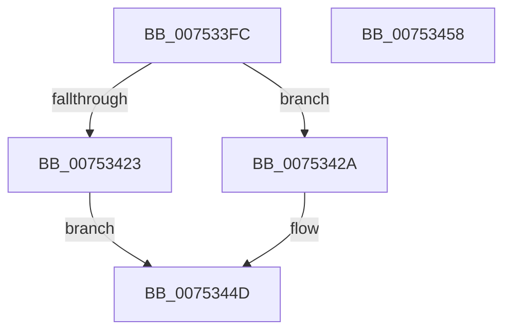

# PfpSetParameter

- RVA: `0x007533FC`–`0x00753459` (길이 `93` bytes)
- VA: `0x00000001407533FC`
- 실행 섹션: `PAGE`
- PDB 이름 있음: `예`; PDB Function 태그: `아니요`
- unwind 정보 RVA: `0x00065960`
- 디코드: `26`개 명령, `93/93` bytes 표시
- 미해석 바이트: `0` (있으면 어셈블리에 `.byte`로 보존)

> 이 문서는 커널 이미지의 기계어와 PDB 기호를 분석해 생성했습니다. 4번과 5번은 함수 원형과 자료형을 바이너리 사용 방식에서 추정한 C 해석이며 원본 소스 복구 결과는 아닙니다.

## 1. Dependencies

- 직접 호출 지점: **2**; 고유 호출 대상: **2**
- 직접 호출자로 확인된 함수: **3**
- RIP 상대 이미지 참조: **0**

### Outgoing calls
- `0x00753419` → [RtlInitUnicodeString](../../text/42/RtlInitUnicodeString_function_0042A780.md) (function, `0x0042A780`)
- `0x00753448` → [ZwSetValueKey](../../text/6A/ZwSetValueKey_function_006ADCD0.md) (function, `0x006ADCD0`)

### Direct callers
- [PfpSetBaseTime](PfpSetBaseTime_function_0075333C.md) at `0x007533A7`
- [PfSetSuperfetchInformation](../AD/PfSetSuperfetchInformation_function_00ADE6E8.md) at `0x00ADF1D0`
- [PfpParametersInitialize](../../init/C3/PfpParametersInitialize_function_00C3CEF0.md) at `0x00C3D052`

### Static image references
- 디코드된 RIP-relative 메모리 참조가 없습니다.

## 2. Other-region calls and transfers

- 다른 실행 섹션으로 향하는 call: **2**
  - `0x00753419` → [RtlInitUnicodeString](../../text/42/RtlInitUnicodeString_function_0042A780.md) (`PAGE` → `.text`)
  - `0x00753448` → [ZwSetValueKey](../../text/6A/ZwSetValueKey_function_006ADCD0.md) (`PAGE` → `.text`)
- 별도 외부 분기/꼬리 이동을 확인하지 못했습니다.

## 3. Assembly (complete function range)

```asm
007533FC  48 89 5C 24 08                  mov qword ptr [rsp + 8], rbx
00753401  57                              push rdi
00753402  48 83 EC 40                     sub rsp, 0x40
00753406  48 8B D9                        mov rbx, rcx
00753409  0F 57 C0                        xorps xmm0, xmm0
0075340C  48 8D 4C 24 30                  lea rcx, [rsp + 0x30]
00753411  49 8B F9                        mov rdi, r9
00753414  0F 11 44 24 30                  movups xmmword ptr [rsp + 0x30], xmm0
00753419  E8 62 73 CD FF                  call 0x14042a780
0075341E  48 85 DB                        test rbx, rbx
00753421  75 07                           jne 0x14075342a
00753423  B8 0D 00 00 C0                  mov eax, 0xc000000d
00753428  EB 23                           jmp 0x14075344d
0075342A  8B 44 24 70                     mov eax, dword ptr [rsp + 0x70]
0075342E  48 8D 54 24 30                  lea rdx, [rsp + 0x30]
00753433  89 44 24 28                     mov dword ptr [rsp + 0x28], eax
00753437  41 B9 04 00 00 00               mov r9d, 4
0075343D  45 33 C0                        xor r8d, r8d
00753440  48 89 7C 24 20                  mov qword ptr [rsp + 0x20], rdi
00753445  48 8B CB                        mov rcx, rbx
00753448  E8 83 A8 F5 FF                  call 0x1406adcd0
0075344D  48 8B 5C 24 50                  mov rbx, qword ptr [rsp + 0x50]
00753452  48 83 C4 40                     add rsp, 0x40
00753456  5F                              pop rdi
00753457  C3                              ret
00753458  CC                              int3
```

## 4. C-style interpretation (structured pseudocode)

```c
__int64 __fastcall PfpSetParameter(__int64 a1, __int64 a2, int a3, __int64 a4, unsigned int a5)
{
    __int64 result;
    __int64 v_rsp;
    unsigned __int64 v_stack_m18;
    unsigned int v_stack_m20;
    unsigned __int64 v_stack_m28;
    unsigned __int64 v_stack_p8;

    v_stack_p8 = v_rbx;
    v_rsp = (v_rsp) - (64);
    v_stack_m18 = v_xmm0;
    result = RtlInitUnicodeString(v_stack_m18, a2, a3, a4);
    if (a1 != 0) goto loc_0075342A;
    goto loc_0075344D;
loc_0075342A:
    v_stack_m20 = (unsigned int)((unsigned int)(a5));
    a3 = 0;
    v_stack_m28 = a4;
    result = ZwSetValueKey(a1, v_stack_m18, a3, 4);
loc_0075344D:
    v_rsp = (v_rsp) + (64);
    return result;
}
```

## 5. (Beta) C Style

```c
int64_t PfpSetParameter(int64_t Arg1, int64_t Arg2, int32_t Arg3, int64_t Arg4, uint32_t Arg5)
{
    int64_t result;
    int64_t local_rsp;
    uint64_t v_stack_m18;
    uint32_t v_stack_m20;
    uint64_t v_stack_m28;
    uint64_t v_stack_p8;

    v_stack_p8 = local_rbx;
    local_rsp = (local_rsp) - (64);
    v_stack_m18 = v_xmm0;
    result = RtlInitUnicodeString(v_stack_m18, Arg2, Arg3, Arg4);
    if (Arg1 != 0) goto loc_0075342A;
    goto loc_0075344D;
loc_0075342A:
    v_stack_m20 = (uint32_t)((uint32_t)(Arg5));
    Arg3 = 0;
    v_stack_m28 = Arg4;
    result = ZwSetValueKey(Arg1, v_stack_m18, Arg3, 4);
loc_0075344D:
    local_rsp = (local_rsp) + (64);
    return result;
}
```

## 6. Execution-region graph

[열기: 2D/3D 그래프와 함수 탐색 컨트롤 패널](../../../control-panel.html?section=page&rva=0x007533FC&view=graph)

- 2D 그래프는 위에서 아래로 흐르고, 3D 그래프는 빈 공간을 드래그해 회전합니다. Shift+드래그는 이동, 휠은 확대·축소, 함수 노드 선택은 대상 보고서 이동입니다.

### Static fallback


