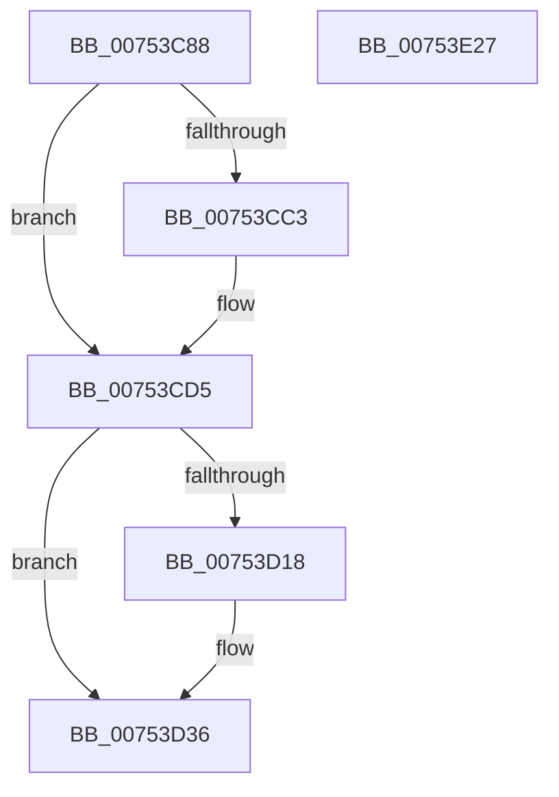

# PoClearTransitionMarker

- RVA: `0x00753C88`–`0x00753E28` (길이 `416` bytes)
- VA: `0x0000000140753C88`
- 실행 섹션: `PAGE`
- PDB 이름 있음: `예`; PDB Function 태그: `아니요`
- unwind 정보 RVA: `0x000BAAA4`
- 디코드: `88`개 명령, `416/416` bytes 표시
- 미해석 바이트: `0` (있으면 어셈블리에 `.byte`로 보존)

> 이 문서는 커널 이미지의 기계어와 PDB 기호를 분석해 생성했습니다. 4번과 5번은 함수 원형과 자료형을 바이너리 사용 방식에서 추정한 C 해석이며 원본 소스 복구 결과는 아닙니다.

## 1. Dependencies

- 직접 호출 지점: **10**; 고유 호출 대상: **10**
- 직접 호출자로 확인된 함수: **1**
- RIP 상대 이미지 참조: **15**

### Outgoing calls
- `0x00753CBA` → [RtlLockBootStatusData](../A9/RtlLockBootStatusData_function_00A94BE0.md) (function, `0x00A94BE0`)
- `0x00753CC7` → [RtlInitializeBootStatusDataBlackBox](../79/RtlInitializeBootStatusDataBlackBox_function_00790694.md) (function, `0x00790694`)
- `0x00753CD0` → [RtlUnlockBootStatusData](../A4/RtlUnlockBootStatusData_function_00A4CAF0.md) (function, `0x00A4CAF0`)
- `0x00753D0F` → [ExIsSoftBoot](../../text/4F/ExIsSoftBoot_function_004FAE60.md) (function, `0x004FAE60`)
- `0x00753D3D` → [PopAcquireRwLockExclusive](../../text/43/PopAcquireRwLockExclusive_function_00430B44.md) (function, `0x00430B44`)
- `0x00753DCB` → [RtlComputeCrc32](../../text/46/RtlComputeCrc32_function_00468F40.md) (function, `0x00468F40`)
- `0x00753DEB` → [RtlpSystemBootStatusRequest](../A8/RtlpSystemBootStatusRequest_function_00A8B384.md) (function, `0x00A8B384`)
- `0x00753DF7` → [PopReleaseRwLock](../../text/2D/PopReleaseRwLock_function_002DFBBC.md) (function, `0x002DFBBC`)
- `0x00753E01` → [PopRecordLongPowerButtonPressDetected](PopRecordLongPowerButtonPressDetected_function_007543BC.md) (function, `0x007543BC`)
- `0x00753E0D` → [_security_check_cookie](../../text/6A/_security_check_cookie_function_006AC640.md) (function, `0x006AC640`)

### Direct callers
- [CmCompleteRegistryInitialization](../7D/CmCompleteRegistryInitialization_function_007DF1EC.md) at `0x007DF341`

### Static image references
- `0x00753C9F` → RVA `0x00E0A740` (`.data`; read)
- `0x00753CD5` → RVA `0x00E67410` (`.data`; read)
- `0x00753CEC` → RVA `0x00E673F0` (`.data`; read)
- `0x00753D36` → RVA `0x00F0F1E0` (`.data`; read)
- `0x00753D4F` → RVA `0x00E67418` (`.data`; write)
- `0x00753D60` → RVA `0x00E67420` (`.data`; read)
- `0x00753D76` → RVA `0x00E67400` (`.data`; read)
- `0x00753D7F` → RVA `0x00E6742C` (`.data`; write)
- `0x00753D90` → RVA `0x00E673F1` (`.data`; write)
- `0x00753D96` → RVA `0x00E6741B` (`.data`; read)
- `0x00753DA1` → RVA `0x00E6741B` (`.data`; write)
- `0x00753DB4` → RVA `0x00F0858C` (`.data`; write)
- `0x00753DC4` → RVA `0x00E67420` (`.data`; write)
- `0x00753DD0` → RVA `0x00E6741E` (`.data`; read/write)
- `0x00753DDE` → RVA `0x00E67428` (`.data`; write)

## 2. Other-region calls and transfers

- 다른 실행 섹션으로 향하는 call: **5**
  - `0x00753D0F` → [ExIsSoftBoot](../../text/4F/ExIsSoftBoot_function_004FAE60.md) (`PAGE` → `.text`)
  - `0x00753D3D` → [PopAcquireRwLockExclusive](../../text/43/PopAcquireRwLockExclusive_function_00430B44.md) (`PAGE` → `.text`)
  - `0x00753DCB` → [RtlComputeCrc32](../../text/46/RtlComputeCrc32_function_00468F40.md) (`PAGE` → `.text`)
  - `0x00753DF7` → [PopReleaseRwLock](../../text/2D/PopReleaseRwLock_function_002DFBBC.md) (`PAGE` → `.text`)
  - `0x00753E0D` → [_security_check_cookie](../../text/6A/_security_check_cookie_function_006AC640.md) (`PAGE` → `.text`)
- 별도 외부 분기/꼬리 이동을 확인하지 못했습니다.

## 3. Assembly (complete function range)

```asm
00753C88  48 89 5C 24 08                  mov qword ptr [rsp + 8], rbx
00753C8D  48 89 7C 24 10                  mov qword ptr [rsp + 0x10], rdi
00753C92  55                              push rbp
00753C93  48 8D 6C 24 A9                  lea rbp, [rsp - 0x57]
00753C98  48 81 EC 90 00 00 00            sub rsp, 0x90
00753C9F  48 8B 05 9A 6A 6B 00            mov rax, qword ptr [rip + 0x6b6a9a]
00753CA6  48 33 C4                        xor rax, rsp
00753CA9  48 89 45 47                     mov qword ptr [rbp + 0x47], rax
00753CAD  48 83 65 EF 00                  and qword ptr [rbp - 0x11], 0
00753CB2  48 8D 4D EF                     lea rcx, [rbp - 0x11]
00753CB6  C6 45 E7 00                     mov byte ptr [rbp - 0x19], 0
00753CBA  E8 21 0F 34 00                  call 0x140a94be0
00753CBF  85 C0                           test eax, eax
00753CC1  78 12                           js 0x140753cd5
00753CC3  48 8B 4D EF                     mov rcx, qword ptr [rbp - 0x11]
00753CC7  E8 C8 C9 03 00                  call 0x140790694
00753CCC  48 8B 4D EF                     mov rcx, qword ptr [rbp - 0x11]
00753CD0  E8 1B 8E 2F 00                  call 0x140a4caf0
00753CD5  48 8D 05 34 37 71 00            lea rax, [rip + 0x713734]
00753CDC  C7 45 F7 07 00 00 00            mov dword ptr [rbp - 9], 7
00753CE3  48 89 45 FF                     mov qword ptr [rbp - 1], rax
00753CE7  BB 02 00 00 00                  mov ebx, 2
00753CEC  48 8D 05 FD 36 71 00            lea rax, [rip + 0x7136fd]
00753CF3  C7 45 07 20 00 00 00            mov dword ptr [rbp + 7], 0x20
00753CFA  48 89 45 17                     mov qword ptr [rbp + 0x17], rax
00753CFE  40 B7 01                        mov dil, 1
00753D01  C7 45 0F 10 00 00 00            mov dword ptr [rbp + 0xf], 0x10
00753D08  C7 45 1F 20 00 00 00            mov dword ptr [rbp + 0x1f], 0x20
00753D0F  E8 4C 71 DA FF                  call 0x1404fae60
00753D14  84 C0                           test al, al
00753D16  74 1E                           je 0x140753d36
00753D18  48 8D 45 E7                     lea rax, [rbp - 0x19]
00753D1C  C7 45 27 05 00 00 00            mov dword ptr [rbp + 0x27], 5
00753D23  48 89 45 2F                     mov qword ptr [rbp + 0x2f], rax
00753D27  40 32 FF                        xor dil, dil
00753D2A  BB 03 00 00 00                  mov ebx, 3
00753D2F  C7 45 37 01 00 00 00            mov dword ptr [rbp + 0x37], 1
00753D36  48 8D 0D A3 B4 7B 00            lea rcx, [rip + 0x7bb4a3]
00753D3D  E8 02 CE CD FF                  call 0x140430b44
00753D42  0F 57 C9                        xorps xmm1, xmm1
00753D45  0F 57 C0                        xorps xmm0, xmm0
00753D48  0F 11 05 C1 36 71 00            movups xmmword ptr [rip + 0x7136c1], xmm0
00753D4F  C6 05 C2 36 71 00 01            mov byte ptr [rip + 0x7136c2], 1
00753D56  48 B8 C4 02 00 00 80 F7 FF FF   movabs rax, 0xfffff780000002c4
00753D60  0F 11 05 B9 36 71 00            movups xmmword ptr [rip + 0x7136b9], xmm0
00753D67  41 B8 08 00 00 00               mov r8d, 8
00753D6D  33 C9                           xor ecx, ecx
00753D6F  0F 11 0D 7A 36 71 00            movups xmmword ptr [rip + 0x71367a], xmm1
00753D76  0F 11 0D 83 36 71 00            movups xmmword ptr [rip + 0x713683], xmm1
00753D7D  8B 00                           mov eax, dword ptr [rax]
00753D7F  89 05 A7 36 71 00               mov dword ptr [rip + 0x7136a7], eax
00753D85  66 0F 73 D9 01                  psrldq xmm1, 1
00753D8A  66 0F 7E C8                     movd eax, xmm1
00753D8E  24 F3                           and al, 0xf3
00753D90  88 05 5B 36 71 00               mov byte ptr [rip + 0x71365b], al
00753D96  8A 05 7F 36 71 00               mov al, byte ptr [rip + 0x71367f]
00753D9C  0C C0                           or al, 0xc0
00753D9E  0F B6 D0                        movzx edx, al
00753DA1  88 05 74 36 71 00               mov byte ptr [rip + 0x713674], al
00753DA7  48 B8 14 00 00 00 80 F7 FF FF   movabs rax, 0xfffff78000000014
00753DB1  C1 EA 06                        shr edx, 6
00753DB4  89 15 D2 47 7B 00               mov dword ptr [rip + 0x7b47d2], edx
00753DBA  48 8D 15 5F 36 71 00            lea rdx, [rip + 0x71365f]
00753DC1  48 8B 00                        mov rax, qword ptr [rax]
00753DC4  48 89 05 55 36 71 00            mov qword ptr [rip + 0x713655], rax
00753DCB  E8 70 51 D1 FF                  call 0x140468f40
00753DD0  80 25 47 36 71 00 EF            and byte ptr [rip + 0x713647], 0xef
00753DD7  48 8D 55 F7                     lea rdx, [rbp - 9]
00753DDB  45 33 C9                        xor r9d, r9d
00753DDE  89 05 44 36 71 00               mov dword ptr [rip + 0x713644], eax
00753DE4  44 8B C3                        mov r8d, ebx
00753DE7  41 8D 49 20                     lea ecx, [r9 + 0x20]
00753DEB  E8 94 75 33 00                  call 0x140a8b384
00753DF0  48 8D 0D E9 B3 7B 00            lea rcx, [rip + 0x7bb3e9]
00753DF7  E8 C0 BD B8 FF                  call 0x1402dfbbc
00753DFC  40 8A D7                        mov dl, dil
00753DFF  33 C9                           xor ecx, ecx
00753E01  E8 B6 05 00 00                  call 0x1407543bc
00753E06  48 8B 4D 47                     mov rcx, qword ptr [rbp + 0x47]
00753E0A  48 33 CC                        xor rcx, rsp
00753E0D  E8 2E 88 F5 FF                  call 0x1406ac640
00753E12  4C 8D 9C 24 90 00 00 00         lea r11, [rsp + 0x90]
00753E1A  49 8B 5B 10                     mov rbx, qword ptr [r11 + 0x10]
00753E1E  49 8B 7B 18                     mov rdi, qword ptr [r11 + 0x18]
00753E22  49 8B E3                        mov rsp, r11
00753E25  5D                              pop rbp
00753E26  C3                              ret
00753E27  CC                              int3
```

## 4. C-style interpretation (structured pseudocode)

```c
__int64 __fastcall PoClearTransitionMarker(__int64 a1, __int64 a2, __int64 a3, int a4)
{
    __int64 result;
    __int64 v_rbx;
    __int64 v_rdi;
    __int64 v_rsp;
    unsigned __int64 v_stack_m18;
    unsigned int v_stack_m28;
    unsigned __int64 v_stack_m30;
    unsigned int v_stack_m38;
    unsigned int v_stack_m40;
    unsigned __int64 v_stack_m48;
    unsigned int v_stack_m50;
    unsigned int v_stack_m58;
    unsigned __int64 v_stack_m5F;
    unsigned __int64 v_stack_m60;
    unsigned int v_stack_m68;
    unsigned __int64 v_stack_m70;
    unsigned __int8 v_stack_m78;
    unsigned __int64 v_stack_m8;
    unsigned __int64 v_stack_p10;
    unsigned __int64 v_stack_p8;

    v_stack_p8 = v_rbx;
    v_stack_p10 = v_rdi;
    v_rsp = (v_rsp) - (144);
    result = (*(unsigned __int64 *)(v_rip + 7039642)) ^ (v_rsp);
    v_stack_m18 = result;
    v_stack_m78 = 0;
    result = RtlLockBootStatusData(v_stack_m70, a2, a3, a4);
    if (!(sign_flag)) {
        a1 = v_stack_m70;
        result = RtlInitializeBootStatusDataBlackBox(a1, a2, a3, a4);
        a1 = v_stack_m70;
        result = RtlUnlockBootStatusData(a1, a2, a3, a4);
    }
    v_stack_m68 = 7;
    v_stack_m60 = v_rip + 7419700;
    v_stack_m58 = 32;
    v_stack_m48 = v_rip + 7419645;
    v_stack_m50 = 16;
    v_stack_m40 = 32;
    result = ExIsSoftBoot(a1, a2, a3, a4);
    v_rbx = 2;
    v_rdi = 1;
    if ((unsigned __int8)(result) != 0) {
        result = v_stack_m78;
        v_stack_m38 = 5;
        v_stack_m30 = result;
        v_rdi = 0;
        v_rbx = 3;
        v_stack_m28 = 1;
    }
    result = PopAcquireRwLockExclusive(v_rip + 8107171, a2, a3, a4);
    *(unsigned __int64 *)(v_rip + 7419585) = v_xmm0;
    *(unsigned __int8 *)(v_rip + 7419586) = 1;
    *(unsigned __int64 *)(v_rip + 7419577) = v_xmm0;
    a1 = 0;
    *(unsigned __int64 *)(v_rip + 7419514) = v_xmm1;
    *(unsigned __int64 *)(v_rip + 7419523) = v_xmm1;
    *(unsigned int *)(v_rip + 7419559) = (unsigned int)((unsigned int)(*(unsigned int *)(result)));
    result = (unsigned __int8)(((unsigned int)(*(unsigned int *)(result))) & (243));
    *(unsigned __int8 *)(v_rip + 7419483) = (unsigned __int8)(result);
    result = (unsigned __int8)((*(unsigned __int8 *)(v_rip + 7419519)) | (192));
    *(unsigned __int8 *)(v_rip + 7419508) = (unsigned __int8)(result);
    a2 = (unsigned int)(((unsigned __int8)(result)) >> (6));
    *(unsigned int *)(v_rip + 8079314) = (unsigned int)(a2);
    *(unsigned __int64 *)(v_rip + 7419477) = *(unsigned __int64 *)(result);
    result = RtlComputeCrc32(a1, v_rip + 7419487, 8, a4);
    a4 = 0;
    *(unsigned int *)(v_rip + 7419460) = (unsigned int)(result);
    result = RtlpSystemBootStatusRequest(a4 + 32, v_stack_m68, (unsigned int)((unsigned int)(v_rbx)), a4);
    result = PopReleaseRwLock(v_rip + 8106985, v_stack_m68, (unsigned int)((unsigned int)(v_rbx)), a4);
    a1 = 0;
    result = PopRecordLongPowerButtonPressDetected(a1, 0, (unsigned int)((unsigned int)(v_rbx)), a4);
    a1 = (v_stack_m18) ^ (v_rsp);
    result = _security_check_cookie(a1, 0, (unsigned int)((unsigned int)(v_rbx)), a4);
    return result;
}
```

## 5. (Beta) C Style

```c
int64_t PoClearTransitionMarker(int64_t Arg1, int64_t Arg2, int64_t Arg3, int32_t Arg4)
{
    int64_t result;
    int64_t local_rbx;
    int64_t local_rdi;
    int64_t local_rsp;
    uint64_t v_stack_m18;
    uint32_t v_stack_m28;
    uint64_t v_stack_m30;
    uint32_t v_stack_m38;
    uint32_t v_stack_m40;
    uint64_t v_stack_m48;
    uint32_t v_stack_m50;
    uint32_t v_stack_m58;
    uint64_t v_stack_m5F;
    uint64_t v_stack_m60;
    uint32_t v_stack_m68;
    uint64_t v_stack_m70;
    uint8_t v_stack_m78;
    uint64_t v_stack_m8;
    uint64_t v_stack_p10;
    uint64_t v_stack_p8;

    v_stack_p8 = local_rbx;
    v_stack_p10 = local_rdi;
    local_rsp = (local_rsp) - (144);
    result = (*(uint64_t *)(v_rip + 0x6B6A9A)) ^ (local_rsp);
    v_stack_m18 = result;
    v_stack_m78 = 0;
    result = RtlLockBootStatusData(v_stack_m70, Arg2, Arg3, Arg4);
    if (!(sign_flag)) {
        Arg1 = v_stack_m70;
        result = RtlInitializeBootStatusDataBlackBox(Arg1, Arg2, Arg3, Arg4);
        Arg1 = v_stack_m70;
        result = RtlUnlockBootStatusData(Arg1, Arg2, Arg3, Arg4);
    }
    v_stack_m68 = 7;
    v_stack_m60 = v_rip + 7419700;
    v_stack_m58 = 32;
    v_stack_m48 = v_rip + 7419645;
    v_stack_m50 = 16;
    v_stack_m40 = 32;
    result = ExIsSoftBoot(Arg1, Arg2, Arg3, Arg4);
    local_rbx = 2;
    local_rdi = 1;
    if ((uint8_t)(result) != 0) {
        result = v_stack_m78;
        v_stack_m38 = 5;
        v_stack_m30 = result;
        local_rdi = 0;
        local_rbx = 3;
        v_stack_m28 = 1;
    }
    result = PopAcquireRwLockExclusive(v_rip + 8107171, Arg2, Arg3, Arg4);
    *(uint64_t *)(v_rip + 0x7136C1) = v_xmm0;
    *(uint8_t *)(v_rip + 0x7136C2) = 1;
    *(uint64_t *)(v_rip + 0x7136B9) = v_xmm0;
    Arg1 = 0;
    *(uint64_t *)(v_rip + 0x71367A) = v_xmm1;
    *(uint64_t *)(v_rip + 0x713683) = v_xmm1;
    *(uint32_t *)(v_rip + 0x7136A7) = (uint32_t)((uint32_t)(*(uint32_t *)(result)));
    result = (uint8_t)(((uint32_t)(*(uint32_t *)(result))) & (243));
    *(uint8_t *)(v_rip + 0x71365B) = (uint8_t)(result);
    result = (uint8_t)((*(uint8_t *)(v_rip + 0x71367F)) | (192));
    *(uint8_t *)(v_rip + 0x713674) = (uint8_t)(result);
    Arg2 = (uint32_t)(((uint8_t)(result)) >> (6));
    *(uint32_t *)(v_rip + 0x7B47D2) = (uint32_t)(Arg2);
    *(uint64_t *)(v_rip + 0x713655) = *(uint64_t *)(result);
    result = RtlComputeCrc32(Arg1, v_rip + 7419487, 8, Arg4);
    Arg4 = 0;
    *(uint32_t *)(v_rip + 0x713644) = (uint32_t)(result);
    result = RtlpSystemBootStatusRequest(Arg4 + 32, v_stack_m68, (uint32_t)((uint32_t)(local_rbx)), Arg4);
    result = PopReleaseRwLock(v_rip + 8106985, v_stack_m68, (uint32_t)((uint32_t)(local_rbx)), Arg4);
    Arg1 = 0;
    result = PopRecordLongPowerButtonPressDetected(Arg1, 0, (uint32_t)((uint32_t)(local_rbx)), Arg4);
    Arg1 = (v_stack_m18) ^ (local_rsp);
    result = _security_check_cookie(Arg1, 0, (uint32_t)((uint32_t)(local_rbx)), Arg4);
    return result;
}
```

## 6. Execution-region graph

[열기: 2D/3D 그래프와 함수 탐색 컨트롤 패널](../../../control-panel.html?section=page&rva=0x00753C88&view=graph)

- 2D 그래프는 위에서 아래로 흐르고, 3D 그래프는 빈 공간을 드래그해 회전합니다. Shift+드래그는 이동, 휠은 확대·축소, 함수 노드 선택은 대상 보고서 이동입니다.

### Static fallback


