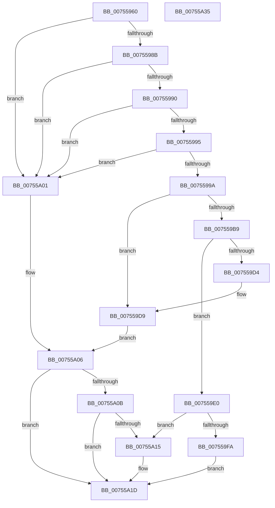

# PoCreatePowerLimitRequest

- RVA: `0x00755960`–`0x00755A36` (길이 `214` bytes)
- VA: `0x0000000140755960`
- 실행 섹션: `PAGE`
- PDB 이름 있음: `예`; PDB Function 태그: `아니요`
- unwind 정보 RVA: `0x000C924C`
- 디코드: `67`개 명령, `214/214` bytes 표시
- 미해석 바이트: `0` (있으면 어셈블리에 `.byte`로 보존)

> 이 문서는 커널 이미지의 기계어와 PDB 기호를 분석해 생성했습니다. 4번과 5번은 함수 원형과 자료형을 바이너리 사용 방식에서 추정한 C 해석이며 원본 소스 복구 결과는 아닙니다.

## 1. Dependencies

- 직접 호출 지점: **5**; 고유 호출 대상: **5**
- 직접 호출자로 확인된 함수: **0**
- RIP 상대 이미지 참조: **0**

### Outgoing calls
- `0x007559AE` → [PoCaptureReasonContext](../../text/23/PoCaptureReasonContext_function_00230A38.md) (function, `0x00230A38`)
- `0x007559C7` → [ExAllocatePool2](../../poolcode/B8/ExAllocatePool2_function_00B820F0.md) (function, `0x00B820F0`)
- `0x007559EF` → [PopAssociatePowerLimitRequest](PopAssociatePowerLimitRequest_function_00755EC8.md) (function, `0x00755EC8`)
- `0x00755A0B` → [PoDestroyReasonContext](../../text/23/PoDestroyReasonContext_function_00230944.md) (function, `0x00230944`)
- `0x00755A18` → [PopFreePowerLimitRequest](PopFreePowerLimitRequest_function_00756494.md) (function, `0x00756494`)

### Direct callers
- 이 함수 시작 RVA로 연결되는 직접 call은 확인되지 않았습니다. 간접 호출은 완전히 역산할 수 없습니다.

### Static image references
- 디코드된 RIP-relative 메모리 참조가 없습니다.

## 2. Other-region calls and transfers

- 다른 실행 섹션으로 향하는 call: **3**
  - `0x007559AE` → [PoCaptureReasonContext](../../text/23/PoCaptureReasonContext_function_00230A38.md) (`PAGE` → `.text`)
  - `0x007559C7` → [ExAllocatePool2](../../poolcode/B8/ExAllocatePool2_function_00B820F0.md) (`PAGE` → `POOLCODE`)
  - `0x00755A0B` → [PoDestroyReasonContext](../../text/23/PoDestroyReasonContext_function_00230944.md) (`PAGE` → `.text`)
- 별도 외부 분기/꼬리 이동을 확인하지 못했습니다.

## 3. Assembly (complete function range)

```asm
00755960  4C 8B DC                        mov r11, rsp
00755963  49 89 5B 10                     mov qword ptr [r11 + 0x10], rbx
00755967  49 89 73 18                     mov qword ptr [r11 + 0x18], rsi
0075596B  49 89 7B 20                     mov qword ptr [r11 + 0x20], rdi
0075596F  41 56                           push r14
00755971  48 83 EC 30                     sub rsp, 0x30
00755975  4C 8B F1                        mov r14, rcx
00755978  33 FF                           xor edi, edi
0075597A  33 C9                           xor ecx, ecx
0075597C  49 8B C1                        mov rax, r9
0075597F  49 89 4B 08                     mov qword ptr [r11 + 8], rcx
00755983  48 8B F2                        mov rsi, rdx
00755986  4D 85 F6                        test r14, r14
00755989  74 76                           je 0x140755a01
0075598B  48 85 D2                        test rdx, rdx
0075598E  74 71                           je 0x140755a01
00755990  4D 85 C0                        test r8, r8
00755993  74 6C                           je 0x140755a01
00755995  48 85 C0                        test rax, rax
00755998  74 67                           je 0x140755a01
0075599A  49 8D 4B 08                     lea rcx, [r11 + 8]
0075599E  41 B1 01                        mov r9b, 1
007559A1  49 89 4B F0                     mov qword ptr [r11 - 0x10], rcx
007559A5  33 D2                           xor edx, edx
007559A7  49 21 7B E8                     and qword ptr [r11 - 0x18], rdi
007559AB  48 8B C8                        mov rcx, rax
007559AE  E8 85 B0 AD FF                  call 0x140230a38
007559B3  8B D8                           mov ebx, eax
007559B5  85 C0                           test eax, eax
007559B7  78 20                           js 0x1407559d9
007559B9  8D 57 48                        lea edx, [rdi + 0x48]
007559BC  B9 00 01 00 00                  mov ecx, 0x100
007559C1  41 B8 50 50 6C 6D               mov r8d, 0x6d6c5050
007559C7  E8 24 C7 42 00                  call 0x140b820f0
007559CC  48 8B F8                        mov rdi, rax
007559CF  48 85 C0                        test rax, rax
007559D2  75 0C                           jne 0x1407559e0
007559D4  BB 9A 00 00 C0                  mov ebx, 0xc000009a
007559D9  48 8B 4C 24 40                  mov rcx, qword ptr [rsp + 0x40]
007559DE  EB 26                           jmp 0x140755a06
007559E0  48 8B 44 24 40                  mov rax, qword ptr [rsp + 0x40]
007559E5  48 8B D6                        mov rdx, rsi
007559E8  48 8B CF                        mov rcx, rdi
007559EB  48 89 47 18                     mov qword ptr [rdi + 0x18], rax
007559EF  E8 D4 04 00 00                  call 0x140755ec8
007559F4  8B D8                           mov ebx, eax
007559F6  85 C0                           test eax, eax
007559F8  78 1B                           js 0x140755a15
007559FA  49 89 3E                        mov qword ptr [r14], rdi
007559FD  33 DB                           xor ebx, ebx
007559FF  EB 1C                           jmp 0x140755a1d
00755A01  BB 0D 00 00 C0                  mov ebx, 0xc000000d
00755A06  48 85 C9                        test rcx, rcx
00755A09  74 12                           je 0x140755a1d
00755A0B  E8 34 AF AD FF                  call 0x140230944
00755A10  48 85 FF                        test rdi, rdi
00755A13  74 08                           je 0x140755a1d
00755A15  48 8B CF                        mov rcx, rdi
00755A18  E8 77 0A 00 00                  call 0x140756494
00755A1D  48 8B 74 24 50                  mov rsi, qword ptr [rsp + 0x50]
00755A22  8B C3                           mov eax, ebx
00755A24  48 8B 5C 24 48                  mov rbx, qword ptr [rsp + 0x48]
00755A29  48 8B 7C 24 58                  mov rdi, qword ptr [rsp + 0x58]
00755A2E  48 83 C4 30                     add rsp, 0x30
00755A32  41 5E                           pop r14
00755A34  C3                              ret
00755A35  CC                              int3
```

## 4. C-style interpretation (structured pseudocode)

```c
__int64 __fastcall PoCreatePowerLimitRequest(__int64 a1, __int64 a2, __int64 a3, __int64 a4)
{
    __int64 result;
    __int64 v_rbx;
    __int64 v_rdi;
    __int64 v_rsp;
    unsigned __int64 v_stack_p10;
    unsigned __int64 v_stack_p18;
    unsigned __int64 v_stack_p20;
    unsigned __int64 v_stack_p8;

    *(unsigned __int64 *)(v_rsp + 16) = v_rbx;
    *(unsigned __int64 *)(v_rsp + 24) = v_rsi;
    *(unsigned __int64 *)(v_rsp + 32) = v_rdi;
    v_rsp = (v_rsp) - (48);
    v_rdi = 0;
    a1 = 0;
    *(unsigned __int64 *)(v_rsp + 8) = 0;
    if (0 == 0) goto loc_00755A01;
    if (a2 == 0) goto loc_00755A01;
    if (a3 == 0) goto loc_00755A01;
    if (a4 == 0) goto loc_00755A01;
    *(unsigned __int64 *)(v_rsp - 16) = v_rsp + 8;
    a2 = 0;
    result = PoCaptureReasonContext(a4, a2, a3, 1);
    if (sign_flag) goto loc_007559D9;
    result = ExAllocatePool2(256, v_rdi + 72, (unsigned int)(0x6D6C5050ULL), 1);
    if (result != 0) goto loc_007559E0;
loc_007559D9:
    goto loc_00755A06;
loc_007559E0:
    *(unsigned __int64 *)(result + 24) = v_stack_p8;
    result = PopAssociatePowerLimitRequest(result, 0, (unsigned int)(0x6D6C5050ULL), 1);
    if (sign_flag) goto loc_00755A15;
    *(unsigned __int64 *)(a1) = result;
    v_rbx = 0;
    goto loc_00755A1D;
loc_00755A01:
loc_00755A06:
    if (result == 0) goto loc_00755A1D;
    result = PoDestroyReasonContext(result, 0, (unsigned int)(0x6D6C5050ULL), 1);
    if (result != 0) {
        a1 = result;
        result = PopFreePowerLimitRequest(a1, 0, (unsigned int)(0x6D6C5050ULL), 1);
    }
    v_rsp = (v_rsp) + (48);
    return (unsigned int)((unsigned int)((unsigned int)(0xC000000DULL)));
}
```

## 5. (Beta) C Style

```c
int64_t PoCreatePowerLimitRequest(int64_t Arg1, int64_t Arg2, int64_t Arg3, int64_t Arg4)
{
    int64_t result;
    int64_t local_rbx;
    int64_t local_rdi;
    int64_t local_rsp;
    uint64_t v_stack_p10;
    uint64_t v_stack_p18;
    uint64_t v_stack_p20;
    uint64_t v_stack_p8;

    *(uint64_t *)(local_rsp + 0x10) = local_rbx;
    *(uint64_t *)(local_rsp + 0x18) = local_rsi;
    *(uint64_t *)(local_rsp + 0x20) = local_rdi;
    local_rsp = (local_rsp) - (48);
    local_rdi = 0;
    Arg1 = 0;
    *(uint64_t *)(local_rsp + 0x8) = 0;
    if (0 == 0) goto loc_00755A01;
    if (Arg2 == 0) goto loc_00755A01;
    if (Arg3 == 0) goto loc_00755A01;
    if (Arg4 == 0) goto loc_00755A01;
    *(uint64_t *)(local_rsp - 0x10) = local_rsp + 8;
    Arg2 = 0;
    result = PoCaptureReasonContext(Arg4, Arg2, Arg3, 1);
    if (sign_flag) goto loc_007559D9;
    result = ExAllocatePool2(256, local_rdi + 72, (uint32_t)(0x6D6C5050ULL), 1);
    if (result != 0) goto loc_007559E0;
loc_007559D9:
    goto loc_00755A06;
loc_007559E0:
    *(uint64_t *)(result + 0x18) = v_stack_p8;
    result = PopAssociatePowerLimitRequest(result, 0, (uint32_t)(0x6D6C5050ULL), 1);
    if (sign_flag) goto loc_00755A15;
    *(uint64_t *)(Arg1) = result;
    local_rbx = 0;
    goto loc_00755A1D;
loc_00755A01:
loc_00755A06:
    if (result == 0) goto loc_00755A1D;
    result = PoDestroyReasonContext(result, 0, (uint32_t)(0x6D6C5050ULL), 1);
    if (result != 0) {
        Arg1 = result;
        result = PopFreePowerLimitRequest(Arg1, 0, (uint32_t)(0x6D6C5050ULL), 1);
    }
    local_rsp = (local_rsp) + (48);
    return (uint32_t)((uint32_t)((uint32_t)(0xC000000DULL)));
}
```

## 6. Execution-region graph

[열기: 2D/3D 그래프와 함수 탐색 컨트롤 패널](../../../control-panel.html?section=page&rva=0x00755960&view=graph)

- 2D 그래프는 위에서 아래로 흐르고, 3D 그래프는 빈 공간을 드래그해 회전합니다. Shift+드래그는 이동, 휠은 확대·축소, 함수 노드 선택은 대상 보고서 이동입니다.

### Static fallback


