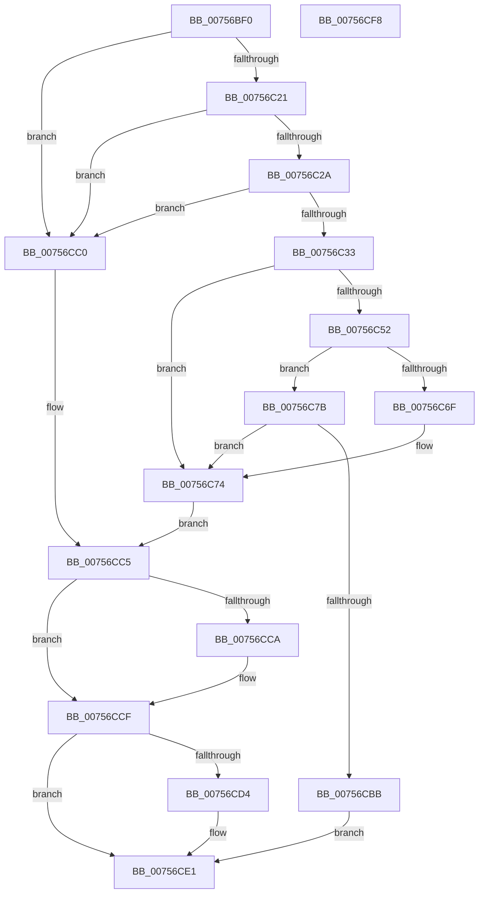

# PoCreateThermalRequest

- RVA: `0x00756BF0`–`0x00756CF9` (길이 `265` bytes)
- VA: `0x0000000140756BF0`
- 실행 섹션: `PAGE`
- PDB 이름 있음: `예`; PDB Function 태그: `아니요`
- unwind 정보 RVA: `0x000A118C`
- 디코드: `74`개 명령, `265/265` bytes 표시
- 미해석 바이트: `0` (있으면 어셈블리에 `.byte`로 보존)

> 이 문서는 커널 이미지의 기계어와 PDB 기호를 분석해 생성했습니다. 4번과 5번은 함수 원형과 자료형을 바이너리 사용 방식에서 추정한 C 해석이며 원본 소스 복구 결과는 아닙니다.

## 1. Dependencies

- 직접 호출 지점: **5**; 고유 호출 대상: **5**
- 직접 호출자로 확인된 함수: **0**
- RIP 상대 이미지 참조: **0**

### Outgoing calls
- `0x00756C47` → [PoCaptureReasonContext](../../text/23/PoCaptureReasonContext_function_00230A38.md) (function, `0x00230A38`)
- `0x00756C62` → [ExAllocatePool2](../../poolcode/B8/ExAllocatePool2_function_00B820F0.md) (function, `0x00B820F0`)
- `0x00756CB0` → [PopAssociateThermalRequest](PopAssociateThermalRequest_function_00756E78.md) (function, `0x00756E78`)
- `0x00756CCA` → [PoDestroyReasonContext](../../text/23/PoDestroyReasonContext_function_00230944.md) (function, `0x00230944`)
- `0x00756CDC` → [ExFreePoolWithTag](../../poolcode/B8/ExFreePoolWithTag_function_00B82870.md) (function, `0x00B82870`)

### Direct callers
- 이 함수 시작 RVA로 연결되는 직접 call은 확인되지 않았습니다. 간접 호출은 완전히 역산할 수 없습니다.

### Static image references
- 디코드된 RIP-relative 메모리 참조가 없습니다.

## 2. Other-region calls and transfers

- 다른 실행 섹션으로 향하는 call: **4**
  - `0x00756C47` → [PoCaptureReasonContext](../../text/23/PoCaptureReasonContext_function_00230A38.md) (`PAGE` → `.text`)
  - `0x00756C62` → [ExAllocatePool2](../../poolcode/B8/ExAllocatePool2_function_00B820F0.md) (`PAGE` → `POOLCODE`)
  - `0x00756CCA` → [PoDestroyReasonContext](../../text/23/PoDestroyReasonContext_function_00230944.md) (`PAGE` → `.text`)
  - `0x00756CDC` → [ExFreePoolWithTag](../../poolcode/B8/ExFreePoolWithTag_function_00B82870.md) (`PAGE` → `POOLCODE`)
- 별도 외부 분기/꼬리 이동을 확인하지 못했습니다.

## 3. Assembly (complete function range)

```asm
00756BF0  4C 8B DC                        mov r11, rsp
00756BF3  49 89 5B 10                     mov qword ptr [r11 + 0x10], rbx
00756BF7  49 89 6B 18                     mov qword ptr [r11 + 0x18], rbp
00756BFB  49 89 73 20                     mov qword ptr [r11 + 0x20], rsi
00756BFF  57                              push rdi
00756C00  48 83 EC 30                     sub rsp, 0x30
00756C04  48 8B F1                        mov rsi, rcx
00756C07  33 DB                           xor ebx, ebx
00756C09  33 C9                           xor ecx, ecx
00756C0B  49 8B C1                        mov rax, r9
00756C0E  48 8B EA                        mov rbp, rdx
00756C11  49 89 4B 08                     mov qword ptr [r11 + 8], rcx
00756C15  48 21 0E                        and qword ptr [rsi], rcx
00756C18  48 85 D2                        test rdx, rdx
00756C1B  0F 84 9F 00 00 00               je 0x140756cc0
00756C21  4D 85 C0                        test r8, r8
00756C24  0F 84 96 00 00 00               je 0x140756cc0
00756C2A  48 85 C0                        test rax, rax
00756C2D  0F 84 8D 00 00 00               je 0x140756cc0
00756C33  49 8D 4B 08                     lea rcx, [r11 + 8]
00756C37  41 B1 01                        mov r9b, 1
00756C3A  49 89 4B F0                     mov qword ptr [r11 - 0x10], rcx
00756C3E  33 D2                           xor edx, edx
00756C40  49 21 5B E8                     and qword ptr [r11 - 0x18], rbx
00756C44  48 8B C8                        mov rcx, rax
00756C47  E8 EC 9D AD FF                  call 0x140230a38
00756C4C  8B F8                           mov edi, eax
00756C4E  85 C0                           test eax, eax
00756C50  78 22                           js 0x140756c74
00756C52  BA 40 02 00 00                  mov edx, 0x240
00756C57  B9 00 01 00 00                  mov ecx, 0x100
00756C5C  41 B8 50 43 6F 6C               mov r8d, 0x6c6f4350
00756C62  E8 89 B4 42 00                  call 0x140b820f0
00756C67  48 8B D8                        mov rbx, rax
00756C6A  48 85 C0                        test rax, rax
00756C6D  75 0C                           jne 0x140756c7b
00756C6F  BF 9A 00 00 C0                  mov edi, 0xc000009a
00756C74  48 8B 4C 24 40                  mov rcx, qword ptr [rsp + 0x40]
00756C79  EB 4A                           jmp 0x140756cc5
00756C7B  48 8B 44 24 40                  mov rax, qword ptr [rsp + 0x40]
00756C80  48 8B D5                        mov rdx, rbp
00756C83  44 8B 44 24 60                  mov r8d, dword ptr [rsp + 0x60]
00756C88  48 8B CB                        mov rcx, rbx
00756C8B  48 89 43 18                     mov qword ptr [rbx + 0x18], rax
00756C8F  48 B8 08 00 00 00 80 F7 FF FF   movabs rax, 0xfffff78000000008
00756C99  C6 43 10 64                     mov byte ptr [rbx + 0x10], 0x64
00756C9D  41 C1 E8 1F                     shr r8d, 0x1f
00756CA1  41 80 F0 01                     xor r8b, 1
00756CA5  48 8B 00                        mov rax, qword ptr [rax]
00756CA8  48 89 43 30                     mov qword ptr [rbx + 0x30], rax
00756CAC  48 89 43 38                     mov qword ptr [rbx + 0x38], rax
00756CB0  E8 C3 01 00 00                  call 0x140756e78
00756CB5  8B F8                           mov edi, eax
00756CB7  85 C0                           test eax, eax
00756CB9  78 B9                           js 0x140756c74
00756CBB  48 89 1E                        mov qword ptr [rsi], rbx
00756CBE  EB 21                           jmp 0x140756ce1
00756CC0  BF 0D 00 00 C0                  mov edi, 0xc000000d
00756CC5  48 85 C9                        test rcx, rcx
00756CC8  74 05                           je 0x140756ccf
00756CCA  E8 75 9C AD FF                  call 0x140230944
00756CCF  48 85 DB                        test rbx, rbx
00756CD2  74 0D                           je 0x140756ce1
00756CD4  BA 50 43 6F 6C                  mov edx, 0x6c6f4350
00756CD9  48 8B CB                        mov rcx, rbx
00756CDC  E8 8F BB 42 00                  call 0x140b82870
00756CE1  48 8B 5C 24 48                  mov rbx, qword ptr [rsp + 0x48]
00756CE6  8B C7                           mov eax, edi
00756CE8  48 8B 6C 24 50                  mov rbp, qword ptr [rsp + 0x50]
00756CED  48 8B 74 24 58                  mov rsi, qword ptr [rsp + 0x58]
00756CF2  48 83 C4 30                     add rsp, 0x30
00756CF6  5F                              pop rdi
00756CF7  C3                              ret
00756CF8  CC                              int3
```

## 4. C-style interpretation (structured pseudocode)

```c
__int64 __fastcall PoCreateThermalRequest(__int64 a1, __int64 a2, __int64 a3, __int64 a4, unsigned int a5)
{
    __int64 result;
    __int64 v_rbx;
    __int64 v_rsp;
    unsigned __int64 v_stack_p10;
    unsigned __int64 v_stack_p18;
    unsigned __int64 v_stack_p20;
    unsigned __int64 v_stack_p8;

    *(unsigned __int64 *)(v_rsp + 16) = v_rbx;
    *(unsigned __int64 *)(v_rsp + 24) = v_rbp;
    *(unsigned __int64 *)(v_rsp + 32) = v_rsi;
    v_rsp = (v_rsp) - (48);
    v_rbx = 0;
    a1 = 0;
    *(unsigned __int64 *)(v_rsp + 8) = 0;
    if (a2 == 0) goto loc_00756CC0;
    if (a3 == 0) goto loc_00756CC0;
    if (a4 == 0) goto loc_00756CC0;
    *(unsigned __int64 *)(v_rsp - 16) = v_rsp + 8;
    a2 = 0;
    result = PoCaptureReasonContext(a4, a2, a3, 1);
    if (sign_flag) goto loc_00756C74;
    result = ExAllocatePool2(256, 576, (unsigned int)(0x6C6F4350ULL), 1);
    if (result != 0) goto loc_00756C7B;
loc_00756C74:
    goto loc_00756CC5;
loc_00756C7B:
    *(unsigned __int64 *)(result + 24) = v_stack_p8;
    *(unsigned __int8 *)(result + 16) = 100;
    a3 = (unsigned int)(((unsigned int)(a5)) >> (31));
    a3 = (unsigned __int8)((a3) ^ (1));
    *(unsigned __int64 *)(result + 48) = *(unsigned __int64 *)(v_stack_p8);
    *(unsigned __int64 *)(result + 56) = *(unsigned __int64 *)(v_stack_p8);
    result = PopAssociateThermalRequest(result, 0, a3, 1);
    if (sign_flag) goto loc_00756C74;
    *(unsigned __int64 *)(a1) = result;
    goto loc_00756CE1;
loc_00756CC0:
loc_00756CC5:
    if (result != 0) {
        result = PoDestroyReasonContext(result, 0, a3, 1);
    }
    if (result != 0) {
        a2 = 0x6C6F4350ULL;
        a1 = result;
        result = ExFreePoolWithTag(a1, a2, a3, 1);
    }
    v_rsp = (v_rsp) + (48);
    return (unsigned int)((unsigned int)((unsigned int)(0xC000000DULL)));
}
```

## 5. (Beta) C Style

```c
int64_t PoCreateThermalRequest(void *Arg1, int64_t Arg2, int64_t Arg3, int64_t Arg4, uint32_t Arg5)
{
    uint8_t *arg1 = (uint8_t *)Arg1;

    int64_t result;
    int64_t local_rbx;
    int64_t local_rsp;
    uint64_t v_stack_p10;
    uint64_t v_stack_p18;
    uint64_t v_stack_p20;
    uint64_t v_stack_p8;

    *(uint64_t *)(local_rsp + 0x10) = local_rbx;
    *(uint64_t *)(local_rsp + 0x18) = local_rbp;
    *(uint64_t *)(local_rsp + 0x20) = local_rsi;
    local_rsp = (local_rsp) - (48);
    local_rbx = 0;
    Arg1 = 0;
    *(uint64_t *)(local_rsp + 0x8) = 0;
    if (Arg2 == 0) goto loc_00756CC0;
    if (Arg3 == 0) goto loc_00756CC0;
    if (Arg4 == 0) goto loc_00756CC0;
    *(uint64_t *)(local_rsp - 0x10) = local_rsp + 8;
    Arg2 = 0;
    result = PoCaptureReasonContext(Arg4, Arg2, Arg3, 1);
    if (sign_flag) goto loc_00756C74;
    result = ExAllocatePool2(256, 576, (uint32_t)(0x6C6F4350ULL), 1);
    if (result != 0) goto loc_00756C7B;
loc_00756C74:
    goto loc_00756CC5;
loc_00756C7B:
    *(uint64_t *)(result + 0x18) = v_stack_p8;
    *(uint8_t *)(result + 0x10) = 100;
    Arg3 = (uint32_t)(((uint32_t)(Arg5)) >> (31));
    Arg3 = (uint8_t)((Arg3) ^ (1));
    *(uint64_t *)(result + 0x30) = *(uint64_t *)(v_stack_p8);
    *(uint64_t *)(result + 0x38) = *(uint64_t *)(v_stack_p8);
    result = PopAssociateThermalRequest(result, 0, Arg3, 1);
    if (sign_flag) goto loc_00756C74;
    *(uint64_t *)(arg1) = result;
    goto loc_00756CE1;
loc_00756CC0:
loc_00756CC5:
    if (result != 0) {
        result = PoDestroyReasonContext(result, 0, Arg3, 1);
    }
    if (result != 0) {
        Arg2 = 0x6C6F4350ULL;
        Arg1 = result;
        result = ExFreePoolWithTag(Arg1, Arg2, Arg3, 1);
    }
    local_rsp = (local_rsp) + (48);
    return (uint32_t)((uint32_t)((uint32_t)(0xC000000DULL)));
}
```

### 관측된 메모리 오프셋

구조체 형식이 확인되지 않은 접근은 인자 기준의 오프셋으로만 기록했습니다.

| 기준 인자 | 오프셋 표현 | 폭 (bit) | 접근 |
|---|---:|---:|---|
| `Arg1` | `+ 0x0` | `64` | `R/W` |
| `Arg1` | `+ 0x0` | `64` | `W` |

## 6. Execution-region graph

[열기: 2D/3D 그래프와 함수 탐색 컨트롤 패널](../../../control-panel.html?section=page&rva=0x00756BF0&view=graph)

- 2D 그래프는 위에서 아래로 흐르고, 3D 그래프는 빈 공간을 드래그해 회전합니다. Shift+드래그는 이동, 휠은 확대·축소, 함수 노드 선택은 대상 보고서 이동입니다.

### Static fallback


