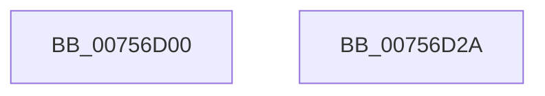

# PoDeleteThermalRequest

- RVA: `0x00756D00`–`0x00756D2B` (길이 `43` bytes)
- VA: `0x0000000140756D00`
- 실행 섹션: `PAGE`
- PDB 이름 있음: `예`; PDB Function 태그: `아니요`
- unwind 정보 RVA: `0x0005CF00`
- 디코드: `13`개 명령, `43/43` bytes 표시
- 미해석 바이트: `0` (있으면 어셈블리에 `.byte`로 보존)

> 이 문서는 커널 이미지의 기계어와 PDB 기호를 분석해 생성했습니다. 4번과 5번은 함수 원형과 자료형을 바이너리 사용 방식에서 추정한 C 해석이며 원본 소스 복구 결과는 아닙니다.

## 1. Dependencies

- 직접 호출 지점: **3**; 고유 호출 대상: **3**
- 직접 호출자로 확인된 함수: **0**
- RIP 상대 이미지 참조: **0**

### Outgoing calls
- `0x00756D09` → [PopDeactiveThermalRequest](../AD/PopDeactiveThermalRequest_function_00ADF634.md) (function, `0x00ADF634`)
- `0x00756D12` → [PoDestroyReasonContext](../../text/23/PoDestroyReasonContext_function_00230944.md) (function, `0x00230944`)
- `0x00756D1F` → [ExFreePoolWithTag](../../poolcode/B8/ExFreePoolWithTag_function_00B82870.md) (function, `0x00B82870`)

### Direct callers
- 이 함수 시작 RVA로 연결되는 직접 call은 확인되지 않았습니다. 간접 호출은 완전히 역산할 수 없습니다.

### Static image references
- 디코드된 RIP-relative 메모리 참조가 없습니다.

## 2. Other-region calls and transfers

- 다른 실행 섹션으로 향하는 call: **2**
  - `0x00756D12` → [PoDestroyReasonContext](../../text/23/PoDestroyReasonContext_function_00230944.md) (`PAGE` → `.text`)
  - `0x00756D1F` → [ExFreePoolWithTag](../../poolcode/B8/ExFreePoolWithTag_function_00B82870.md) (`PAGE` → `POOLCODE`)
- 별도 외부 분기/꼬리 이동을 확인하지 못했습니다.

## 3. Assembly (complete function range)

```asm
00756D00  40 53                           push rbx
00756D02  48 83 EC 20                     sub rsp, 0x20
00756D06  48 8B D9                        mov rbx, rcx
00756D09  E8 26 89 38 00                  call 0x140adf634
00756D0E  48 8B 4B 18                     mov rcx, qword ptr [rbx + 0x18]
00756D12  E8 2D 9C AD FF                  call 0x140230944
00756D17  BA 50 43 6F 6C                  mov edx, 0x6c6f4350
00756D1C  48 8B CB                        mov rcx, rbx
00756D1F  E8 4C BB 42 00                  call 0x140b82870
00756D24  48 83 C4 20                     add rsp, 0x20
00756D28  5B                              pop rbx
00756D29  C3                              ret
00756D2A  CC                              int3
```

## 4. C-style interpretation (structured pseudocode)

```c
__int64 __fastcall PoDeleteThermalRequest(__int64 a1)
{
    __int64 result;
    __int64 v_rsp;

    v_rsp = (v_rsp) - (32);
    result = PopDeactiveThermalRequest(a1, a2, a3, a4);
    result = PoDestroyReasonContext(*(unsigned __int64 *)(a1 + 24), a2, a3, a4);
    result = ExFreePoolWithTag(a1, (unsigned int)(0x6C6F4350ULL), a3, a4);
    v_rsp = (v_rsp) + (32);
    return result;
}
```

## 5. (Beta) C Style

```c
int64_t PoDeleteThermalRequest(void *Arg1)
{
    uint8_t *arg1 = (uint8_t *)Arg1;

    int64_t result;
    int64_t local_rsp;

    local_rsp = (local_rsp) - (32);
    result = PopDeactiveThermalRequest(Arg1, a2, a3, a4);
    result = PoDestroyReasonContext(*(uint64_t *)(arg1 + 0x18), a2, a3, a4);
    result = ExFreePoolWithTag(Arg1, (uint32_t)(0x6C6F4350ULL), a3, a4);
    local_rsp = (local_rsp) + (32);
    return result;
}
```

### 관측된 메모리 오프셋

구조체 형식이 확인되지 않은 접근은 인자 기준의 오프셋으로만 기록했습니다.

| 기준 인자 | 오프셋 표현 | 폭 (bit) | 접근 |
|---|---:|---:|---|
| `Arg1` | `+ 0x18` | `64` | `R` |

## 6. Execution-region graph

[열기: 2D/3D 그래프와 함수 탐색 컨트롤 패널](../../../control-panel.html?section=page&rva=0x00756D00&view=graph)

- 2D 그래프는 위에서 아래로 흐르고, 3D 그래프는 빈 공간을 드래그해 회전합니다. Shift+드래그는 이동, 휠은 확대·축소, 함수 노드 선택은 대상 보고서 이동입니다.

### Static fallback


