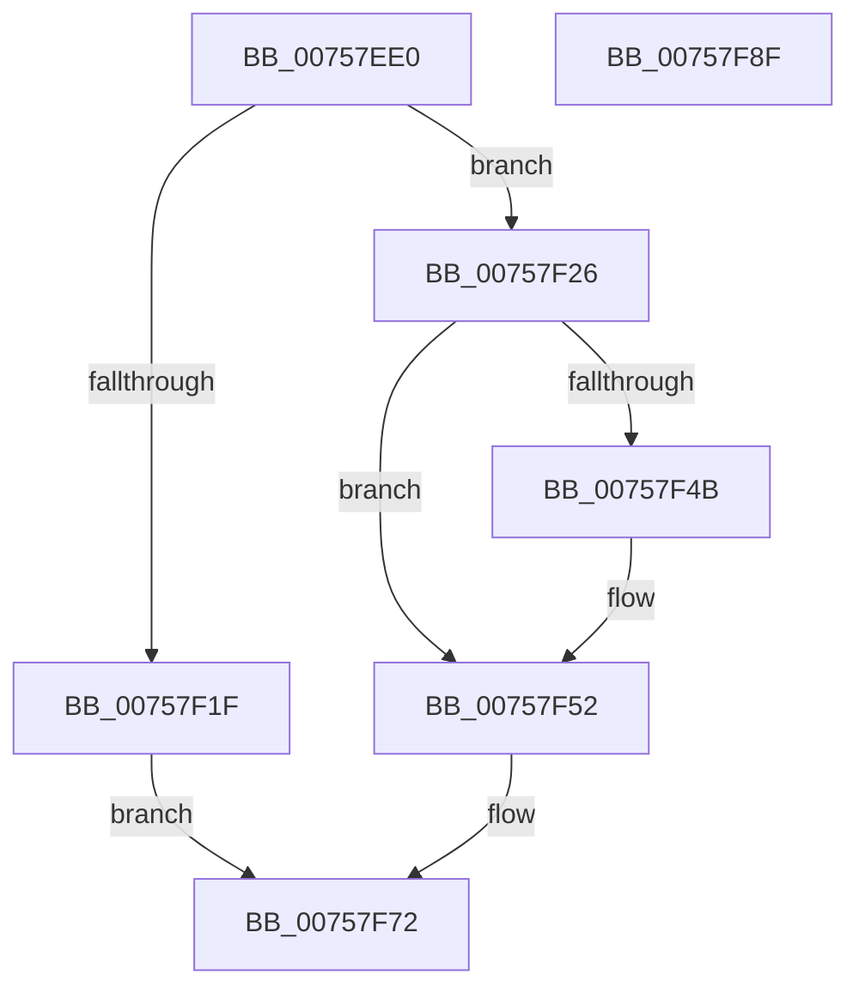

# PoDisableSleepStates

- RVA: `0x00757EE0`–`0x00757F90` (길이 `176` bytes)
- VA: `0x0000000140757EE0`
- 실행 섹션: `PAGE`
- PDB 이름 있음: `예`; PDB Function 태그: `아니요`
- unwind 정보 RVA: `0x0005E6B4`
- 디코드: `46`개 명령, `176/176` bytes 표시
- 미해석 바이트: `0` (있으면 어셈블리에 `.byte`로 보존)

> 이 문서는 커널 이미지의 기계어와 PDB 기호를 분석해 생성했습니다. 4번과 5번은 함수 원형과 자료형을 바이너리 사용 방식에서 추정한 C 해석이며 원본 소스 복구 결과는 아닙니다.

## 1. Dependencies

- 직접 호출 지점: **3**; 고유 호출 대상: **3**
- 직접 호출자로 확인된 함수: **4**
- RIP 상대 이미지 참조: **4**

### Outgoing calls
- `0x00757F10` → [ExAllocatePool2](../../poolcode/B8/ExAllocatePool2_function_00B820F0.md) (function, `0x00B820F0`)
- `0x00757F33` → [ExAcquireFastMutex](../../text/20/ExAcquireFastMutex_function_0020E5A0.md) (function, `0x0020E5A0`)
- `0x00757F6A` → [ExReleaseFastMutex](../../text/25/ExReleaseFastMutex_function_002519C0.md) (function, `0x002519C0`)

### Direct callers
- [VslpIumPhase4Initialize](../../text/58/VslpIumPhase4Initialize_function_0058FAE0.md) at `0x0058FB5D`
- [HalpLoadMicrocode](../70/HalpLoadMicrocode_function_0070B200.md) at `0x0070B421`
- [PopInitializeHibernateGlobals](PopInitializeHibernateGlobals_function_0075DA64.md) at `0x0075DAF2`
- [PopInitializeHibernateGlobals](PopInitializeHibernateGlobals_function_0075DA64.md) at `0x0075DB12`
- [PopInitializeHibernateGlobals](PopInitializeHibernateGlobals_function_0075DA64.md) at `0x0075DB41`
- [PopWnfHibernateRevocationCheckCallback](PopWnfHibernateRevocationCheckCallback_function_0075E440.md) at `0x0075E467`

### Static image references
- `0x00757F26` → RVA `0x00F0EA80` (`.data`; read)
- `0x00757F38` → RVA `0x00F0EA78` (`.data`; read)
- `0x00757F3F` → RVA `0x00F0EA70` (`.data`; read)
- `0x00757F63` → RVA `0x00F0EA78` (`.data`; write)

## 2. Other-region calls and transfers

- 다른 실행 섹션으로 향하는 call: **3**
  - `0x00757F10` → [ExAllocatePool2](../../poolcode/B8/ExAllocatePool2_function_00B820F0.md) (`PAGE` → `POOLCODE`)
  - `0x00757F33` → [ExAcquireFastMutex](../../text/20/ExAcquireFastMutex_function_0020E5A0.md) (`PAGE` → `.text`)
  - `0x00757F6A` → [ExReleaseFastMutex](../../text/25/ExReleaseFastMutex_function_002519C0.md) (`PAGE` → `.text`)
- 별도 외부 분기/꼬리 이동을 확인하지 못했습니다.

## 3. Assembly (complete function range)

```asm
00757EE0  48 8B C4                        mov rax, rsp
00757EE3  48 89 58 08                     mov qword ptr [rax + 8], rbx
00757EE7  48 89 68 10                     mov qword ptr [rax + 0x10], rbp
00757EEB  48 89 70 18                     mov qword ptr [rax + 0x18], rsi
00757EEF  48 89 78 20                     mov qword ptr [rax + 0x20], rdi
00757EF3  41 56                           push r14
00757EF5  48 83 EC 20                     sub rsp, 0x20
00757EF9  4D 8B F0                        mov r14, r8
00757EFC  8B F2                           mov esi, edx
00757EFE  8B E9                           mov ebp, ecx
00757F00  BA 18 00 00 00                  mov edx, 0x18
00757F05  B9 00 01 00 00                  mov ecx, 0x100
00757F0A  41 B8 50 6F 53 64               mov r8d, 0x64536f50
00757F10  E8 DB A1 42 00                  call 0x140b820f0
00757F15  33 FF                           xor edi, edi
00757F17  48 8B D8                        mov rbx, rax
00757F1A  48 85 C0                        test rax, rax
00757F1D  75 07                           jne 0x140757f26
00757F1F  BF 9A 00 00 C0                  mov edi, 0xc000009a
00757F24  EB 4C                           jmp 0x140757f72
00757F26  48 8D 0D 53 6B 7B 00            lea rcx, [rip + 0x7b6b53]
00757F2D  89 68 10                        mov dword ptr [rax + 0x10], ebp
00757F30  89 70 14                        mov dword ptr [rax + 0x14], esi
00757F33  E8 68 66 AB FF                  call 0x14020e5a0
00757F38  48 8B 05 39 6B 7B 00            mov rax, qword ptr [rip + 0x7b6b39]
00757F3F  48 8D 0D 2A 6B 7B 00            lea rcx, [rip + 0x7b6b2a]
00757F46  48 39 08                        cmp qword ptr [rax], rcx
00757F49  74 07                           je 0x140757f52
00757F4B  B9 03 00 00 00                  mov ecx, 3
00757F50  CD 29                           int 0x29
00757F52  48 89 0B                        mov qword ptr [rbx], rcx
00757F55  48 8D 0D 24 6B 7B 00            lea rcx, [rip + 0x7b6b24]
00757F5C  48 89 43 08                     mov qword ptr [rbx + 8], rax
00757F60  48 89 18                        mov qword ptr [rax], rbx
00757F63  48 89 1D 0E 6B 7B 00            mov qword ptr [rip + 0x7b6b0e], rbx
00757F6A  E8 51 9A AF FF                  call 0x1402519c0
00757F6F  49 89 1E                        mov qword ptr [r14], rbx
00757F72  48 8B 5C 24 30                  mov rbx, qword ptr [rsp + 0x30]
00757F77  8B C7                           mov eax, edi
00757F79  48 8B 7C 24 48                  mov rdi, qword ptr [rsp + 0x48]
00757F7E  48 8B 6C 24 38                  mov rbp, qword ptr [rsp + 0x38]
00757F83  48 8B 74 24 40                  mov rsi, qword ptr [rsp + 0x40]
00757F88  48 83 C4 20                     add rsp, 0x20
00757F8C  41 5E                           pop r14
00757F8E  C3                              ret
00757F8F  CC                              int3
```

## 4. C-style interpretation (structured pseudocode)

```c
__int64 __fastcall PoDisableSleepStates(int a1, int a2, __int64 a3)
{
    __int64 result;
    __int64 v_rdi;
    __int64 v_rsp;
    unsigned __int64 v_stack_p10;
    unsigned __int64 v_stack_p18;
    unsigned __int64 v_stack_p20;
    unsigned __int64 v_stack_p8;

    *(unsigned __int64 *)(v_rsp + 8) = v_rbx;
    *(unsigned __int64 *)(v_rsp + 16) = v_rbp;
    *(unsigned __int64 *)(v_rsp + 24) = v_rsi;
    *(unsigned __int64 *)(v_rsp + 32) = v_rdi;
    v_rsp = (v_rsp) - (32);
    result = ExAllocatePool2(256, 24, (unsigned int)(0x64536F50ULL), a4);
    v_rdi = 0;
    if (result != 0) goto loc_00757F26;
    goto loc_00757F72;
loc_00757F26:
    *(unsigned int *)(result + 16) = (unsigned int)((unsigned int)(a1));
    *(unsigned int *)(result + 20) = (unsigned int)((unsigned int)(a2));
    result = ExAcquireFastMutex(v_rip + 8088403, 24, (unsigned int)(0x64536F50ULL), a4);
    if ((*(unsigned __int64 *)(*(unsigned __int64 *)(v_rip + 8088377))) != (v_rip + 8088362)) {
        a1 = 3;
    }
    *(unsigned __int64 *)(result) = a1;
    *(unsigned __int64 *)(result + 8) = *(unsigned __int64 *)(v_rip + 8088377);
    *(unsigned __int64 *)(*(unsigned __int64 *)(v_rip + 8088377)) = result;
    *(unsigned __int64 *)(v_rip + 8088334) = result;
    result = ExReleaseFastMutex(v_rip + 8088356, 24, (unsigned int)(0x64536F50ULL), a4);
    *(unsigned __int64 *)(a3) = result;
loc_00757F72:
    v_rsp = (v_rsp) + (32);
    return (unsigned int)((unsigned int)((unsigned int)(0xC000009AULL)));
}
```

## 5. (Beta) C Style

```c
int64_t PoDisableSleepStates(int32_t Arg1, int32_t Arg2, void *Arg3)
{
    uint8_t *arg3 = (uint8_t *)Arg3;

    int64_t result;
    int64_t local_rdi;
    int64_t local_rsp;
    uint64_t v_stack_p10;
    uint64_t v_stack_p18;
    uint64_t v_stack_p20;
    uint64_t v_stack_p8;

    *(uint64_t *)(local_rsp + 0x8) = local_rbx;
    *(uint64_t *)(local_rsp + 0x10) = local_rbp;
    *(uint64_t *)(local_rsp + 0x18) = local_rsi;
    *(uint64_t *)(local_rsp + 0x20) = local_rdi;
    local_rsp = (local_rsp) - (32);
    result = ExAllocatePool2(256, 24, (uint32_t)(0x64536F50ULL), a4);
    local_rdi = 0;
    if (result != 0) goto loc_00757F26;
    goto loc_00757F72;
loc_00757F26:
    *(uint32_t *)(result + 0x10) = (uint32_t)((uint32_t)(Arg1));
    *(uint32_t *)(result + 0x14) = (uint32_t)((uint32_t)(Arg2));
    result = ExAcquireFastMutex(v_rip + 8088403, 24, (uint32_t)(0x64536F50ULL), a4);
    if ((*(uint64_t *)(*(uint64_t *)(v_rip + 0x7B6B39))) != (v_rip + 8088362)) {
        Arg1 = 3;
    }
    *(uint64_t *)(result) = Arg1;
    *(uint64_t *)(result + 0x8) = *(uint64_t *)(v_rip + 0x7B6B39);
    *(uint64_t *)(*(uint64_t *)(v_rip + 0x7B6B39)) = result;
    *(uint64_t *)(v_rip + 0x7B6B0E) = result;
    result = ExReleaseFastMutex(v_rip + 8088356, 24, (uint32_t)(0x64536F50ULL), a4);
    *(uint64_t *)(arg3) = result;
loc_00757F72:
    local_rsp = (local_rsp) + (32);
    return (uint32_t)((uint32_t)((uint32_t)(0xC000009AULL)));
}
```

### 관측된 메모리 오프셋

구조체 형식이 확인되지 않은 접근은 인자 기준의 오프셋으로만 기록했습니다.

| 기준 인자 | 오프셋 표현 | 폭 (bit) | 접근 |
|---|---:|---:|---|
| `Arg3` | `+ 0x0` | `64` | `W` |

## 6. Execution-region graph

[열기: 2D/3D 그래프와 함수 탐색 컨트롤 패널](../../../control-panel.html?section=page&rva=0x00757EE0&view=graph)

- 2D 그래프는 위에서 아래로 흐르고, 3D 그래프는 빈 공간을 드래그해 회전합니다. Shift+드래그는 이동, 휠은 확대·축소, 함수 노드 선택은 대상 보고서 이동입니다.

### Static fallback


