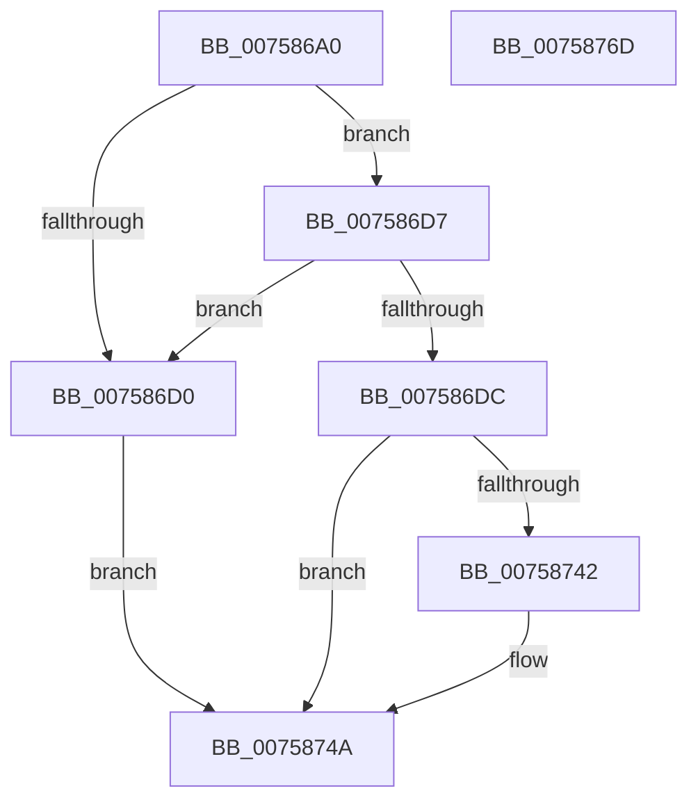

# PoFxEnableDStateReporting

- RVA: `0x007586A0`–`0x0075876E` (길이 `206` bytes)
- VA: `0x00000001407586A0`
- 실행 섹션: `PAGE`
- PDB 이름 있음: `예`; PDB Function 태그: `아니요`
- unwind 정보 RVA: `0x000CC1E4`
- 디코드: `55`개 명령, `206/206` bytes 표시
- 미해석 바이트: `0` (있으면 어셈블리에 `.byte`로 보존)

> 이 문서는 커널 이미지의 기계어와 PDB 기호를 분석해 생성했습니다. 4번과 5번은 함수 원형과 자료형을 바이너리 사용 방식에서 추정한 C 해석이며 원본 소스 복구 결과는 아닙니다.

## 1. Dependencies

- 직접 호출 지점: **4**; 고유 호출 대상: **4**
- 직접 호출자로 확인된 함수: **0**
- RIP 상대 이미지 참조: **1**

### Outgoing calls
- `0x007586E6` → [memset](../../text/6C/memset_function_006C6C40.md) (function, `0x006C6C40`)
- `0x00758737` → [PopFxRegisterDevice](PopFxRegisterDevice_function_00759B80.md) (function, `0x00759B80`)
- `0x00758745` → [PoFxStartDevicePowerManagement](../../text/4B/PoFxStartDevicePowerManagement_function_004B5740.md) (function, `0x004B5740`)
- `0x00758753` → [_security_check_cookie](../../text/6A/_security_check_cookie_function_006AC640.md) (function, `0x006AC640`)

### Direct callers
- 이 함수 시작 RVA로 연결되는 직접 call은 확인되지 않았습니다. 간접 호출은 완전히 역산할 수 없습니다.

### Static image references
- `0x007586B7` → RVA `0x00E0A740` (`.data`; read)

## 2. Other-region calls and transfers

- 다른 실행 섹션으로 향하는 call: **3**
  - `0x007586E6` → [memset](../../text/6C/memset_function_006C6C40.md) (`PAGE` → `.text`)
  - `0x00758745` → [PoFxStartDevicePowerManagement](../../text/4B/PoFxStartDevicePowerManagement_function_004B5740.md) (`PAGE` → `.text`)
  - `0x00758753` → [_security_check_cookie](../../text/6A/_security_check_cookie_function_006AC640.md) (`PAGE` → `.text`)
- 별도 외부 분기/꼬리 이동을 확인하지 못했습니다.

## 3. Assembly (complete function range)

```asm
007586A0  48 89 5C 24 18                  mov qword ptr [rsp + 0x18], rbx
007586A5  48 89 7C 24 20                  mov qword ptr [rsp + 0x20], rdi
007586AA  55                              push rbp
007586AB  48 8D 6C 24 A9                  lea rbp, [rsp - 0x57]
007586B0  48 81 EC F0 00 00 00            sub rsp, 0xf0
007586B7  48 8B 05 82 20 6B 00            mov rax, qword ptr [rip + 0x6b2082]
007586BE  48 33 C4                        xor rax, rsp
007586C1  48 89 45 47                     mov qword ptr [rbp + 0x47], rax
007586C5  48 8B FA                        mov rdi, rdx
007586C8  48 8B D9                        mov rbx, rcx
007586CB  48 85 C9                        test rcx, rcx
007586CE  75 07                           jne 0x1407586d7
007586D0  BB 0D 00 00 C0                  mov ebx, 0xc000000d
007586D5  EB 73                           jmp 0x14075874a
007586D7  48 85 FF                        test rdi, rdi
007586DA  74 F4                           je 0x1407586d0
007586DC  33 D2                           xor edx, edx
007586DE  48 8D 4D A7                     lea rcx, [rbp - 0x59]
007586E2  44 8D 42 50                     lea r8d, [rdx + 0x50]
007586E6  E8 55 E5 F6 FF                  call 0x1406c6c40
007586EB  33 C0                           xor eax, eax
007586ED  48 89 7C 24 30                  mov qword ptr [rsp + 0x30], rdi
007586F2  0F 57 C0                        xorps xmm0, xmm0
007586F5  48 89 45 27                     mov qword ptr [rbp + 0x27], rax
007586F9  48 89 45 3F                     mov qword ptr [rbp + 0x3f], rax
007586FD  4C 8D 45 F7                     lea r8, [rbp - 9]
00758701  0F 11 45 07                     movups xmmword ptr [rbp + 7], xmm0
00758705  44 8D 48 01                     lea r9d, [rax + 1]
00758709  48 C7 44 24 28 40 00 00 00      mov qword ptr [rsp + 0x28], 0x40
00758712  48 83 64 24 20 00               and qword ptr [rsp + 0x20], 0
00758718  48 8D 45 2F                     lea rax, [rbp + 0x2f]
0075871C  0F 11 45 17                     movups xmmword ptr [rbp + 0x17], xmm0
00758720  48 8D 55 A7                     lea rdx, [rbp - 0x59]
00758724  48 89 45 17                     mov qword ptr [rbp + 0x17], rax
00758728  48 8B CB                        mov rcx, rbx
0075872B  44 89 4D 13                     mov dword ptr [rbp + 0x13], r9d
0075872F  0F 11 45 F7                     movups xmmword ptr [rbp - 9], xmm0
00758733  0F 11 45 2F                     movups xmmword ptr [rbp + 0x2f], xmm0
00758737  E8 44 14 00 00                  call 0x140759b80
0075873C  8B D8                           mov ebx, eax
0075873E  85 C0                           test eax, eax
00758740  78 08                           js 0x14075874a
00758742  48 8B 0F                        mov rcx, qword ptr [rdi]
00758745  E8 F6 CF D5 FF                  call 0x1404b5740
0075874A  8B C3                           mov eax, ebx
0075874C  48 8B 4D 47                     mov rcx, qword ptr [rbp + 0x47]
00758750  48 33 CC                        xor rcx, rsp
00758753  E8 E8 3E F5 FF                  call 0x1406ac640
00758758  4C 8D 9C 24 F0 00 00 00         lea r11, [rsp + 0xf0]
00758760  49 8B 5B 20                     mov rbx, qword ptr [r11 + 0x20]
00758764  49 8B 7B 28                     mov rdi, qword ptr [r11 + 0x28]
00758768  49 8B E3                        mov rsp, r11
0075876B  5D                              pop rbp
0075876C  C3                              ret
0075876D  CC                              int3
```

## 4. C-style interpretation (structured pseudocode)

```c
__int64 __fastcall PoFxEnableDStateReporting(__int64 a1, __int64 a2)
{
    __int64 result;
    __int64 v_rsp;
    unsigned __int64 v_stack_m18;
    unsigned __int64 v_stack_m20;
    unsigned __int64 v_stack_m30;
    unsigned __int64 v_stack_m38;
    unsigned __int64 v_stack_m48;
    unsigned int v_stack_m4C;
    unsigned __int64 v_stack_m58;
    unsigned __int64 v_stack_m5F;
    unsigned __int64 v_stack_m68;
    unsigned __int64 v_stack_m8;
    unsigned __int64 v_stack_mB8;
    unsigned __int64 v_stack_mC8;
    unsigned __int64 v_stack_mD0;
    unsigned __int64 v_stack_mD8;
    unsigned __int64 v_stack_p18;
    unsigned __int64 v_stack_p20;

    v_stack_p18 = v_rbx;
    v_stack_p20 = v_rdi;
    v_rsp = (v_rsp) - (240);
    result = (*(unsigned __int64 *)(v_rip + 7020674)) ^ (v_rsp);
    v_stack_m18 = result;
    if (a1 != 0) goto loc_007586D7;
loc_007586D0:
    goto loc_0075874A;
loc_007586D7:
    if (a2 == 0) goto loc_007586D0;
    a2 = 0;
    result = memset(v_stack_mB8, a2, a2 + 80, a4);
    result = 0;
    v_stack_mC8 = 0;
    v_stack_m38 = 0;
    v_stack_m20 = 0;
    v_stack_m58 = v_xmm0;
    v_stack_mD0 = 64;
    v_stack_m48 = v_xmm0;
    v_stack_m48 = v_stack_m30;
    v_stack_m4C = (unsigned int)(result + 1);
    v_stack_m68 = v_xmm0;
    v_stack_m30 = v_xmm0;
    result = PopFxRegisterDevice((unsigned int)(0xC000000DULL), v_stack_mB8, v_stack_m68, result + 1);
    if (!(sign_flag)) {
        a1 = *(unsigned __int64 *)(a2);
        result = PoFxStartDevicePowerManagement(a1, v_stack_mB8, v_stack_m68, result + 1);
    }
    a1 = (v_stack_m18) ^ (v_rsp);
    result = _security_check_cookie(a1, v_stack_mB8, v_stack_m68, result + 1);
    return result;
}
```

## 5. (Beta) C Style

```c
int64_t PoFxEnableDStateReporting(int64_t Arg1, int64_t Arg2)
{
    int64_t result;
    int64_t local_rsp;
    uint64_t v_stack_m18;
    uint64_t v_stack_m20;
    uint64_t v_stack_m30;
    uint64_t v_stack_m38;
    uint64_t v_stack_m48;
    uint32_t v_stack_m4C;
    uint64_t v_stack_m58;
    uint64_t v_stack_m5F;
    uint64_t v_stack_m68;
    uint64_t v_stack_m8;
    uint64_t v_stack_mB8;
    uint64_t v_stack_mC8;
    uint64_t v_stack_mD0;
    uint64_t v_stack_mD8;
    uint64_t v_stack_p18;
    uint64_t v_stack_p20;

    v_stack_p18 = local_rbx;
    v_stack_p20 = local_rdi;
    local_rsp = (local_rsp) - (240);
    result = (*(uint64_t *)(v_rip + 0x6B2082)) ^ (local_rsp);
    v_stack_m18 = result;
    if (Arg1 != 0) goto loc_007586D7;
loc_007586D0:
    goto loc_0075874A;
loc_007586D7:
    if (Arg2 == 0) goto loc_007586D0;
    Arg2 = 0;
    result = memset(v_stack_mB8, Arg2, Arg2 + 80, a4);
    result = 0;
    v_stack_mC8 = 0;
    v_stack_m38 = 0;
    v_stack_m20 = 0;
    v_stack_m58 = v_xmm0;
    v_stack_mD0 = 64;
    v_stack_m48 = v_xmm0;
    v_stack_m48 = v_stack_m30;
    v_stack_m4C = (uint32_t)(result + 1);
    v_stack_m68 = v_xmm0;
    v_stack_m30 = v_xmm0;
    result = PopFxRegisterDevice((uint32_t)(0xC000000DULL), v_stack_mB8, v_stack_m68, result + 1);
    if (!(sign_flag)) {
        Arg1 = *(uint64_t *)(Arg2);
        result = PoFxStartDevicePowerManagement(Arg1, v_stack_mB8, v_stack_m68, result + 1);
    }
    Arg1 = (v_stack_m18) ^ (local_rsp);
    result = _security_check_cookie(Arg1, v_stack_mB8, v_stack_m68, result + 1);
    return result;
}
```

## 6. Execution-region graph

[열기: 2D/3D 그래프와 함수 탐색 컨트롤 패널](../../../control-panel.html?section=page&rva=0x007586A0&view=graph)

- 2D 그래프는 위에서 아래로 흐르고, 3D 그래프는 빈 공간을 드래그해 회전합니다. Shift+드래그는 이동, 휠은 확대·축소, 함수 노드 선택은 대상 보고서 이동입니다.

### Static fallback


